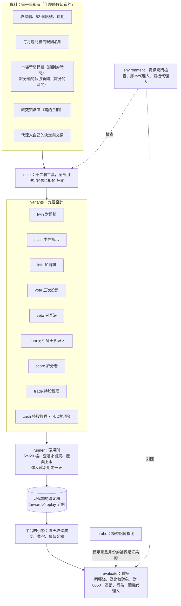

# AI 代理人實驗室（`research/agent_lab`）

使用者 2026-11-20（D-050）：專門研究用 AI 代理人做股票投資決策——收集知識、市場資訊、新聞、每天的策略、過去的交易、市場情緒，做出決策；建立最好的交易與模擬環境；做深入的研究、回測、前向觀察；架構規劃好，放在一個模組分類裡。

本檔是架構與分期。判定準則與結果寫在 `docs/research/results.md`「AI 代理人實驗室」；現在的狀態跑 `python -m quant_platform.research.agent_lab board`。

## 1. 目標與不變的限制

- 目標：找出「用語言模型的代理人」在台股有沒有站得住的用法、是哪一種用法；量尺和其他策略一樣——同樣現金流（30 萬＋每月 5 日 1 萬）全部買 0050，兩種錢（已拿到的、兩邊都賣掉）都不輸才算（D-002、D-020、D-045）。
- 只在模擬帳戶，永遠不下真的單（D-001、D-007）；策略 100% 個股（D-003）。
- 只有前向紀錄是證據。語言模型讀過的年份一律算樣本內；補做（事後用當天的資料決定）只看行為、費用與設計之間的差異，標明「補做」。
- 帳戶的錢由平台的引擎算（D-017），實驗室不另寫一套成交與費稅。
- 模型：2026-11-20 起是 `claude-haiku-5-5`（D-051；之前是 OpenAI 的 `gpt-6-luna`，帳戶沒有額度），經過本機的 AI API 平台（D-052）。費用在 LLM 每月總預算 5 美元內；實驗室每天實際決定的上限 2 美元（環境變數 `AGENT_LAB_MONTHLY_BUDGET_USD`）、補做另計 1.2 美元（`AGENT_LAB_REPLAY_BUDGET_USD`）。換更貴的模型是使用者的決定。

## 2. 文獻給的設計依據（2026-11-20 查）

| 發現 | 出處 | 對設計的意義 |
|---|---|---|
| 長期、含下市股、扣成本的重測，代理人沒有顯著勝過買進持有；多頭太保守、空頭太激進 | FINSABER（arXiv 2505.07078） | 量尺用同現金流的 0050；多空盤都要看到才下結論 |
| 有名的代理人移到模型截止日之後，Sharpe 衰減 51%～62%；問模型某天漲跌答對 85%～93% | Profit Mirage（2510.07920）、The Memorization Problem（2504.14765） | 補做不是證據；遮名字、叫它不要用未來資訊都沒用；自己量模型的記憶（`probe`） |
| 即時比賽多數輸買進持有；A 股 6 個模型全輸指數；排名隨盤勢翻轉 | AI-Trader（2512.10971）、DeepFund（2505.11065）、StockBench（2510.02209）、Agent Market Arena（2510.11695） | 60 個交易日只夠淘汰與看行為，不夠認定贏家 |
| 同一個設計每次跑不一樣；溫度 0 也是 | AlphaForgeBench（2602.18481） | 多次取樣投票做成一個設計（`vote`），把離散度當指標 |
| 辯論、反思記憶只有樣本內的消融證據；TradingAgents 沒有消融 | TradingAgents（2412.20138）、FinMem（2311.13743）、FinCon（2407.06567） | 多角色只當一個要付成本的設計（`team`），不當預設 |
| 算術與格式錯誤、編造代號、過度交易（手續費 5～9 倍） | StockBench、FINSABER | 動作用受限的 JSON、代號必須當天查過、檔數與產業上限由程式檢查、費稅由工具算（`check`） |
| 語言模型讀新聞這類任務偏誤小、有扣成本後的效果；直接選股沒有 | Chronologically Consistent LLMs（2502.21206）、Buy the Rumor（2608.14014） | 加「只否決」的設計（`veto`）對照「自己選股」 |
| 台股沒有嚴格樣本外的研究 | — | 這裡的前向紀錄是第一手資料；模型與提示版本每天記錄 |

平台 10/04 的評估（結果紀錄「AI 交易方法 實證與架構」）已有同方向的結論；這一輪補的是代理人專屬的部分。

## 3. 架構

| 模組 | 內容 |
|---|---|
| `variants.py` | 設計清單：每個設計的模式、工具、它回答的一個問題、和誰比 |
| `desk.py` | 代理人當天能讀的東西。第一版的六個工具（大盤、規則共識、訊號篩選、個股資料卡、持股、日誌）加六個：`headlines` 市場新聞標題、`mood` 市場情緒、`lessons` 研究知識庫、`review` 已賣出交易的檢討、`check` 名單檢查、`events` 公司事件（庫藏股買回公告、內部人申報轉讓、董監質押、注意股與處置股，2026-11-20 加）；資料卡的新聞標出「有數字」與「後續報導」 |
| `runner.py` | 一個設計一天的決定（單一代理人逐步查、三次投票、只否決、分析師團隊）、硬規則、只追加的決定檔、整批的一天、補做 |
| `environment.py` | 模擬環境的保證：把當天以後的數字全部換掉再跑一次工具（`leak_check`）、不呼叫模型的腳本代理人、隨機代理人 |
| `evaluate.py` | 看板：用平台引擎算每個設計的帳戶，和比較對象、0050 比；逐日差額分塊重抽；行為統計；評分者的分數和買進後 20 個交易日漲跌的名次相關（`score_skill`，滿 20 個交易日的決定才算）；未滿 60 個交易日只列數字不判 |
| `probe.py` | 模型記憶檢測：不給資料問過去每個月的相對漲跌 |
| `view.py` | 網站頁面 `/research/agents` 讀的資料（只讀實驗室自己的檔案，開頁不重算） |
| `__main__.py` | 指令：`decide`、`board`、`leakcheck`、`probe` |

資料夾：`instance/research/agent_lab/forward/<設計>.jsonl`（實際的決定，寫了不改）、`replay/<名稱>/`（補做）、`board.json`（看板）、`probe/<模型>.json`。

## 4. 模擬環境的四個保證

1. **時間閘門**：價格與因子只讀到當天那一格；新聞標題看「讀到的時間」、評分過的新聞看「評分的時間」、知識庫看「寫的日期」，都要早於決定時間。`leakcheck` 把之後的數字換掉重跑，輸出要一字不差；`tests/test_research_agent_lab.py` 用「之後才出現的檔案」測新聞。
2. **實際與補做走同一段程式**：差別只有存到哪個資料夾與「補做」標記。
3. **動作受限**：只能回 JSON；代號必須當天查過或已持有；檔數、產業上限、可交易由程式檢查；不合規就沿用前一天並照實記錄。2026-11-20 起依平台前向與回測的證據（結果紀錄「代理人的硬規則依據」）：持有 20 檔（不夠的照規則共識的順序補滿）、處置中的股票不新買，對照組一起套。外部文字（新聞標題、知識庫）是資料，指示裡寫明不照做，輸出再經過硬規則。
4. **錢由引擎算**：隔天收盤成交、手續費、交易稅、最低金額都是平台引擎；帳戶的錢全部平均放在名單上（選得少＝每檔比重大，沒有現金）。
6. **模型鎖定**（D-056）：模型與思考強度寫在 `variants.LAB_MODEL`、`LAB_EFFORT`（第一版代理人是 `llm_agent.AGENT_MODEL`），不讀共用設定；每筆決定記設定的模型、平台實際回應的模型、思考強度、指示版本；回應的模型不是設定的就不採用。一個設計的前向期間這四項不變，變了 16:00 檢查報紅；試別的模型＝新增設計（`Variant.model`）並排跑。補做的花費另計（`agent_lab_replay`，每月 1.2 美元），實際決定每月 2 美元，都在總上限 5 美元內。
5. **只跑 commit 過的程式**：流程 `llmagent` 開始時用 `git archive` 取出最新 commit 的 `src`（`build\llmagent-src`），代理人從那裡跑；工作目錄裡別的對話沒 commit 的程式碰不到它（2026-11-20 18:00 試跑時，三個設計就是在別人改 `daily.py` 改到一半時匯入失敗）。

## 5. 評估規約

- 每個設計開始前在結果紀錄寫：回答哪一個問題、和誰比、判定、預期。
- 對照有三層：機械對照組（`twin`）、隨機代理人（從它自己查過的股票裡抽）、0050。
- 主要比較事先指定一個（`plain` 對 `twin`），其他是探索；差距落在分塊重抽的 5%～95% 範圍內寫「分不出來」。
- 每個設計都做出第一次決定後滿 60 個交易日判一次（日期用交易所日曆算，頁面上顯示；11/20 起算是 2027-02-25，但模型帳戶 11/20 沒有額度，照實際第一次決定算），之後每 60 個交易日再判；換模型、改指示＝新設計、重新起算。
- 每天記：提示版本、模型、查了什麼工具、花費、是否沿用前一天、當天查過的股票。

## 6. 分期

| 階段 | 內容 | 狀態 |
|---|---|---|
| A0 | 模組、六個設計、模擬環境檢查、看板、記憶檢測、接進 15:40 的流程、中性指示的補做 | 2026-11-20 完成；補做的結果寫在結果紀錄；「只否決」依補做的行為改成剔除延續 10 個交易日。第一次實際決定等模型帳戶加值 |
| A1 | 網站頁面「模型與訊號 › AI 代理人」（`/research/agents`，`agent_lab/view.py`）：每個設計持有什麼與理由、查了哪些工具、成績、行為、補做、模型記憶 | 2026-11-20 完成；處分效應（賣賺留賠的比例）與每天的圖還沒做 |
| A2 | 資訊加深：重大訊息（公開資訊觀測站）當工具、新聞分「有數字的基本面」與「敘事」並標是不是第一次報導、法人期貨部位、每天把市場狀態算一次給所有設計共用 | 2026-11-20 一部分（在任何設計第一次真的決定之前）：`events` 公司事件工具，給「加資訊」「三次投票」「只否決」「分析師團隊」；新聞標「有數字」「後續報導」。還沒做：重大訊息全文；法人期貨部位與融資維持率（平台的資料只到 10 月初，要先每天抓）；市場狀態共用 |
| A3 | 離散度：每個設計固定跑三次、把三次之間的差異列為正式指標；`vote` 以外的設計也量 | 未開始（費用約三倍，先看 A0 的每日花費） |
| A4 | 硬性風控覆蓋做成可以開關的設計（組合連動上限、單日換股上限）；代理人決定每檔比重 | 未開始 |
| A5 | 更強或時點一致的模型當新的設計 | 2026-11-20 全部改用 Claude Haiku 5.5（D-051）；更貴的模型等使用者決定費用 |
| A6 | 滿 60 個交易日的判定與淘汰；留下的設計進下一輪、被淘汰的寫原因 | 第一次實際決定後第 60 個交易日（11/23 起算是 2027-02-26） |
| A7 | 評分者：模型替共識前 40 檔與持股逐一打分，程式持有分數最高的 20 檔（結果紀錄「評分者設計」，開始前寫） | 2026-11-20 加入，和其他設計同一天開始（11/23）；開始前比過三種評分指示，照事先寫的規則用「逐檔獨立判斷」（同一天問兩次最一致；強迫拉開分數最不一致）；分數預測力 12/22 起算得出來 |
| A8 | 持股經理：從帳戶現有持股出發，模型只決定賣哪幾檔、買哪幾檔（結果紀錄「持股經理」）；同一段程式給使用者用：`agent_lab advise --holdings … --cash …`（只給建議、不下單） | 2026-11-21 加入，11/23 起前向；9/1～11/20 的回測是五個設計裡最好的、仍輸 0050、和對照組分不出來。網頁上輸入持股的表單還沒做 |
| A9 | 穩健候選：候選改從回測連動最低五分之一的規則來（`twin2`、`trade2`；結果紀錄「穩健候選」） | 2026-11-22 試過、不採用：連動只從 1.32 降到 1.10、錢比原來的對照組少；那些規則少跌靠的是跌破均線留現金，不是選的股票。程式留著參數（`Variant.panel`），沒有設計在用 |
| A10 | 持股經理可以留現金（`cash`；結果紀錄「持股經理可以留現金」）：賣掉的可以不補、最少 10 檔，帳戶照持股比例算 | 2026-11-22 加入，11/23 起前向。回測：下跌段 54 天裡 52 天滿檔（沒有擇時）、上漲段平均 98%；等於持股經理的第二次執行，兩次差 7,674～12,395 元 |

## 7. 來源

FINSABER https://arxiv.org/abs/2505.07078 ・ StockBench https://arxiv.org/abs/2510.02209 ・ LiveTradeBench https://arxiv.org/abs/2511.03628 ・ Agent Market Arena https://arxiv.org/abs/2510.11695 ・ AI-Trader https://arxiv.org/abs/2512.10971 ・ DeepFund https://arxiv.org/abs/2505.11065 ・ Profit Mirage https://arxiv.org/abs/2510.07920 ・ The Memorization Problem https://arxiv.org/abs/2504.14765 ・ Look-Ahead-Bench https://arxiv.org/abs/2601.13770 ・ Chronologically Consistent LLMs https://arxiv.org/abs/2502.21206 ・ TradingAgents https://arxiv.org/abs/2412.20138 ・ FinMem https://arxiv.org/abs/2311.13743 ・ FinAgent https://arxiv.org/abs/2402.18485 ・ FinCon https://arxiv.org/abs/2407.06567 ・ AlphaAgents https://arxiv.org/abs/2508.11152 ・ AlphaForgeBench https://arxiv.org/abs/2602.18481 ・ Agentic Trading 綜述 https://arxiv.org/abs/2605.19337 ・ Buy the Rumor, Sell the News https://arxiv.org/abs/2608.14014

文獻裡的數字是另一個代理人查網路整理的，沒有逐篇對原文表格；用在這裡的只有方向（補做不是證據、要有對照、60 天不夠認定贏家），不拿它的數字當本平台的結果。
