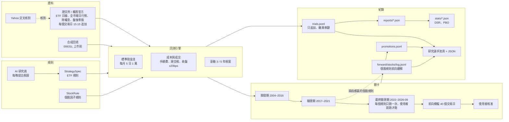
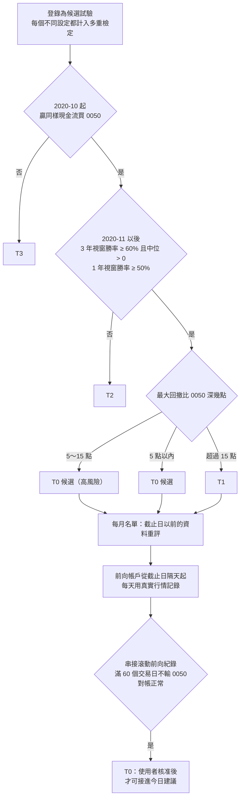
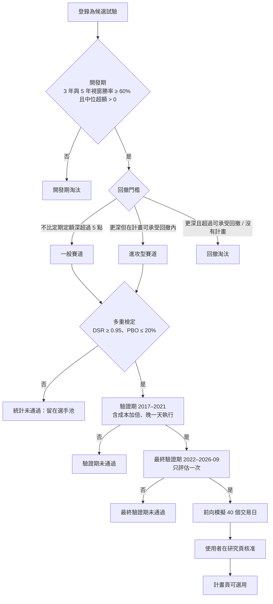

# 研究：判定準則

研究方法拆成三份（2026-11-11）：本檔是研究要回答的問題、架構、資料、比較方式、規則怎麼寫與怎麼試、關卡、新設計的設定與紀錄放在哪裡；現在成立的結論在 `docs/research/conclusions.md`；每個研究的判定與結果（只增）在 `docs/research/results.md`。T0、截止日、可以上線的定義只在 `docs/trading_rules.md` §7。每一個試過的規則與它的狀態在網站「研究 › 研究選手池」（`/research/pool`，機器可讀版 `/research/pool.json`）；數字以選手池與開發歷程為準。

## 1. 研究要回答的問題

在相同的現金流、相同的成本、相同的盤後零股執行假設下，有沒有規則能長期勝過「每月 5 日把錢全部買進 0050」？規則必須事先寫成設定檔，不能指名個股；AI 是研究員，不是交易員；真實下單永久關閉。使用者 2026-10-03 的原則：只做上市股票、不借錢不融資、槓桿型 ETF 可以當工具、以投入的錢為主，風險由使用者在系統外控制。使用者 2026-10-04 決定實際配置：**每月投入的八成照定期定額買 0050，兩成走策略**；之後使用者說明策略帳戶的算法：先有啟動資金（先用 30 萬），之後每月定期定額投入，整個帳戶都可以買賣、獲利再投入；研究的主問題是「怎樣操作這個帳戶，才能比同樣的錢定期定額買 0050 滾得更多」。使用者也要求：不要只差一點參數的相似策略，要多種因子、自己找出哪個強哪個弱。

## 2. 架構

模組：`research/history/`（資料）、`research/spec.py`（ETF 規則）、`research/stock_rules.py`（個股規則）、`research/engine.py` 與 `research/legacy_challenger.py`（回測）、`research/compare.py`（對基準）、`research/registry.py`（試驗登錄）、`research/significance.py` 與 `statistics.py`（檢定）、`research/promotion.py`（關卡與帳本）、`research/pool.py`（選手池）、`research/agent/`（AI 研究員）、`research/forward.py`（ETF 前向模擬）、`research/stock_forward.py`（個股規則前向觀察）。

## 3. 資料

> 下表是 2026-10-04 的盤點，當時寫「尚未／待做」的多數已補齊（上櫃股價 10/05、季財報 10/06、籌碼與基本面、集保 10/21、FinMind 付費資料 10/22 起、交易所漲跌停價 10/21）。每種資料現在到哪一天看系統頁「資料品質」；每批資料的時點規則在本節第 7 節各段與[需求 §6](../REQUIREMENTS.md)。

| 資料 | 來源 | 範圍 | 位置 |
|---|---|---|---|
| ETF 日線 18 個序列（0050、006208、0056、0051、0052、0053、0055、0057、00631L、00646、00662、00713、00878、00919、00679B、00687B、加權指數、報酬指數） | 證交所／櫃買官方，Yahoo 交叉核對 | 2004-02-11 起（各自上市日起） | `instance/research/history/daily/*.parquet` |
| 全市場上市普通股日行情（含後來下市的 179 檔） | 證交所每日收盤行情（MI_INDEX ALLBUT0999） | 2004-02-11～今，5,552 個交易日、470 萬列、1,261 檔 | `instance/research/history/stocks/twse/<年>.parquet` |
| 除權息、分割 | 證交所／櫃買除權息表；官方未註記的分割在目錄宣告 | 2003 起 | `history/raw/twse_ex_rights`、`actions.json` |
| 盤後零股成交分布與各限價成交率 | 證交所 TWT53U 抽樣 | 2010 起每 10 個交易日 | `history/odd_lot.json` |
| 00631L 上市前（2004–2014-10） | 合成：0050 含息日報酬 × 2 − 3.5%／年（成本校準自 2014–2026 真實追蹤差） | — | 標示 `synthetic`，manifest 有校準 |
| 櫃買個股 | 尚未（網站 2026-10-03 連不上） | — | 待做 |
| 財報、月營收、本益比 | 尚未（FinMind 免費等級有，每小時 600 次） | — | 待做 |
| 個股三大法人買賣超 | 證交所 T86、FinMind（2026-10-04 實測） | 2012-05-02 起（更早沒有） | 待做（R13） |
| 個股外資持股比率 | FinMind `TaiwanStockShareholding`（實測） | 2004-02-12 起 | 待做（R13） |
| 個股融資融券 | FinMind `TaiwanStockMarginPurchaseShortSale`（實測） | 2001 起 | 待做（R13） |
| 市場整體三大法人買賣金額 | 證交所 BFI82U（實測） | 2004-04-07 起 | 待做（R13） |
| 新聞、政治事件 | 沒有可回溯到 2004 年、標明當時何時公開的資料 | — | 無法回測；只能從現在起收集、前向觀察 |
| 下載中（2026-10-04 起）：外資持股、月營收、本益比／淨值比／殖利率、融資融券、三大法人 | FinMind 免費等級，每檔一次抓全歷史，每小時約 560 次，平日 13:30–15:30 暫停讓給每日流程 | 1,26x 檔 × 5 種，約 11 小時 | `history/raw/finmind/<資料集>/<代號>.json.gz`；進度在研究頁「執行中的程式」 |

資料規則：研究用資料只讀；每日新增的行情不改變開發期的資料指紋；資料修正或目錄擴充後重跑，舊紀錄保留。

## 4. 比較方式

- **策略帳戶的基準**（使用者 2026-10-04 決定）：啟動資金 30 萬，之後每月 5 日投入 1 萬；帳戶裡所有的錢都可以買賣、獲利再投入。比較對象是同樣的現金流全部買 0050。滾動視窗也一樣：每個起點放 30 萬、之後每月 1 萬。
- 超額 =（規則期末資產 − 基準期末資產）÷ 投入金額。門檻看 2020-10-26 起的帳戶與 2020-11 以後每個月開始的 3 年、1 年視窗（勝率 = 超額 > 0 的視窗比例，另看中位與最差）；2015-06 起只列出來參考（使用者 2026-10-26、10-27）。正式條文在[需求 §7](../REQUIREMENTS.md)「新設計」與「選手池分級」。
- 最大回撤以單位淨值算（排除新資金的影響）；XIRR 是資金加權報酬。報告以已實現（全部賣掉、扣完費稅）的結果為準。
- 費用、稅、滑價、成交方式、漲跌停、選股資格：[交易需知](trading_rules.md)（交易規則的唯一來源）。
- 舊基準（2026-10-04 前的試驗、ETF 規則）：每月 5 日投入 10,000 元，當天以盤後零股全部買進 0050；股利留到下次一起投入。2026-10-04 前的「一次投入」試算，滾動視窗其實是每月投入算的（引擎 1.2.0 前的錯誤），不採用。

## 5. 規則怎麼寫、怎麼試

- ETF 規則（`StrategySpec`）：投入時點、投入金額倍數（均線、回撤）、固定配置與再平衡、趨勢控制（跌破均線改防守配置或現金）、ETF 輪動與核心＋衛星。
- 個股規則（`StockRule`）：單一或混合因子（12-1 月動能、6 月動能、1 月反轉、60 日低波動、接近 52 週高點、近 12 月殖利率，百分位排名加權）、前 N 名等權、每月或每季換股、緩衝（留到跌出前 N×倍數才賣）；降低交易的設定（R3）：最短持有（新買的至少留幾次檢查，不再合格仍賣）、加碼門檻（低於目標超過幾成才加碼，缺口大的先買）、每筆最低金額。
- 因子庫（2026-10-04 擴充）：原本 6 個加上 3 個月動能、1 週反轉、1 年低波動、近 1 個月最大單日漲幅低、成交值大、成交值放大、站上 200 日均線幅度，共 13 個價格與成交因子；籌碼與基本面因子等 FinMind 資料下載完加入。
- 因子強弱分析（`research/factors.py`，`python -m quant_platform.research factors`）：每月 5 日把合格股票依因子排名，算和下個月報酬的排序相關（平均、t 值、正的月份比例）與前五分之一減後五分之一的報酬，分開發期、驗證期、最終驗證期、2020 年前後、2024 年後報告，判定強／不穩／弱／反向；研究頁「因子強弱」分頁。這是描述，不登錄為試驗。
- 每個個股規則都記錄交易量：費稅佔投入（整段期間手續費＋證交稅 ÷ 投入）、每年周轉率（一年賣出金額 ÷ 平均資產）、每年費稅佔平均資產、每月下單筆數。
- 來源：事先固定的規則批次（ETF 三批 131 個；個股兩批 26 個、大掃描 492 個、持有與加碼規則 40 個）、AI 研究員每晚最多 3 輪 12 個試驗（看不到驗證期與最終驗證期）。
- 大掃描分兩階段：先只算全期間（幾秒一個），再對前 40 名算完整視窗並跑驗證期。
- 每個不同的規則都登錄為一次試驗，計入多重檢定（同一規則在新資料版本重跑只算一次；穩健性變體不算）。
- 空頭減碼附帶版本（2026-10-25 起，「空頭減碼第三版」照事先寫的判定通過）：每一批新規則（`daily --name`）與大規模搜尋的最後名單（`scan`、`scan-large`，結果記在搜尋摘要的 `half_twins`）評完後，過門檻、100% 個股、本身沒有大盤濾網或減碼的規則，自動補評「加權指數跌破 200 日均線就減碼一半」的版本（`daily.half_twins`，`--no-half` 可關；減碼批次 `bearguard*` 本身不補）。兩個版本都是試驗、都照一般等級評分，過門檻的都進名單與前向。

## 6. 關卡

現行（2026-10-27 起；正式條文在[需求 §7](../REQUIREMENTS.md)，分級摘要在[交易需知](trading_rules.md)第 7 節）：

- 每個不同的規則都登錄為一次試驗；報告揭露試驗過的不同設定數。三段歷史都已看過，最後判斷依每月滾動的前向觀察。
- 前向觀察的結果只觀察，不用來挑規則。

### 舊設計的關卡（2026-10-04 以前，備查）

- 多重檢定：Deflated Sharpe Ratio 以「不同規則數」當試驗次數；PBO 以 CSCV 算。2026-10-03 累計 679 個不同規則；ETF 規則最佳 DSR 0.17、個股規則最佳 0.02（`stats/stocks-development-*.json`，PBO 10%），門檻 0.95——目前沒有規則通過統計門檻。
- 驗證期可以在統計門檻之外先跑（檢查規則是否只在開發期有效）。最終驗證（2022–2026-09）每個規則只跑一次：跑過就等於看過答案，之後改規則再跑就不算數，所以使用者說「跑」才跑（2026-10-04 第一次跑，4 個規則）。
- 兩段期間都贏的個股規則自動進入前向觀察（R2），（2026-10-17 起改成每月滾動：只用截止日以前的資料挑，帳戶一律從截止日隔天起算；以下為當時的寫法）從加入那天起每個交易日記錄，不等最終驗證；這和關卡裡「前向模擬 40 個交易日」是同一份紀錄，但晉級仍要依序過關。
- 前向模擬的結果只觀察，不用來挑規則。

## 新設計的設定（2026-10-04 起，`research/daily.py`）

門檻 2026-10-27 起改以 2020-10 以後為準（`REQUIREMENTS.md` §7「新設計」）；下面是 2026-10-04 定的原文。

- 期間：2015-06-01～2026-09-30 挑規則，2020-10-26～2026-09-30 另外重算一次；2015 年以前不用來挑規則。
- 帳戶：啟動資金 30 萬、每月 5 日 1 萬，整個帳戶都能買賣；比同樣現金流買 0050。
- 決策：每個交易日收盤後把合格股票依因子排名（一個或多個因子，百分位相加，負的權重表示反過來用）；持股跌出前 N × 保留倍數、而且已持有至少 20 個交易日才賣；新進榜的當天買；已持有的只在投入日加碼；每筆至少 1,000 元；可設一部分（例如一半）一直放 0050。
- 因子：13 個價格與成交因子加 6 個技術指標（均線交叉 20／60、RSI 14、MACD 柱狀體、KD 的 K 值 9 日、布林通道 %B、接近 55 日高點），共 19 個；RSI、KD、布林也測反向（買超賣）。籌碼與基本面下載完再加。
- 門檻：2015-06 起與 2020-10 起都贏 0050；滾動 3 年視窗勝率 ≥ 60% 且中位為正；1 年視窗勝率 ≥ 50%；最大回撤不比 0050 深超過 5 個百分點。過門檻的規則自動進入前向觀察。
- 因子強弱（新設計版）：每週排名一次，看之後 20 個交易日；分 2015-06 起、2015-06～2020-10、2020-10 起、2024 起報告（`python -m quant_platform.research factors --recent`）。
- 第一批（`daily --name factors`）：每個因子一個規則（前 20 名），再加一半放 0050 的版本，共 44 個；只差因子、不做參數微調。

## 10. 紀錄在哪裡

- **研究知識庫**（使用者 2026-10-22：我所有的失敗紀錄都要記起來，作為知識庫，讓後面的人可以用 AI 問他的決策、確認可不可行、回測狀況）：網站「研究 › 知識庫」（`/research/knowledge`，JSON `/research/knowledge.json?q=`；指令 `python -m quant_platform.research knowledge --ask "問題"`）。從本檔每一段、最佳化紀錄、淘汰方向、試驗登錄（每個規則最新一次回測：等級、期末、回撤、沒過的原因）、大規模與組合搜尋、開發歷程、AGENTS.md 已核定方向與需求自動建立，來源有變就重建；AI 只根據紀錄回答、每句附出處。每天 16:00 需求檢查核對「每個做完的研究都寫了結果」與「知識庫收了每一個試驗」。
- 研究流程對照（流程名稱 → 結果寫在哪；2026-10-22 補齊，之後每個流程的名稱都寫在它的結果旁邊）：`deep1` 深度學習第一版（循環網路看每檔最近 40 個交易日）→ 第 9 節「深度學習」；`deep2large` 深度學習三個看成本換股規則只在前 100 大上市股排名 → 第 9 節 D 系列；`deep2risk` R1 依預測下跌機率配置 → 第 9 節 R1；`factorcorr` 因子排名相關與高度相關的群 → 第 9 節因子相關；`holding2_a`／`holding2_b` 持有方式第二輪 → 最佳化紀錄「持有方式」；`rebuild150` 引擎 1.5.0 全部重算 → 第 9 節引擎 1.5.0；`robot40` RL 機器人 4.0（每天自己決定每檔與現金的權重）→ 第 9 節 RL；`limitscheck` 官方漲跌停價核對（引擎 1.6.0 的依據）→ 開發歷程 10/22 與路線圖 S9-W23；`splitblends_a`、`splitblends_b` 所有組合換開盤賣收盤買 → 第 7 節「開盤賣、收盤買」。

- 試驗登錄：`instance/research/trials.jsonl`（只追加、雜湊串鏈；`python -m quant_platform.research trials` 可列）
- 報告：`instance/research/reports/<期間>-…json`（含每月超額、視窗、設定檔）
- 統計：ETF 規則 `instance/research/stats/development-*.json`；個股規則 `stats/stocks-development-*.json`（`python -m quant_platform.research stats --family stocks --period development`）
- 晉級帳本：`instance/research/promotions.jsonl`
- AI 研究日誌：`instance/research/journal.jsonl`；費用 `agent/usage.jsonl`
- 執行中的程式：`instance/research/jobs/*.json`（研究頁「執行中的程式」、`/research/jobs.json`）；背景執行腳本 `scripts\research-pipeline.ps1 -Name seed|factors|finmind`，輸出在 `instance/research/logs/`
- 因子強弱：`instance/research/factors/strength-*.json`；FinMind 原始資料：`history/raw/finmind/`
- 每個規則的回測紀錄頁：`/research/rules/<雜湊>`（JSON 加 `.json`）；2026-10-04 起的回測報告含逐月資產（`curve`）
- 前向模擬：ETF `instance/research/forward/log.jsonl`；個股規則 `forward/stocks/tracked.json`（追蹤中的規則與起始日）與 `forward/stocks/log.jsonl`（每日持股、交易、0050 對照、重算檢查；`python -m quant_platform.research forward [--date YYYY-MM-DD]` 補記並對帳）
- 舊版挑戰者：`instance/research/legacy/challenger-*.json`
- 網頁：研究頁（`/research`）、研究選手池（`/research/pool`、`/research/pool.json`）、本檔（系統頁 › 專案資訊 › 研究方法）
- 指令：`python -m quant_platform.research batch|stats|promote|legacy|stocks|forward`（個股：`stocks --name cost --period development|validation [--passed]`）、`python -m quant_platform.research.history fetch|build|actions|crosscheck|oddlot|stocks`（在專案根目錄以 `$env:PYTHONPATH="src"` 執行，避開 13:30–14:40）
