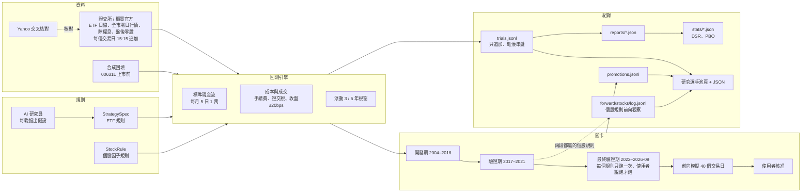
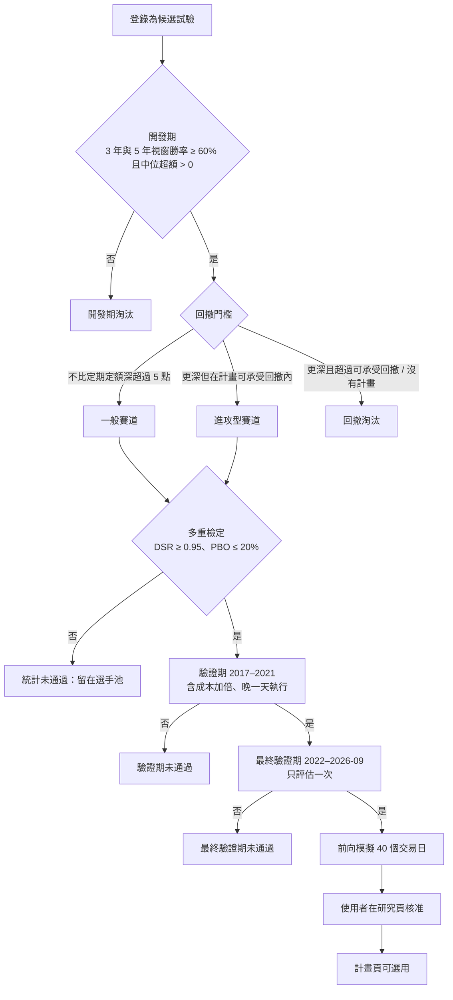
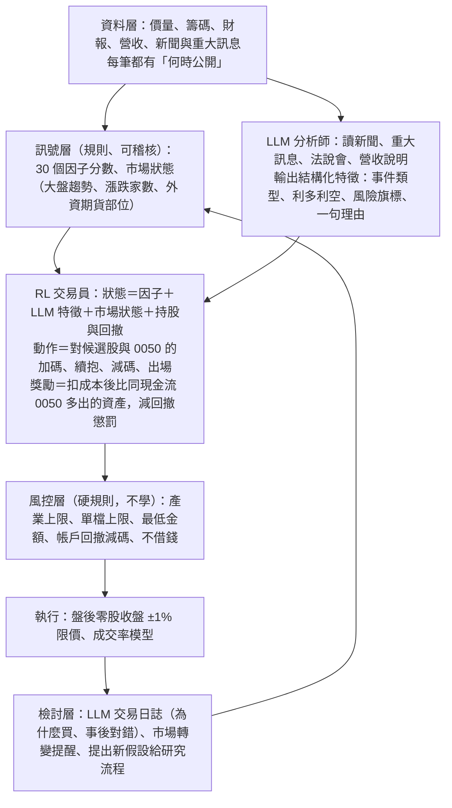

# 研究方法與研究路線圖

更新：2026-10-04。本檔是研究怎麼做、做到哪裡、接下來做什麼的唯一說明；每一個試過的規則與它的狀態在網站「研究 › 研究選手池」（`/research/pool`，機器可讀版 `/research/pool.json`）。數字以選手池與開發歷程為準，本檔的數字是 2026-10-04 的快照。

## 1. 研究要回答的問題

在相同的現金流、相同的成本、相同的盤後零股執行假設下，有沒有規則能長期勝過「每月 5 日把錢全部買進 0050」？規則必須事先寫成設定檔，不能指名個股；AI 是研究員，不是交易員；真實下單永久關閉。使用者 2026-10-03 的原則：只做上市股票、不借錢不融資、槓桿型 ETF 可以當工具、以投入的錢為主，風險由使用者在系統外控制。使用者 2026-10-04 決定實際配置：**每月投入的八成照定期定額買 0050，兩成走策略**；之後使用者說明策略帳戶的算法：先有啟動資金（先用 30 萬），之後每月定期定額投入，整個帳戶都可以買賣、獲利再投入；研究的主問題是「怎樣操作這個帳戶，才能比同樣的錢定期定額買 0050 滾得更多」。使用者也要求：不要只差一點參數的相似策略，要多種因子、自己找出哪個強哪個弱。

## 2. 架構

模組：`research/history/`（資料）、`research/spec.py`（ETF 規則）、`research/stock_rules.py`（個股規則）、`research/engine.py` 與 `research/legacy_challenger.py`（回測）、`research/compare.py`（對基準）、`research/registry.py`（試驗登錄）、`research/significance.py` 與 `statistics.py`（檢定）、`research/promotion.py`（關卡與帳本）、`research/pool.py`（選手池）、`research/agent/`（AI 研究員）、`research/forward.py`（ETF 前向模擬）、`research/stock_forward.py`（個股規則前向觀察）。

## 3. 資料

| 資料 | 來源 | 範圍 | 位置 |
|---|---|---|---|
| ETF 日線 18 個序列（0050、006208、0056、0051、0052、0053、0055、0057、00631L、00646、00662、00713、00878、00919、00679B、00687B、加權指數、報酬指數） | 證交所／櫃買官方，Yahoo 交叉核對 | 2004-02-11 起（各自上市日起） | `instance/research/history/daily/*.parquet` |
| 全市場上市普通股日行情（含後來下市的 179 檔） | 證交所每日收盤行情（MI_INDEX ALLBUT0999） | 2004-02-11～今，5,552 個交易日、470 萬列、1,261 檔 | `instance/research/history/stocks/twse/<年>.parquet` |
| 除權息、分割 | 證交所／櫃買除權息表；官方未註記的分割在目錄宣告 | 2003 起 | `history/raw/twse_ex_rights`、`actions.json` |
| 盤後零股成交分布與各限價成交率 | 證交所 TWT53U 抽樣 | 2010 起每 10 個交易日 | `history/odd_lot.json` |
| 00631L 上市前（2004–2014-10） | 合成：0050 含息日報酬 × 2 − 3.5%／年（成本校準自 2014–2026 真實追蹤差） | — | 標示 `synthetic`，manifest 有校準 |
| 櫃買個股 | 尚未（網站 2026-10-03 連不上） | — | 待做 |
| 財報、月營收、本益比 | 尚未（FinMind 免費等級有，每小時 600 次） | — | 待做 |
| 個股三大法人買賣超 | 證交所 T86、FinMind（2026-10-04 實測） | 2012-05-02 起（更早沒有） | 待做（R13） |
| 個股外資持股比率 | FinMind `TaiwanStockShareholding`（實測） | 2004-02-12 起 | 待做（R13） |
| 個股融資融券 | FinMind `TaiwanStockMarginPurchaseShortSale`（實測） | 2001 起 | 待做（R13） |
| 市場整體三大法人買賣金額 | 證交所 BFI82U（實測） | 2004-04-07 起 | 待做（R13） |
| 新聞、政治事件 | 沒有可回溯到 2004 年、標明當時何時公開的資料 | — | 無法回測；只能從現在起收集、前向觀察 |
| 下載中（2026-10-04 起）：外資持股、月營收、本益比／淨值比／殖利率、融資融券、三大法人 | FinMind 免費等級，每檔一次抓全歷史，每小時約 560 次，平日 13:30–15:30 暫停讓給每日流程 | 1,26x 檔 × 5 種，約 11 小時 | `history/raw/finmind/<資料集>/<代號>.json.gz`；進度在研究頁「執行中的程式」 |

資料規則：研究用資料只讀；每日新增的行情不改變開發期的資料指紋；資料修正或目錄擴充後重跑，舊紀錄保留。

## 4. 比較方式

- **策略帳戶的基準**（使用者 2026-10-04 決定，個股規則的主要比較）：先有一筆啟動資金（研究先用 30 萬），之後每月 5 日定期定額投入 1 萬；帳戶裡所有的錢（投入的加上賺賠的）都可以買賣、獲利再投入。比較對象是同樣的現金流（啟動資金＋每月）全部買 0050。滾動視窗也一樣：每個起點放 30 萬、之後每月 1 萬，3 年或 5 年後比。選手池預設用這個基準（`/research/pool`；`?basis=dca` 看每月投入、`?basis=lump_sum` 看一次投入）。
- 舊基準（2026-10-04 前的試驗、ETF 規則、八成定期定額那部分）：每月 5 日投入 10,000 元，當天以盤後零股全部買進 0050；股利留到下次一起投入。2026-10-04 前的「一次投入」試算，滾動視窗其實是每月投入算的（引擎 1.2.0 前的錯誤），不採用。
- 超額 =（規則期末資產 − 基準期末資產）÷ 投入金額。全期與滾動 3 年、5 年視窗（每個月起算一次）都算；勝率 = 超額 > 0 的視窗比例；另看中位與最差視窗。
- 最大回撤以單位淨值算（排除新資金的影響）；XIRR 是資金加權報酬。
- 成本：手續費 0.1425%（保守估計每筆最低 20 元；國泰、台新最低 1 元，個股規則一律用國泰），賣出證交稅個股 0.3%、ETF 0.1%、債券 ETF 免；成交價＝收盤 ± 20 bps 進位到升降單位；今日建議的委託限價是收盤 ± 1%（只決定買不買得到）。
- 個股規則：可選股票須收盤 ≥ 10 元、近 20 日日均成交值 ≥ 2,000 萬元、上市 ≥ 252 個交易日；下市的股票以最後成交價計；期間前兩年暖機。

## 5. 規則怎麼寫、怎麼試

- ETF 規則（`StrategySpec`）：投入時點、投入金額倍數（均線、回撤）、固定配置與再平衡、趨勢控制（跌破均線改防守配置或現金）、ETF 輪動與核心＋衛星。
- 個股規則（`StockRule`）：單一或混合因子（12-1 月動能、6 月動能、1 月反轉、60 日低波動、接近 52 週高點、近 12 月殖利率，百分位排名加權）、前 N 名等權、每月或每季換股、緩衝（留到跌出前 N×倍數才賣）；降低交易的設定（R3）：最短持有（新買的至少留幾次檢查，不再合格仍賣）、加碼門檻（低於目標超過幾成才加碼，缺口大的先買）、每筆最低金額。
- 因子庫（2026-10-04 擴充）：原本 6 個加上 3 個月動能、1 週反轉、1 年低波動、近 1 個月最大單日漲幅低、成交值大、成交值放大、站上 200 日均線幅度，共 13 個價格與成交因子；籌碼與基本面因子等 FinMind 資料下載完加入。
- 因子強弱分析（`research/factors.py`，`python -m quant_platform.research factors`）：每月 5 日把合格股票依因子排名，算和下個月報酬的排序相關（平均、t 值、正的月份比例）與前五分之一減後五分之一的報酬，分開發期、驗證期、最終驗證期、2020 年前後、2024 年後報告，判定強／不穩／弱／反向；研究頁「因子強弱」分頁。這是描述，不登錄為試驗。
- 每個個股規則都記錄交易量：費稅佔投入（整段期間手續費＋證交稅 ÷ 投入）、每年周轉率（一年賣出金額 ÷ 平均資產）、每年費稅佔平均資產、每月下單筆數。
- 來源：事先固定的規則批次（ETF 三批 131 個；個股兩批 26 個、大掃描 492 個、持有與加碼規則 40 個）、AI 研究員每晚最多 3 輪 12 個試驗（看不到驗證期與最終驗證期）。
- 大掃描分兩階段：先只算全期間（幾秒一個），再對前 40 名算完整視窗並跑驗證期。
- 每個不同的規則都登錄為一次試驗，計入多重檢定（同一規則在新資料版本重跑只算一次；穩健性變體不算）。

## 6. 關卡

- 多重檢定：Deflated Sharpe Ratio 以「不同規則數」當試驗次數；PBO 以 CSCV 算。2026-10-03 累計 679 個不同規則；ETF 規則最佳 DSR 0.17、個股規則最佳 0.02（`stats/stocks-development-*.json`，PBO 10%），門檻 0.95——目前沒有規則通過統計門檻。
- 驗證期可以在統計門檻之外先跑（檢查規則是否只在開發期有效）。最終驗證（2022–2026-09）每個規則只跑一次：跑過就等於看過答案，之後改規則再跑就不算數，所以使用者說「跑」才跑（2026-10-04 第一次跑，4 個規則）。
- 兩段期間都贏的個股規則自動進入前向觀察（R2），從加入那天起每個交易日記錄，不等最終驗證；這和關卡裡「前向模擬 40 個交易日」是同一份紀錄，但晉級仍要依序過關。
- 前向模擬的結果只觀察，不用來挑規則。

## 7. 2026-10-03 的結論

### 目前結論（網站研究總覽顯示這一段；最近更新 2026-10-18）

- **錢與跌市的取捨前緣**（2026-10-18 晚）：過門檻的規則裡沒有別的同時賺更多又少跌的 9 個——要錢：#4941 3,904 萬（跌市最糟多跌 9.8 點，高風險）、#4589 3,062 萬（8.9 點）；兼顧：#4938 2,876 萬（3.5 點）、#4940 2,722 萬（1.1 點、一般 T0）；要穩：#4949、#4946、#4594、#4957、#4415。組合搜尋（15 萬個兩檔／三檔組合，只用開發期挑 20 個）全部是 T0 候選，但沒有勝過 #4938 的；用現有資料，這條取捨線大致已經找齊，接下來要新資料（集保大戶、券商分點要 FinMind 付費）或前向觀察的確認。
- **錢多又不在跌市多跌：組合帳戶**（2026-10-18）：深度學習 36%＋跌市穩的 #4547 64%（#4938）2,876 萬、回撤 −42%、0050 大跌時最糟多跌 3.5 點，過事先登錄的門檻；再加共識清單三家一起（#4940）2,722 萬、回撤 −35.0%（一般 T0 候選）、最糟只多跌 1.1 點。期末最高的過門檻規則是深度學習加「漲過目標 2 倍賣回」（#4941，3,904 萬，高風險、跌市最糟多跌 9.8 點）。三個都從 9/1 起前向觀察；深度學習改隔天成交反而變差。
- **這個月的名單與前向帳戶**（2026-10-18 重新挑選，截止 8/31）：86 個過門檻（50 個 T0 候選、36 個 T0 候選（高風險）），前向帳戶 88 個全部 9/1 起，31 個交易日 65 個暫時贏 0050。跌市不多跌的大搜尋只找到 4 個最後名單（1 個高風險候選、其餘輸或小贏 0050）：穩的大多不賺錢。深度學習規則最深的回撤是 2021-06～2022-09 熱門股回落（0050 那時沒大跌），和共識清單（2018 下半年）、#4547（都不深）時間不同；組合帳戶開始進每月滾動，並試兩個「分散跌點」的組合（結果見第 7 節最後）。
- **跌市時的表現**（使用者 2026-10-18：回撤上限是為了避免市場不好時比 0050 跌得多、失去信心做錯決定；`research/downside.py`，研究總覽「跌市時的表現」分頁）：0050 下跌的月份，大部分過門檻的規則平均跌得比 0050 少（0050 平均 −3.6%）；但在 0050 每次跌 10% 以上的期間，期末最高的幾個最糟會多跌 5～9 個百分點（#4589 T0 共識清單 2018 下半年 −22.2% 對 −13.3%；深度學習 #4916 2020 疫情 −26.9% 對 −19.1%）。#4547、#4586（外資持股＋新高次數＋股利調升＋技術模型）最糟只多跌 2.8 與 0.5 個百分點，是跌市時最不會讓人心慌的一組，期末 2,402 萬與 2,003 萬。
- **回撤上限放寬並標註高風險**（使用者 2026-10-18：錢賺得多就可以）：回撤比 0050 深 5～15 個百分點、其他門檻都過的規則升為「T0 候選（高風險）」，進每月滾動與前向觀察，頁面紅色標示。深度學習看成本換股的組合帳戶 #4932（2,866 萬、−39.4%）、模型 G 看成本換股 #4914（1,711 萬、−42.3%）等因此成為高風險候選；回撤更深的（#4916 −53.7%）仍是 T1。

- **深度學習第二版＋看成本換股是目前最強的訊號，但都卡在回撤**（2026-10-17）：單獨的規則 4,238 萬（0050 982 萬）、回撤 −54%；選股端壓回撤的方法（依下跌機率配置、分群上限、去掉波動的風險否決、只挑大型股、學習出場第二版）都過不了。最接近的是「T0 共識清單 63%＋深度 37%」的帳戶：2,866 萬、2020-10 起 768 萬、回撤 −39.45%，比 T0 上限（0050 −34.0% 加 5 個百分點）深 0.4 個百分點，T1。

- **前向觀察每月滾動**（使用者 2026-10-16／10-17）：截止日＝兩個月前的月底；只用截止日以前的資料挑規則、重訓模型，前向帳戶一律從截止日隔天起算。10 月：截止 8/31，599 個規則有 50 個過門檻，加 2 個新聞對照實驗共 52 個帳戶，2026-09-01 起 31 個交易日，44 個暫時贏 0050。
- **深度學習第二版過了模型門檻**（2026-10-17）：dl-2.1.0（學「之後 20 日會不會進當天前 10%」）2016～2020 前 20 名平均多賺 +1.50%，模型 G（gbm-2.2.0）+1.25%；2021～2025 也比較好（平均 +2.5% 對 +1.4%）。但直接做成規則換股太多（費稅佔投入 95%）、2020-10 起輸 0050，T2。下一步照文獻加「不交易區」與和模型 G 合併。

- **只看 100% 個股**（使用者 2026-10-09）：0050 是使用者自己另外持有的部位，「一半放 0050」之類的規則只是把它混進來、數字變好看，不是策略本身的本事。含 0050 的 72 個規則（包括之前的 5 個 T0 候選）全部不採用、停止前向觀察；之後只研究 100% 個股的規則。
- **100% 個股的 T0 候選 32 個**（2026-10-16，引擎 1.4.2；0050 同樣現金流 982 萬）：全部規則都照當時的台股交易規則重跑過（漲停買不到、跌停與停牌賣不掉、整股與零股、下市沒賣就歸零、股利與健保、颱風休市的除權息、每筆手續費），429,149 筆買賣逐筆稽核 0 違規；1.4.2 修掉了「因子值相同的股票照股票代號排名」的偏差。期末最高的是新的「外資持股＋新高次數＋股利調升＋技術模型」（#3919，2,591 萬、回撤 −31.8%），其次是 T0 共識清單（2,142～2,280 萬）；回撤最淺的是近 52 週高＋EPS 成長＋日內動能（#3604，1,894 萬、−24.1%）。這些都是從大量候選裡挑出來的（DSR 接近 0），最乾淨的證據是開發期共識（成員只用 2020-09 以前挑）與前向觀察。全部從 2026-10-01 起前向觀察，持有方式一律「月線上續抱」，已做過的決定固定、不被之後的資料改寫。
- **追強勢股的規則回撤深是本質**：20 檔正在漲的股票會一起回落。使用者決定回撤門檻維持（不比 0050 深超過 5 個百分點）。到目前試過的賣出／減碼方式：15% 移動停損、大盤跌破 200 日均線、帳戶跌破自己的 200 日均線、學習出場、依自己的波動減碼到現金——都沒有在不犧牲更多報酬下把回撤壓進門檻。只挑低波動的股票回撤可以壓到 −23%，但報酬大輸 0050。
- **只在大型股裡挑**（2026-10-09）：市值前 100 大挑 20 檔（不放 0050、也不照市值比例）。大型股讓趨勢規則回撤變淺、成本降到三分之一以下（費稅佔投入 13%～17%，全市場版 32%～60%），代價是 2015–2019 小型股強的年份與 2024 台積電獨漲的年份落後。8 個規則：1 個 T0 候選（上一條）、3 個 T1（每檔等額的趨勢 1,477 萬、回撤 −44%；趨勢＋月營收年增 1,443 萬、回撤 −45%；機器學習＋趨勢各半 回撤 −39.2%）、其餘 T3。
- **因子**：價格趨勢類（站上 200 日均線、6 個月動能、52 週高點）、機器學習、借券賣出餘額低能贏 0050；股利調升做成組合找到 2 個 T0 候選（單獨偏弱）。借券費率高、注意股與處置股、現金增資比較適合當「排除」的濾網；反轉、低波動、價值殖利率、營收財報單獨做、日曆時間、因子動能都輸或沒有預測力。
- **強化學習**（2026-10-16 更新）：分配器與部位調整的 6 個版本都等於固定比例；技術機器人 2.0、全部因子的 2.1 都是 T3（背答案）。**機器人 3.0 是 T0 候選**（引擎 1.4.3）：8 個強訊號區塊的權重由機器人逐年學，2018 起比 0050 +354.6%、2020-10 起 +246.8%，同樣 8 個區塊平均是 +255.9%／+105.2%——機器人在引擎裡贏了自己的對照。但 3.0 的區塊是用 2015-06～2020-10 挑的、測試從 2018 起，2018～2020 不是乾淨的樣本外，乾淨的是 2020-10 起；3.1（每年只用那年以前的資料挑區塊）沒贏自己的對照（+63.3% 對平均 +114.4%），所以 3.0 的優勢很可能來自挑區塊時看過測試年；逐年挑槽位的平均本身是 T0 候選。完全自由的 4.0、4.1 都是 T3（−360.6%、−344.3%）。目前沒有乾淨的證據顯示 RL 比簡單平均好。
- **成本**：100% 個股的趨勢規則每月約 12～15 筆委託、費稅約投入的 32%～60%；機器學習每月約 30～37 筆、費稅約 113%～131%。
- **AI 的角色**（2026-10-09 起）：LLM 每晚把新聞標題整理成事件欄位，只用在「利空不買」與對照組的前向實驗（100% 個股版本）；AI 研究員每週提出最多 2 個 100% 個股的規則、只看 2015-06～2020-09，本身也有一個前向帳戶「AI 研究員（整體）」。
- **外部做法搬過來沒有用**（2026-10-10）：依台股量化公開做法與文獻事先登錄 6 個規則（營收公布後換股、趨勢連續性、日內動能、產業殘差動能、不買樂透型股票、FinLab 型四因子），全部沒過；最接近的是四因子（1,208 萬、兩段都贏 0050、回撤 −36.9%，但 1 年／3 年視窗勝率 43%／50%）。在這段台股，最簡單的「站上 200 日均線」仍是最好的訊號。
- **搜尋規模**（使用者 2026-10-10：沒測過上千上萬個方法不要說找不到，也不要用一樣的參數充數）：大規模兩階段搜尋已跑過約 190 萬個候選（每輪只放新的因子家族，最後名單要和以前的都不同），統計記錄在選手池。
- **買得到嗎（R4）**：盤後零股 80%～90% 在限價（收盤 ±1%）內成交、成交價中位數就是收盤；風險是漲停日的買單與委託量（帳戶大了整張改盤後定價）。

### 最佳化紀錄（網站研究總覽「最佳化紀錄」分頁顯示；最新在上）

使用者 2026-10-20：持續優化每一個策略，要看得到結果。每個試驗做完就在這裡加一行；細節在下面第 7 節各段。判定：過＝照事先寫的門檻通過；沒過＝照實記錄、不採用；進行中＝背景還在跑。

| 日期 | 家族 | 做了什麼 | 結果 | 判定 |
|---|---|---|---|---|
| 2026-10-20 | 規則 | 70 個過門檻規則加「看成本才換股」（#4968～#5039） | 只有 16 個變好；期末中位數 1,455 萬 → 1,016 萬，44 個 T0 候選剩 17 個：慢換股的規則被擋掉該換的股票 | 沒過（不當預設） |
| 2026-10-20 | 合併 | 深度學習＋T0 共識＋模型 G 各三分之一（#4990） | 1,830 萬、回撤 −41.9%、跌市最糟多跌 6.6 點，高風險候選但被 #4938 同時勝過 | 沒過 |
| 2026-10-20 | 技術機器人 | 第三版：只看價量的深度學習（dl-2.5.0，不給籌碼與財報） | 等每月滾動跑完後訓練 | 進行中 |
| 2026-10-20 | 規則 | 產業動能家族：產業 6 個月、產業 1 個月、同產業落後補漲 | 等模型訓練跑完後搜尋 | 進行中 |
| 2026-10-20 | 新資料 | 董監質押（觀測站 IRB180，2015 起每月）事件研究 | 質押過半每週約 14 檔，之後 20 日比平均 +0.05%（t＝0.27），沒有效果 | 沒過 |
| 2026-10-20 | 機器學習 | 模型 H：模型 G 加上內部人申報、庫藏股與董監質押特徵（#5040、#5041） | 模型門檻險過（前 20 名多賺 1.254% 對 1.246%）；#5040 1,647 萬、回撤 −38.9%，比模型 G 的 #4914（1,711 萬、−42.3%）錢少 4%、回撤淺 3.4 點，從高風險變一般 T0 候選；月線續抱版 T2 | 過（進每月滾動），不在前緣 |
| 2026-10-20 | 深度學習 | 2.4.0：學「以自己波動調整後」的前一成 | 2016～2020 前 20 名多賺 1.15%，輸模型 G 的 1.25%，沒做規則 | 沒過 |
| 2026-10-20 | 深度學習 | 只持有前 10 名（#4967） | 2,650 萬（#4941 3,904 萬）、回撤 −51.5%，T1 | 沒過 |
| 2026-10-20 | 深度學習 | 同波動組內排名、去掉押高波動（#4965、#4966） | 361 萬、964 萬，輸 0050（T3）：深度學習的錢主要來自押高波動 | 沒過 |
| 2026-10-20 | 強化學習 | 5.0：讓機器人決定集中或分散 | 診斷：任何狀態下都是前 10 名最好，機器人只會學到固定前 10 名 | 不做 |
| 2026-10-20 | 預測 | 預測明天 0050 漲跌（邏輯迴歸、梯度提升樹） | 2020-10 起猜對 49%～50%，照預測進出大輸一直抱著 | 不採用 |
| 2026-10-20 | 分析 | 77 個因子的相關 | 6 群＋41 個獨立；深度學習與低波動相關 −0.70 | 描述 |
| 2026-10-19 | 新資料 | 內部人申報賣股、庫藏股買回事件研究 | 內部人 2020-10 後方向相反；庫藏股不明顯 | 沒過 |
| 2026-10-18 | 組合 | 組合搜尋：15 萬個兩檔／三檔組合挑 20 個 | 20 個全是 T0 候選，沒有勝過 #4938；3 個在取捨前緣 | 部分（全部進前向） |
| 2026-10-18 | 組合 | 深度學習 36%＋跌市穩的 #4547 64%（#4938） | 2,876 萬、回撤 −42%、跌市最糟多跌 3.5 點 | 過 |
| 2026-10-18 | 組合 | 共識＋深度學習＋#4547（#4940） | 2,722 萬、回撤 −35%，一般 T0 候選 | 沒過（錢略少），但在前緣 |
| 2026-10-18 | 深度學習 | 漲過目標 2 倍賣回（#4941） | 3,904 萬、回撤 −46.8%：期末最高的過門檻規則 | 沒過登錄門檻，升為高風險候選 |
| 2026-10-18 | 深度學習 | 隔天收盤／開盤成交 | 3,702／3,769 萬（原本 4,238 萬） | 沒過 |
| 2026-10-18 | 搜尋 | 跌市不多跌的大搜尋 | 4 個最後名單、1 個高風險候選 | 收穫少 |
| 2026-10-18 | 深度學習 | 3.0 跨股注意力、2.2.0 加上櫃訓練 | 都沒贏 2.1.0 | 沒過 |

### 2026-10-03（舊設計）

- ETF 規則 131 個：時點、定期不定額、換標的、趨勢控制、ETF 輪動、核心＋衛星、板塊輪動——沒有一個同時通過視窗與統計門檻；最接近的是「每月 16／26 日買」（開發期 3 年勝率 71%，DSR 0.17）。槓桿型（00631L 固定比例）報酬高於基準但回撤深（全數定投 −84%），且對合成成本假設敏感。
- 舊版機器學習模型：排序訊號有資訊（5 日排序相關 0.03），但優勢來自 2026 年才選進股票池的小公司（倖存者偏差），用當時大型股重算就不贏。
- 個股規則 510 個：動能、反轉、高殖利率、低波動單獨都輸；**只有「接近 52 週高點」有效**。大掃描裡開發期最好的規則（混合三因子、每季換股，開發期 +100%～+129%）在驗證期多半輸 10%～26%——這是過度擬合的實況。
- **兩段獨立期間都贏的規則**：「接近 52 週高點、前 30 名、每月檢查、留到跌出前 90 才賣」——開發期 +22%（3 年勝率 84%、中位 +7%），驗證期 +27%（年化 28.4% 對 22.3%，勝率 76%、中位 +9.5%、最差 −16%），回撤都不比 0050 深；成本加倍後優勢大幅縮小（開發期 −10%、驗證期 +4.5%）。一次投入 30 萬：2005–2016 變 121 萬（0050 68 萬），2017–2021 變 83 萬（0050 71 萬）。費稅佔投入：開發期 23%、驗證期 13%（一年把整個組合換 4～6 次、每月約 28～38 筆委託）。
- **持有與加碼規則（R3，40 個規則，每月投入基準）**：這兩條是策略本身的規則（使用者 10/04 指正：不是「降成本」），交易變少只是副作用。19 個過開發期門檻（21 個因回撤比 0050 深超過 5 個百分點被擋），跑驗證期後只剩 3 個兩段都贏。最好的是「前 30 名、每月檢查、留到跌出前 90、新買的至少留 6 個月、落後目標三成以上才加碼、每筆至少 1,000 元」：開發期 +49%（3 年勝率 77%、中位 +8%，最大回撤 −60% 對 0050 −56%），驗證期 +18%（年化 26.3% 對 22.3%，3 年勝率 68%、中位 +8.7%、最差 −21%）；費稅佔投入從 23% 降到 11%（驗證期 13% → 4%），周轉從一年 4.1 次降到 1.9 次，委託從每月 28 筆降到 11 筆。只加「落後三成才加碼」的版本費稅幾乎不變（賣出才是成本大宗），但委託從 28 筆降到 22 筆。統計上仍不顯著：月超額平均 +0.41%，95% 區間 −0.13%～+0.98%，DSR 0.00。
- 教訓：單獨「最短持有 3 個月」或改成每季換股，開發期大幅變好（+39%～+96%），驗證期卻輸 5%～16%；放寬到前 150、前 250 才賣，回撤變深或驗證期輸。開發期越好看的設定越容易在驗證期輸，這和大掃描一樣是過度擬合。驗收目標「費稅 < 投入的 3%」沒有達到：費稅佔投入會隨資產變大而上升（12 年期間資產長到投入的 1.8 倍），只有一年換不到一次的設定才接近 3%，而它們都過不了門檻。
- 驗證期已經被用來篩選很多規則（R3 跑了 19 個），它不再是完全沒看過的資料；真正沒看過的只剩最終驗證（2022–2026-09）與 10/05 起的前向觀察。
- 兩段都贏的 4 個個股規則從 2026-10-03 起自動進入前向觀察（第一筆紀錄 10/05，當天是第一個投入日）。

### 最終驗證（2026-10-04，使用者說跑）

4 個兩段都贏的規則各跑一次 2022-01～2026-09（試驗 #1148～#1151，國泰手續費），**全部輸給 0050 定期定額**：

| 規則 | 期末（投入 57 萬） | 0050 | 比 0050 | 年化 | 3 年視窗勝率 |
|---|---|---|---|---|---|
| 52 週高點、前 30、每月、留到跌出前 90 | 128.6 萬 | 169.2 萬 | −71% | 35.4% 對 48.3% | 0／22 |
| 同上＋落後三成才加碼 | 130.2 萬 | 169.2 萬 | −69% | 36.0% | 0／22 |
| 同上＋新買的至少留 6 個月 | 113.2 萬 | 169.2 萬 | −98% | 29.6% | 0／22 |
| 52 週高點、前 50、每季 | 136.9 萬 | 169.2 萬 | −57% | 38.3% | 0／22 |

一次投入 30 萬（2022-01 起）：冠軍規則 91.7 萬，0050 103.5 萬。0050 在 2025-06 一拆四，基準的資產在分割前後連續（59.6 萬 → 60.1 萬），沒有算錯。

為什麼輸——不是規則在 2022–2023 失效，而是 2024 年起台積電獨漲：

| 年 | 冠軍規則比 0050（各月超額相加，約略的百分點） |
|---|---|
| 2020、2021 | +8、+14 |
| 2022（空頭，台積電跌） | +21 |
| 2023 | +12.5 |
| 2024 | −24 |
| 2025 | −18 |
| 2026 1–9 月 | −2.6 |

最終驗證期間台積電含息 +315%、0050 +246%、加權指數 18,500 → 47,940。0050 裡台積電權重很高；平均分配 30～50 檔的規則等於少押台積電，台積電一枝獨秀時一定追不上。開發期（台積電 +520%、0050 +127%）與驗證期（+294%、+137%）規則能贏，是因為那時中型股也一起漲。

### 因子強弱（2026-10-04，13 個價格與成交因子、259 個月）

看分數最高五分之一（規則只買前段）每年比所有合格股票平均、比 0050 多或少幾個百分點（未扣成本）：

| 因子 | 判定 | 比平均：開發／驗證／最終／2024 後 | 比 0050：開發／驗證／最終／2024 後 |
|---|---|---|---|
| 站上 200 日均線幅度 | 強 | +4.7／+8.9／+11.9／+14.7 | +5.7／+7.9／−2.9／−16.9 |
| 接近 52 週高點 | 強 | +7.3／+5.5／+9.4／+10.5 | +8.3／+4.6／−5.4／−21.1 |
| 6 個月動能 | 強 | +3.4／+6.7／+10.2／+12.9 | +4.4／+5.8／−4.6／−18.6 |
| 3 個月動能 | 強 | +3.8／+6.6／+8.3／+11.2 | +4.8／+5.7／−6.5／−20.3 |
| 成交值大 | 不穩 | −4.7／+3.9／+12.9／+21.8 | −3.6／+2.9／−1.9／−9.8 |
| 殖利率、低波動、反轉、不追飆股 | 弱或不穩 | 2017 年後前段都輸平均 | 最終驗證期每年輸 17～21 |

- 趨勢與動能類（200 日均線、52 週高點、3／6 個月動能）在三段期間選出的股票都比一般股票會漲，是最穩的因子；殖利率與低波動整體排序準（排序相關 t 3～4），但前段在 2017 年後反而落後。
- **但 2022 年起，所有因子的前段都輸 0050**，2024 年後每年輸 10～41 個百分點：0050 被台積電帶著漲，比一般股票多得太多。只換股不持有台積電（或 0050），在這種市場一定追不上。
- 所以下一步不是再找更強的單一因子，而是讓策略帳戶保留 0050／台積電的權重（核心），只用趨勢與動能因子決定加碼哪些股票或何時調整比重；也要試市值或成交值加權，而不是等權。

### 期間切分合理嗎（使用者 2026-10-04 問：疫情後市場大不同）

- 切分本身沒有偷看：開發 2004–2016、驗證 2017–2021、最終驗證 2022–2026-09。疫情後的市場剛好全在最終驗證期，所以這次最終驗證就是在回答「新市場還有沒有用」——答案是沒有。
- 真正的分水嶺不是疫情本身（2020、2021 規則還贏），而是 2024 年起的 AI 行情讓指數集中在台積電。用 2004–2016 找到的「中型股輪動」型規則，假設的市場結構已經變了。
- 弱點：開發期資料老（13 年前到 25 年前）；最終驗證期只有 4 年 9 個月，22 個 3 年視窗彼此重疊，實際上只算一兩個獨立樣本；而且被一檔股票主導。
- 現在三段歷史都看過了。之後新規則不能再宣稱 2022–2026 是「沒看過的資料」（研究者已經知道台積電獨漲），唯一真正沒看過的是 10/05 起的前向觀察。之後的做法（R9）：每個新規則都分「2020 前／2020 後」「含／不含台積電」報告；以「0050 核心＋衛星」為主要比較對象，而不是用 30 檔取代 0050（R8）。

## 8. 已淘汰的方向與原因

| 方向 | 原因 |
|---|---|
| 投入時點（每月 6／16／26 日） | 差異在 0.1% 以內，統計上分不出 |
| 定期不定額（均線、回撤倍數） | 閒置現金拖累，3 年勝率 7%～65% |
| 0050 對 0056 輪動、板塊輪動 | 全部落後；台股板塊動能在 2008–2016 不存在，買最強板塊最差 |
| 趨勢控制（跌破均線改現金或防守） | 回撤變小但年化少 3～5 個百分點、換股成本高 |
| 核心＋衛星 | 略低於基準 |
| 個股 12-1 月動能、6 月動能、1 月反轉、高殖利率 | 開發期回撤 −70%～−80%，勝率 0%～35%；反轉與殖利率最差 |
| 個股低波動 | 回撤小但報酬輸 |
| 每季換股的 52 週高點（開發期最好） | 驗證期輸，判定為參數碰巧 |
| 52 週高點加「最短持有 3 個月」或改每季換股（R3） | 開發期 +39%～+96%，驗證期輸 5%～16% |
| 52 週高點放寬到跌出前 150／250 才賣（R3） | 開發期回撤比 0050 深 5 個百分點以上，或驗證期 3 年勝率 12%～52% |
| 舊版 ML 選股 | 倖存者偏差 |
| 用 30～50 檔等權個股取代 0050（52 週高點全族，2026-10-04 最終驗證） | 2024 年起台積電獨漲，2022–2026 輸 0050 57%～98%；只有 2022–2023 贏 |
| 趨勢規則加上櫃股票（R6，2026-10-05） | 期末變少、回撤變深（−45% → −55%）；上櫃小型股只多波動 |
| 趨勢規則加 15% 移動停損（R7，2026-10-05） | 交易筆數變 2.4 倍、期末輸 0050、回撤沒變小 |
| 趨勢規則加大盤 200 日均線濾網（R7，2026-10-05） | 最深的回撤是熱門股自己崩跌、大盤沒跌，濾網擋不到；空手 680 天、期末少三分之一 |
| 趨勢規則加「帳戶跌破自己的 200 日均線就換 0050」（R7b，2026-10-06） | 訊號太慢、換過去 0050 也在跌、反覆換進換出；期末輸 0050，回撤反而 −58% |
| 機器學習用報酬「排名」當標籤（gbm-1.0.0，2026-10-06） | 學成防守型（低波動、高殖利率），IC 為正但前 20 名追不到大漲股，大輸 0050；改用超額報酬標籤 |
| 單一財報因子做 20 檔規則（2026-10-06） | 10 個全部 T3：財報一季才變一次，選到的多是高品質但不漲的股票；只在機器學習模型裡當特徵 |
| RL 調整個股／0050 比例（rl-overlay-1.0.0，2026-10-06） | 樣本外年化 26.4%，輸固定一半 0050（33.0%）；下跌年少賠、上漲年跟不上，每年換 26～79 次 |
| RL 調整部位、換部位更貴（rl-overlay-1.1.0，2026-10-07） | 年化 31.2%，仍輸固定一半 0050（32.9%），回撤只少 3 點；學到的接近固定一半 |
| RL 在家族間分配（rl-sleeves-1.0.0、1.1.0，2026-10-09） | 等於固定「各 1/4、一半 0050」（32.2% 對 32.1%）；RL 在本平台 5 個版本都沒有贏過固定比例，結案 |
| 依自己的波動減碼到現金（vol_scale v1，2026-10-09） | 回撤只淺 4 點、期末少三分之二；三個規則全 T3 |
| 「更好的動能」：趨勢連續性、日內動能、產業殘差動能（2026-10-10） | 文獻與台股研究支持，但在 2015–2026 都輸單純的站上 200 日均線（T3） |
| 營收公布後每月換股（2026-10-10） | 大型股趨勢骨架改成月換後從 1,151 萬掉到 892 萬（T3） |
| 不買樂透型股票（高特質波動、近月暴漲，2026-10-10） | 擋掉真正的贏家，期末少四成、回撤只淺 2 點（T2） |
| 只挑低波動的股票（趨勢或機器學習＋低波動，2026-10-09） | 回撤 −22%～−23%，但大輸 0050（T3） |
| 月營收加速單獨做規則（2026-10-09） | 強弱分析判定強，但前段比 0050 少；20 檔每週換股 −408%（一半 0050 −217%），T3 |
| 機器學習預測 60 日（gbm-1.3.0，2026-10-09） | 成本降一半，但前 20 名挑不出領先股，兩個規則都輸 0050（T3） |
| 學習個股出場（exit-1.0.0，2026-10-07） | 樣本外分不出該賣哪檔（10 年只有 4 年賣掉的比留著的差，平均差距 0.6%＝一趟成本）；每天照模型賣，每月 384 筆委託，帳戶被成本磨光（43 萬、回撤 −100%） |

## 9. 研究路線圖（給下一個接手的模型）

**2026-10-04 使用者指正**：策略每天都可以交易，不該只在每月 5 日；2005 年的市場制度（漲跌幅 7%、集合競價、沒有當沖與盤中零股）和現在差很多，不該拿來挑規則。研究重新設計見路線圖 S9-W02：以 2015-06 之後挑規則、另外檢查 2020-10 之後、每天都能決策、滾動前進評估；2015 年以前只當壓力測試參考。下面 R1–R16 依新設計重做。

### AI 方法評估（2026-10-09）

使用者問：有了 AI 之後哪些方法績效還不錯、AI 跟交易怎麼結合（例如 AI 代理交易）。完整報告：[AI 交易方法 實證與架構](../reports/AI%20交易方法%20實證與架構.md)（系統頁專案資訊「AI 方法評估」；筆記在 `research_notes/AI 交易方法 實證與架構/`）。結論：在嚴格樣本外（模型截止日之後、獨立重測、扣成本）站得住的只有橫斷面機器學習與 LLM 讀新聞產生訊號，淨效果都小；LLM 交易代理、LLM 自動挖因子、時間序列基礎模型、深度強化學習在獨立重測或真錢比賽都沒有穩定贏被動基準。本平台的架構：量化引擎做決定，LLM 只提供可稽核的輸入（事件欄位、說明、稽核），硬規則把關，使用者自己下單。期望值排序：① 機器學習改預測 60 日（gbm-1.3.0，2026-10-09 執行：成本降一半但兩個規則都 T3，未通過）② LLM 事件特徵（上表 D 段）③ AI 研究員改造後重開（稽核、寫程式、少量事先登錄的假設，全部進試驗帳；等使用者決定）④ 波動度預測先對 HAR ⑤ LLM 寫委託說明 ⑥ RL 結案 ⑦ LLM 代理直接下單不做。LLM 元件的評估規約：模型讀過的歷史一律算樣本內；即時評分存檔；遮名稱不算防護；防漏靠工具設計（故意偷看的策略也能通過 DSR、PBO）；每個提示詞版本、模型、門檻都進試驗帳。

### RL＋LLM 選股專家架構（提案，2026-10-04）

使用者問：能不能做一個像資深交易高手的 RL＋LLM 選股專家。評估如下，尚未實作。

**資料盤點（2026-10-04）**

| 資料 | 狀態 |
|---|---|
| 上市股每日價量（2004 起、含下市）、ETF 18 檔、除權息 | 有，每天自動更新 |
| 外資持股、融資融券、本益比／淨值比、月營收（上市，2001～2005 起） | 有 |
| 三大法人買賣超（2012-05 起）、產業別 | 有 |
| 上櫃個股股價 | 有（2026-10-05）：FinMind `TaiwanStockPrice` 2000 起、1,068 檔（含下市），`history/stocks/tpex/`；之後每天由櫃買官方行情追加 |
| 季財報（損益 2000 起、資產負債 2012 起） | 有（2026-10-06）：上市＋上櫃 2,613 檔的損益表與資產負債表；現金流量表下載中。五個財報因子以法定公告期限隔天才能用（`research/fundamentals.py`） |
| 期貨法人未平倉（台指期 2018 起）、下市清單 | 缺；FinMind 免費可補 |
| 新聞、重大訊息、法說會 | 歷史拿不到（FinMind 新聞不能查一段期間）；只能從現在起每天收集 |
| 盤後零股個股成交率、盤中分鐘資料 | 缺（R4；分鐘資料不在研究範圍） |

**架構（六層）**

**強化學習的訓練量（使用者 2026-10-05 問：每次訓練交易不同，等於不同情境，應該也算訓練次數）**：對一半。RL 每一回合做的決定不同，會走出不同的持股、現金與成本路徑，這些確實是新的訓練樣本，可以學「自己的動作會造成什麼結果」（何時出場、部位多大、交易成本）。但市場本身每一回合都是同一段歷史：2015-06 起約 2,700 個交易日、每天約 600 檔可選股票，股價怎麼走不會因為訓練次數變多而改變。訓練回合越多，越容易把「哪一天哪一檔會漲」背下來。所以訓練時要打散情境（隨機起點與長度、每回合隨機抽一部分股票、區塊重抽歷史報酬、加入雜訊），而判斷好壞一律用沒看過的期間（滾動前進的測試段）與前向觀察。

**兩個最大的風險**

1. LLM 的「事後之明」：語言模型訓練時已經讀過 2015～2025 年發生的事（哪家公司後來大漲、哪家出事），拿它回測歷史會偷看答案。所以 LLM 的部分不能用歷史回測證明，只能從現在起前向收集、前向評估；它在歷史回測裡只能做不需要判斷的事（例如把文字整理成類別）。
2. 強化學習容易背答案：2015-06 起約 2,700 個交易日、相鄰幾天高度相關，交易成本又大（買賣一趟約 1%）。對策：不從零學，而是疊在已知有效的趨勢規則上（只學加碼、減碼、出場的調整）；動作少、限制由風控層執行；滾動前進訓練；多個隨機種子；必須在驗證與前向觀察贏過 T1 趨勢規則才算數。

**分段做法與驗收**

| 段 | 內容 | 驗收 |
|---|---|---|
| A 補資料（2026-10-05 開始） | 上櫃股價、季財報（上市＋上櫃）、上櫃籌碼、期貨法人部位、下市清單（FinMind 免費，背景下載 `scripts\\research-pipeline.ps1 -Name data-a`）；新聞從 10/05 起每個交易日 14:40 收集前一個交易日（成交值前 150 檔與前向觀察持股，`research/news.py`） | 時點一致；上櫃納入股票池 |
| B 監督式基準（2026-10-06：`research/model.py`，`gbm-1.0.0` 排名標籤 T3、`gbm-1.1.0` 超額報酬標籤 T2、`gbm-1.2.0` 含財報的一半 0050 版是第一個 T0 候選，結果見第 7 節） | 30 個因子在當天合格股票中的百分位當特徵、之後 20 個交易日報酬的排名當標籤，每週一筆樣本；每年一個梯度提升模型（scikit-learn `HistGradientBoostingRegressor`，設定事先固定），只用標籤在那一年之前就結束的樣本訓練；分數當成因子 `ml_gbm`，規則照分數選前 20 名（同產業最多 3 成；全部或一半 0050；等額或依波動度配置，4 個規則）；樣本外診斷（每週 IC、前五分之一的排名差）在 `research/models/gbm-1.0.0/meta.json`；財報因子下載完加入成下一版 | 跟 T1 趨勢規則同門檻比較；這是 RL 要贏的對手之一 |
| C RL 交易員（C1 部位調整 2026-10-06：`research/rl.py`，`rl-overlay-1.0.0` 未通過驗收；2026-10-07 `rl-overlay-1.1.0` 換部位更貴、C1b 學習個股出場 `exit-1.0.0` 都未通過；2026-10-09 C3 `research/rl_sleeves.py`（`rl-sleeves-1.0.0`、`1.1.0`）在三個家族之間每天分配，等於固定比例，未通過；C 段結案，見第 7 節） | 環境就是現有每天決策引擎；先學出場與部位大小。C1：底層是最好的 T1 規則（站上 200 日均線、前 20 名、同產業最多 3 成、依波動度配置），RL 每個交易日收盤後只決定個股佔帳戶 0%／50%／100%（其餘 0050，每移動 100% 成本 0.5%）；獎勵＝當天比 0050 多的對數報酬減一半的回撤加深；狀態＝規則帳戶與 0050 的 5／20／60 日報酬、20 日波動、250 日回撤、兩者差距、站上 200 日均線比例、加權指數比 200 日均線、目前部位與帳戶回撤（只用訓練年份正規化）；PPO、隨機起點 250 個交易日、狀態加雜訊、設定事先固定；滾動前進（預測 Y 年只用 Y 年以前訓練）、5 個種子平均；合成資料的固定情境測試學得出來（樣本外 +139% 對一直持股 −10%）。C1b：每天對每檔持股預測「留著比換成規則的下一名多賺多少」（之後 20 個交易日、12 個收盤時已知的狀態、逐年滾動訓練的梯度提升），少於一趟成本 0.6% 就賣、20 個交易日內不買回 | 滾動前進的測試段（2017 起）贏 T1 規則、回撤不更深 |
| D LLM 分析師（2026-10-09 使用者同意、上限每月 5 美元；`research/news_events.py`、worker 21:45；否決與對照兩個帳戶 10/12 起前向） | 每天替收集到的**全部**新聞與重大訊息（約 150 檔，不只候選股）評分成事先固定的欄位：事件類型（財測、股利、營收、併購或處分、訴訟或違約、處置或警示、人事、產品、其他）、利多或利空、有沒有具體數字、比預期好或差、風險旗標；當天存成 Parquet、記錄模型版本，換模型只往後用、不回頭重算。先事先登錄一條利空否決規則（例如出現重大利空旗標的股票不買、持股提前檢查），同一引擎並排跑「有否決」與「沒否決」兩個影子帳戶；只觀察、不決策。估計每月 5～30 美元（批次 API 夜間跑） | 評估一年（假設每週 IC 0.03、標準差 0.10，約 44 週 t 才到 2）：事件分數的每週 IC、被否決的股票之後的表現；夠強才變成模型特徵 |
| E 整合（2026-10-09 修正：RL 那一層三次都贏不了固定比例，改用現有引擎） | 梯度提升模型與組合帳戶做決定＋LLM 事件否決（只能刪除或延後，不能新增股票或改金額）＋硬風控；LLM 另外寫每筆委託的說明與交易日誌 | 前向觀察 60 個交易日不輸 0050 → T0；60 天只能確認「沒壞」，超額要更長的前向紀錄 |

### 新設計（2026-10-04 起，`research/daily.py`）

- 期間：2015-06-01～2026-09-30 挑規則，2020-10-26～2026-09-30 另外重算一次；2015 年以前不用來挑規則。
- 帳戶：啟動資金 30 萬、每月 5 日 1 萬，整個帳戶都能買賣；比同樣現金流買 0050。
- 決策：每個交易日收盤後把合格股票依因子排名（一個或多個因子，百分位相加，負的權重表示反過來用）；持股跌出前 N × 保留倍數、而且已持有至少 20 個交易日才賣；新進榜的當天買；已持有的只在投入日加碼；每筆至少 1,000 元；可設一部分（例如一半）一直放 0050。
- 因子：13 個價格與成交因子加 6 個技術指標（均線交叉 20／60、RSI 14、MACD 柱狀體、KD 的 K 值 9 日、布林通道 %B、接近 55 日高點），共 19 個；RSI、KD、布林也測反向（買超賣）。籌碼與基本面下載完再加。
- 門檻：2015-06 起與 2020-10 起都贏 0050；滾動 3 年視窗勝率 ≥ 60% 且中位為正；1 年視窗勝率 ≥ 50%；最大回撤不比 0050 深超過 5 個百分點。過門檻的規則自動進入前向觀察。
- 因子強弱（新設計版）：每週排名一次，看之後 20 個交易日；分 2015-06 起、2015-06～2020-10、2020-10 起、2024 起報告（`python -m quant_platform.research factors --recent`）。
- 第一批（`daily --name factors`）：每個因子一個規則（前 20 名），再加一半放 0050 的版本，共 44 個；只差因子、不做參數微調。

**2026-10-04 結果（新設計第一批）**

因子強弱（每週排名、看 20 個交易日，前段比平均每年）：趨勢與動能類最強——站上 200 日均線 +10.4%、52 週高點 +10.0%、6 個月動能 +8.8%、RSI +8.1%、3 個月動能 +7.9%，2015–2020 與 2020 年後都成立；技術指標 KD、均線交叉、布林、55 日突破、MACD 也是正的但較弱；低波動、殖利率、反轉、不追飆股在近期是反向（前段比平均少 3～5 個百分點）。2024 年後所有因子的前段仍輸 0050。

規則（啟動資金 30 萬＋每月 1 萬，2015-06 起投入 166 萬）：44 個都沒有全部過門檻。最接近的兩個只差回撤：

| 規則 | 2015-06 起期末 | 0050 | 2020-10 起比 0050 | 1 年／3 年視窗勝率 | 最大回撤（0050） | 年化（0050） |
|---|---|---|---|---|---|---|
| 站上 200 日均線、前 20 名 | 1,652 萬 | 991 萬 | +39% | 60%／78% | −52%（−34%） | 31.9%（24.8%） |
| 同上、一半放 0050 | 1,333 萬 | 991 萬 | +49% | 60%／81% | −42%（−34%） | 28.9%（24.8%） |

- 逐年比 0050（百分點）：2015 +4、2016 −20、2017 +34、2018 −13、2019 +9、2020 +39、2021 +53、2022 +18、2023 +24、2024 +3、2025 −25、2026（1–9 月）+14。
- 回撤的來源：追趨勢會集中在同一個熱門類股；2026-07 持有的被動元件股（國巨、華新科、禾伸堂、大毅等）一個月跌 26%～61%，帳戶從 2,069 萬跌到 1,215 萬（加權指數同月 −6.5%）。檢查過不是資料錯誤（沒有除權息或分割調整，是類股崩跌）。
- 一半放 0050 把回撤從 −52% 降到 −42%，2020-10 起反而多賺；費稅佔投入從 49% 降到 17%。
- 6 個月動能（1,317 萬、一半 0050 1,197 萬）、成交值大（1,065 萬～1,085 萬，2020-10 起 +78%～+136%，但視窗勝率不到一半）次之。
- 注意：這 44 個規則和因子強弱都用同一段資料，最好的結果一定偏樂觀；兩個只差回撤的規則已加入前向觀察（2026-10-04 起，標示「只差回撤門檻」），以真實行情判斷。是否接受 −42%～−52% 的回撤由使用者決定（計畫頁的可承受回撤，或直接告知）。
- 下一步：限制同一類股的比重（產業上限，R7）、趨勢＋流動性的混合、核心比例，看能不能把回撤壓到門檻內而不犧牲報酬；籌碼與基本面下載完加入。

**選手池分級與產業上限（2026-10-04，使用者要求）**

分級：T3 輸 0050；T2 只有部分期間贏；T1 兩段都贏、視窗也夠但回撤比 0050 深超過 5 個百分點；T0 候選全部門檻都過；T0 再加串接滾動前向紀錄滿 60 個交易日仍不輸 0050（2026-10-19 使用者選定，需求「每月滾動」那條）。

產業上限（`risk` 批次，8 個規則）：

| 站上 200 日均線、前 20 名 | 2015-06 起期末（0050 991 萬） | 2020-10 起比 0050 | 1 年／3 年視窗勝率 | 最大回撤（0050 −34%） | 等級 |
|---|---|---|---|---|---|
| 不設上限 | 1,652 萬 | +39% | 60%／78% | −52% | T1 |
| 同產業最多 3 成 | 1,794 萬 | +32% | 60%／82% | −45% | T1 |
| 同產業最多 2 成 | 2,064 萬 | +106% | 63%／78% | −50% | T1 |
| 一半放 0050 | 1,333 萬 | +49% | 60%／81% | −42% | T1 |
| 一半放 0050、同產業最多 3 成 | 1,431 萬 | +23% | 62%／84% | −39.0% | T1（門檻 −39.0%，差不到 0.1 個百分點） |
| 一半放 0050、同產業最多 2 成 | 1,526 萬 | +58% | 63%／85% | −41% | T1 |

- 產業上限讓報酬變高、回撤變小，但回撤不隨上限單調變化（上限改變了選到的股票）。52 週高點加上限反而輸 0050；趨勢＋成交值大 1,078 萬～1,170 萬。
- 停止繼續微調參數（每多試一組就多一次碰巧的機會）。再降回撤要換機制：帳戶或市場跌破某條件時減碼（R7 風險覆蓋），或籌碼與基本面因子加入後重組。
- 所有 T1 規則自動進入前向觀察（下一個交易日 15:30）。

**籌碼與基本面因子（R13，2026-10-04）**

資料：FinMind 免費等級 1,261 檔 × 5 種（外資持股、本益比／淨值比、融資融券、三大法人、月營收），6,305 次請求、0 錯誤，整理成 `history/chips/*.parquet`（`python -m quant_platform.research.history chips`）。時點：外資持股、法人、融資、本益比當天晚上才公布，用前一個交易日的值；月營收用公告日（`create_time`）隔天起，沒有公告日的用次月 11 日。新增 11 個因子（共 30 個）：外資持股比率、外資持股增加、外資買超、投信買超、融資增加、券資比、本益比倒數、淨值比倒數、月營收年增、近 3 個月營收年增、市值。

| 因子 | 判定 | 前段比平均：2015-06 起／2015–2020／2020-10 起／2024 起 |
|---|---|---|
| 融資餘額增加 | 強 | +7.3／+5.2／+9.2／+10.3 |
| 月營收年增率 | 強 | +6.7／+5.5／+7.9／+11.4 |
| 近 3 個月營收年增 | 強 | +5.4／+4.5／+6.3／+11.7 |
| 投信買超 | 強 | +4.5／+4.5／+4.4／+4.7 |
| 外資買超、外資持股增加 | 弱 | 2020 前約 0，2020-10 起 +9～+10，2024 起 +15 |
| 市值（大型股） | 不穩 | 2020 前 −3，2020-10 起 +5.5，2024 起 +11.6 |
| 本益比倒數、淨值比倒數 | 弱 | 0 到 −4 |

- 但做成規則（前 20 名、每天）26 個全部是 T3：籌碼數字每天變，前 20 名一直換，費稅和雜訊吃掉優勢；因子分析的前五分之一約 120 檔、每週換一次，兩者不同。
- 趨勢加籌碼確認（同產業最多 3 成）：趨勢＋月營收年增 1,571 萬、2020-10 起多 125%，但回撤 −54.5%（T1，沒有比單純趨勢好）；趨勢＋投信買超、趨勢＋外資買超是 T3（費稅佔投入 68%～80%）。
- 統計（`stats --family daily`，84 個每天決策規則）：最好的「站上 200 日均線、同產業最多 2 成」月超額平均 +1.15%，95% 區間 −0.15%～+2.78%，DSR 0.00；PBO 9%（不太像從一堆規則裡碰巧挑到）。報酬大但波動也大，11 年的資料還不足以在統計上確認；答案要看前向觀察。
- 目前最好的仍是「站上 200 日均線、前 20 名、同產業最多 3 成」（1,794 萬、回撤 −45%，T1）。

**資料版本修正（2026-10-05）**：每天決策規則的資料版本原本會每晚改變（0050 序列與今年的除權息檔每天 15:15 重寫，連帶整份檔案的雜湊改變），所以 `stats --family daily` 找不到目前版本的試驗、重跑也不會沿用。改成只計算期間內（到 2026-09-30）的內容，並加入籌碼資料。全部每天決策規則在新版本上重跑：84 個舊規則的期末、回撤、2020-10 起與交易筆數和 10/04 完全相同。

**上櫃與風險控制（R6、R7，2026-10-05）**

都以目前最好的「站上 200 日均線、前 20 名、同產業最多 3 成」為底，設定事先固定：

| 規則 | 2015-06 起期末（0050 991 萬） | 2020-10 起比 0050 | 1 年／3 年視窗勝率 | 最大回撤（0050 −34%） | 等級 |
|---|---|---|---|---|---|
| 只有上市（原規則） | 1,794 萬 | +32% | 60%／82% | −45% | T1 |
| 上市＋上櫃 | 1,338 萬 | −37% | 65%／66% | −55% | T2 |
| 一半放 0050（原規則） | 1,431 萬 | +23% | 62%／84% | −39% | T1 |
| 一半放 0050、上市＋上櫃 | 1,289 萬 | +3% | 68%／74% | −43% | T1 |
| 加權指數跌破 200 日均線就空手 | 1,232 萬 | +76% | 53%／58% | −46% | T2 |
| 同上、一半放 0050 | 1,219 萬 | +58% | 56%／71% | −40% | T1 |
| 跌離買進後高點 15% 停損 | 792 萬 | −130% | 44%／62% | −51% | T3 |
| 同上、一半放 0050 | 897 萬 | −67% | 45%／66% | −39% | T3 |
| 停損＋指數濾網 | 902 萬 | −76% | 46%／52% | −45% | T3 |
| 同上、一半放 0050 | 1,002 萬 | −33% | 50%／56% | −36% | T2 |

- 上櫃（R6）：三個趨勢家族加上上櫃後都變差（趨勢 1,794 → 1,338 萬、回撤 −45% → −55%；趨勢＋成交值大 1,170 → 1,099 萬；52 週高點仍輸 0050）。對追趨勢的規則，上櫃小型股帶來的是波動不是報酬。規則預設維持只有上市；上櫃資料留著，給之後營收、財報類的因子用。
- 回撤從哪來：趨勢規則最深的幾次回撤，都是持股自己崩跌、大盤沒怎麼跌——濾網版 2021-07-08 → 2022-01-26 帳戶 −46%，加權指數 −1%（航運、鋼鐵等熱門股回落）；原規則 2018-06 → 2019-05 −43%，加權指數 −6%。所以看大盤的濾網擋不到：它讓帳戶 680 個交易日空手、期末少三分之一，回撤沒有變小。
- 停損：交易筆數 1,823 → 4,365，期末輸 0050，回撤也沒有變小。推測原因是趨勢股波動大，跌 15% 後常再漲回，停損賣在低點、20 個交易日不買回又錯過反彈（未逐筆驗證）。
- 唯一回撤進門檻的是「停損＋指數濾網、一半放 0050」（−36%），但 2020-10 起輸 0050 33%，等於回到買 0050。
- 統計（`stats --family daily`）：只有上市的 90 個規則最好 DSR 0.00、PBO 0.11；上市＋上櫃 6 個 PBO 0.19。
- 結論：要壓回撤得看「持股本身」，不是大盤。目前有效的只有 0050 核心比例（−45% → −39%）和產業上限。

**看持股本身的兩個機制（R7b，2026-10-06，使用者說繼續研究）**

| 規則（站上 200 日均線、前 20 名、同產業最多 3 成） | 2015-06 起期末（0050 991 萬） | 2020-10 起比 0050 | 1 年／3 年視窗勝率（3 年中位） | 最大回撤（0050 −34%） | 費稅佔投入 | 等級 |
|---|---|---|---|---|---|---|
| 每檔等額（原規則） | 1,794 萬 | +32% | 60%／82%（+39%） | −45% | 54% | T1 |
| 依波動度配置 | 2,126 萬 | +120% | 61%／85%（+49%） | −48% | 60% | T1 |
| 同上、一半放 0050 | 1,634 萬 | +55% | 60%／89%（+23%） | −43% | 21% | T1 |
| 帳戶跌破自己的 200 日均線就換 0050 | 796 萬 | −78% | 46%／53% | −58% | 55% | T3 |
| 同上、一半放 0050 | 878 萬 | −24% | 46%／56% | −46% | 27% | T3 |
| 依波動度配置＋帳戶濾網 | 1,199 萬 | +39% | 47%／71% | −55% | 66% | T2 |
| 同上、一半放 0050 | 1,128 萬 | +34% | 47%／76% | −45% | 28% | T2 |

- 依波動度配置（每檔金額和它近 60 日的日波動成反比）：報酬明顯變高、視窗勝率也更好，但回撤沒有變小（−45% → −48%）。它是目前月超額最高的規則：每月比 0050 多 1.20%，95% 區間 −0.06%～+2.84%（重抽樣有 97% 為正），但試過 102 個規則後 DSR 仍是 0.00，統計上還不能確認。兩個都進前向觀察。
- 帳戶濾網：程式照設計運作（2015-06 起換到 0050 共 712 個交易日、42 次），但 200 日均線太慢：2021-07 開始跌，2022-01 才換，換過去 0050 在 2022 也跌了約三成；2022 下半年反覆換進換出、錯過反彈。最深回撤反而到 −58%（2021-07-08 → 2023-01-12）。
- 統計（102 個每天決策規則）：最好的 DSR 0.00、PBO 0.13。
**監督式基準（R15 B 段，2026-10-06）**

| 模型（30 個因子，逐年滾動訓練） | 樣本外 IC（12 年平均） | 分數前 20 名比中位數多（20 日） | 規則：前 20 名、同產業最多 3 成 | 一半放 0050 |
|---|---|---|---|---|
| gbm-1.0.0：排名標籤 | +0.091（60%～92% 的週為正） | — | 422 萬（輸 0050 −343%）、T3 | 680 萬、T3 |
| gbm-1.1.0：超額報酬標籤 | +0.066（67%～92% 的週為正） | 每年都為正，+0.1%～+4.4%，2021、2025、2026 最大 | 1,920 萬（2015-06 起比 0050 +560%、2020-10 起 +214%）、回撤 −47%、3 年視窗勝率 51%、T2 | 1,378 萬（+233%、+106%）、回撤 −36%（門檻內）、3 年視窗勝率 56%、T2 |

- 第一版用「之後 20 個交易日報酬的排名」當標籤，IC 雖然為正，但模型學到的是防守：分數和低波動、高殖利率、高盈餘殖利率、短期跌深的相關約 0.4～0.6，和 RSI、MACD 反而負相關——排名標籤獎勵很少墊底的平穩股票，追不到會大漲的股票；照分數選前 20 名大輸 0050。原計畫寫的是超額報酬，排名是寫程式時的偏差，第二版改回超額報酬（之後 20 個交易日報酬減當天合格股票的中位數，截掉每天頭尾 1%）。
- 第二版的報酬接近或超過最好的趨勢規則，一半 0050 的版本回撤 −36% 已在門檻內，只差 3 年視窗勝率（56%，門檻 60%）——目前最接近 T0 的規則，已手動加入前向觀察（2026-10-06 起）。
- 交易太多是最大的拖累：每月約 37 筆委託，全部個股的版本費稅是投入金額的 144%（239 萬）；模型分數每天變動，選到的股票常常掉出保留區。減少換手（分數取近幾天平均、每週決策）在 2026-10-07 試了，見下方「降換手與學習出場」。
- 統計（108 個每天決策規則）：最好的仍是依波動度配置的趨勢規則，DSR 0.00、PBO 0.09；第二版機器學習每月比 0050 多 0.92%，95% 區間 −0.29%～+2.43%。

**財報因子與第三版模型（2026-10-06）**

因子強弱（每週排名、看之後 20 個交易日，前五分之一比平均每年）：

| 因子 | 判定 | 2015-06 起／2015–2020／2020-10 起／2024 起 |
|---|---|---|
| 每股盈餘比去年同季成長 | 強 | +3.1／+2.9／+3.2／+5.6 |
| 營業利益率比去年同季增加 | 弱 | +0.7／+2.3／−0.6／−0.5 |
| 負債比低 | 弱 | −1.4／0／−2.7／−0.9 |
| 股東權益報酬率（近四季） | 弱 | −2.6／−3.9／−1.4／+4.4 |
| 毛利率（近四季） | 反向 | −3.9／−2.0／−5.6／−4.2 |

- 單一財報因子做規則（前 20 名、每天）10 個全部 T3：財報一季才變一次，前 20 名多是高品質但不漲的股票；EPS 成長雖然「強」，做成 20 檔仍大輸 0050。
- `gbm-1.2.0`（35 個因子含財報、超額報酬標籤）：樣本外 IC 平均 +0.066，前 20 名比中位數多 −0.1%～+4.0%（11 年為正）。
- **第一個 T0 候選**：「機器學習（含財報）：前 20 名、同產業最多 3 成、一半放 0050」——2015-06 起 1,268 萬（0050 991 萬，+167%）、2020-10 起 +31%、1 年／3 年視窗勝率 69%／71%（3 年中位 +8.5%）、最大回撤 −33.6%（0050 −34%）；全部個股版 1,453 萬、回撤 −44.5%（T1）。兩個都在 2026-10-06 自動進前向觀察；T0 要再前向 60 個交易日不輸 0050。
- 注意：這是試過 120 個規則後的最好之一（DSR 0.00；每月比 0050 多 0.32%，95% 區間 −0.04%～+0.80%）；換手仍高（每月約 37 筆、費稅是投入的 50%）。加了財報後回撤比第二版小（−36% → −34%），報酬也比第二版低（1,378 → 1,268 萬）。

**強化學習部位調整（R15 C1，2026-10-06 執行）**

樣本外 2017-01～2026-10（每日報酬、不含每月投入，只看部位調整本身）：

| 做法 | 年化 | 最大回撤 |
|---|---|---|
| RL 調整部位（平均個股 43%） | 26.4% | −33.9% |
| 規則一直全部個股 | 38.0% | −49.1% |
| 規則固定一半 0050 | 33.0% | −36.9% |
| 全部 0050 | 25.1% | −34.0% |

- 沒通過驗收（要贏規則、回撤不更深）：RL 只略贏 0050，比「固定一半 0050」年化少 6.6 個百分點、回撤只少 3 點；每年換部位 26～79 次，成本吃掉不少。逐年看，RL 在 2018、2022 下跌年少賠（−13% 對規則 −17%、−7% 對 −20%），但上漲年跟不上（2020 +22% 對 +69%、2021 +32% 對 +75%）——和大盤濾網、帳戶濾網一樣：避開下跌的代價是錯過反彈。
- 不往 C2（接進真實帳戶引擎）走這個設定。使用者 2026-10-07 決定兩個方向都試：讓「換部位」更貴與學個股出場（見下方）。
- `rl-overlay-1.1.0`（每換 100% 在獎勵裡多扣 2%，帳戶實際成本不變；2026-10-07 18:26 完成）：樣本外年化 31.2%、回撤 −33.8%、平均個股 39%、每年換 8～40 次（1.0.0 是 26.4%、−33.9%、26～79 次）。換得少了、報酬也高了，但仍輸固定一半 0050（32.9%、−36.9%），只是回撤少 3 點——學到的幾乎就是「大約一半個股」。未通過驗收；RL 調整部位這條路到此為止（C2 不做），不再用調獎勵參數追報酬。

**降換手與學習出場（2026-10-07，使用者：都要）**

T0 候選每月約 37 筆委託。事先固定兩種減少換手的做法（不做參數搜尋），各做全部個股與一半 0050：

| 機器學習（含財報）：前 20 名、同產業最多 3 成 | 2015-06 起期末（0050 991 萬） | 比 0050 多（2015-06 起／2020-10 起） | 1 年／3 年視窗勝率 | 最大回撤（0050 −34%） | 每月委託 | 費稅佔投入 | 等級 |
|---|---|---|---|---|---|---|---|
| 每天決策（10/06）、全部個股 | 1,453 萬 | +278%／+40% | 68%／68% | −44.5% | 37 | 126% | T1 |
| 每天決策（10/06）、一半 0050 | 1,268 萬 | +167%／+31% | 69%／71% | −33.6% | 37 | 50% | T0 候選 |
| 分數取近 5 日平均、全部個股 | 1,448 萬 | +276%／+12% | 61%／69% | −49.0% | 33 | 113% | T1 |
| 分數取近 5 日平均、一半 0050 | 1,241 萬 | +151%／+19% | 61%／70% | −35.5% | 33 | 44% | T0 候選 |
| 每週決策、全部個股 | 1,764 萬 | +466%／+87% | 62%／72% | −46.8% | 30 | 131% | T1 |
| 每週決策、一半 0050 | 1,426 萬 | +262%／+53% | 64%／74% | −35.4% | 30 | 45% | T0 候選 |

- 每週決策比每天好：一半 0050 的版本期末多 158 萬、2020-10 起從 +31% 變 +53%、3 年視窗 71% → 74%；回撤深 1.8 點（仍在門檻內），1 年視窗 69% → 64%。模型分數每天的小變動多半是雜訊，跟著換股只是付成本。
- 但成本沒有省多少：委託與周轉只少約兩成，帳戶變大、每筆金額變大，費稅佔投入幾乎不變（50% → 45%）。好處主要是報酬，不是成本。
- 分數取近 5 日平均較差：委託少一成，2020-10 起反而變差（+31% → +19%），分數落後、換股變慢但沒有少換多少。
- 新的 2 個 T0 候選與 2 個 T1 在 2026-10-08 15:30 起自動進前向觀察，和 10/06 的 T0 候選並排比較。統計（126 個規則）：DSR 0.00、PBO 0.07；每週一半 0050 每月比 0050 多 0.41%（95% 區間 −0.03%～+1.10%）。它是兩種做法裡較好的那個，兩種都算進試驗數。

學習出場（R15 C1b，`exit-1.0.0`，`research/exits.py`）：疊在「站上 200 日均線、前 20 名、同產業最多 3 成、依波動度配置」（T1）上，每個交易日對每檔持股預測「留著比換成規則的下一名，之後 20 個交易日多賺多少」，少於一趟成本（0.6%）就賣、20 個交易日內不買回。狀態 12 個（持有天數、買進後漲跌、離高點、在規則裡的名次、趨勢／動能／上週報酬／波動的百分位、20 日波動、站上 200 日均線比例、加權指數比 200 日均線、和替補的趨勢差距），逐年滾動訓練梯度提升回歸（一步 Q 學習），樣本是規則自己的持股、每週一筆。

- 樣本外（2016–2025）模型想賣 20%～71% 的持股；「賣掉的之後比替補差、留著的比替補好」只有 4 年成立（2016、2017、2020、2025），10 年平均起來留著的只比賣掉的多 0.6%，剛好是一趟成本——分不出該賣哪一檔。
- 照模型每天賣：全部個股 2015-06 起期末 43 萬（每月 384 筆委託、回撤 −100%），一半 0050 202 萬（121 筆、−89%），都是 T3。帳戶被換股成本和一直換到較後面名次的股票磨光。
- 結論：未通過。問題在模型本身分不出好壞（樣本外診斷已顯示），不是決定的頻率，所以不做「改成每週決定」之類的變體。個股出場維持規則本身（掉出保留區才賣）。

**執行可行性（R4，2026-10-07 執行）**

`research/execution.py`：T0 候選與 T1 共 22 個規則，2015-06 起在快取的盤後零股報表（TWT53U，每 10 個交易日一天，共 277 天）上的每筆個股委託（每個規則 83～522 筆），和當天 14:30 的競價比。

| 項目 | 結果 |
|---|---|
| 限價（收盤 ±1%）內成交 | 79%～92% |
| 剛好卡在限價（多半是漲停買進、跌停賣出） | 4%～13% |
| 超出限價（買不到／賣不掉） | 2%～4% |
| 當天這檔零股沒有成交 | 1%～5% |
| 成交價離收盤（對委託不利為正） | 中位數 0；平均 −54～−2 個基點（買進 −22～+18、賣出 −100～−25）；九成在 +72 個基點以內 |
| 漲停那天的買單 | 每個規則 9～26 筆，其中 70%～100% 卡在限價，不一定買得到 |
| 委託量 | 零股部分佔當天競價量中位 5%～33%；約三分之一的委託超過一半（九成位數是競價量的 2～4 倍） |

- 引擎假設每筆在收盤 ±0.2% 成交，實測中位數就是收盤、平均甚至更好，所以回測的價差偏保守（若改用實測，期末會高 3%～12%），維持 0.2%。極端值是零股競價偶爾離收盤很遠（例如 3679 某天高 8.9%）。
- 兩個真正的風險：漲停日的買單（追強勢股的規則約一成買單碰到）、委託量（帳戶變大後零股委託常比當天競價量大）。接進每日建議（S10）時：整張的部分改走盤後定價（14:00～14:30、以收盤價成交），漲停日的買單要標示「可能買不到」，並把前向觀察的成交假設和實際回報對帳。

**組合帳戶（2026-10-09，使用者：繼續找 T0）**

`research/blend.py`：一個帳戶分成幾份，每份照自己的規則操作（啟動資金與每月投入照比例分，各份之間不再平衡），其餘買 0050；組合本身是一個試驗，用同樣的門檻、滾動視窗與前向觀察。挑的兩個家族是機器學習每週（#2051，T1）與站上 200 日均線、依波動度配置（#2025，T1）：兩者逐月超額的相關 0.75、最差的 12 個月只有一半重疊（趨勢和 6 個月動能相關 0.94，等於同一家族，不放）。配比事先固定 3 種：

| 組合 | 2015-06 起期末（0050 991 萬） | 比 0050（2015-06 起／2020-10 起） | 1 年／3 年視窗勝率（3 年中位） | 最大回撤（0050 −34%） | 每月委託・費稅佔投入 | 等級 |
|---|---|---|---|---|---|---|
| 兩個家族各半 | 1,959 萬 | +583%／+103% | 63%／79%（+32%） | −44.0% | 43・96% | T1 |
| 各 1/4、一半放 0050 | 1,492 萬 | +302%／+51% | 63%／80%（+16%） | −37.9% | 44・48% | **T0 候選** |
| 各 1/3、1/3 放 0050 | 1,606 萬 | +371%／+57% | 63%／80%（+21%） | −41.2% | 44・64% | T1 |

- 各 1/4、一半 0050 是第 4 個 T0 候選，期末比「機器學習每週、一半 0050」（1,426 萬）高、3 年視窗勝率也較好（80% 對 74%），但回撤深 2.5 點（−37.9% 對 −35.4%，門檻 −39%）。10/12 15:30 起自動前向觀察。
- 分散的效果有限：兩個家族各半的回撤 −44%，只比各自（−47%、−48%）淺 3～4 點——兩個都是追強勢股，大跌時一起跌。真正壓回撤的仍是 0050 的比例。
- 統計（129 個規則）：最好的 DSR 0.00、PBO 0.08；兩個家族各半每月比 0050 多 0.97%（95% 區間 −0.06%～+2.45%）。

**強化學習在家族間分配（R15 C3，2026-10-09）**

`research/rl_sleeves.py`：每個交易日收盤後，從 8 種固定比例挑一種，分配給機器學習每週、站上 200 日均線（依波動度）與 0050；移動 0.5% 成本、獎勵另扣 2%；PPO、逐年滾動、5 個種子。樣本外 2017-01～2026-10（每日報酬、不含每月投入）：

| 做法 | 年化 | 最大回撤 |
|---|---|---|
| `rl-sleeves-1.0.0`（每回合從各 1/4、一半 0050 開始） | 31.6% | −35.6% |
| `rl-sleeves-1.1.0`（每回合從隨機組合開始） | 32.2% | −35% |
| 固定「各 1/4、一半 0050」 | 32.1% | −34.7% |
| 訓練期最好的固定組合（每年事後挑） | 29.1% | −48.7% |
| 機器學習全部／趨勢全部 | 35.4%／37.8% | −46.9%／−49.1% |
| 0050 | 25.0% | −34.0% |

- 兩版都贏事先定的對照「訓練期最好的固定組合」——但那個對照太弱：用過去挑的固定組合，常挑到單一家族、正好換到它表現差的年份。真正的比較是固定「各 1/4、一半 0050」：RL 平均分配 28%／26%／47%，結果幾乎一樣。1.0.0 是「每回合從那個組合開始、移動要成本」學成待在起點；1.1.0 從隨機組合開始，仍收斂到差不多的比例。
- 結論：未通過（沒有贏過簡單的固定比例）。加上 C1、C1b，RL 在本平台試了 5 個版本，都等於或輸給固定比例，和文獻（300 多年樣本外不贏平均分配）一致；照 AI 方法評估，RL 這條線結案，不再開新變體。

**預測 60 日的模型（gbm-1.3.0，2026-10-09，AI 方法評估第一名）**

和 gbm-1.2.0 只差標籤：學「之後 60 個交易日」的超額報酬（文獻：預測期 3 個月以上、交易較少，扣成本後較好）。事先登錄、只做每週決策的兩個規則，不掃預測期。

| 規則（前 20 名、同產業最多 3 成、每週決策） | 期末（0050 991 萬） | 比 0050（2015-06 起／2020-10 起） | 3 年視窗勝率 | 最大回撤 | 每月委託・費稅佔投入 | 等級 |
|---|---|---|---|---|---|---|
| 預測 60 日、全部個股 | 833 萬 | −95%／−70% | 59% | −50% | 24・55% | T3 |
| 預測 60 日、一半 0050 | 947 萬 | −26%／−19% | 62% | −38% | 24・26% | T3 |
| （對照）預測 20 日、一半 0050 | 1,426 萬 | +262%／+53% | 74% | −35% | 30・45% | T0 候選 |

- 成本確實降了（費稅佔投入 45% → 26%、每月委託 30 → 24），但報酬掉更多。樣本外 IC 比較高（平均 +0.091 對 +0.066），可是分數前 20 名之後 60 天比中位數多的很少（多數年份 −1%～+2%，只有 2025、2026 明顯為正）：模型學會的是「避開會跌的」，排得出整體順序，挑不出領先的那一小群。
- 文獻的結論在這裡沒有成立（美國與新興市場的大樣本、多空組合；本平台是只做多、前 20 名、和 0050 比）。不改預測期再試（使用者 2026-10-04 的研究方向：不做相近參數）。

**繼續找 T0（2026-10-09 晚上，使用者：再繼續找 T0 的策略）**

事先固定 5 個試驗：新的事件因子「月營收加速」（最新月營收年增率減前 3 個月平均，只在公布後 20 個交易日內有值；文獻：有數字的基本面新聞會漂移幾週）單獨兩個，加三個組合帳戶。

| 規則 | 期末（0050 991 萬） | 比 0050（2015-06 起／2020-10 起） | 1 年／3 年視窗勝率（3 年中位） | 最大回撤 | 每月委託・費稅佔投入 | 等級 |
|---|---|---|---|---|---|---|
| 每週 月營收加速：前 20 名 | 313 萬 | −408%／−227% | 29%／27%（−18%） | −48% | 32・51% | T3 |
| 同上、一半 0050 | 631 萬 | −217%／−129% | 32%／35%（−6%） | −37% | 31・28% | T3 |
| **組合：機器學習每週＋站上 200 日均線＋月營收年增 各 1/4、一半 0050** | 1,331 萬 | +205%／+55% | 58%／75%（+11%） | −38.1% | 45・43% | **T0 候選** |
| 組合：機器學習每週＋趨勢（依波動度）＋趨勢＋月營收 各 1/6、一半 0050 | 1,379 萬 | +234%／+51% | 58%／78%（+16%） | −39.0% | 58・38% | T1（回撤差 0.03 點） |
| 組合：機器學習每週＋月營收加速 各 1/4、一半 0050 | 1,021 萬 | +19%／−35% | 46%／53% | −39% | 62・46% | T2 |

- 第 5 個 T0 候選（#2062），但期末比最好的組合（#2056 機器學習＋趨勢，1,492 萬）低；三個家族各 1/6 的版本回撤 −39.0%，比門檻（0050 −33.97% 加 5 點）深 0.03 點，照門檻是 T1，不調比例重試。
- 月營收加速：因子強弱判定「強」（前五分之一比平均每年 +3.9%、排序相關 +0.025），但前五分之一比 0050 少 1.7%，2024 起少 25%：訊號真實但短命、偏小型股，每週換一次就被成本與台積電行情吃掉。和機器學習放一起也拖累（2020-10 起輸 0050）。
- 統計（136 個規則）：最好的 DSR 0.00、PBO 0.08。

**100% 個股、壓回撤（2026-10-09 深夜，使用者：0050 自己持有、回撤門檻維持、好的策略要知道什麼時候賣）**

事先固定 7 個，全部 100% 個股（不含 0050）：

| 規則 | 期末（0050 991 萬） | 比 0050（2015-06 起／2020-10 起） | 1 年／3 年視窗勝率 | 最大回撤（0050 −34%） | 每月委託・費稅佔投入 | 等級 |
|---|---|---|---|---|---|---|
| 站上 200 日均線＋60 日低波動 | 511 萬 | −289%／−177% | 54%／61% | **−23%** | 16・35% | T3 |
| 機器學習＋60 日低波動（每週） | 390 萬 | −362%／−210% | 40%／43% | **−22%** | 23・44% | T3 |
| 組合：機器學習＋趨勢＋低波動 各 1/3 | 1,361 萬 | +223%／−22% | 57%／74% | −41% | 52・67% | T2 |
| 組合：機器學習＋「趨勢＋低波動」各半 | 1,145 萬 | +93%／−45% | 66%／78% | −38.8% | 46・83% | T2 |
| 趨勢（依波動度）、波動大時減碼（現金） | 737 萬 | −153%／−134% | 51%／67% | −44% | 38・48% | T3 |
| 機器學習每週、波動大時減碼（現金） | 725 萬 | −160%／−108% | 45%／51% | −44% | 52・79% | T3 |
| 組合：機器學習＋趨勢各半、波動大時減碼（現金） | 734 萬 | −154%／−118% | 51%／59% | −44% | 89・63% | T3 |

- 低波動能壓回撤（−22%～−23%，比 0050 還淺），但 2020 年後台積電與熱門股帶動的行情裡，平穩的股票漲不動，大輸 0050；放進組合裡，回撤 −38.8% 進了門檻，2020-10 起卻輸 0050。
- 依自己的波動減碼到現金（`vol_scale` "v1"，21 日波動超過過去 3 年中位數的 1.25 倍才減，每次 1/4）：回撤只淺 4 點（−48% → −44%），期末少了快三分之二——波動升高時多半已經跌了一段，減碼後又錯過反彈，來回還付成本。文獻上對動能多空組合有效的做法，在只做多、20 檔、扣台灣成本的帳戶裡不成立。
- 統計（143 個規則）：DSR 0.00。
- AI 研究員第一輪（`researcher-2.0.0`，22:28，0.03 美元）：只提 1 個——「站上 200 日均線＋月營收加速×0.5、每週、同產業最多 3 成、依波動度配置」（#2072）：1,524 萬、2015-06 起比 0050 +322%、2020-10 起 +88%，3 年視窗勝率 66%，但 1 年視窗勝率 46%、回撤 −50%（T1 以下）。和人工的趨勢規則差不多，沒有新東西。

**只在大型股裡挑（2026-10-09 深夜，使用者：不要放 0050，也不要照 0050 的比例買台積電）**

`DailyRule.large_caps`：只在市值前 N 大裡排名（市值 = 前一天收盤 × 發行股數，每天重算，股票可以換進換出）。0050 是市值前 50 大照市值比例持有（台積電約一半）；這裡從**市值前 100 大**挑前 20 名、**每檔等額**（買進時每檔約 1/20）、同產業最多 3 成。理由：因子強弱裡「市值大」2020-10 起前段比平均多 5.5%、2024 起 +11.6%（2020 前 −3%），大型股波動也較小。事先固定 5 個，每個因子家族一個：

| 規則（市值前 100、前 20 名、同產業最多 3 成、每檔等額） | 期末（0050 991 萬） | 比 0050（2015-06 起／2020-10 起） | 1 年／3 年視窗勝率（3 年中位） | 最大回撤（0050 −34.0%） | 每月委託・費稅佔投入 | 等級 |
|---|---|---|---|---|---|---|
| 站上 200 日均線（每天） | **1,477 萬** | **+293%／+141%** | 56%／76%（+18.8%） | −44.3% | 9・17% | T1 |
| 組合：機器學習每週＋站上 200 日均線 各半 | 1,146 萬 | +94%／+66% | 54%／67%（+9.3%） | **−39.2%** | 23・22% | T1 |
| 月營收年增＋每股盈餘成長（每週） | 1,113 萬 | +74%／+118% | 44%／44% | −50.9% | 6・7% | T3 |
| 外資＋投信買超（每週） | 942 萬 | −29%／+23% | 41%／29% | −40.6% | 18・38% | T3 |
| 機器學習（含財報，每週） | 818 萬 | −104%／−15% | 44%／52% | −36.4% | 14・28% | T3 |

- 大型股讓趨勢規則**便宜很多**：每月 9 筆委託、費稅只佔投入的 17%（全市場版每月 12～15 筆、32%～60%），回撤也淺了 4 點（全市場版 −48%）；期末比全市場版（2,126 萬）少，因為 2015–2019 大型股輸小型股。
- 逐年比 0050（站上 200 日均線）：2021 +40%、2023 +24%、2026 +39%；2024 −34%（台積電一年漲八成，每檔等額跟不上）、2016 −16%。這就是不照市值買的代價：台積電獨漲的年份一定落後。
- 組合帳戶回撤 −39.2%，門檻是 −39.0%（0050 −34.0% 加 5 點），只差 0.2 點；不調參數去湊門檻，交給前向觀察。
- 機器學習在大型股裡反而變差（輸 0050）：推測是模型在全市場訓練，挑得出的領先股多在中小型股。
- 兩個 T1 會在 10/12 15:30 自動進前向觀察。

第二批（事先固定 3 個，各一個假設）：

| 規則（市值前 100、前 20 名、同產業最多 3 成） | 期末（0050 991 萬） | 比 0050（2015-06 起／2020-10 起） | 1 年／3 年視窗勝率（3 年中位） | 最大回撤（0050 −34.0%） | 每月委託・費稅佔投入 | 等級 |
|---|---|---|---|---|---|---|
| 站上 200 日均線、依波動度配置（#2078） | 1,151 萬 | +97%／+59% | 55%／61%（+4.0%） | **−36.6%** | 8・13% | **T0 候選** |
| 站上 200 日均線＋月營收年增（#2079） | 1,443 萬 | +273%／+199% | 50%／60%（+4.7%） | −44.6% | 8・13% | T1 |
| 站上 200 日均線＋機器學習 同時排名（每週，#2080） | 877 萬 | −68%／−8% | 48%／59% | −49.8% | 9・17% | T3 |

- (1) 依波動度配置在大型股裡把回撤壓進門檻（−44% → −37%），報酬也少了不少（1,477 → 1,151 萬）：錢多放在平穩的大型股。逐年比 0050：2021 +37%、2023 +22%、2026 +33%；2016 −15%、2024 −29%、2025 −15%。
- 集中度（重算持股，`scratchpad` 檢查，不登錄）：持股平均 19.7 檔；台積電只有 29% 的日子持有、平均佔帳戶 1.9%（最多 10%）；最大一檔平均 12%、最多 26%，最常是中華電、南亞、合庫金、玉山金——依波動度配置把錢給平穩的股票，不是給市值大的。和 0050 每天報酬的相關 0.69、年化追蹤誤差 18%，不是變相的 0050。每檔等額版的最大一檔平均 9%（最多 19%）。
- (2) 趨勢加營收在大型股裡 2020-10 起比 0050 多 199%（大型股規則中最高），但回撤 −45%，T1。
- (3) 兩個訊號合成一個分數反而最差：機器學習在大型股裡沒有優勢，合在一起拖累趨勢。
- 統計（152 個規則）：DSR 0.00、PBO 0.13；#2078 每月超額 +0.22%（95% 區間 −0.75%～+1.25%）——是勉強過門檻、經過很多試驗才找到的，前向觀察才是真正的考驗。

**台股量化做法回顧與第三批（2026-10-10，使用者：去網路上看人家怎麼做、GitHub、量化交易）**

報告：[台股量化 開源專案與實證](../reports/台股量化%20開源專案與實證.md)（系統頁專案資訊「台股量化做法」；筆記在 `research_notes/台股量化 開源專案與實證/`）。重點：
- 公開的台股量化數字幾乎都是 FinLab 的樣本內回測；唯一乾淨的樣本外（FinLab LightGBM 2019–2026）年化 26.0%、回撤 −45.8%，輸 0050（29.9%、−34.0%）。FinLab 自己的表裡單一因子全輸 0050，贏的只有「月營收動能＋價格趨勢」和四因子整合分數。
- 台股證據最一致的是月營收（公布後反應不足、約一個月）；法人買超、集保大戶、價值、小型股單獨做的證據弱；經典 12-1 動能在台股弱，改良版（連續、日內、殘差）較有支持。
- 只做多組合靠停損、濾網、波動度縮放降回撤的證據很薄，和本平台六次失敗一致；研究力氣應放在訊號本身。
- 本平台的營收規則從沒對準營收公布日換股（每月檢查日是 5 日，在公布前）。
- 統計：試過 152 個規則後，月超額 +0.22% 的規則要約 126 年前向紀錄才能在 95% 信心下證明；「前向 60 個交易日不輸 0050」的門檻幾乎分不出有沒有能力（53% 對 50%）。

第三批 `evidence`（事先固定 6 個，在看任何新因子的強弱之前登錄；全部 100% 個股、前 20 名、同產業最多 3 成）：

| # | 規則 | 假設 |
|---|---|---|
| 1 | 大型股（市值前 100）站上 200 日均線＋近 3 個月營收年增、營收公布後換股（`check: "revenue"`：每月 10 日、遇非交易日順延，之後的下一個交易日）、依波動度配置 | 營收漂移約一個月；公布後換一次，拿到漂移又少交易 |
| 2 | 大型股 站上 200 日均線＋趨勢連續性（`fip_12`）、每檔等額 | 連續小漲的趨勢不反轉；用訊號取代「依波動度配置」的低波傾斜 |
| 3 | 大型股 日內動能（`imom_12`，開盤到收盤的累積報酬）、依波動度配置 | 台股日內動能延續、隔夜跳空反轉 |
| 4 | 大型股 產業殘差動能（`resid_mom_12`）、每檔等額 | 扣掉同產業共同漲跌，少押單一題材 |
| 5 | 全市場 站上 200 日均線、依波動度配置、不買樂透型股票（`exclude: "v1"`：60 日特質波動最高 2 成、21 日最大單日漲幅最高 1 成不新買，持股照原規則） | 全市場的深回撤來自樂透型股票 |
| 6 | 四因子：近 3 個月營收年增＋6 個月動能＋ROE＋60 日低波動、營收公布後換股、每檔等額 | 校準 FinLab 公開數字在本平台縮水多少 |

- 三個新因子都只用 12 個月前到 1 個月前（第 −251～−21 個交易日）的資料；開盤價從原始日行情讀入（`LegacyData.opens`，上市 1,164 檔都有）。新因子不自動進機器學習模型的特徵（`model.features()` 排除；要用就開新版本）。
- 事先寫好的設計檢查（不看報酬）：大型股池內 `fip_12` 和 60 日低波動的每週排序相關若超過 0.6，第 2 個就不跑。結果 585 週平均 −0.01，照跑。
- 結果（00:25～00:27）：全部沒過。

| # | 規則 | 期末（0050 991 萬） | 比 0050（2015-06 起／2020-10 起） | 1 年／3 年視窗勝率 | 最大回撤 | 每月委託・費稅佔投入 | 等級 |
|---|---|---|---|---|---|---|---|
| 1 | 大型股 趨勢＋近 3 個月營收、營收公布後換股（#2081） | 892 萬 | −63%／−35% | 38%／39% | −40.3% | 5・6% | T3 |
| 2 | 大型股 趨勢＋趨勢連續性（#2082） | 857 萬 | −81%／+9% | 45%／38% | −38.1% | 8・11% | T3 |
| 3 | 大型股 日內動能（#2083） | 410 萬 | −350%／−179% | 31%／25% | −22.4% | 3・2% | T3 |
| 4 | 大型股 產業殘差動能（#2084） | 669 萬 | −194%／−62% | 27%／39% | −44.3% | 6・8% | T3 |
| 5 | 全市場 趨勢（依波動度）、不買樂透型股票（#2085） | 1,301 萬 | +187%／+117% | 53%／52% | −45.8% | 23・67% | T2 |
| 6 | 四因子、營收公布後換股（#2086） | 1,208 萬 | +127%／+67% | 43%／50% | **−36.9%** | 9・13% | T2 |

- 營收日曆（1）：每月換一次在大型股裡反而變差——同一個骨架每天決策是 T0 候選（1,151 萬），改成營收公布後每月換、加營收後只剩 892 萬；趨勢股在月中轉弱時要等到下個月才賣。
- 三個「更好的動能」（2～4）都輸給單純的站上 200 日均線：連續性和殘差把 2020 後的強勢題材（AI 伺服器等）扣掉了；日內動能挑到的是盤中穩、隔夜跳空少的股票，實際上變成低波動（回撤 −22%、大輸）。因子強弱：連續性「弱」（前段比平均 −0.3%）、日內動能「弱」（+2.3%）、產業殘差「強」（+4.4%，但仍比 0050 少 1.9%）。
- 樂透閘門（5）擋掉了真正的贏家：全市場趨勢規則 2,126 萬 → 1,301 萬，回撤只淺 2 點（−48% → −46%）。
- 四因子（6）是唯一同時「兩段都贏、回撤在門檻內」的，而且 2024 台積電年沒落後（+1%）；但 1 年視窗勝率 43%、3 年 50%：贏的年份集中（2017、2021～2023），其他年份常輸。它也說明 FinLab 公開數字（21.7%、−30.3%）在本平台的成本與現金流下縮水：贏 0050 但不穩定。
- 統計（158 個規則）：DSR 0.00、PBO 0.15。

**大規模搜尋（`research/scan.py`，`scan-1.0.0`，2026-10-10 01:50 背景執行）**

使用者：沒測過上千上萬個方法不要說找不到 T0；不要用一樣的參數亂測充數；2005–2015 的市場差太多，不要拿來測；月營收是落後指標。

- 搜尋空間（不同的是訊號，不是參數）：39 個訊號——價格、技術、籌碼、季財報、趨勢品質因子與 4 個已訓練的模型分數（月營收 3 個與市值不放）——的每一個、每一對、每三個一組（共 9,919 組），各在兩個股票池（全部上市、市值前 100）、兩種配置（每檔等額、依波動度），共 **39,676 個候選**。其餘固定不調：前 20 名、保留到跌出前 60 或滿 20 個交易日、同產業最多 3 成；有模型分數或籌碼因子的每週決策（分數每天變），其餘每天。全部 100% 個股。
- 第一階段（快篩，只用 2015-06～2020-09）：向量化的帳戶——持股的隔日報酬（等額或依波動度，每天重算權重）、每次買進扣手續費與滑價、賣出再加證交稅——和 0050 的淨值比。這段用的持股選法和正式引擎一樣（測試逐日比對）。過關：贏 0050、回撤不比 0050 深超過 5 個百分點、1 年視窗至少一半贏。結果全部存在 `instance/research/scans/<版本>-<時間>/screen.parquet`（不逐一登錄）。
- 第二階段：過關的依開發期超額由高到低，跳過和已選者每日報酬相關高於 0.9 的（避免同一個策略換個名字），取 80 個用完整引擎跑（2015-06 起與 2020-10 起、滾動視窗、門檻、登錄成試驗；名稱以「掃描：」開頭）。2020-10 以後在第一階段完全沒看過，是真正的檢查。
- 結果（01:50～02:09，15 分鐘）：1,363 個過第一階段；80 個完整回測中 **10 個 T0 候選**、6 個 T1、18 個 T2、46 個 T3。第一階段贏、2020-10 以後也贏的不少，但也有一半在 2020-10 以後輸 0050——快篩只看前段，後段才是檢查。

| 試驗 | 規則（全部前 20 名、同產業最多 3 成、全部上市股） | 期末（0050 991 萬） | 年化 | 2020-10 起（0050 378 萬） | 1 年／3 年視窗勝率 | 最大回撤（0050 −34.0%） | 每月委託・費稅佔投入 |
|---|---|---|---|---|---|---|---|
| #2107 | 近 52 週高＋EPS 成長＋日內動能（每天） | **2,084 萬** | 35.1% | 495 萬 | 75%／90% | **−29.9%** | 19・97% |
| #2094 | 近 52 週高＋營益率增＋模型 D（每週） | 1,910 萬 | 33.9% | 443 萬 | 73%／74% | −36.3% | 23・104% |
| #2104 | 3 月動能＋融資增加＋日內動能（每週） | 1,729 萬 | 32.5% | 477 萬 | 61%／87% | −36.1% | 28・130% |
| #2117 | 3 月動能＋EPS 成長＋模型 A（每週、依波動度） | 1,650 萬 | 31.8% | 467 萬 | 69%／90% | −34.5% | 23・87% |
| #2113 | 近 52 週高＋布林位置＋券資比（每週） | 1,621 萬 | 31.6% | 429 萬 | 60%／74% | −38.2% | 31・125% |
| #2090 | 近 52 週高＋RSI＋MACD（每天） | 1,612 萬 | 31.5% | 447 萬 | 67%／77% | −30.7% | 42・158% |
| #2118 | 融資增加＋模型 C（每週） | 1,540 萬 | 30.9% | 467 萬 | 66%／80% | −33.5% | 36・134% |
| #2131 | 外資持股增＋融資增加＋模型 B（每週） | 1,423 萬 | 29.8% | 459 萬 | 58%／72% | −36.0% | 35・126% |
| #2140 | 近 52 週高＋MACD＋模型 C（每週、依波動度） | 1,418 萬 | 29.8% | 494 萬 | 72%／82% | −32.9% | 33・129% |
| #2139 | MACD＋融資增加＋模型 D（每週、依波動度） | 1,316 萬 | 28.7% | 470 萬 | 54%／66% | −34.7% | 37・113% |

模型 A＝gbm-1.0.0（排名標籤）、B＝gbm-1.1.0（超額報酬）、C＝gbm-1.2.0（含財報）、D＝gbm-1.3.0（60 日）。

- 共同點：「近 52 週高」或「3 月動能」這類價格趨勢，加上一個基本面或籌碼的確認（EPS 成長、營益率增、融資增加），再加上一個不同角度的訊號（日內動能、模型、技術指標）。單獨看都不突出的訊號，三個一起排名就把回撤壓進了門檻——之前一次只試幾個時看不到。
- 不是變相的 0050（`scratchpad` 重算持股，不登錄）：四個最好的台積電平均只佔帳戶 0.1%～1.1%、持股 20 檔、最大一檔平均 7%～12%、和 0050 每天報酬的相關 0.47～0.63。#2107 最常持有國泰金、富邦金、開發金、致茂、中再保、健策、台新金、台達電。
- 要注意的：交易多（每月 19～42 筆委託、費稅是投入的 87%～158%，已經扣在報酬裡）；多數在 2024～2026 輸 0050（台積電獨漲）；第一階段看過 39,676 個，挑出來的最好結果一定偏樂觀，所以全部進前向觀察。
- 統計（238 個規則）：#2107 每月超額 +0.78%（95% 區間 +0.05%～+1.75%）、PBO 0.23。

第二輪（四個訊號一組，`scan4`，02:17 背景執行）：329,004 個候選，最後名單除了彼此不同，也要和第一輪的 80 個每日報酬相關不高於 0.9。

**新版模型、技術分析 RL 機器人、RL 3.0（2026-10-10 02:51 背景執行 `robots`；使用者：兩個都做、要一個純技術分析流派的 RL 機器人）**

- `gbm-1.4.0`（因子 `ml_gbm_quality`，搜尋裡叫「模型 E」）：和 gbm-1.2.0 相同（超額報酬標籤、20 日、逐年滾動），特徵改成全部 36 個規則因子**去掉月營收 3 個**（使用者：落後指標）、**加上趨勢品質 3 個**。訓練後用大規模搜尋只跑含模型 E 的組（單獨、兩兩、三個一組，3,120 個候選），完整回測 20 個。
- 技術分析 RL 機器人（`research/tech_rl.py`，`tech-rl-1.0.0`）：只看價格與成交量。每檔股票每天收盤後，看 20 個技術因子在當天合格股票中的百分位（趨勢、動能、RSI、KD、MACD、布林、均線交叉、突破、波動、量能、日內動能、殘差動能）、大盤的技術狀態（加權指數對 200 日均線、站上 200 日均線的股票比例）與自己的部位（有沒有持有、持有幾天、賺賠、離高點多遠），選「在場／不在場」。在場的獎勵是那檔股票隔天的對數報酬減當天合格股票平均（學挑股票、不學猜大盤），進場扣 0.35%、出場扣 0.65%。一個網路給所有股票共用（上千檔股票、很多年＝很多局，比帳戶層級的 RL 多很多經驗），PPO，每年 3 個種子平均，交易某年的機器人只用那一年以前結束的局訓練（測試驗證改動未來資料不影響訓練）。規則 `techbot`：(1) 機器人自己決定（只買它想要的、前 20 名、同產業最多 3 成；`exit_model="tech1"` 由它決定每一筆賣出，引擎自己的保留區與持有天數放寬到不會先賣）；(2) 只用它的分數、一般保留與持有規則（對照：看它的出場判斷有沒有加分）。
- RL 3.0（`research/rl_strategies.py`，`rl-strategies-3.0.0`）：在執行當下所有 100% 個股的 T0 候選與現金之間每天分配（策略帳戶由完整引擎重算、各自已扣交易成本），換策略付 0.6%；狀態是每個策略的 5／20／60 日報酬、20 日波動、離高點多遠與大盤狀態；獎勵是帳戶對數成長減「平均分配」再扣回撤加深；PPO 以常態分布輸出各策略的權重（softmax）。2018 起逐年、3 個種子。要贏平均分配（每月重設）、訓練期最好的單一策略與 0050，回撤在門檻內才算通過。策略多半用 2015-06～2020-09 挑出，2021 起才是乾淨的樣本外，報告分開列。
- 研究頁「機器學習」分頁加了兩張卡（機器人的逐年樣本外、RL 3.0 的對照表）。

結果（02:51～03:17）：

- `gbm-1.4.0`：樣本外 IC 平均 +0.058（gbm-1.2.0 是 +0.066，少了月營收略低）。含模型 E 的搜尋 3,124 個候選、141 個過快篩、8 個完整回測（其他和之前 80 個太像的跳過）：**3 個 T0 候選**。
  - #2168「RSI＋融資增加＋模型 E（每週）」：**2,732 萬**（0050 991 萬）、年化 38.9%、2020-10 起 788 萬對 378 萬、1 年／3 年視窗 66%／96%、回撤 −34.0%（剛好等於 0050）；每月 35 筆委託、費稅佔投入 181%；持股 20 檔、前後換過 789 檔、台積電平均 0.2%、和 0050 相關 0.55。逐年比 0050：2021 +67%、2025 +11%、2026 +21%；2019 −13%、2024 −6%。
  - #2172「6 月動能＋3 月動能＋模型 E、市值前 100（每週）」：1,773 萬、年化 32.8%、回撤 −36.3%、每月 9 筆、費稅 24%（大型股，交易少）。
  - #2169「RSI＋日內動能＋模型 E（每週）」：1,166 萬、回撤 −29.5%。
- 技術分析 RL 機器人 `tech-rl-1.0.0`（每天決策）：**沒有學到東西**。訓練獎勵從亂猜的 −0.14 只到約 0（學會的主要是「不進場就不付成本」），樣本外在場時每天贏平均股票 −0.05%～+0.05%（雜訊），在場比例 0%～43% 亂跳。兩個規則都大輸 0050（自己決定 2015-06 起 −388%、回撤 −50%；只用分數 −319%）。原因：每天的超額報酬幾乎全是雜訊，信號只有約每天 0.05%。第二版 `tech-rl-1.1.0`：每週決策、獎勵看之後 5 個交易日、訓練量約兩倍（背景執行中）。
- RL 3.0（在 14 個 T0 候選與現金之間分配）：**未通過**——樣本外 2018 起年化 27.1%（回撤 −29%），輸給「平均分配、每月重設」的 34.5%（−29%）和訓練期最好的單一策略 29.7%；贏 0050（25.2%、−34%）。RL 平均每個策略放 6%～7%、現金 8%，等於「平均分配少一點、加一點現金、再多付換策略的成本」。**反而是平均分配本身很強**：2021 起（乾淨的樣本外）年化 39.8%、回撤 −29%，0050 是 28.7%、−34%。所以把「全部 T0 候選平均分配」當成一個帳戶用完整引擎正式回測（`t0equal`，背景執行中）。
- 第二輪四個訊號一組：第一階段 329,004 個候選全部篩完；第二階段登錄時讀到模型 E 的種子（這輪的資料沒有模型 E）而中斷；已修正（資料沒有的訊號跳過）並加上「接著跑第二階段」（`scan --resume`），03:34 續跑：13,575 個過快篩，但前 600 名大多彼此太像，只挑出 12 個（**3 個 T0 候選**、1 個 T1、3 個 T2、5 個 T3）：
  - #2181「RSI＋營益率增＋日內動能＋模型 D（每週、依波動度）」：2015-06 起比 0050 +553%、2020-10 起 +134%、回撤 **−28.2%**。
  - #2188「55 日突破＋融資增加＋EPS 成長＋日內動能（每週）」：+298%／+16%、回撤 −33.2%。
  - #2183「RSI＋MACD＋殘差動能＋模型 B（每週、依波動度）」：+67%／+41%、回撤 −35.4%。
  - 下一步（`wide4`）：同一份第一階段結果，改從前 5,000 名挑彼此不同的 80 個（`--pool 5000`）。
- 到 03:40：100% 個股的 T0 候選 17 個（#2078、第一輪 10 個、模型 E 3 個、四個一組 3 個）。
- 四個一組再挑一次（`wide4`，03:44～04:01，從前 5,000 名挑 80 個、和之前 100 個都不同）：**8 個 T0 候選**（#2190、#2191、#2208、#2234、#2237、#2254、#2261、#2263）、6 個 T1、9 個 T2、57 個 T3。最好的 #2208「近 52 週高＋站上 200 日均線＋券資比＋日內動能（每週）」2015-06 起比 0050 +773%、2020-10 起 +143%、回撤 −37.5%；#2263「RSI＋布林位置＋融資增加＋EPS 成長（每週、依波動度）」+498%／+193%、回撤 −31.9%；#2254（市值前 100）回撤 −28.5%。T0 候選共 25 個。
- 技術機器人 1.1.0（每週決策，03:38～04:13）：仍然沒有學到東西——樣本外在場時每天贏平均股票 −0.03%～+0.05%、在場比例 6%～55% 亂跳；兩個規則 #2270（自己決定）、#2271（只用分數）2015-06 起輸 0050 319%、364%（T3）。原因見下面「全面研究」：獎勵和「平均股票」比，一直在場或一直不在場的期望都約 0，而進出要付約 1%，PPO 最便宜的解就是少交易；做得出來的 RL 都是在已知有效的訊號上學交易方式、而且和最好的簡單規則比。
- **要注意的現象**（全面研究算出來的）：開發期（2015-06～2020-09）的超額排名幾乎預測不了 2020-10 以後——三輪最後名單的排序相關 0.23、−0.01、0.02，2020-10 以後輸 0050 的比例 76%、83%、63%。所以 T0 候選是「兩段都贏」的少數，而 2020-10 以後這一段已經被用來挑選；真正的檢驗是前向觀察。下一輪的最後名單改用穩定度挑（前後兩半都贏、最差 1 年、回撤），去重改看「對 0050 的超額報酬」相關（門檻 0.7）。

**AI 與程式交易全面研究（2026-10-10 清晨，使用者：去 GitHub、論壇、論文、金融研究機構做最完整的研究）**

報告：[AI 與程式交易可行方法全面研究](../reports/AI%20與程式交易可行方法全面研究.md)（系統頁專案資訊「AI 與程式交易全面研究」；筆記 8 份在 `research_notes/AI 與程式交易可行方法全面研究/`：全球開源、競賽與論壇、學術機器學習、技術分析與 RL、法人機構、自動挖因子與 LLM、投資組合與風控、亞洲與台股）。結論：越接近實盤的證據，方法越樸素——梯度提升樹橫斷面排序、很多弱訊號合成一個分數、緩衝帶控周轉、每次嘗試都記帳並打折；LLM 代理下單、深度 RL、時間序列基礎模型、自動挖公式在獨立重測與真錢比賽都沒有穩定贏被動基準。給本平台的排序：
- 立即採用：(1) T0 共識清單——全部 T0 候選在訊號層合成一個分數、只交易一張清單（`t0_consensus`，前 20 與前 40 兩個試驗；先量測 #2189 淨額下單）；(2) 試驗帳校正——有效試驗數、規劃用月超額打折（回測 × 0.27～0.43）、穩定度挑選；(3) 截斷重算的防偷看檢查；(4) gbm-2.0 集成（多種子、LightGBM 排序目標、脊迴歸、60 日標籤，因子 `ml_gbm_ens`）；(5) 擁擠、規模與持股重疊診斷（25 個 T0 裡多個用「融資增加」）。
- 之後再試：成本門檻換股、技術機器人 2.0（監督式排序＋規則出場，RL 只在模仿 #2090 後微調）、新原始因子＋下一輪搜尋、處置／注意股排除、市場狀態傾斜、AI 研究員改提新原始因子、新聞事件延伸、高股息 ETF 成分調整、每季重訓。
- 不要做：LLM 代理下單、RL 分配器與每檔進出的 PPO、外層開關、學出場、時間序列基礎模型、深度／圖模型（gbm-2.0 之前）、LLM／GP 挖公式、高頻因子、最佳化權重、同策略參數掃描。

**T0 共識清單、診斷、有效試驗數、防偷看檢查（2026-10-11 晚，使用者：請繼續研究；全面研究「立即採用」1、2、3、5）**

- 共識清單（`research/consensus.py`，因子 `t0_consensus`）：成員是 2026-10-11 當下全部 25 個 100% 個股 T0 候選，凍結在 `consensus_members.MEMBERS_V1`（換成員就是新版本）。每個交易日，每個成員照自己的因子在自己的股票池（全部上市或市值前 100）裡替股票排百分位；一檔股票的共識分數是涵蓋它的成員百分位的平均（一個策略一票）。前 20 名與前 40 名一起登錄（結構對照，不看結果再挑），每週決策、同產業最多 3 成、每檔等額。

| 規則 | 期末（0050 991 萬） | 年化 | 2020-10 起（0050 378 萬） | 1 年／3 年視窗勝率（3 年最差） | 最大回撤 | 每月委託・費稅佔投入 | 等級 |
|---|---|---|---|---|---|---|---|
| 共識清單 前 20 名（#2272） | **4,040 萬** | **44.4%** | **989 萬** | 71%／**100%**（+4%） | **−30.4%** | 31・224% | T0 候選 |
| 共識清單 前 40 名（#2273） | 2,043 萬 | 34.8% | 559 萬 | 64%／88%（−49%） | −30.7% | 49・115% | T0 候選 |

  - #2272 逐年比 0050：2015 +20%、2016 +2%、2017 0%、2018 +27%、2019 −7%、2020 +14%、2021 +58%、2022 +14%、2023 +38%、2024 +9%、2025 −2%、2026 +23%——12 年只有 2 年小輸，連台積電獨漲的 2024 也贏。每月超額 +1.45%（95% 區間 **+0.55%～+2.57%**，整段大於 0），所有規則中最高也最穩。委託每月 31 筆，和單一 T0 相近（#2189 平均分配要 437 筆）。
  - **要注意**：25 個成員是看過 2020-10 以後的結果才被標成 T0 的，共識清單的回測（包括 2020-10 以後）是在「已知的贏家」上投票，一定偏樂觀；乾淨的檢驗是下面的開發期共識，以及登錄日起的前向紀錄。費稅是投入的 224%（約 372 萬），已扣在報酬裡。
- 開發期共識（`dev_consensus`，乾淨的方法檢驗）：成員是大規模搜尋全部 180 個最後名單（第一輪 80、模型 E 8、四個一組 12＋80），它們只用 2015-06～2020-09 的結果挑出，不管後來的等級；2020-10 以後的結果就是「很多開發期贏家投票」這個方法本身的樣本外表現。**兩個都過門檻（T0 候選）**：

| 規則 | 期末（0050 991 萬） | 2020-10 起（0050 378 萬、年化 34.8%） | 1 年／3 年視窗勝率 | 最大回撤 | 每月委託・費稅佔投入 |
|---|---|---|---|---|---|
| 開發期共識 前 20 名（#2274） | 1,506 萬 | 456 萬、年化 40.0%、回撤 −30.7% | 54%／80% | −30.9% | 26・93% |
| 開發期共識 前 40 名（#2275） | 1,695 萬 | 473 萬、年化 41.1%、回撤 −31.7% | 67%／84% | −31.1% | 36・75% |

  - 這是目前最乾淨的證據：沒有用任何 2020-10 以後的結果挑成員，2020-10 以後每年仍贏 0050 約 5～6 個百分點、回撤淺 2～3 點。T0 共識清單 2020-10 起的 989 萬，和這裡的 456～473 萬之間的差距，大致就是「事後挑贏家」的樂觀偏差；規劃時用開發期共識的數字。
  - 逐年比 0050（前 40 名）：2021 +34%、2022 +16%、2023 +24%；2024 −17%、2025 −15%（台積電帶動的年份落後）。
- 擁擠、規模與重疊診斷（`research/diagnostics.py`，不是新試驗，`instance/research/diagnostics/`）：
  - 規模：25 個 T0 的持股平均落在市值第 62～96 百分位，放在全市場最小兩成的錢只有 0%～6%；共識清單 2%。不是靠微型股。
  - 排除市值最小兩成的股票重跑（穩健性，不登錄）：多數仍贏 0050；但 #2261（+455% → +10%、2020-10 起 −105%）、#2208（+817% → +114%、回撤 −37% → −49%）、#2104、#2113、#2118、#2188、#2190 的超額大幅縮水或 2020-10 起轉負——這幾個的優勢有一部分來自小型股。共識清單 #2272 仍有 +1,347%（2020-10 起 +419%）、回撤 −31%。
  - 融資增加：用到它的 T0 持股的融資增加百分位約 0.72～0.79（偏散戶追價）；共識清單 0.72。台積電平均佔 0%～5%。
  - 持股重疊：T0 之間平均每週 Jaccard 0.13（彼此持股不太一樣）。
- 有效試驗數（`scan.effective_trials`、`scan-trials`）：三輪第一階段共 371,804 個候選；每輪抽 10,000 個重算每日對 0050 超額，超額相關 0.9 以上合併後至少 13,856 組（下限，全體只會更多）。統計（`stats --family daily`）現在同時列 DSR 的三種試驗數：登錄規則數（345）、加上有效組數、加上全部篩過的數。用哪一種，DSR 都接近 0——這不改門檻，只說明回測排名本身不夠，要看下面的開發期共識與前向紀錄。PBO 0.14。
- 搜尋 1.1.0（下一輪起）：最後名單改用穩定度挑（開發期前後兩半都贏 0050，先比較弱的那一半，再比最差 1 年）、去重改看「對 0050 的每日超額」相關（≤ 0.7）、每個候選的每日超額都存下來算有效試驗數。
- 防偷看檢查（`research/leakcheck.py`、`leakcheck`）：隨機 5 個交易日（2018-06-14、2018-11-13、2021-03-11、2022-08-08、2025-01-10），每個因子（45 個，含 5 個模型分數與共識分數）用截到那天的資料重算（價格到當天、每日籌碼到前一天、月營收與財報依可用日），逐檔和全歷史的值比對：每天約 3.8～4.3 萬個值，**全部一致，沒有發現偷看**。測試已驗證會抓到故意偷看的因子。
- gbm-2.0.0（`research/model_ensemble.py`，因子 `ml_gbm_ens`，搜尋裡叫「模型 F」，2026-10-12 10:11 背景訓練）：特徵與標籤日期同 gbm-1.4.0，只換模型層——每年四類成員：多種子提升樹（5 個、每次分割隨機用一半特徵）、「之後 20 日報酬在當週前五分之一」的分類器（瞄準頂端；不另裝套件，所以不用 LambdaRank）、脊迴歸、60 日標籤提升樹（3 個）；每週把各成員分數轉成百分位，同類先平均、四類再等權平均。事先登錄的門檻：2016～2020 的「前 20 名之後 20 日比中位數多」平均不低於 gbm-1.4.0（0.88%）才跑規則與「含模型 F」的搜尋（搜尋 1.1.0：穩定度挑選）。
- gbm-2.0.0 結果（10/12 10:11～10:15）：樣本外 IC 平均 +0.056；門檻通過（2016～2020 前 20 名之後 20 日比中位數多 1.17%，gbm-1.4.0 0.88%）。各類成員：多種子提升樹與 60 日標籤最穩；「前五分之一分類器」IC 常為負但前 20 名多賺為正（它只排頂端）；脊迴歸 IC 接近提升樹。規則 #2276「模型 F 前 20 名、每週」1,720 萬、2020-10 起 484 萬，但回撤 −47%（T1）——和其他單獨的機器學習規則一樣回撤太深。「含模型 F」的搜尋（搜尋 1.1.0）：3,284 個候選、190 個過穩定度快篩，但每一個和之前 180 個最後名單的超額相關都超過 0.7，挑不出新的——模型 F 和既有的組合太像。
- 看成本才換股結果（10/12 10:17～10:27）：成本大降、報酬掉更多。T0 共識前 20 名：每月委託 31 → 14 筆、費稅佔投入 224% → 61%，但期末 4,040 → 3,031 萬、回撤 −30% → −39%（#2277，T1）；開發期共識前 40 名：委託 36 → 23 筆、費稅 75% → 36%，期末 1,695 → 1,494 萬（#2278，T0 候選但比原版差）。追強勢股的共識清單裡，換股是「有用的周轉」：抱著跌出保留區的股票損失比手續費多。淘汰。
- 前向觀察第一天（10/12 15:30）：62 個個股規則（含 4 個共識清單、37 個掃描規則）都記錄了，對帳沒有問題，共識清單第一天各買進 20 或 40 檔。
- 看成本才換股（`DailyRule.switching = "cost1"`，`switch_mapping`）：持股跌出保留區時，只有「換進來的預期 20 日超額 − 持股的預期 20 日超額 > 一趟成本 0.99%」才換；預期值是規則自己的分數百分位每十分位的平均之後 20 日超額（只用 2015-06～2020-09 估、單調化）。套在 T0 共識前 20 名與開發期共識前 40 名（`costswitch`，各一個新試驗），10:17 背景執行。
- 新價量因子（`daily.RAW_V2`，2026-10-13，全面研究「之後再試」第 3 項）：近 60 日創 52 週新高的次數、收盤在 60 日區間的位置、特質波動低（扣大盤，60 日）、量價相關低（20 日）、隔夜反轉（12 個月扣最近 1 個月、除權息調整）。不進模型特徵。流程 `rawv2`（09:18 背景）：因子強弱 → 新穎性閘門（和既有 41 個訊號的每週排序相關都 < 0.7 才收，不看報酬）→ 1～4 個一組、至少含一個通過閘門的新因子的搜尋（搜尋 1.1.0）→ 統計。
- 新穎性閘門結果（不看報酬）：收 3 個——近 60 日新高次數（和站上 200 日均線相關 0.69）、量價相關低（和 1 個月反轉 0.56）、隔夜反轉（和日內動能 0.68）；擋 2 個——60 日區間位置（和 RSI 0.87）、特質波動低（和 60 日低波動 0.98）。搜尋因此是 182,892 個候選。
- 技術模型結果（09:19～09:22）：gbm-2.1.0 樣本外 IC 平均 +0.041（全因子的 gbm-2.0.0 是 +0.056）；規則 #2279 1,470 萬、2020-10 起 482 萬，但回撤 −50%（T1）；#2090（近 52 週高＋RSI＋MACD）是 1,612 萬、回撤 −30.7%。沒贏 #2090，照事先寫的條件不做機器人的 RL 微調：純技術的機器學習排不出比簡單三因子組合更好的名單，回撤更深。
- 技術分析機器人第二版，第一步「技術模型」（`gbm-2.1.0`，因子 `ml_tech_ens`）：和 gbm-2.0.0 同樣的集成，只用機器人的 20 個價量技術因子；規則「技術模型前 20 名、每週」要贏 #2090（近 52 週高＋RSI＋MACD，最好的純技術 T0 候選）才算數；第二步（模仿 #2090 後用 RL 微調進出）看第一步結果再決定。流程 `techmodel`（09:19 背景）。
- 引擎 1.3.0（2026-10-13，使用者：請符合市場交易規則；證交所沒有持有 20 天的規定；被擋下隔天就要重新評估）：收盤鎖在漲停不能買、鎖在跌停或沒有成交不能賣（證交所的漲跌幅：參考價＝前一個交易日收盤除以當天的除權息因子，±10%，2015-06-01 以前 ±7%，向內取到升降單位）；市場擋下任何一筆，規則在下一個交易日重新排名、重新決定（每週決策的規則也是）。「最短持有 20 個交易日」不是市場規則，是新設計的預設，從沒比較過：最好的 4 個改成不設最短持有（舊引擎）——T0 共識前 20 名 4,040 → 2,357 萬（#2280）、開發期共識前 40 名 1,695 → **2,061 萬**（#2281，較乾淨的這個變好）、#2107 2,084 → 1,430 萬、#2168 2,732 → 1,541 萬；四個仍是 T0 候選。挑選時用的是 20 天，所以 20 天佔便宜；用 1.3.0 重跑全部 T0 與 T1（63 個，`rerun13`）後再決定預設。
- 引擎 1.3.1（2026-10-13 晚）：修正 1.3.0 的錯誤。1.3.0 把「沒有成交就不能賣」套在已下市或長期停止交易的股票上，這種股票永遠留在持股名單；依波動度分配資金的規則（`inverse_vol`）因為它的價格不動、波動度約 0，幾乎把整個帳戶分給一張永遠買不到的單，結果 #2078 等 4 個規則多年空手（2020-10 起期末＝投入的 102 萬）。修正（使用者：沒賣掉的股票下市就是馬桶紙）：下市前沒賣掉的持股**歸零**——在證交所下市名單（FinMind `TaiwanStockDelisting`，726 筆）上、下市日之後沒再成交的，下市日歸零；不在名單上但之後再也沒有成交的，最後成交後第 20 個交易日歸零；暫停交易後恢復的，期間照實賣不掉、恢復成交那天才賣。2015 年起的資料有 80 檔適用。波動度低於 0.01%／日視為不明（取其他股票的中位數）；沒有成交被擋下的單也記在操作紀錄（「沒有成交」）。#2078 2020-10 起期末由 102 萬回到 439 萬（2015-06 起 1,043 萬，期間 2 檔下市歸零）；#2107 2,072 萬（1 檔歸零）、#2168 1,660 萬（1 檔歸零、11 次漲停買不到）。適用範圍：被併購或下市收購的公司實際上會拿到現金，這裡一律算 0，只會讓結果更差。1.3.0 的 `rerun13` 結果（#2302～#2365）與新價量因子搜尋第二階段的 19 個（1.3.0）作廢，以 1.3.1 的 `rerun131` 為準。
- 全系統盤點與重建（2026-10-14 夜，使用者：到底還有哪些東西是用舊的方式？數值到底對不對？）：
  - 前向觀察 10/01～10/14：110 個規則買 2,341 筆、只賣 4 筆。原因：
    - 92 個每天決策的規則中 60 個是固定持有 20 個交易日，最早 10/29 才能賣。
    - 其餘的要掉出前 60 名（月線上續抱還要跌破月線）才賣。
    - 處理：60 個固定持有的規則停止追蹤（紀錄保留），改追蹤它們的月線上續抱版本，從 10/01 起補紀錄（`forward --trend-from`）。仍在追蹤 79 個。
    - 3 個策略組合（子策略固定持有）與 AI 研究員帳戶（沒有合格規則時整個放 0050）：10/15 處理，見下面。
  - 規則結果：539 個每天決策規則中，有 204 個的最新結果還在舊引擎（1.1.0：91、1.2.0：107、組合 1.2.0：6；其中標成 T0 候選 6 個、T1 13 個）。
  - 模型：7 個分數模型（gbm-1.0.0～2.1.0）、學習出場、技術機器人 1.0 都在颱風休市日除權息修正之前訓練。模型訓練不牽涉交易規則，但學到的還原股價在那 184 個事件日有假的跳空。
    - 機器人 2.1 用了這些模型分數。
    - 今天的機器人 2.0、因子動能、引擎 1.4.0 與稽核都在修正之後，不受影響。
  - 處理（引擎 1.4.1，流程 `rebuild141`，22:55 起）：重新訓練全部模型 → 登錄中 466 個規則（461 個每天決策、5 個組合，不含 0050 與 17 個子策略的組合）全部用 1.4.1 重跑 → 統計 → 排行榜 → 交易稽核 → 防偷看檢查。之後不會再有舊引擎或舊模型的結果留在「最新」。
  - 舊設計（每月決策、開發／驗證／最終驗證期）742 筆只在「舊設計紀錄」分頁，不用來做任何決定。
  - 搜尋第一階段的快篩是簡化帳戶，只用來挑候選；最後名單一律走完整引擎。
- 引擎 1.4.1 全部重建的結果（`rebuild141`，10/14 22:55～10/15 03:3x）：
  - 466 個規則重跑，27 個是 T0 候選；加上下面借券搜尋的 2 個，**100% 個股的 T0 候選共 29 個**。0050 同樣現金流 982 萬。
  - 最好的幾個（期末、最大回撤）：
    - #3210 T0 共識＋看成本換股、不設最短持有：2,280 萬、−36.8%。
    - #3194：2,251 萬。#3211：2,142 萬。
    - #3170 RSI＋MACD＋融資增加＋模型 C：2,115 萬。
    - #3098 近 52 週高＋EPS 成長＋日內動能：1,796 萬、−26.8%（回撤最淺）。
  - 交易規則稽核：377,865 筆買賣 **0 違規**。防偷看檢查：61 個因子用截斷資料重算，全部一致。
  - 機器人 2.1 用修正後的模型分數重訓：2018 起 316 萬，0050 654 萬，T3，結案。
  - 還留在舊引擎的只有含 0050 的規則（1.1.0 48 個、1.2.0 19 個）與 6 個組合（含 17 個子策略的那個），刻意不重跑、不採用。
- 借券、當沖、注意、處置因子（`shortfactors`，10/15 01:5x 完成）：
  - 因子強弱（每週排名、之後 20 個交易日，IC 與 t 值）：
    - 借券賣出餘額低：2015-06 起 +0.028（t 5.1），2015～2020 +0.023、2020-10 起 +0.033，兩段都成立 → **強**。
    - 借券回補：約 0 → 弱。
    - 當沖比例低：IC +0.066（t 7.8），但前五分之一每年比平均少 4.1% → **反向**；IC 來自排在最後的當沖熱門股，不能拿來挑股票。
    - 不過熱（注意股次數少）：IC +0.015，但前五分之一每年少 4.5% → 比較像「排除過熱股」的濾網。
    - 未被處置：IC +0.007 → 弱。
  - 新穎性閘門：收借券賣出低（和產業動能最高相關 0.44）、借券回補、不過熱、未被處置；擋當沖比例低（和 60 日低波動 0.81）。
  - 搜尋（scan 1.2.0）：387,116 個候選、15,232 個過快篩；和以前 322 個最後名單都不同的 25 個用完整引擎跑，75.8 分鐘：**2 個 T0 候選**、4 個 T2、19 個 T3。
    - #3385 站上 200 日線＋外資持股增＋借券賣出低＋借券回補（市值前 100、每週、月線上續抱）：1,187 萬；2015-06 起比 0050 +123%、2020-10 起 +25%；回撤 −32.3%（0050 −34.0%）；1 年／3 年視窗勝率 56%／65%。
    - #3392 成交值大＋券資比＋日內動能＋借券賣出低（每週、月線上續抱）：1,162 萬；+109%、+48%；回撤 −34.4%；58%／68%。
  - 兩個都在 10/15 15:30 自動進前向觀察。借券、當沖資料原本只有一次下載；10/15 起每晚 21:30 從證交所（TWT93U、TWTB4U）與櫃買中心（margin/sbl、intraday/stat）日報接續，注意與處置公告也每晚更新當月與當年。和 FinMind 逐筆核對一致：台積電 10/13 借券賣出餘額 12,031,514 股、10/14 當沖 4,878,000 股、買進 122.3 億；環球晶 10/13 借券賣出餘額 21,259,000 股。
- 前向觀察清理（2026-10-15）：3 個組合規則的子策略改月線上續抱版本（從 10/01 補紀錄，`switch_to_trend` 也處理組合）；AI 研究員（整體）帳戶停止（研究員暫停、沒有合格規則，整個放 0050）。另外發現前向每天整段重算會被晚到的資料與改版改寫過去的決定（108 個帳戶接不上前一天）：改成已做過的決定固定（`research/decisions.py`，見需求「個股規則前向模擬」），已發生的標成重算基準並寫明原因。追蹤中 85 個帳戶（82 個每天決策、3 個組合）。
- RL 為什麼找不到 T0（2026-10-16，使用者：多因子都能有 T0，RL 找不到？是學習策略有問題，還是因子不夠多？我要怎麼看到學習狀況？）：
  - 從訓練紀錄看，問題在**學習方式**，不在因子太少：
    - 2.1 在訓練年份上每 20 天贏 0050 3.0%～3.8%，2.0 約 2%。
    - 拿去沒看過的年份，2.1 九年合計 −37%（同樣 47 個因子平均 −40%），2.0 +17%（20 個技術因子平均 −23%）。訓練和實際差這麼多，就是背答案（過度擬合）。
    - 2.1 的線性策略要學約 2,300 個數字，每年只有 41～139 筆決策（每筆 20 天），權重每年大跳：2021 年 63% 押營益率增，2026 年 62% 押 6 個月動能。
    - 因子從 20 個加到 47 個反而更差：資料不夠時，參數越多越容易背答案。
  - **比較基準也不一樣**：
    - 多因子的 T0 候選，是從幾十萬個候選裡挑兩段期間都贏的；挑選本身用了 2015～2026 的結果，DSR 接近 0，數字偏樂觀。
    - 機器人是逐年滾動、每一年都沒看過，只能從 2018 年開始評估，比較乾淨，也比較嚴格。
    - 同樣乾淨的開發期共識清單（只用 2020-09 以前挑成員）是 T0 候選，但數字比 T0 共識清單低很多。
  - 機器人 3.0（`block-rl-3.0.0`）改的是學習方式：
    - 8 個強訊號區塊（每個家族在 2015-06～2020-10 前五分之一最好的一個，加模型 F），約 100 個參數。
    - 同樣的 20 天遊戲錯開 4 組起點，決策多 4 倍。
    - 每年訓練期最後五分之一留著驗證：學到驗證最好的回合就停，驗證沒贏 8 個區塊平均的年份就不押（直接用平均）。
    - 對平均權重的拉力加大（0.05 → 0.2），5 個種子。
    - 對照：8 個區塊平均（`block_equal`）。兩個都做成規則（前 20 名、每週、月線上續抱），照同一套 T0～T3 分級。流程 `robot30`（10/16 18:54 起）。
  - 學習狀況頁 `/research/rl`（研究 › RL 學習狀況）：每個機器人每一年的訓練樣本數、訓練時與實際每 20 天贏 0050 多少、驗證（3.0）、有沒有不押、學習曲線（訓練／驗證，每 10 回合一點）、樣本外累積對平均、每年平均權重熱圖。10/16 晚上加上 4.0、4.1、3.1，以及每個機器人的規則在引擎裡實跑的結果（2015-06／2020-10 起比 0050、分級、引擎版本）。
  - 3.0 的結果（10/16 20:30）：
    - 訓練環境（每 20 天換一次前 20 名、等額）：9 個測試年合計機器人 +0.315、8 區塊平均 +0.526（對數報酬），3 年驗證沒贏平均、不押——在訓練環境裡機器人沒贏自己的對照。
    - 引擎（每週決策、月線上續抱、同產業最多 3 成、30 萬＋每月 1 萬、交易所規則）：機器人 2018 起比 0050 +354.6%、2020-10 起 +246.8%，T0 候選；8 區塊平均 +255.9%／+105.2%，也是 T0 候選。月超額平均 +0.94%（95% 區間 −0.23%～+2.22%），DSR 0.69（試驗數 626）。
    - 兩個環境的差別在持有方式：訓練環境每 20 天整批換，引擎讓還在漲的股票留著。
    - 要注意：「2015-06 起」對機器人其實是 2018 起（之前沒有權重、沒有持股，評估從第一個有持股的日子算）；8 個區塊是看 2015-06～2020-10 挑的，2018～2020 的測試年知道哪些訊號會有效。乾淨的證據是 2020-10 起。
  - 機器人 3.1（`block-rl-3.1.0`，流程 `robot31`，10/16 20:45 起）：8 個槽位（高點突破、均線趨勢、技術擺盪、動能、法人與融資、借券、基本面、模型 F），每個測試年只用 2015-06 到那年第一個交易日已實現的「前五分之一減後五分之一」挑各槽位最強的成員（至少 120 個交易日的紀錄），其他和 3.0 一樣；對照是同一年的 8 個槽位平均（`rolling_equal`）。
- 2026-10-16 夜的結果（引擎 1.5.0）：
  - **RL 3.1（乾淨版）沒贏自己的對照**：每年只用之前的資料挑區塊之後，機器人 2018 起比 0050 +63.3%、2020-10 起 +50.3%（3 年視窗勝率 56%，沒過門檻）；同樣逐年挑的 8 個槽位**平均**是 +114.4%／+152.0%，過門檻（T0 候選）。3.0 在引擎裡贏對照（+354.6% 對 +255.9%），很可能來自偷看了 2018～2020 才挑區塊；去掉之後，RL 學權重沒有比平均好。逐年挑槽位本身（不是 RL）是新的 T0 候選。
  - RL 4.1（訓練帳戶＝使用者的帳戶）：比 0050 −344.3%／−240.2%，T3；平均持有 6～12 檔，訓練環境 9 年中只有 2021、2022 贏。
  - **反向（學著賠）**：反向機器人 −93.0%／−90.7%；直接把模型 F 反過來（最低 20 檔）−537.1%／−300.9%，8 個區塊平均反過來 −515.4%／−283.6%。訊號反過來會輸很多，表示訊號確實有資訊；機器人學著賠反而賠得比直接反過來少（學習沒有找到更差的組合）。
  - **深度學習風險濾網沒有用**：模型預測大跌準（2016～2020 AUC 0.738 對波動 0.704，門檻通過），但當濾網讓策略變差。例：#3919 在 1.5.0 沒濾網 2,402 萬，不買最高一成 1,768 萬，再加持股進最高 5% 就賣 1,020 萬；回撤只從 −33.7% 到 −32.4%。最可能大跌的股票也是波動最大、漲最多的強勢股，策略賺的正是它們。**這個用法失敗，方向沒有結案**（使用者 2026-10-16：只試一個簡單用法不能說不行）：風險模型本身準，下一版改成依風險調整部位大小或整體曝險，照文獻重新設計（`docs/research_dl_exits_review.md`）。
  - GPU 搜尋（`scan --prefilter`，4 個一組）：520 個單一訊號版本中 14 個訊號單獨贏 0050（開發期），4 個一組 8,008 個候選、1,994 個過第一階段，但和以前的最後名單太像，只剩 5 個進引擎：3 個 T2、2 個 T3，沒有 T0。17 分鐘跑完。
  - 1.5.0 對 1.4.x（同樣 237 個規則）：期末中位數 −2.3%（90% 在 −19%～+19%），沒有異常；T0 共識清單 2,280 → 2,574 萬但回撤 −36.8% → −39.3% 變 T1。
- 學習出場（C1b）為什麼最大回撤 −100%（2026-10-16 查）：每個引擎版本都一樣（10/07 1.2.0 起），每月約 380 筆委託、一年換手 93 次、費稅吃掉投入本金的 56%。不是程式錯誤：它學的是「這檔接下來 20 天比替代的股票多少」，卻每天判斷一次，只要預測輸超過一次來回成本（0.6%）就賣；預測很吵，每天都有持股被判賣，賣了換下一名、20 天內不准買回，於是天天換股。學到的值沒有考慮「明天還會再判斷」，是第一版的設計問題（規則是 T3）。**方向沒有結案**（使用者 2026-10-16）：要改成考慮成本與重複判斷的設計（停止問題、不交易區間、meta-labeling 等），照文獻重做。
- 深度學習（2026-10-16，使用者：deep learning 的項目有沒有研究？；`research/model_deep.py`，`dl-1.0.0`，因子 `ml_deep`）：GRU 讀每檔最近 40 個交易日的報酬與成交值變化名次、12 個因子名次，學下 20 個交易日報酬的名次；逐年滾動、留五分之一選回合、3 個種子。
  - 樣本外 IC 不差（2015～2026：+0.066、+0.078、+0.055、+0.131、+0.028、+0.034、+0.103、+0.126、+0.075、+0.083、+0.049、+0.070），但前 20 名比中位數多賺的平均只有 +0.2%（2016～2020），模型 F（gbm-2.0.0）是 +1.15%：整體排序有一點用，最前面的 20 檔沒有比較好。
  - 事先登錄的門檻（2016～2020 前 20 名多賺不低於 gbm-2.0.0）沒過，依規定 dl-1.0.0 不做規則、不做含它的搜尋。**深度學習方向沒有結案**（使用者 2026-10-16：套一個簡單模型就說不行是錯的）：GRU＋MSE 學全部股票的名次只是最簡單的版本，正在依文獻重新設計（排序損失、跨股票注意力、前段為主的目標等，`docs/research_dl_exits_review.md`）。
- 深度學習第二版 D1（2026-10-17，使用者：深度學習繼續優化；`research/model_deep2.py`；設計依 `docs/research_dl_exits_review.md` §2.6；**門檻在訓練前寫在這裡**）：
  - 修正第一版的五個設計問題：標籤改成 20 日超額報酬（當天中位數以上、頭尾 1% 截掉）；選回合改看保留期的前 20 名多賺；輸入改成當天 z 分數（不轉名次）：60 個交易日的超額日報酬、開盤到收盤、隔夜跳空、收盤對 20／60／200 日均線、成交值對自己 60 日平均、外資／投信／自營商買超、融資增加、借券賣出餘額（籌碼一律晚一天），再接上當天因子快照（gbm-2.2.0 的特徵，不含月營收）與大盤狀態；每天都是樣本；10 個種子各自轉名次後平均。GRU 64 → MLP（64、32，dropout 0.1）。逐年滾動，保留最後五分之一的交易日、保留期前 20 個交易日不進訓練（purge），最多 20 回合、連續 4 回合沒變好就停。訓練與打分都只用合格股票（上市；要不要加上櫃與小型股訓練，等使用者決定）。
  - 兩個登錄變體（兩個都計入試驗數）：`dl-2.0.0`（因子 `ml_deep2`）Huber（δ 5%）＋偏重前段的 ListNet；`dl-2.1.0`（因子 `ml_deep2_top`）學「之後 20 日是否在當天前 10%」，正例權重 9。
  - 事先登錄的門檻（模型層）：2016～2020 每年前 20 名比中位數多賺（每週樣本，和所有模型同一個 `model._top20`）的平均 ≥ gbm-2.2.0 同期的平均，**而且** 5 年中至少 4 年 ≥ +0.6%（一趟來回成本）。先訓練 2016～2020，沒過就不訓練其他年度、不做規則；過了才訓練 2015、2021～2026，再用規則「前 20 名、同產業最多 3 成、每週決策、月線上續抱」照選手池等級判定（`daily.deep2_batch`）。
  - **結果**（2026-10-17 00:50～01:32，RTX 5070 Ti，兩個變體同時跑，12 年 × 10 個種子 42 分鐘）：
    - `dl-2.0.0`（Huber＋ListNet）**沒過**：2016～2020 平均 +1.02%（gbm-2.2.0 +1.25%），≥ +0.6% 的年 4 個（2016 +0.61%、2017 +1.82%、2018 −0.12%、2019 +0.66%、2020 +2.14%）。依規定不訓練其他年度、不做規則。
    - `dl-2.1.0`（前一成分類）**過**：平均 +1.50%，4 年 ≥ +0.6%（2016 +0.82%、2017 +1.73%、2018 −0.07%、2019 +1.65%、2020 +3.34%）。之後的年度（只當檢查）：2021 +4.13%、2022 +1.02%、2023 +3.18%、2024 +1.29%、2025 +3.07%、2026 +6.84%；gbm-2.2.0 同年 +2.59%、+0.80%、+1.41%、−0.03%、+2.00%、+6.84%。
    - IC 多半是負的（−0.09～+0.04），前 20 名卻比較好：和文獻一致（Qlib、Kwiatkowski & Chudziak），整體排序和最前面的選股是兩回事；第一版正好相反（IC +0.075、前 20 名 +0.2%）。
    - 規則 #4912（前 20 名、同產業最多 3 成、每週決策、月線上續抱，引擎 1.5.0）：2015-06 起 1,377 萬對 0050 982 萬，**2020-10 起輸 0050（−37%）**、最大回撤 −57.0%（0050 −34.0%）、**費稅佔投入 95%**、3 年視窗勝率 78%，**T2**。分數每週變動大，前 20 名一直換。
    - 下一步（文獻 §4.3 E1、§2.6 D2）：同一個模型加成本換股門檻（新進要比持有的好過一趟來回成本才換）與和模型 G 各半合併；方向沒有結案。
- 成本換股（E1）與深度＋模型 G 合併（D2）（2026-10-17，使用者：你覺得要分析什麼就分析；`daily.deep2_cost_batch`；**門檻在跑之前寫在這裡**）：
  - 先做階段 0 免費診斷（不登錄試驗，`deep2-diagnose`）：dl-2.1.0 與模型 G 每週分數的排序相關、前 20 名重疊、各自與各半合併的前 20 名多賺、每週前 20 名被換掉的比例。
  - 三個登錄規則，同一個框架：前 20 名、同產業最多 3 成、每週決策、前 60 名內續抱、離開前 60 名時只有替補的預期 20 日超額比它多過一趟來回成本（約 0.99%，`switching="cost1"`，對照表只用開發期估）才換；不用月線續抱（月線續抱在決策日之間會一直賣）。分數：dl-2.1.0、模型 G、兩者名次各半。
  - 事先登錄的門檻（和自己的原規則比：dl-2.1.0 對 #4912、模型 G 對 #4629；合併的兩個都比）：費稅佔投入少 30% 以上、2015-06 起期末不輸原規則、2020-10 起期末至少原規則的 95%、最大回撤不比原規則深超過 2 個百分點；合併的另外要兩段期間期末都不輸模型 G 的同框架規則。等級照選手池。
  - **結果**（2026-10-17 03:05～03:13；引擎 1.5.0；0050 同樣現金流 982 萬、2020-10 起 377 萬）：
    - 階段 0 診斷（開發期 2016～2020 平均）：dl-2.1.0 與模型 G 分數排序相關 0.27、前 20 名只有 20% 相同；前 20 名多賺：深度 +1.50%、模型 G +1.14%、各半合併 +1.56%；每週前 20 名換掉：深度 44%、模型 G 53%。兩個模型挑的是不同的股票。
    - #4913 dl-2.1.0 看成本換股：**3,659 萬**（原 #4912 1,377 萬）、2020-10 起 **804 萬**（原 339 萬）、回撤 −56.4%（原 −57.0%）、費稅佔投入 138%（原 95%）。門檻**沒過**：費稅沒有少（帳戶大很多，費稅金額跟著大；費稅佔投入不適合比較帳戶大小差很多的兩個規則，下次改登錄「費稅佔平均資產」）。其他三項都過。T1（回撤）。
    - #4914 模型 G 看成本換股：1,711 萬（原 #4629 1,368 萬）、2020-10 起 557 萬（原 450 萬）、回撤 −42.3%（原 −48.8%）、費稅 15%（原 87%）。門檻**過**。T1（回撤比 0050 深 8 個百分點）。
    - #4915 各半合併看成本換股：2,371 萬、2020-10 起 709 萬、回撤 −45.4%、費稅 45%。對 #4912、#4629、#4914 的門檻都**過**。T1。
    - 防偷看（`deep2-leakcheck`，10/17 09:58）：6 個日期（2015～2025）把資料截到當天，重建輸入、用當年的 10 個網路重算 2,570 個分數，和存下的分數比，最大差 0.00024（存檔精度），**沒有偷看**。
    - 結論：成本換股讓兩個模型的規則都大幅變好，最強的是深度模型；三個都卡在回撤（T1）。下一步 R1：依預測下跌機率決定每檔資金。
- 依預測下跌機率配置（R1）（2026-10-17；`daily.deep2_risk_batch`；**門檻在跑之前寫在這裡**）：同 #4913、#4914、#4915，只把每檔的錢改成和「深度風險模型預測 20 日內跌 15% 以上的機率」成反比（`weighting="inverse_risk"`，機率最低算 5%）；不剔除任何一檔（否決會砍到贏家）。門檻：和自己的原規則比，最大回撤至少淺 1 個百分點，而且 2015-06 起與 2020-10 起期末都至少原規則的 95%。等級照選手池。
  - **結果**（10:18～10:24）：#4916 深度：4,238 萬（原 3,659）、2020-10 起 974 萬（原 804）、回撤 −53.7%（原 −56.4%）→ **過**；#4917 模型 G：1,162 萬（原 1,711，只剩 68%）、回撤 −40.1%（原 −42.3%）→ **沒過**；#4918 各半：2,559 萬（原 2,371）、2020-10 起 797 萬（原 709）、回撤 −43.4%（原 −45.4%）→ **過**。三個都還是 T1：回撤只淺 2～3 個百分點，離 T0（不比 0050 的 −34% 深超過 5 個百分點）還遠。依預測風險配置對深度模型的規則有幫助（報酬也變高），對模型 G 沒有。
- 相關群集上限（R2）（2026-10-17；`daily.deep2_cluster_batch`；**門檻在跑之前寫在這裡**）：同 #4913、#4914、#4915，加上「同一群連動股最多 3 成」：每月用前 120 個交易日的日報酬相關，把合格股票做平均連結階層分群成 15 群（`FactorPanel.cluster`），同一群最多 6 檔（20 × 0.3），加在同產業 3 成之上。依據：追強勢股的回撤來自 20 檔一起回落，同一個題材常跨產業。門檻（文獻報告 §3.2）：和自己的原規則比，最大回撤至少淺 3 個百分點，而且 2015-06 起與 2020-10 起期末都至少原規則的 90%。等級照選手池。
  - **結果**（10:24～10:30）：三個都**沒過**。回撤確實變淺，報酬砍得更多：#4919 深度 1,775 萬（原 3,659，49%）、回撤 −45.4%（原 −56.4%）；#4920 模型 G 1,010 萬（原 1,711，59%）、回撤 −36.2%（原 −42.3%）、T2；#4921 各半 787 萬（原 2,371，33%）、T3。強勢股的報酬就是集中在一起漲的題材，限制同一群等於不買主升段。
- 回撤發生在哪裡（2026-10-17，免費分析，月資料）：深度＋R1（#4916）最深的三段是 2021-06～2022-09 −47%（航運等題材 2021 年中見頂，0050 是 2021-12～2022-10 −30%）、2026-06～07 −35%、2018-06～10 −28%；模型 G 也是 2021-06～2022-10 最深（−36%）。
- 找不連動的個股策略各半合併（免費分析，只用開發期 2015-06～2020-09 每月比 0050 的超額報酬）：和 #4916 相關最低的規則（+0.25～+0.41）開發期幾乎沒有超額報酬；用「各半合併後的資訊比率」挑，最好的夥伴只讓資訊比率從 0.188 到 0.199，每月超額卻從 +1.29% 降到 +0.88%。追強勢的規則都在同樣的時候跌，個股帳戶裡分散的空間很小；沒有登錄試驗。
- 去掉波動的大跌風險（R3）（2026-10-17；`research/model_risk2.py`、`dl-risk-2.0.0`、`daily.deep2_r3_batch`；**門檻在跑之前寫在這裡**）：
  - 模型：標籤改成「之後 20 個交易日最低收盤低於今天收盤超過自己平常波動的 2 倍」（60 日日波動 × √20 × 2），網路與逐年滾動同 dl-risk-1.0.0（GRU、40 日、3 個種子）。
  - 用法：只在同樣波動、同樣動能的股票之間比——當天合格股票依 60 日波動分十組、6 個月動能分五組（50 組），每組分數最高的一成不新買（`risk_veto="r3"`）。
  - 模型門檻：2016～2020 每年在各波動十分位內的 AUC 平均 ≥ 0.55，而且被否決的那些股票之後 20 日比同組平均差的年份 ≥ 4／5（證明否決的是輸家，不只是會大跌的股票）。沒過就不做規則。
  - 規則門檻：#4913、#4914、#4915 加上這個否決，三個中至少兩個和自己的原規則比，2015-06 起與 2020-10 起期末都至少原規則的 95%，而且最大回撤至少淺 2 個百分點。等級照選手池。
  - **結果**（18:40～18:48）：模型門檻**過**——2016～2020 波動十分位內 AUC 平均 0.633（每年 0.62～0.65），被否決的股票之後 20 日比同組差的年份 4／5（2016 是 +0.09%；12 年裡 11 年為負，但每 20 日只差 −0.1%～−1.0%）。規則門檻**沒過**（三個都沒過）：#4922 深度 3,486 萬（原 3,659）、2020-10 起 691 萬（原 804，86%）、回撤 −57.2%（原 −56.4%）；#4923 模型 G 1,842 萬（原 1,711）、583 萬（原 557）、回撤 −42.5%（原 −42.3%）；#4924 各半 2,240 萬（原 2,371，94.5%）、回撤 −44.1%（原 −45.4%）。否決的確是輸家，但輸得太少，動不了回撤。
  - 小結（R1、R2、R3、合併夥伴）：這幾個規則的回撤是整個市場或題材一起跌，不是個股爆掉；從「選哪些股票」這一端壓回撤，效果都很小或要付出大部分報酬。
- 只在市值前 100 大挑（2026-10-17；`daily.deep2_large_batch`；**跑之前寫在這裡**）：#4913、#4914、#4915 改成只在市值前 100 大的上市股票裡挑 20 檔（每檔等額，不照市值比例）。依據：10/09 大型股版本讓趨勢規則回撤變淺、成本降到三分之一。照選手池等級判定，看有沒有一個到 T0 候選；文獻（Avramov 等）預期深度學習的優勢在大型股會打折。
  - **結果**（23:00～23:05）：三個都輸 0050，T3——#4929 深度 919 萬（0050 982 萬）、#4930 模型 G 420 萬、#4931 各半 852 萬；回撤 −48%／−34%／−44%。和文獻一致：機器學習與深度學習的優勢在中小型股。
  - 逐月看深度＋R1（#4916）：2021-05→06 單月 +43%（航運題材）之後回吐，2022 年空頭 −35%（0050 −27%）；2026-06→07 單月 −35%（0050 −4%），8 月又 +33%。報酬和波動都來自中小型強勢股，回撤是這個策略的本質，不是選股端修得掉的。
- 學習出場第二版 E2（2026-10-17；`research/exits2.py`、`exit-2.0.0`；**門檻在跑之前寫在這裡**；設計依文獻報告 §4.3）：
  - 在 dl-2.1.0 的排名上（每週決策、同產業最多 3 成），每週把前 60 名的每一檔都當成「假如持有」，替補是第 21 名（規則的下一個）。持有的價值用擬合 Q 迭代學：這一週比當天中位數多的報酬，加 0.97 ×「下週繼續持有」與「下週換掉」較好的那個（離開前 60 名就換）；換成替補的價值是替補自己的持有價值減一趟來回成本（0.6%）。零股委託不影響價格，兩個分支都能從歷史算出，不用探索。8 輪、每輪一個提升樹；5 個自助樣本（以週為單位重抽）。
  - 換股條件：替補價值減成本比這檔的價值多，而且多過 5 個模型之間分歧的 1 倍；每週最多換 3 檔（差距大的先換）。逐年滾動，year Y 只用在 Y 前 60 個交易日以前就結束的週。
  - 模型層門檻（先算，不過就不進引擎）：2016～2020 樣本外，被換掉的股票之後 60 個交易日比替補平均差至少 1.2%（兩趟成本），而且 5 年中至少 4 年比「同樣的週隨機換同樣多檔」差，每週平均換股不超過 3 檔。
  - **結果**（23:08～23:10）：模型層門檻**沒過**。2016 年的訓練資料不夠（資料從 2015-06 起，扣掉 60 日間隔可用的週太少），照登錄的門檻缺一年就不算過；有結果的 2017～2020：被換掉的比替補之後 60 日 +0.92%、−3.99%、−5.20%、−1.59%（2017 換錯），比隨機換股差的年份 3／4；每週換 2.2 檔。之後年度只當檢查：10 年中 7 年比隨機好，但不穩定。不接進引擎；方向沒有結案（下一版：從 2016 起算門檻要在登錄時處理資料長度、替補改成規則實際的下一名）。
- 免費分析：低波動類因子在因子強弱分析都是「反向」（整體排序有用，前段每年輸 0050 約 10%），和深度模型合用會像 R2 一樣砍報酬，不登錄。搜尋第二階段改用看成本框架也不會有新東西：搜尋會排除和以前名單走勢太像的組合（這次 673 個只剩 2 個就是這個原因），深度模型的組合和既有動能策略高度相關。
- 核心＋深度衛星（2026-10-17；`daily.core_satellite_batch`；**跑之前寫在這裡**）：
  - 免費試算（月資料、約略）：47 個 T0 候選平均（×12.4、回撤 −21%）加 36% 的深度 #4916（×29.0、−47%）＝ ×17.7、回撤 −30%（0050 ×6.8、−30%）；用一個 T0 共識規則當核心也類似（#4316：×25.4、−28% → 加深度 ×35.4、−30%）。深度規則的回撤是它持有的那一類股票，放在帳戶的一部分、和回撤淺的核心搭配，帳戶回撤可以和 0050 差不多、報酬高很多。
  - 登錄的試驗：一個帳戶分成兩個獨立運作的部分（`research/blend.py`，各自用自己那份錢、不互相再平衡）：核心＝T0 共識清單看成本換股（#4316 同規則，T0 候選），衛星＝深度學習第二版依下跌機率配置（#4916 同規則）。比例用風險平價：只用 2015-06～2020-09 兩者每月報酬的波動算，核心 63%、深度 37%，跑之前固定。
  - 門檻：等級是 T0 候選（含回撤不比 0050 深超過 5 個百分點），而且 2015-06 起與 2020-10 起期末都高於 #4316 單獨。
  - **結果**（23:28～23:34，#4932）：2,866 萬（#4316 單獨 2,410 萬、0050 982 萬）、2020-10 起 768 萬（650 萬、377 萬）、3 年視窗勝率 97%、1 年 66%、費稅佔投入 78%；最大回撤 −39.45%，比 0050 的 −34.03% 深 5.42 個百分點 → **T1，門檻沒過**（只差 0.42 個百分點）。兩段期間都贏核心單獨。比例是跑之前用開發期波動固定的，看了結果再調低深度比例來過線就是拿結果調參數，不做。
  - 小結：深度學習第二版的訊號是真的（防偷看通過、兩段期間都大幅贏），但它的回撤來自中小型強勢股本身；目前所有不調參數、事先登錄的做法，最好的是這個核心＋衛星，回撤只超出 T0 上限 0.4 個百分點。
- 深度學習第三版 D3（2026-10-17 深夜；使用者：繼續（選 1：維持門檻繼續找）；`model_deep2.py` 的 `dl-3.0.0`、因子 `ml_deep3`；**門檻在跑之前寫在這裡**，設計依文獻報告 §2.6 D3）：
  - 同 dl-2.1.0（前一成分類、60 日序列＋快照＋大盤、10 個種子、逐年滾動），加兩樣：大盤狀態決定序列特徵放大或縮小的閘門（MASTER 式），以及每天所有合格股票的編碼再過一層 4 頭自注意力（同一天的股票互相比較，殘差＋LayerNorm）。打分時一天的股票一起算。
  - 模型門檻（對 dl-2.1.0，同一套 `model._top20`）：2016～2020 前 20 名多賺的平均比 dl-2.1.0 多至少 0.2 個百分點，而且 5 年中至少 4 年比較好；沒過就不訓練其他年度、不做規則（文獻：A 股 HIST 對 GRU 的增益比種子差異還小，沒有獨立重現）。
  - 規則（過了才跑，`daily.deep3_batch`）：#4913、#4916 同框架換成 dl-3.0.0；各自要在 2015-06 起與 2020-10 起期末都高於 dl-2.1.0 的同框架規則。
  - **結果**（10/17 23:59～10/18 00:15）：**沒過**，而且 5 年都比 dl-2.1.0 差：前 20 名多賺 2016 +0.71%（dl-2.1.0 +0.82%）、2017 +1.28%（+1.73%）、2018 −0.12%（−0.07%）、2019 +1.44%（+1.65%）、2020 +2.18%（+3.34%），平均 +1.10% 對 +1.50%。和文獻一致（跨股注意力的增益沒有獨立重現）；不訓練其他年度、不做規則。
- 深度學習加上櫃與小型股訓練 S9-W15（2026-10-18；`dl-2.2.0`、因子 `ml_deep2_wide`；**門檻在跑之前寫在這裡**）：同 dl-2.1.0，只是學習的股票改成上市＋上櫃所有正常交易的股票（股價 ≥ 1 元、20 日日均成交值 ≥ 100 萬、上市滿 120 個交易日），特徵在這些股票裡標準化；選回合、打分、評估仍只用合格的上市股（和 dl-2.1.0 同一把尺）。門檻對 dl-2.1.0：2016～2020 前 20 名平均多 0.2 個百分點以上、5 年中至少 4 年較好；過了才訓練其他年度、才跑 #4913／#4916 同框架的規則（`daily.deep2_wide_batch`，要兩段期間都高於 dl-2.1.0 的同框架規則）。限制：前向日（最後存檔日之後）的分數用上市的面板重建特徵，和訓練時的標準化範圍不同；若規則進前向要先處理。
  - **結果**（01:47～02:06；第一次 00:59 因公司事件因子在全市場面板出錯中止，修正後重跑）：**沒過**——前 20 名多賺 2016 +0.26%（dl-2.1.0 +0.82%）、2017 +1.74%（+1.73%）、2018 +0.93%（−0.07%）、2019 +1.96%（+1.65%）、2020 +2.80%（+3.34%），平均 +1.54% 對 +1.50%（只多 0.04 個百分點，要 0.2），較好的年 3／5。不訓練其他年度、不做規則。
- 跌市不多跌的大搜尋（2026-10-18；使用者：市場不好時不要比 0050 跌得多，繼續再研究；`scan --prefilter --calm`，流程 `scancalm`；**跑之前寫在這裡**）：過門檻的 82 個規則裡，0050 每次跌 10% 以上時都沒有多跌超過 1 個百分點的只有 12 個（最高 #4586 2,003 萬），其他 70 個都被標高風險。這次搜尋把「跌市不多跌」當成挑最後名單的條件：照舊先在開發期篩單獨贏 0050 的訊號、1～4 個一組、第一階段只看開發期、要和以前的最後名單不同；最後名單另外要求開發期 0050 每次跌 10% 以上的期間（2018 年底、2020 年疫情）都沒有比 0050 多跌超過 1 個百分點（`scan.worst_fall_gap`、`CALM_GAP`）。最後 40 個進引擎、全部登錄。開發期之後的大跌（2022、2025 年初）不參與挑選，結果出來後看「跌市時的表現」就是樣本外檢查。
  - **結果**（12:56～13:14）：15,520 個候選、3,372 個過第一階段，但同時符合「開發期每次大跌不多跌 1 個百分點」和「和以前 450 個最後名單不同」的只有 **4 個**（不是 40 個）。#4933 近 52 週高＋深度模型2前一成＋模型C：1,587 萬、回撤 −40.8%，T0 候選（高風險）；#4936 淨值比低＋外資持股＋技術模型（市值前 100）：1,078 萬、回撤 −27.9%，T2；#4934、#4935 約 530 萬，T3（大輸 0050）。
  - 樣本外（2022、2025 年初的大跌，挑選時沒看）：#4936 每次都比 0050 跌得少（2022 −11.8% 對 −29.5%），#4935、#4934 大致和 0050 差不多；#4933 2022 多跌 2.7 個百分點、2025 多跌 2.6 個百分點。開發期的「不多跌」只部分延續到樣本外。
  - 小結：用「開發期大跌不多跌」來挑，挑得到穩的，但大多不賺錢（4 個裡 3 個沒贏 0050 或只小贏）。過門檻的規則裡，跌市穩、錢也多的仍是 #4547（2,402 萬、最糟多跌 2.8 點）與 #4586（2,003 萬、0.5 點）。
- 這個月重新挑選（2026-10-18 `rolling-regrade`，截止 8/31，新等級）：623 個規則、**86 個過截止日門檻**（原本 50 個；新增的多是 T0 候選（高風險））；它們從 9/1 起的前向測試 63 個贏 0050。前向帳戶 **88 個**（86 個加 2 個新聞對照實驗），全部 2026-09-01 起；依等級 T0 候選 50 個、T0 候選（高風險）36 個。共同起跑線（9/1～10/16，31 個交易日）65 個暫時贏 0050；最前面的多是跌市多跌的高風險規則（第一名「3 月動能＋券資比＋日內動能＋模型D」+11.8%），跌市穩的 #4586 隔天成交版 +7.4%。31 個交易日還太短，只是觀察。
- 深度學習規則的回撤從哪裡來（2026-10-18，診斷）：#4916（4,238 萬、回撤 −53.7%）、#4913 最深的一段都是 **2021-06～2022-09**（月底 −46.7%／−50.9%，同期間 0050 只 −22.7%）——2021 年上半年的熱門股（航運等）回落，0050 那時還在漲，所以「0050 大跌時多跌多少」量不到它（它們最糟的一次是 2020 疫情多跌 7.8 個百分點），要看「落後 0050 最多」。T0 共識清單 #4589 最深的是 2018 下半年（−22.2% 對 −5.8%），#4547 是 2022（−25.4% 對 −29.5%，比 0050 少跌）：三者最深的時間不同。
- 組合帳戶進每月滾動（2026-10-18）：每月滾動原本只評單一規則，核心＋衛星 #4932（T0 候選（高風險）、2,866 萬）因此沒有任何一個月評過、也沒有前向帳戶。現在不含 0050 的組合帳戶也照同樣方式評（只用截止日以前的資料、截止日隔天起前向），過門檻的有自己的前向帳戶（各部分各自用自己那份錢）。這個月只補評還沒評過的規則（`rolling --step select --only-new`）。
- 分散跌點的組合帳戶（2026-10-18；使用者：錢賺得多就可以，跌市多跌的備註高風險，繼續再研究；`daily.spread_batch`，流程 `spread`；**跑之前寫在這裡**）：
  - 想法：上面三個規則最深的回撤時間不同（深度學習 2021～2022、共識清單 2018 下半年、#4547 都不深），分開放在同一個帳戶裡，一個在跌的時候另外兩個不一定在跌。#4932 是深度學習配共識清單；這次換成配跌市最穩的掃描規則 #4547，以及三個一起。
  - 兩個試驗（各部分各自用自己那份錢、不互相再平衡，`research/blend.py`）：(1) 深度學習第二版（#4916 同規則）36%＋#4547 同規則 64%；(2) T0 共識清單看成本換股（#4316 同規則）38%＋深度學習 22%＋#4547 40%。比例用和 #4932 同一個算法事先固定：2015-07～2020-09 各自的月報酬波動倒數（#4316 5.09%、#4916 8.58%、#4547 4.80%；同算法算 #4932 得 0.63／0.37，和當時一致）。
  - 門檻（每個各自判定）：等級是 T0 候選（含高風險）；2015-06 起與 2020-10 起期末都高於 #4932（2,866 萬、768 萬）；而且 0050 每次大跌 10% 以上時，最糟一次多跌的比 #4932（5.2 個百分點）少。
  - **結果**（14:43～14:46）：
    - #4938 深度學習 36%＋#4547 64%：**過**。T0 候選（高風險），2,876 萬（#4932 2,866 萬）、2020-10 起 842 萬（768 萬）、回撤 −42.0%、0050 大跌時最糟多跌 3.5 個百分點（#4932 5.2）、最落後 0050 −24.6%（#4932 −33.6%）、費稅佔投入 79%。
    - #4940 共識清單 38%＋深度學習 22%＋#4547 40%：**沒過**（期末 2,722 萬低於 #4932；2020-10 起 784 萬高於 768 萬），但它是**一般的 T0 候選**（回撤 −35.0%，0050 −34.0%），0050 大跌時最糟只多跌 1.1 個百分點，費稅 68%。
    - 換股時機相同、只換夥伴：深度學習配跌市穩的 #4547，比配共識清單（#4932）錢一樣多、跌市少跌；兩者在 2021 年中都沒有大量持有航運（#4547 14%），這就是分散到的地方。
    - 截止 8/31 的每月滾動：#4932、#4938、#4940 都過門檻，9/1 起前向帳戶（組合帳戶第一次進前向）；9/1～10/16 前向測試 #4938 +7.81%（93 個裡第 6，0050 +0.48%）、#4940 +5.63%、#4932 +3.83%。
- 深度學習規則改隔天成交（2026-10-18；使用者：繼續研究有什麼更好的策略；`daily.deep2_timing_batch`，流程 `deep2timing`；**跑之前寫在這裡**）：
  - 想法：10/16 的成交時間比較（使用者問盤前、盤中買會不會比較好）只做了當時最強的 8 個 T0 候選，那時還沒有深度學習規則。結果 8 個裡 5 個改隔天成交變好，T0 共識清單最多（1,812 萬 → 隔天收盤 2,824 萬、隔天開盤 3,062 萬）；可能的原因是當天盤後買不到漲停的強勢股、當天漲多的隔天常回一點。期末最高的深度學習規則 #4916（4,238 萬、回撤 −53.7%，T1）還沒試過。
  - 兩個試驗：#4916 同規則，只改成「隔天收盤成交」與「隔天開盤成交」（決策一樣用當天收盤後的資料）。
  - 門檻（各自判定）：等級是 T0 候選（含高風險，也就是回撤不比 0050 深超過 15 個百分點）；而且 2015-06 起與 2020-10 起期末都高於 #4916（4,238 萬）。
  - **結果**（14:43）：**兩個都沒過**，都是 T1。隔天收盤 #4937 3,702 萬、隔天開盤 #4939 3,769 萬（#4916 4,238 萬）、回撤 −51%。和共識清單相反，深度學習的訊號當天盤後成交最好（它用到很短期的走勢，隔天就被別人買走一部分）。
- 持股漲太多就賣回（2026-10-18；使用者：繼續研究有什麼更好的策略；引擎欄位 `trim_above`、`daily.trim_batch`，流程 `trim`；**跑之前寫在這裡**）：
  - 診斷（不登錄）：2021-06-30 深度學習 #4916 帳戶 769 萬裡航運佔 48%、鋼鐵 21%，陽明（2609）一檔佔 30%；T0 共識清單 #4316 同一天航運也佔 48%；#4547 航運只有 14%。「同產業最多 3 成」只在買進時數檔數，買進後大漲的股票越長越大；之後 2021 下半年航運鋼鐵回落、2022 半導體跌，帳戶 3 個月內從 769 萬掉到 581 萬（0050 那時沒跌）。#4932 把深度學習和共識清單放在一起，在這一段沒有分散到。
  - 新規則欄位 `trim_above`：每個決策日，一檔持股的金額超過它目標金額的 2 倍（20 檔等額時約帳戶的 10%），就賣回目標金額，賣到的錢補進低於目標的持股（最常見的再平衡帶做法；只試 2 倍這一個值）。
  - 四個試驗：#4916、#4913（深度學習）、#4316、#4589（T0 共識清單）同規則加上 `trim_above` 2。
  - 門檻（各自判定，對照自己的原規則）：等級是 T0 候選（含高風險）；2015-06 起與 2020-10 起期末都至少是原規則的 95%；最大回撤至少淺 2 個百分點。
  - **結果**（14:48～15:00）：**四個都沒過**——賣回大漲股都少賺 6%～9%。
    - #4941（#4916 加賣回）：3,904 萬（原 4,238 萬，92%）、2020-10 起 813 萬（83%）、回撤 −46.8%（原 −53.7%，淺 6.9 點）。照登錄門檻沒過，但等級從 T1 變成 **T0 候選（高風險）**，是目前**期末最高的過門檻規則**；0050 大跌時最糟多跌 9.8 個百分點（2025 年初），最落後 0050 −39.9%。
    - #4942（#4913 加賣回）：3,432 萬（94%）、回撤 −49.9%（淺 6.5 點），仍 T1。
    - #4943（#4316 加賣回）：2,258 萬（94%）、回撤 −36.3%（只淺 0.3 點）；#4944（#4589 加賣回）：2,802 萬（92%）、回撤 −32.8%（淺 1.3 點）。共識清單的回撤不是單一大漲股造成的。
    - 截止 8/31 的每月滾動：#4941、#4943、#4944 過門檻，9/1 起前向。
- 組合搜尋（2026-10-18 晚；使用者：繼續研究有什麼更好的策略；`research/blend_scan.py`、`daily.blend_scan_batch`，流程 `blendscan`；**跑之前寫在這裡**）：
  - 想法：#4938 證明「錢多但跌點不同的規則放在同一個帳戶」有用；與其一個一個猜夥伴，把所有兩檔、三檔組合都算一遍。
  - 成員：每個最新引擎、100% 個股、上市、2015-06 起的單一規則，等級是 T0 候選（含高風險）、T0 或 T1（兩段都贏 0050）——97 個。
  - 第一階段（只讀成員登錄報告裡 2020-09 以前的月底價值，不重跑引擎）：組合帳戶的各部分各用自己那份錢、不互相再平衡，所以組合的價值＝各成員價值按比例相加；比例用開發期月報酬波動的倒數（同 #4932、#4938）。開發期月報酬相關超過 0.9 的規則算同一家（深度學習的各版本是一家；97 個規則只有 28 家），同一家不放在同一個組合。留下的條件（開發期）：贏 0050、月底最大回撤不比 0050 深超過 5 個百分點、0050 每次跌 10% 以上時都沒有多跌超過 1 個百分點。試算：152,096 個組合、13,646 個留下。
  - 第二階段：依開發期多賺排序，每家最多出現在 5 個、任兩個不共用兩家，取 20 個用引擎完整重跑（`research/blend.py`）並全部登錄。
  - 判定：照選手池等級；另外記 20 個裡有幾個「T0 候選（含高風險）、期末高於 #4938（2,876 萬）、0050 大跌時最糟多跌比 #4938（3.5 點）少」。成員本身是看過全期挑出來的，2020-10 以後不算乾淨的樣本外；乾淨的檢查是每月滾動截止日之後的前向測試與前向帳戶。
  - **結果**（21:23～21:58，#4945～#4964）：20 個**全部是 T0 候選**（12 個一般、8 個高風險），但**沒有一個**同時期末高於 #4938、跌市少跌——最高 #4948 2,607 萬（跌市最糟多跌 4.0 點）。開發期「每次大跌都不多跌 1 點」延續到全期的大致有一半（全期最糟 −4.9～+1.2 點）。值得記的：#4945（#4816 64%＋深度學習隔天收盤 36%）2,393 萬、回撤 −34.7%、一般 T0、最糟多跌 1.1 點；#4955 1,658 萬、回撤 −30.7%、最糟 0.3 點。組合裡的深度學習多半選到隔天成交的版本（開發期比較好、2020-10 以後比較差），是開發期挑版本的偏差。
  - 截止 8/31 的每月滾動：20 個都過門檻，9/1 起前向；前向測試 #4947 +11.7%（113 個裡第 2）、#4945 第 6。
- 免費試算（月底資料、不登錄）：(1) 組合帳戶每年 1 月把各部分調回原比例：#4938、#4940、#4932 期末差 −1%～+0.3%、月底回撤淺 2～3 點、跌市最糟幾乎不變——效果小，先不改引擎。(2) #4938、#4940 裡的深度學習換成「漲過 2 倍賣回」的 #4941：錢少 3%～4%、回撤淺 3～5 點，跌市最糟沒有變好——不登錄。
- 新資料（2026-10-18 查）：集保大戶持股分布（`TaiwanStockHoldingSharesPer`）與券商分點（`TaiwanStockTradingDailyReport`）FinMind 免費等級拿不到（回覆要升級贊助會員），要使用者決定。
- 內部人申報轉讓（2026-10-19；使用者：資料先用免費的；`research/history/insider.py`，流程 `insiderdata`）：公開資訊觀測站「股權轉讓事前申報－持股轉讓日報表」可以指定日期查全部上市（SY）或上櫃（OY）公司的當天申報（申報日期、公司、身分、轉讓方式、股數、受讓人、轉讓前後持股、有效期間），2015-06 起每個交易日上市、上櫃各一次請求、間隔 3 秒、13:30～14:40 暫停，原始回應照存（可續傳、可重新解析）。用法：申報日的下一個交易日起才算知道。下載完先做因子強弱分析（例如「近 60 日內部人申報在市場賣出的股數佔發行股數」，贈與、信託、轉讓給特定人不算賣出），再事先登錄規則。文獻：內部人賣股之後報酬偏弱（Lakonishok & Lee 2001；台灣董監申報轉讓的事件研究），平台的「沒有現金增資」也是同類的排除濾網。
- 公司公告的兩個新因子（2026-10-19；使用者：還有什麼方法可以找到更好的策略；`chips.DISCLOSURE_FACTORS`，流程 `disclosurestudy`；**判定方式在跑之前寫在這裡**）：
  - 資料：內部人申報轉讓（上一條）與庫藏股買回案（`research/history/buyback.py`，觀測站「庫藏股統計彙總表」，每市場每年一次請求；只用董事會決議當下公告的欄位——已買回股數、金額、均價要等買回期間結束才有，不能用）。
  - 因子：`low_insider_sell_60`＝60 日內內部人申報要在市場賣出的股數佔發行股數（反向）；`buyback_60`＝60 日內董事會決議要買回的股數佔發行股數。都從申報／決議日的下一個交易日起算。
  - 事件研究（描述，不挑規則）：大部分股票大部分時候是 0，所以不比前五分之一，而是每週比「有事件的股票」之後 20 個交易日的報酬減全部合格股票平均，分 2015-06～2020-10、2020-10 起、2024 起與每年，附 t 值。
  - 判定：開發期（2015-06～2020-10）方向符合文獻（內部人賣出為負、庫藏股為正）且 |t| ≥ 2，而且 2020-10 起同方向，才做成規則；內部人做成「不買」濾網（新進不買、持股照原規則），先套在取捨前緣的 #4941、#4589、#4547；庫藏股做成大搜尋的必含訊號（`scan --require buyback_60`，只用開發期挑）。沒過就記錄、不用。
  - **結果**（10/19 23:54；內部人資料 11:16～23:51 下載、庫藏股 14:40～14:42）：**兩個都沒過**。內部人在市場賣股：每週約 29 檔，之後 20 日比平均 2015-06～2020-10 −0.51%（t＝−5.44，符合文獻），但 2020-10 起反過來 +0.31%（t＝2.2）、2024 起 +0.57%（t＝2.73）——近年內部人多在大漲後申報賣出，這些股票還在漲；前後方向相反，不做濾網。庫藏股：每週約 11 檔，開發期 +0.40%（t＝1.27，不夠）、2020-10 起 −0.06%。兩個因子不放進大搜尋（`scan.LEFT_OUT`），只當模型 H 的特徵（模型可能學到非線性的用法）。
- 因子相關（2026-10-20；使用者：那些因子有高度相關；`factors --correlations`，描述、不挑規則）：77 個因子，2015-06 起每 20 個交易日、合格股票的排名相關取平均（139 次）。相關 ≥ 0.7 連成的群 6 個、獨立的 41 個：(1) 價格強弱 13 個（6／3 月動能、站上 200 日線、黃金交叉、RSI、MACD、KD、布林、55 日突破、60 日區間位置、1 週／1 月反轉〔反向〕、深度風險 2）；(2) 波動與深度學習 12 個（60 日／1 年低波動、特質波動、不追飆股、隔夜反轉、當沖少、深度風險，和**全部深度學習分數**——dl-2.1.0 與 60 日低波動相關 −0.70、與預測下跌機率 +0.63：深度學習大半在挑高波動股）；(3) 機器學習 5 個模型（F、G、C、E 與超額標籤，彼此 0.5～0.8）；(4) 12-1 月動能與產業殘差動能；(5) 外資持股增加與外資買超；(6) 月營收年增與 3 個月年增。實際上大約是 47 個不同的訊號。
- 深度學習去掉挑高波動的成分（2026-10-20；`daily.NEUTRAL_FACTORS` 的 `ml_deep2_volneutral`、`daily.deep2_neutral_batch`，流程 `deep2neutral`；**跑之前寫在這裡**）：每天依 60 日波動把有分數的股票切成十等分，深度學習分數在自己那一組裡的百分位（因子中立化）；#4916、#4913 同框架各一個。門檻：T0 候選（含高風險），而且在錢與跌市的取捨前緣上（沒有過門檻的規則同時期末更高、0050 大跌時又少跌）。
  - **結果**（01:18～01:3x，#4965、#4966）：**兩個都沒過，T3**——依預測下跌機率配置 361 萬、平均配置 964 萬（0050 982 萬）。深度學習在同一個波動組裡比，沒有選股能力；它賺的錢主要來自挑高波動、會大漲的股票，回撤深也是同一件事。
- 強化學習 5.0 要不要做「決定集中或分散」（2026-10-20；診斷、不登錄）：dl-2.1.0 每週的前 10／20／30 名之後 20 日比合格股票平均多賺：2015-06～2020-09 +2.24%／+1.67%／+1.44%，2020-10 起 +3.51%／+3.12%／+2.53%；前 10 名勝過前 30 名的週只有 55%～58%，但當天分數拉得開或不開（三等分）都是前 10 名最好——事後最好的選擇也只比固定前 20 名多 2.13%，而且看得到的狀態分不出來。機器人能學到的只有「永遠前 10 名」，等於固定設定，所以不做 RL 5.0 的集中度版本，改直接登錄一個試驗：
  - 深度學習只持有前 10 名（2026-10-20；`daily.deep2_top10_batch`，流程 `deep2top10`；**跑之前寫在這裡**）：#4941（看成本換股、依下跌機率配置、漲過目標 2 倍賣回）改成前 10 名、前 30 名內續抱。門檻：T0 候選（含高風險），而且期末高於 #4941（3,904 萬）。
    - **結果**（01:44～01:50）：**沒過**——2015-06 起比 0050 +1,005%（#4941 +1,760%）、2020-10 起 +369%，回撤 −51%（T1）。診斷是不扣成本的平均配置；照規則交易時，10 檔集中後換股成本與單檔波動把前 10 名多的那一點吃掉。
- 看成本換股全面套用（2026-10-20；使用者：持續優化每一個策略；`daily.cost_all_batch`，流程 `costall`；**跑之前寫在這裡**）：所有過門檻、還沒看成本換股的單一規則（71 個）各加一個看成本換股的版本。每個照選手池等級判定；整體：期末中位數變高、回撤中位數沒有深 2 個百分點以上，之後的新規則預設看成本換股。
  - **結果**（01:45～02:15，#4968～#5039）：**沒過**。能對上原規則的 70 對：期末中位數 1,455 萬 → 1,016 萬，只有 16 個變好；回撤中位數 −37.5% → −38.9%；等級從 44 個 T0 候選＋26 個高風險變成 17＋8，其他掉到 T2、T3。看成本換股只對換手快的深度學習規則有用（#4913），對靠慢訊號的規則會擋掉該換的股票（預期值是整個開發期平均，不分好壞時期）。不當預設；仍是 T0 候選的照常由每月滾動評估。
- 董監質押（2026-10-20；`research/history/pledge.py`、`chips.PLEDGE_FACTORS`，流程 `pledgestudy`；**判定方式在跑之前寫在這裡**）：觀測站 IRB180「董監事質權設定佔董事及監察人實際持有股數」每月一頁靜態網頁（上市、上櫃，2015 起，列出每家公司，沒有質押的是 0），M 月的資料從 M+1 月 16 日（申報期限 15 日的隔天）起用到下個月的資料可用為止。文獻：董監大量質押的公司，跌價時有追繳斷頭賣壓，崩跌風險較高。事件研究 `pledge_heavy`（質押 ≥ 50% 記為 1）：每週比「質押過半的股票」之後 20 個交易日報酬減合格股票平均。判定：開發期（2015-06～2020-10）為負且 |t| ≥ 2、2020-10 起同方向，才把「不買董監質押過半」做成濾網，套在取捨前緣的 #4941、#4589、#4547（新進不買、持股照原規則）；沒過就記錄、不用。
  - **結果**（10/20 01:50～02:00）：下載 280 次（2 次是還沒公布的月份）、140 個月、243,274 筆。質押過半每週約 14 檔，之後 20 日比平均 2015-06～2020-10 +0.05%（t＝0.27）、2020-10 起 +0.16%（t＝0.86）、2024 起 −0.03%——**沒過**，不做濾網。兩個質押因子留在大搜尋之外，模型 H 會當特徵。
- 產業家族（2026-10-20；`daily.INDUSTRY_FACTORS`，流程 `industry`；**判定方式在跑之前寫在這裡**）：台股常整個類股一起動（2021 航運、2023～24 AI 伺服器），平台還沒有產業層級的訊號。三個：產業動能（同產業股票過去 6 個月平均對數報酬，Moskowitz & Grinblatt 1999）、產業短期動能（過去 1 個月；個股 1 個月會反轉，產業 1 個月文獻上是延續）、同產業落後補漲（產業過去 1 週減自己的，Hou 2007 產業內消息擴散有先後）。產業用今天的分類套用到過去（和產業上限、產業殘差動能一樣）；沒分類或當天少於 5 檔交易的產業沒有值。不進模型特徵。步驟：因子強弱（描述）→ 新穎性閘門（和既有訊號每週排序相關 < 0.7 才收，不看報酬）→ 1～4 個一組、至少含一個通過閘門的產業因子的搜尋 → 統計、排行榜、防偷看檢查。判定：最後名單有 T0 候選（含高風險）就照常進每月滾動與前向觀察；要在錢與跌市的取捨前緣上才算比現有的好；沒有 T0 就結案。
- 技術分析機器人第三版（2026-10-20；使用者：技術分析機器人有沒有在優化？；`dl-2.5.0`、因子 `ml_tech_deep`，流程 `techdeep`；**門檻在訓練前寫在這裡**）：前兩版是強化學習（自己決定買賣，學不到東西）與純技術的提升樹（gbm-2.1.0，#2279 輸 #2090）。第三版用目前最好的模型結構——深度學習第二版・前一成（dl-2.1.0）——但只給價量：60 日序列只留報酬、日內、隔夜、三條均線距離、成交值 7 欄（拿掉 5 個籌碼欄），當天快照改成機器人的 20 個技術因子（原本是模型 G 的 57 個），大盤狀態不變。順便回答深度學習的優勢有多少來自純價量。門檻：2016～2020 前 20 名之後 20 日多賺的平均不輸純技術提升樹 gbm-2.1.0（1.07%），且至少 4 年 ≥ 0.6%；過了才做兩個規則（#4913 與 #4941 的框架），各自要是 T0 候選（含高風險）且期末多於 #2090（最好的純技術規則 1,612 萬）才算過，在取捨前緣上才算比現有的好。
- 三家合併（2026-10-20；`daily.three_families_batch`，流程 `threefam`；**跑之前寫在這裡**）：因子相關分析裡不同群的最強分數——深度學習（波動群）、T0 共識（價格強弱）、模型 G（機器學習群）——當天百分位各三分之一，放在 #4916 的框架（看成本換股、依下跌機率配置）。門檻：T0 候選（含高風險）而且在取捨前緣上。
  - **結果**（01:52～02:0x，#4990）：**沒過**——T0 候選（高風險）、1,830 萬、回撤 −41.9%、0050 大跌時最糟多跌 6.6 點（2025 年初），#4938 同時錢更多、跌市少跌。三個分數平均把深度學習的高波動押注沖淡，錢少了，跌市表現也沒變好。
- 預測明天大盤（2026-10-20；使用者：能否開始預測明天的股市；診斷、不登錄）：收盤後已知的 0050 近 1／5／20 日報酬、離 200 日線多遠、20 日波動、外資台指期淨未平倉（250 日 z 值與變化）、外資上市股票買賣超（60 日 z 值），猜隔天 0050 收盤漲或跌。訓練 2019-06～2020-09（資料齊的 322 天），測試 2020-10～2026-09 的 1,451 天：邏輯迴歸猜對 50.3%（AUC 0.497）、梯度提升樹 49.3%（0.488），照抄昨天 52.7%、永遠猜漲 51.9%；照預測進出 0050（扣進出成本）+199%／+40%，一直抱著 +418%。和文獻一致：大盤隔天漲跌幾乎無法預測；平台有預測力的是「哪些股票之後 20 日比較強」。
- 深度學習 2.4.0（2026-10-20；`dl-2.4.0`、因子 `ml_deep2_riskadj`，流程 `deep24`；**門檻在訓練前寫在這裡**）：同 dl-2.1.0，只是學「之後 20 日的超額報酬 ÷ 這檔自己的 60 日波動」的當天前一成（模型層面去掉挑高波動股的成分）；挑保留期最佳回合與門檻仍用原本的超額報酬。門檻同 dl-2.1.0：2016～2020 前 20 名多賺的平均不輸模型 G（gbm-2.2.0）；過了才做 #4916、#4913 同框架兩個規則，各自要是 T0 候選（含高風險）而且在錢與跌市的取捨前緣上。
  - **結果**（02:02～02:10）：**沒過**——2016～2020 前 20 名之後 20 日多賺平均 1.15%（4 年高於 0.6%），模型 G 1.25%。樣本外 IC 2016 +0.10、2018 +0.11，但前 20 名賺得少：去掉高波動成分後頂端變弱，和同波動組內排名（#4965、#4966）的結論一致——深度學習的錢主要來自押高波動。沒做規則。
- 模型 H（2026-10-20；使用者：持續優化每一個策略；`gbm-2.3.0`、因子 `ml_gbm_h`，流程 `modelh`；**門檻在訓練前寫在這裡**）：同模型 G（gbm-2.2.0）的集成與逐年滾動訓練，特徵改成現在全部因子（不含月營收），多了內部人申報賣股與庫藏股買回。門檻：2016～2020 前 20 名多賺的平均不輸 gbm-2.2.0（同模型 G 對 F 的門檻）；過了才做兩個規則（模型 G 的兩個框架：看成本換股 #4914、月線上續抱），照選手池等級判定，再進每月滾動。
  - **結果**（02:02～02:15）：特徵實際是模型 G 的 57 個＋內部人申報賣股、庫藏股、董監質押兩個（61 個；訓練開始時質押已接上）。門檻險過：2016～2020 前 20 名多賺 1.254%，模型 G 1.246%。#5040（看成本換股）T0 候選：1,647 萬、2020-10 起 544 萬、回撤 −38.9%、0050 大跌時最糟多跌 5.9 點；模型 G 同框架 #4914 是 1,711 萬、−42.3%、多跌 7.1 點（高風險）。錢少 4%、回撤淺 3.4 點，不在前緣上（#4938 同時勝過）。#5041（月線上續抱）T2：1,137 萬、回撤 −47.4%。#5040 照常進每月滾動。另：模型 G、H 的特徵清單 2026-10-20 起各自凍結（`extended`＝G 訓練時的 57 個、`extended_h`＝61 個），之後加的因子家族不會改變舊版本重訓的特徵。
- **錢與跌市的取捨前緣**（2026-10-18，研究總覽「跌市時的表現」分頁標「前緣」）：過門檻的規則裡，沒有別的規則同時期末更高、0050 大跌時又少跌的：#4941 3,904 萬（多跌 9.8 點）→ #4589 3,062 萬（8.9）→ #4938 2,876 萬（3.5）→ #4940 2,722 萬（1.1）→ #4949 2,246 萬（0.6）→ #4946 2,234 萬（0.3）→ #4594 1,717 萬（0.2）→ #4957 1,567 萬（少跌 1.2）→ #4415 1,361 萬（少跌 2.4）。
- 穩健性檢查（2026-10-18；`research/robustness.py`，診斷、不登錄試驗、不挑任何規則）：最好的 10 個 T0 候選（單一上市股規則、依期末排序）各跑一次「成本加倍」（手續費、最低手續費、滑價都乘 2，證交稅照法定）與「晚一個交易日以收盤成交」（原本當天盤後成交的才跑），看是否仍贏 0050、等級是否掉。舊設計有同樣兩個檢查（`promotion.py`），每天決策引擎之前沒有。
  - **第一次結果**（10/18 02:09～02:14，最好的 10 個；0050 同樣現金流 982 萬）：成本加倍後 10 個都還贏 0050，8 個仍是 T0 候選。掉等級的：#4589 T0 共識清單隔天開盤成交 3,062 → 1,754 萬、回撤 −40.4%、費稅佔投入 172%（T1；期末最高、也最怕成本）；#4814 1,822 → 1,344 萬、3 年視窗勝率 59%（T2）。晚一個交易日成交（5 個適用）：4 個仍是 T0 候選，#4316 回撤 −39.1%（T1）。兩種情況都穩的：#4547、#4320（外資持股＋新高次數＋股利調升＋技術模型）、#4882（近 52 週高＋站上 200 日線＋券資比＋日內動能）。
  - **全部 47 個 T0 候選**（10/18 10:43～11:00，研究總覽「穩健性檢查」分頁）：成本加倍後仍是 T0 候選 11 個，仍贏 0050 36 個（11 個會輸）；晚一個交易日成交（37 個適用）仍是 T0 24 個。兩種情況都仍是 T0、成本加倍後期末最高的：#4578 T0 共識清單看成本換股隔天開盤（2,549 → 2,059 萬）、#4547（2,402 → 1,810 萬，晚一天 1,937 萬）、#4587、#4586、#4584、#4320、#4526、#4882。
  - 使用者 2026-10-18：「錢賺得多就可以」——不把「成本加倍仍是 T0」加進條件，只當參考資訊。
  - 深度學習這條線照文獻報告排的項目都做過一輪：D1 過（dl-2.1.0），E1 成本換股大幅改善但回撤 T1，R1／R2／R3、大型股、E2、D3、加上櫃訓練都沒過；最接近 T0 的是核心＋衛星（差 0.42 個百分點）。對照目前最好的 T0 候選 #4589（T0 共識清單、隔天開盤成交：3,062 萬、2020-10 起 952 萬、回撤 −34.1%），深度學習多出的報酬是用回撤換來的，沒有把 T0 的上限往上推。
- 深度模型進大搜尋（2026-10-17；`scan --require ml_deep2_top --prefilter`，流程 `deep2scan`；**跑之前寫在這裡**）：既有的兩階段搜尋，只是每一組都要有 dl-2.1.0 的分數：先在開發期（2015-06～2020-09）單獨篩每個訊號（只留單獨贏 0050 的），再組 1～4 個一組 × 全市場／市值前 100 × 等額／依波動度 × 每天／每週決策，月線上續抱；第一階段只看開發期，最後 80 個進引擎，全部登錄、計入試驗數，等級照選手池（T0 候選要回撤不比 0050 深超過 5 個百分點）。**結果**（22:18～22:29）：開發期單獨贏 0050 的訊號只有 15 個（含 dl-2.1.0），3,760 個候選、673 個過第一階段，和以前的最後名單去重後只有 2 個新規則：#4927 T2（2015-06 起 +375.6%、2020-10 起 −38.8%）、#4928 T2（+63.1%、+0.4%）。搜尋的框架是月線上續抱，深度模型在這個框架下換股太多（同 #4912），好成績要靠看成本才換股，而搜尋沒有這個框架。同時修正：搜尋自動排除「已訓練但沒過門檻」的模型分數（10/16 晚上的搜尋把沒過門檻的 dl-1.0.0 當成訊號，產生 #4737，T3、沒有進前向；目前排除 dl-1.0.0、dl-2.0.0）。
- 機器人 4.0 與 4.1（2026-10-16，使用者：月線上續抱、每週決策是策略不是規則，不要給 RL 加一堆奇怪的限制；RL 沒打贏 0050 之前不要停）：
  - 4.0（`free-rl-4.0.0`）：每天看每一檔的因子，自己決定每檔比重與現金（softmax），直接用可微分的帳戶報酬學（比例成本），逐年滾動、留五分之一驗證、3 個種子。訓練環境 9 年合計比 0050 −1.048（對數報酬）；引擎（只受交易所規則：整股、漲跌停、最低手續費、稅、容量、股利、下市）**比 0050 −360.6%，T3**。它學到把錢分散到 600～800 檔（softmax 不會給 0），在 30 萬的帳戶裡每筆都太小。
  - 4.1（`free-rl-4.1.0`）：訓練帳戶改成使用者的帳戶（30 萬、每月 5 日 1 萬、每筆最低手續費、手續費超過 2% 的單不下、不到一股的部位不可能），比重改 sparsemax（可以剛好是 0）。前兩年訓練環境 −0.548、−0.276，平均持有 9～10 檔；跑完見下一筆紀錄。
- 機制全面檢查與引擎 1.5.0（2026-10-16，使用者：好好 review 每一個機制，RL 給我看清楚；不要加交易所規則以外的限制）：
  - 之前的稽核檢查的是「每筆交易有沒有違反交易所規則」（0 違規），沒有檢查策略機制本身。這次逐行讀過引擎、搜尋、前向、模型與 RL，分成「策略選擇被寫死」「正確性或前視」「兩條路徑不一致」三類，報告 15 項。
  - 引擎 1.5.0 修掉的：
    - 減資（最嚴重）：研究完全沒有減資資料，只把隔夜價格比超過 0.6 或 1/0.6 的當成股數變動；減資兩成恢復買賣時價格 ×1.25 被當成真的漲 25%，持股數不變，帳戶與每個價格因子都吃到假報酬。接上證交所與櫃買的減資表與明細（2011 起 691 筆），持股照換發比例換股、退還股款入帳，還原價接續（`research/history/reductions.py`）。
    - 閒置現金：之前只有每月投入日補既有持股，賣出所得與股利要等到有新標的或下個 5 號；0050 對照組每天把現金買回 0050。改成決策日補（規則欄位 `reinvest`）。
    - 被擋單：之前隔天整份重新決策，持股停牌（例如減資停牌 2～4 週）時每週規則每天重排；改成只重試被擋的那筆。
    - 停損、學習出場、大盤濾網：之前只在決策日檢查（每週規則的 15% 停損等於每週看一次）；改成每天。
    - 配股：之前除權日就能賣；改成發放日才撥入。
    - 冷卻期（`cooldown`）、資格也管賣出（`eligibility`）改成規則欄位。
    - 20 日均成交值：之前只平均有成交的日子，一個月只成交一天、那天 2,000 萬的股票也算合格；改成沒成交算 0。
    - 投入日與決策日補持股時，跌停鎖死或沒成交的持股不補（那是策略要賣、市場不讓賣的）。
    - 已做過的決定固定：隔天成交的規則在 `through` 那天做的決定之前會遺失、停損高點沒有跟著更新，已修。
  - 也修了：RL 4.0 全部現金的日子被丟掉（舊持股留著）；13:50 盤後單用 10/01 起跑的帳戶、前向紀錄用各自起跑日（44 個帳戶不一致）；搜尋決賽去重漏了持有方式；深度模型在訓練日之後沒有分數（前向會全部賣掉）；試驗登錄的檔案鎖在 Windows 上偶爾拒絕存取；舊引擎的重跑在新引擎之後登錄時選手池會顯示舊結果（改成每個規則取最新引擎的結果）。
  - 還沒改、要記住的：RL 4.0 只能買預設資格的股票；回測預設保守費率、前向用國泰費率；所有模型分數只對預設資格的股票有值；DailyRule 的預設仍是固定持有 20 天（新的規則一律寫明持有方式）；搜尋第一階段的帳戶和引擎差很多（決賽一定用引擎重跑）。
- 自營商（2026-10-16，`DEALER_FACTORS`，新的籌碼主體）：之前只用外資與投信。FinMind 從 2014-12 起分開記錄自營商的自行買賣與避險（之前合在一起的不用），證交所 T86 第 14、17 欄、櫃買三大法人日報第 16、19 欄每晚接續（台積電 10/15：自行 −65,115 股、避險 7,480,996 股，合計 7,415,881 對得上）。兩個因子，都是 20 日買超佔發行股數、前一天公布隔天才用：
  - 自營商自行買賣買超：券商自己的部位。
  - 自營商避險買超：多半是發行權證後的避險，反映散戶買權證的熱度（可能是反向訊號），由資料決定。
- 模型 G（`gbm-2.2.0`，因子 `ml_gbm_ext`）：和模型 F（gbm-2.0.0）同樣的集成（多種子提升樹、前五分之一分類器、脊迴歸、60 日標籤），特徵改成除了月營收以外的全部規則因子，含後來的借券賣出、注意處置、借券費率、股利與現增、股本、自營商、時間因子。事先登錄的門檻和模型 F 一樣：2016～2020 的「前 20 名之後 20 日比中位數多」要不低於 gbm-2.0.0，過了才做規則（前 20 名、每週、月線上續抱）與「含模型 G」的搜尋。機器人 2.1 的因子清單不變（它沒學過模型 G）。
- 流程 `dealermodel`（10/16 22:15 起，約 01:30 完成）：重建籌碼表 → 因子強弱 → 訓練模型 G → 自營商搜尋 → 模型 G 門檻、規則、搜尋 → 統計、排行榜、防偷看檢查。
- 股本膨脹（2026-10-16，`ISSUANCE_FACTORS`，新的因子家族）：250 個交易日內新增的股數佔發行股數（現金增資、可轉債與員工認股轉換、合併發新股；Pontiff & Woodgate 2008 淨發行股數），反向。發行股數是每日外資持股表的「發行股數」，前一天的值。
  - 配股不是發行：每次配股（FinMind 股利政策的股票股利與除權日，加上每晚除權除息預告表的無償配股率），在除權日之後 70 個交易日內找第一個大小符合（log(1＋每股配股) 的 0.5～1.5 倍）的股數跳動並扣掉。2013 起 1,486 次配股，對到 1,287 次（87%，除權後中位數 17 個交易日、九成在 26 日內）；沒對到的 199 次會留下少量雜訊。
  - 股數減少（減資、註銷庫藏股）不計：彌補虧損的減資不是買回，混進來會誤判。
  - 上市股中 71%～76% 一年內沒有新增股數，14%～17% 新增超過 1%。
  - 流程 `issuance`（10/16 09:2x 起，約 11:30 完成）：重建籌碼表 → 因子強弱 → 新穎性閘門 → 至少含它的搜尋 → 統計、排行榜、防偷看檢查。
  - 結果（09:21～10:34）：因子強弱「弱」——IC +0.010（t 2.3）／ +0.006（t 1.4），2024 起 0；大多數股票同值，切不出前五分之一。新穎性閘門收（和沒有現增相關 0.37）。搜尋 144,204 個候選、5,592 個過快篩、20 個完整回測：1 個 T2、19 個 T3，**沒有 T0**。防偷看檢查一致。結案。
- 10/15 夜到 10/16 清晨的結果（引擎 1.4.2、scan 1.2.1）：
  - 全部重跑（`rebuild142`，00:18～02:03）：登錄中 526 個規則在 1.4.2，**T0 候選 32 個**（同一批規則在 1.4.1 是 29 個：掉 4 個、增 7 個，其中 2 個是新的股利因子規則）、T1 31 個、T2 90 個、T3 373 個。0050 同樣現金流 982 萬。
    - 掉出 T0：#3631 近 52 週高＋成交值大＋EPS 成長（期末反而 1,367 → 1,836 萬，但回撤 −39%，T1）；#3673、#3738、#3601（T2：2020-10 起輸或視窗勝率不夠）。
    - 新進 T0：#3670 近 52 週高＋站上 200 日線＋券資比＋日內動能 1,868 萬；#3595 近 52 週高＋站上 200 日線＋融資增加 1,736 萬；#3606 近 52 週高＋EPS 成長＋日內動能（月線上續抱）1,589 萬；#3826、#3871，以及下面的 #3919、#3928。
    - 最好的幾個：#3919 2,591 萬（下面）；T0 共識清單三個 2,142～2,280 萬（不變）；#3604 近 52 週高＋EPS 成長＋日內動能 1,894 萬、**回撤 −24.1%，最淺**。
    - 交易規則稽核 429,149 筆 0 違規；防偷看檢查（三次）全部一致；統計 DSR 0.00、PBO 0.33。
  - 借券費率搜尋（`lendingfactors`，22:23～00:18）：391,048 個候選、9,482 個過快篩，和以前 347 個最後名單都不同的只剩 15 個：2 個 T2、13 個 T3，**沒有 T0**。借券費率高的股票之後較差（IC 很強），但做成選股規則沒有比既有的好。結案，借券賣出餘額低仍是這條線最好的訊號。
  - 公司財務政策搜尋（`corporate`，02:4x～03:46）：267,392 個候選、10,542 個過快篩、25 個完整回測：**2 個 T0 候選**、1 個 T1、3 個 T2、19 個 T3。
    - #3919 外資持股＋近 60 日新高次數＋股利調升＋技術模型（依波動度配置、每週、月線上續抱）：**2,591 萬**，2015-06 起比 0050 +969%、2020-10 起 +276%，回撤 −31.8%。目前期末最高；但它是 26.7 萬個候選裡挑出來的，DSR 0.00，前向觀察才是真正的檢驗。
    - #3928 券資比＋借券賣出低＋股利調升＋模型 D（每週、月線上續抱）：1,407 萬，+256%、+87%，回撤 −33.5%。
    - T1 #3914 融資增加＋沒有現增＋模型 B＋模型 E：+160%、+58%，回撤 −39.9%。
  - 進前向觀察前補上：股利公告每晚更新（證交所 TWT48U、櫃買 `tpex_exright_prepost` 除權除息預告表，第一次出現那晚當公告日，`research/history/dividends_daily.py`）；固定持有的合格規則改以月線上續抱版本加入（10/16 起，`trend_version`）。10/16 15:30 自動加入 7 個（#3826 的月線上續抱版本、#3602、#3871、#3888、#3914、#3919、#3928）。
- 引擎 1.4.2（2026-10-15 傍晚，排名的同值問題）：設計新因子時發現，完整引擎把因子值相同的股票依股票代號排名次（快篩用的是平均名次，兩者不一致）。上市普通股中同值的比例：注意股次數 83%～93%、處置 91%～98%、即將除息平常 100%、EPS 成長 16%～23%（卡在上限）、55 日突破 15%～18%、近 52 週高 8%（剛好在高點）、借券賣出餘額低只有 1%～2%。代號大的（多半較晚上市）因此無故排前面。修正：相同的值共用平均百分位，總分相同時選成交值較大的；因子強弱的 IC 用共用名次、前五分之一不切開相同的值（注意股、處置這類因子的「前五分之一」原本其實是依代號挑的，之前的「前五分之一每年 −4.5%」不可信）。
  - 先拿 8 個規則比較（1.4.1 → 1.4.2）：T0 共識清單三個完全不變（共識本來就用平均名次）；#3170 RSI＋MACD＋融資＋模型 C 2,115 → 1,748 萬；#3098 近 52 週高＋EPS 成長＋日內動能 1,796 → 1,894 萬、回撤 −26.8% → −24.1%；#3392 1,162 → 1,219 萬；#3385 1,187 → 1,177 萬；全部仍是 T0 候選。
  - 流程 `rebuild142`：借券流程跑完後，登錄中還不是 1.4.2 的規則全部重跑 → 統計、排行榜、稽核、防偷看檢查。前向觀察已做過的決定不變，10/16 起的新決定用 1.4.2。
- 因子強弱（2026-10-15 23:24，引擎 1.4.2 的共用名次；每週排名、之後 20 個交易日；2015-06～2020-10 ／ 2020-10 起）：
  - 借券費率低：IC +0.047（t 5.1）／ +0.066（t 9.3），兩段都很強；但前五分之一每年 −1.3% ／ +2.9%，判「弱」。預測力主要在排除借券費率高的股票（被放空需求大的），適合當濾網或組合裡的一個訊號。
  - 新借券少：IC −0.012 ／ −0.041（t −7.5）：2020-10 起反而是借得多的較好（和成交值大相關 0.56），判「不穩」。
  - 借券費率沒有升高：IC +0.005 ／ +0.024，弱。
  - 股利調升：IC +0.014（t 3.9）／ +0.009，前五分之一為負，弱。
  - 沒有現金增資：IC +0.003 ／ +0.017（t 6.0）；大多數股票同值，切不出前五分之一，是「排除現增股」型的訊號。
  - 同值修正改變的判定：不過熱（注意股）與未被處置從「反向」改為「弱」（IC +0.023 ／ +0.035、+0.018 ／ +0.027，都切不出前五分之一）——之前的「前五分之一每年 −4.5%」是照代號挑的；投信季底作帳由「弱」改「強」（前五分之一 +4.6% ／ +6.8%，IC 約 0）；即將除息「不穩」（+9.9% ／ −17.7%）。其餘連續型因子幾乎不變。
  - 第一次跑（22:18）當掉：共用名次後，整天都同值的因子（即將除息平常 100% 同值）相關係數是空值；改成那天不計入（commit `80f5ac1`）。
- 公司財務政策（2026-10-15，`CORPORATE_FACTORS`，新的因子家族）：FinMind 股利政策（已下載，2,613 檔）裡的公告日、現金股利與現金增資股數。公告日是除權息公告日，比董事會決議晚 1～3 個月，不會偷看但訊號較舊。事先寫定兩個，不調參數：
  - 股利調升：每次現金股利公告，和 305～425 天前公告的那一筆（最接近一年前，季配、半年配、年配都是同期比）比較，差額除以公告後那天的收盤價；保留 250 個交易日。期別標籤（「114年第1季」）有重複與錯標，所以不用標籤配對。文獻：調升股利之後報酬較好（Michaely, Thaler & Womack 1995）。
  - 沒有現金增資：公告的現增新股佔發行股數，取負號；保留 250 個交易日。文獻：現增之後報酬偏低（Loughran & Ritter 1995）。
  - 沒有事件的股票算 0（1.4.2 起同值共用名次）；公告日的下一個交易日起才用。2014～2026 每年約 900～1,400 筆股利變動（調升與調降各約一半）、60～130 筆現增。
  - 流程 `corporate`（`rebuild142` 之後，約 03:00 起）：重建籌碼表 → 因子強弱 → 新穎性閘門 → 至少含一個的搜尋 → 統計、排行榜、防偷看檢查。
  - 若找到 T0 候選：股利資料目前只有一次下載，進前向觀察前要先接上每晚更新（證交所除權息預告表）。
- 借券費率與借券量（2026-10-15，`LENDING_FACTORS`，沿著借券這條線）：FinMind 借券成交明細（每一筆借券的張數與費率，收盤後公布、隔天才用；不是模型特徵）。文獻：被很多人想放空的股票借得多、借券費率高，之後報酬較差（Drechsler & Drechsler 2014）。事先寫定三個，不調參數：
  - 借券費率低：60 個交易日的成交量加權平均費率；60 天內沒有借券成交的股票費率不明，不參與排名。
  - 新借券少：20 個交易日的借券成交量佔發行股數；沒有成交的那天算 0。
  - 借券費率沒有升高：最近 20 天的平均費率減前 60 天的；兩段都要有成交。
  - 流程 `lendingdata`（2,600 多檔，15:30 起約 5 小時）→ `lendingfactors`（避開 19:30～22:15 的籌碼更新，約 22:15 起）：重建籌碼表 → 因子強弱 → 新穎性閘門 → 1～4 個一組且至少含一個借券因子的搜尋 → 統計、排行榜、防偷看檢查。
- 10/14 下午的結果與新方向：
  - 交易規則稽核重跑：57 個前向追蹤規則、405,526 筆買賣，**0 違規**。
  - 時間因子：因子強弱都很弱，IC 同月份季節性 +0.0008、即將除息 −0.0016、投信季底作帳 +0.0014（近 52 週高 +0.044）。搜尋 221,868 個候選，17 個完整回測：1 個 T1、16 個 T3，沒有 T0。**結案**：日曆與事件時間在 2015～2026 台股對之後 20 個交易日的預測力接近零。
  - 防偷看檢查：曾報「即將除息」有差異。原因有兩個，都已修：
    - 檢查工具建立截斷資料時沒帶股利公告。
    - 「離除息幾個交易日」對資料最後一天之後的除息日要估計。改成除息前 28 天，只看日期。
  - 今天的盤後單第一次正式運作：13:49:00 拿到收盤表，13:50:00～13:55:24 算完 64 個策略、0 錯誤，4 個策略有單。
  - 新資料：FinMind 借券與融券餘額（`TaiwanDailyShortSaleBalances`，2005 起）、當沖（`TaiwanStockDayTrading`，2014 起），2,613 檔，背景下載中（`shortdata`）。
    - 新因子 `SHORT_FACTORS`：借券賣出餘額低（佔發行股數）、借券回補（20 日）、當沖比例低（20 日當沖買進金額佔成交值），都用前一天公布的資料，不是模型特徵。
    - 下載完由 `shortfactors` 重建籌碼表 → 因子強弱 → 至少含一個的搜尋 → 統計 → 排行榜 → 防偷看檢查。
    - 借券費率（`TaiwanStockSecuritiesLending`）資料量大，之後再抓。
  - 因子動能（#2908，14:49）：**T3**，期末 663 萬，0050 同現金流 982 萬；回撤 −53.4%；1 年／3 年視窗勝率 44%／45%。照文獻「挑最近表現好的因子」在台股個股無效，**結案**。
  - 技術 RL 機器人 2.0（`tech-rl-2.0.0`，14:59～15:12 訓練；規則 #2909～#2911）：
    - 模擬環境裡（2018～2026 樣本外，每 20 個交易日的對數報酬差加總）：機器人比 0050 **+0.170**、平均權重 −0.233。訓練獎勵由約 0 升到每月 +0.02，不再學成「不交易」；權重會隨市場換，例如 2019 偏 6 月動能、2022 偏 1 月反轉、2023 偏站上 200 日線。
    - 完整引擎、2018-01-08 同一天起跑（30 萬＋每月 1 萬）：

      | 策略 | 期末 | 最大回撤 |
      |---|---|---|
      | 0050 | 654 萬 | — |
      | 機器人 2.0 | 547 萬 | −37.5% |
      | 20 個技術因子平均 | 482 萬 | −45.2% |
      | 技術因子動能 | 464 萬 | −56.1% |

    - 結論：目標設計改對之後 RL 有用，兩個對照都贏；但只有價量，贏不了 0050，三個都是 T3。
  - RL 機器人 2.1（`factor-rl-2.1.0`）：同一個機器人改看 40 個有完整歷史的價量、籌碼、財報、趨勢品質因子與 7 個模型的逐年樣本外分數；對照是「全部平均」（`all_equal`）。22:28 背景訓練（`robot21`）。
  - 注意股與處置股：FinMind 免費額度沒有，改用證交所公告。注意股按月查、處置股按年查，2014 年起共約 170 次請求（`research/history/alerts.py`，CLI `history alerts`）。
    - 新因子 `ALERT_FACTORS`：不過熱（20 日內被列注意股的次數，反向）、未被處置（60 日內被公告處置的次數，反向），都只用公告日隔天起的資料，不是模型特徵。
    - `scan --require-short` 同時包含借券、當沖、注意、處置五個因子，在 `shortfactors` 一起搜尋。
    - 上櫃的注意與處置公告還沒抓。
- 引擎 1.4.0 正式重跑（`rerun140`，10/14 10:28～10:57，211 個；股利政策 2,613 檔下載完、0 錯誤）：
  - 同一批 209 個規則，期末中位數是 1.3.1 的 0.97 倍；0050 同現金流 982 萬（1.3.1 為 991 萬）。
  - T0 候選 26 → 25：4 個由 T1 升、2 個由 T2 升，5 個降為 T1、2 個降為 T2。
  - 最好的幾個：
    - #2743 T0 共識＋看成本換股＋月線上續抱：3,000 萬，2020-10 起比 0050 +520%，回撤 −37.6%。
    - #2687 6 月動能＋52 週高＋毛利率＋模型 C：1,822 萬。
    - #2630 52 週高＋EPS 成長＋日內動能：1,796 萬，回撤 −26.8%，最淺。
    - #2726 T0 共識前 20 名：1,728 萬。
    - 開發期共識 #2736、#2745：1,527～1,557 萬，回撤約 −30%。
- 交易規則稽核（`trade-audit`，55 個前向追蹤規則、397,325 筆買賣）：只剩「持股小於 0」10 筆，全部在 17 個策略的組合帳戶（3051、1472 減資後）。原因是稽核把每個子策略的減資比例對合併持股各乘一次，不是交易違規；已改成每筆股數調整都記錄增減股數，重跑中。
- scan 1.2.0 第二階段（`t0scan5`）：69,372 個候選、2,978 個過快篩，但和以前 292 個最後名單相關超過 0.9 的都排除，只剩 13 個完整回測：1 個 T0 候選、4 個 T2、8 個 T3。
  - 新 T0 候選 #2796「近 52 週高＋3 月動能＋融資增加、市值前 100、每週、月線上續抱」：2015-06 起 +127%、2020-10 起 +4%、回撤 −32.0%。
  - 結論：舊因子組合換賣法，能加的真正新策略很少；下一輪靠新的因子家族。
- 因子動能（`research/factor_timing.py`，因子 `factor_momentum`）：每個基礎因子最近一年已實現的「前五分之一減後五分之一、之後 20 個交易日」報酬差，每天選最好的 5 個（只選為正的）平均百分位。不調參數，視窗、期間、5 個都照文獻（Gupta & Kelly 2019、Ehsani & Linnainmaa 2022）。截斷測試確認不偷看。1 個規則（`factormom`），在時間因子搜尋之後跑。
- 技術 RL 機器人 2.0（`research/rl_timing.py`，`tech-rl-2.0.0`）：照上面的設計實作。
  - 每 20 個交易日決定 20 個技術因子的權重，永遠滿倉，買加權分數最高的 20 檔。
  - 獎勵是之後 20 個交易日帳戶對 0050 的對數報酬差，扣換股成本；懲罰拉向平均權重。
  - 2018 年起逐年滾動訓練，3 個種子。
  - 對照：20 個技術因子平均（`tech_equal`）、技術因子動能（`tech_momentum`）；三個規則條件相同，機器人要兩個都贏才算數。
  - 流程 `robot2` 排在因子動能之後。
- 研究流程重開機後自動接續（`scripts/resume-research.ps1`）：10/14 04:29 Windows Update 重開機，`engine140` 與 `t0scan5` 中斷，10:16 重啟。現在每個流程都寫紀錄，服務啟動時會接續開機前沒跑完的流程。
- 時間因子（2026-10-14，使用者：因子裡面有考慮到時間的部分嗎？）。原有因子用到的時間：
  - 回看長短：5 日～12 個月、52 週、200 日。
  - 資料公布時點：籌碼隔天、財報法定期限、月營收 10 日。
  - 一天裡的時段：日內動能、隔夜反轉。

  沒做過的是日曆與事件時間，新增 `TIME_FACTORS` 三個，都只用當時已知的資訊，也不放進模型特徵：
  - `season_month` 同月份季節性：這檔股票以前每年同一個月的平均報酬，至少 2 年（Heston & Sadka 2008）。
  - `dividend_ahead` 即將除息：FinMind 股利政策的公告日之後的下一個交易日起，除息前 20 個交易日內，值為現金股利÷收盤；沒有公告的股票為 0，照樣參與排名。
  - `trust_quarter_end` 投信季底作帳：前一日的 20 日投信買超，在 3、6、9、12 月最後 28 天取正、下一季前 14 天取負，其餘為 0；日期只看日曆。

  真實資料：同月份季節性涵蓋 82% 的股票交易日；1,016 檔上市股有股利公告，3% 的股票交易日在除息前 20 天內，殖利率中位數 3.7%；作帳窗口佔 17%。流程 `timefactors` 在 `t0scan5` 之後跑：因子強弱 → 1～4 個一組且至少含一個時間因子（通過新穎性閘門者），約 22 萬個候選、月線上續抱 → 統計、排行榜、防偷看檢查。
- 1～3 個一組重跑（`t0scan5`）的說明（使用者問：不是跑過了？）：因子組合和 10/10 的 `scan-1.0.0` 大多相同，差在賣出方式（月線上續抱）與多了 9 個後來加的訊號；完整回測會排除和以前最後名單每日報酬相關超過 0.9 的，所以只會增加真正不同的策略。下一輪起一律要求包含新的因子家族。
- 技術 RL 機器人為什麼學到「不交易」（使用者問：是懲罰還是目標設計有問題？）：是**目標設計**的問題。
  - 獎勵是「持有時比當天平均股票多賺多少、扣進出成本」，不持有時固定是 0、沒有機會成本。
  - 隨便持有的期望約 0，成本約 1%，真訊號每天約 0.05%，所以「不進場」是最好的解。
  - 動作切成「每檔要不要進場」，而不是「錢放哪 20 檔」；獎勵只看 1 天（第二版 5 天），技術訊號有效的期間是幾個月。
  - 訓練用的簡化模擬也沒有漲跌停、整數股等規則。

  RL 2.0 的設計（等搜尋跑完、電腦空出來再做）：
  - 永遠滿倉，只決定買哪些、各多少。
  - 獎勵是帳戶比同現金流 0050 多出的部分，看 20 個交易日。
  - 在完整引擎（1.4.0 規則）裡訓練。
  - 先模仿目前最好的規則，再以「不離它太遠」的懲罰微調；樣本外要贏那個規則才算數。
- 交易規則稽核（引擎 1.4.0，2026-10-13 夜；使用者：確實檢查有沒有以前不能買零股卻買零股、漲停買不到卻買、下市了還賣）。規則與日期由研究助手查證，筆記在 `build/twse_rule_history.md`（不進版本庫，重點如下）：
  - 盤後零股 2005-12-19 起就有（13:40～14:30 委託，14:30 一次撮合，價格在漲跌停內），2015～2020 也能買零股。盤後定價只收整張、以收盤價撮合。
  - 漲跌幅 2015-06-01 由 7% 改 10%；新上市首 5 日無漲跌幅；升降單位 2015～2026 沒改；收盤價定義 2002 年起沒改。
  - 證交稅股票 0.3%、ETF 0.1%；國泰等券商零股最低 1 元始於 2020-10，之前常見 20 元。
  - 二代健保補充保費 2%／5,000 元 → 1.91%／2 萬元（2016）→ 2.11%（2021）。股票股利不足一股按面額折現，但集保帳戶常被當劃撥費用；除息到發放中位約 29 天。
  - 被併購下市者，持有人拿到對價。
  - 盤後時段流動性很小：盤後定價約為一般交易成交值的 0.16～0.32%，盤後零股 0.03～0.17%；個股盤後零股每天中位數 1.3～3.6 萬元；收盤集合競價約 4～9%。
  - 兩個盤後時段 14:30 截止，平台 15:14 後才有當天資料，所以實際只能隔天成交。
- 稽核找到的問題（舊引擎 1.3.1，5 個最好的規則、16,513 筆買賣）：
  - 不到 1 股的零碎股 1,367 筆：現金股利在除息日換成同一檔股票的股數，之後賣出零碎股。
  - 單筆超過當天成交值 1% 的有 964 筆，最大 48%。
  - 2020-10 以前零股手續費只收 1 元的有 1,777 筆。
  - 成交價超出漲跌停 18 筆：收盤價加滑價後超過漲停價。
  - 漲停買、跌停賣、沒有成交的日子買賣、下市後買賣：0 筆（1.3.0、1.3.1 已修）。
  - 另外發現資料問題：除權息日遇颱風休市（2015-07-10、2016-07-08、2019-08-09、2023-08-03、2024-07-24／25、2026-07-10）的 184 筆事件被漏掉。股利沒發給持有人，還原股價也出現假的大跌，因子值也受影響。
  - 現金增資一律當成免費配股：上櫃 529 筆、上市「權」694 筆中的一部分。
- 修正（引擎 1.4.0）：上述全部改掉，規則寫在需求「交易規則與機制」。新增 `research/actions.py`（公司行動）、`research/trade_audit.py`（逐筆稽核，CLI `trade-audit`）、FinMind `TaiwanStockDividend` 下載（2,613 檔）。新引擎的 5 個規則、18,348 筆買賣 0 違規。
  - 暫時的結果（股利政策只下載了 13%，金額會再變；0050 同樣現金流 982 萬）：
    - #2419：當天 1,794 萬、隔天 1,606 萬。
    - #2515：當天 1,744 萬、隔天 2,508 萬。
    - #2524：當天 1,366 萬、隔天 1,380 萬。
    - #2532：當天 3,142 萬、隔天 2,184 萬。
    - #2430：當天 2,099 萬、隔天 1,651 萬。
  - 正式重跑是 `engine140`：211 個規則、當天盤後成交，跑完後寫入這裡。
  - 「隔天成交」不再比較（使用者 2026-10-14）：隔天成交是另一種價格、另一種策略，不是限制。平台改成收盤表一到（約 13:50）就算出今天的單，14:30 前在盤後時段下單，和回測同一個價格。`DailyRule.execution` 的「next」留在程式裡，不使用。
- 引擎 1.3.1 重跑結果（`rerun131`，#2366～#2576，2026-10-13 21:03～21:29，211 個規則、209 筆新試驗）：
  - 市場規則讓成績普遍變低：同一批規則（固定 20 天）期末中位數是 1.2 版的 0.81 倍。T0 共識前 20 名 4,040 → 1,919 萬（舊成績有一大塊來自收盤鎖漲停時「買進」，實際買不到）；#2107 2,084 → 2,072 萬幾乎不變；#2168 2,732 → 1,615 萬（11 次漲停買不到）。
  - 三種持有方式（同一批規則兩兩比較）：月線上續抱對固定 20 天，76 對中 33 對期末較高、期末中位數 0.94 倍、回撤中位數 −41.6% 對 −39.0%；不設最短持有最差（對固定 20 天 57 對中 13 對較高、0.76 倍）；月線上續抱對不設，57 對中 40 對較高、1.12 倍。這些規則是用 20 天挑出來的，20 天佔便宜；月線上續抱沒挑過還差不多，而且有根據（還在漲才留）。決定：**新規則預設用月線上續抱**（下一個工作包把它放進搜尋的快篩，`scan` 目前快篩仍是 20 天），既有規則兩種都留紀錄。不設最短持有不再用。
  - T0 候選：固定 20 天 12 個、不設 4 個、月線上續抱 10 個；至少一種是 T0 候選的策略 15 個。最好的幾個（期末萬元、最大回撤、2020-10 起比 0050）：T0 共識看成本才換股＋月線上續抱 #2532 3,192（−38.6%、+421%）；3 月動能＋EPS 成長＋模型A＋依波動度＋月線上續抱 #2430 2,640（−38.5%、+271%）；#2107 2,072（−28.7%、+109%）；T0 共識前 20 名 #2515 1,919（−34.6%）；#2208 1,889（#2485）；T0 共識前 40 名 #2518 1,742；#2236 1,729（#2494）；#2196＋月線 #2481 1,622；開發期共識前 40 名 #2524 1,444、＋看成本換股 #2533～#2535 1,480～1,548（回撤 −29.6%～−30.1%，最乾淨的證據，三種持有方式都是 T0 候選）。T0 共識清單的成員是看過整段期間挑的，成績偏樂觀；開發期共識才是乾淨的。
  - 新價量因子搜尋（18 萬個候選）的 19 個最後名單在 1.3.1：原樣 1 個 T1（#2573，1,267 萬）、1 個 T2、17 個 T3；月線上續抱版本 1 個 T0 候選（站上 200 日線＋外資持股＋隔夜反轉＋模型D，#2554，1,230 萬、−37.7%、2020-10 起 +31%；原樣 T3），4 個 T2。
  - 統計（全部 503 個試驗）：DSR 0.00、PBO 0.18。
- 持有方式（使用者 2026-10-13：超過 20 天才賣是策略，不是限制；要看它在漲還是在跌，還在漲就留著）：新增 `hold="trend"`——掉出保留區（前 top × keep 名）的持股，還站在 20 日均線（月線，還原權值收盤）之上就續抱，跌破就在當天收盤賣，不設固定的最短持有。`rerun131` 每個規則跑三種：原本的固定 20 天、不設最短持有、月線上續抱，比較後決定預設。
- 近 3 個月模擬操作（`forward_board.recent`，研究頁 `/research/recent/<規則>`）：每個追蹤中的策略照規則跑最近 63 個交易日，列出每一筆買賣（含被擋下的單與原因）、期末持股、和 0050 的比較，分成「研究期間內（9/30 以前，規則是看過這段挑的）」與「9/30 以後（沒看過）」；每天 15:30 和排行榜一起更新。11 月或之後才找到的策略，只要研究仍只用 9/30 以前的資料，也從 10/01 共同起跑。
- 共同起跑線排行榜（`research/forward_board.py`，2026-10-13，使用者：前向起跑時間基準？監控是否轉強、調整建議）：每個前向策略原本從加入那天起算、各自 30 萬，無法互比；排行榜把所有追蹤中的策略都從 2026-10-01（研究期結束後第一天，之後的資料沒挑過任何策略）重算，對同樣的錢買 0050，並和各自回測的月超額比：預期＝月平均超額 × 經過月數，90% 範圍 ±1.645 個標準差 × √月數；強於預期、符合、弱於預期、警示（−2.326 個標準差以下）；名次和 5 個交易日前比的變化。每天 15:30 前向紀錄後自動重算，研究頁「前向觀察」最上方。10/13 第一次：10/01～10/12 共 7 個交易日，59 個符合預期、2 個沒有回測可比；時間短，範圍很寬。
- AI 假設檢驗（`research/hypothesis.py`，2026-10-13，使用者：串 AI 讓使用者知道假設好壞）：研究頁「AI 假設檢驗」輸入一句話 → 語言模型只負責翻成平台的因子（方向、最多 4 個、股票池、決策頻率）與列出缺的資料 → 找出已登錄、因子重疊至少一半的類似規則與因子強弱 → 用正式引擎跑一次並登錄（名稱「使用者假設：…」）→ 依選手池同一套等級給判定（好／部分好／不穩定／不好），模型只用這些數字寫白話說明。背景執行：worker 每 5 分鐘看佇列（避開 13:25～14:45、15:10～15:55）。LLM 預算：假設檢驗每月 0.5 美元，在總上限 5 美元內。
- 發現的資料時點問題（記錄，未修）：財報法定期限遇假日順延到下一個上班日時，「期限隔天起可用」會讓最晚申報的公司早用一天（和月營收的同一個問題）；之後一起修成「順延後的期限隔天」，會換資料版本、財報類規則要重跑。
- 全部 T0 候選平均分配成一個帳戶（#2189，`t0equal`，17 個策略各 1/17 的錢、各自照規則操作）：**T0 候選**——2015-06 起 1,735 萬、年化 32.5%（0050 24.8%）、2020-10 起 414 萬對 378 萬、1 年／3 年視窗 52%／80%、回撤 −30.1%。但**不實用**：17 個策略各自下單，每月約 437 筆委託、費稅佔投入 112%（30 萬分 17 份，每份每檔不到 1,000 元）；而且 2020-10 起只多 35%，比單一最好的策略少。要實用得把 17 份持股合併成一張清單再下單（同一檔只下一筆），這是下一個工作包的候選。RL 3.0 報告裡平均分配的數字（2021 起年化 39.8%）是用每個策略的大帳戶報酬算的，沒有小帳戶分 17 份的成本。

- 到這裡為止，壓回撤試過六種機制（產業上限、0050 核心、大盤濾網、停損、帳戶濾網、依波動度配置），只有 0050 核心比例穩定有效。追趨勢的規則回撤深是本質：它押的是一群正在漲的股票，它們會一起回落。接下來不再為回撤加機制；T1 規則的取捨（報酬高、回撤 −43%～−48%）交給前向觀察與使用者的可承受回撤。下一個研究方向是 R15 的監督式基準（把 30 個因子合在一起學，財報因子下載完加入）。

每一包做完都要：登錄試驗、更新選手池、開發歷程、本檔第 7～8 節。建議順序（2026-10-04 依最終驗證結果調整）：R8 → R13 → R14 → R5 → R9 → R4 → 其餘；R4 執行可行性要等有規則通過才急。

| 編號 | 工作包 | 內容 | 驗收 |
|---|---|---|---|
| R1 | 最終驗證（2026-10-04 完成） | 4 個兩段都贏的規則各跑一次 2022–2026-09，全部輸給 0050（見第 7 節）；它們仍留在前向觀察，網站標示「最終驗證未通過」。之後的規則：使用者說「跑」才跑，指令 `stocks --period holdout --name qualified`（只跑兩段都贏的規則，整批誤跑會被擋） | 選手池與研究頁顯示結果 |
| R2 | 個股規則的前向觀察（2026-10-03 完成程式，驗收進行中） | 15:15 追加當年全市場行情（只抓缺的日子）；15:30 對追蹤中的規則從起始日重算到當天，寫入 `forward/stocks/log.jsonl`（持股、交易、除權息調整、0050 對照、重算檢查），錯過的日子下次補記並標示；研究頁與選手池 JSON 顯示 | 10/05 起 40 個交易日紀錄完整、對帳正常（約 11 月底） |
| R3 | 持有與加碼規則、交易量（2026-10-03 完成） | 策略規則：最短持有、加碼門檻、每筆最低金額；交易量指標：費稅佔投入、周轉、每月委託筆數。結果見第 7 節：費稅減半、委託減六成且兩段都贏的有 1 個；「費稅 < 投入的 3%」未達成 | 下一步若要再降：用一年賣出金額佔資產當目標（而非佔投入），或併入 R7 的單檔上限一起測 |
| R4 | 執行可行性（2026-10-07 完成：限價內成交 79%～92%、成交價中位數就是收盤，引擎假設偏保守；風險是漲停日買單與委託量，見第 7 節。當時的做法：已有 T0 候選，`research/execution.py` 把 T0 候選與 T1 規則 2015-06 起在快取的 TWT53U 抽樣日〔每 10 個交易日一天〕的每筆個股委託，和當天盤後零股競價比：有沒有成交、限價收盤 ±1% 內能否成交、漲跌停日、成交價離收盤多少〔引擎假設 0.2%〕、委託佔競價量多少） | 盤後零股在個股的成交率與成交價差（TWT53U 個股抽樣）；流動性門檻校準；委託單生成接到今日頁（個股規則核准後才需要） | 成交假設有個股資料支持 |
| R5 | 價值與品質因子 | FinMind 免費等級：本益比、淨值比、月營收、財報（注意公告時間，只用公告後的資料）；混入 52 週高點 | 時點一致；進開發期與驗證期 |
| R6 | 櫃買個股（2026-10-05 完成：趨勢規則加上櫃變差，見第 7 節） | 規則可選股票池「上市＋上櫃」（`universe: all`）；轉上市的股票接成同一條序列（轉上市前的櫃買日子與除權息在前）；`tpex` 批次：產業上限的 3 個趨勢規則 × 全部／一半 0050 = 6 個 | 和只有上市的同一規則比較報酬與回撤 |
| R7 | 風險覆蓋（2026-10-06 完成：產業上限、停損、大盤濾網、帳戶濾網、依波動度配置都沒有把趨勢規則的回撤壓進門檻；依波動度配置提高報酬，見第 7 節） | 移動停損：跌離買進後最高點 15% 就賣、20 個交易日內不買回；大盤濾網：加權指數收盤跌破 200 日均線就賣掉個股、持有現金（0050 核心不動），站回再買。`overlays` 批次：兩者單獨與合併 × 全部／一半 0050 = 6 個，設定事先固定、不做參數搜尋 | 回撤與勝率的取捨有數字 |
| R8 | 策略帳戶（啟動資金＋每月）（使用者 2026-10-04 決定，最優先） | 所有個股規則用「30 萬＋每月 1 萬」重評（`scripts\research-pipeline.ps1 -Name seed`：開發期快篩 → 前 40 名滾動視窗 → 驗證期 → 兩段都贏的跑最終驗證）；之後用因子強弱分析挑出的強因子組合新規則，不做參數微調的相似規則；要能在台積電獨漲的年份不落後太多 | 帳戶在開發、驗證、最終驗證與前向觀察都不輸同樣現金流買 0050 |
| R9 | 統計政策 | 家族式多重檢定（同一因子的參數變體算一個家族）、驗證期的 DSR；是否採用由使用者決定並寫入需求 §7 | 文件與程式一致 |
| R10 | 舊版 ML 重測 | 用無倖存者偏差的股票池重訓重測舊版模型 | 挑戰者評估更新 |
| R11 | 海外與槓桿 | 00646、00662 需美股指數代理；槓桿 ETF 固定比例是否列為內建風險選擇由使用者決定（不借錢） | 使用者決定 |
| R12 | 選手池與助理 | `/research/pool.json` 供助理查詢；每週研究報告加入個股規則；AI 研究員可提出個股規則 | 助理能回答「哪些被淘汰、為什麼」 |
| R13 | 籌碼因子 | 外資持股比率變化（2004 起）、融資餘額變化（2001 起）、三大法人買賣超（2012-05 起，只能用 2013 以後當開發期）；用公布後的資料（當天盤後公布、隔天才能用） | 時點一致；分「2020 前／後」報告；和 52 週高點混合測 |
| R15 | RL＋LLM 選股專家（使用者 2026-10-04 問，提案見下方「RL＋LLM 選股專家架構」） | 分五段：補資料 → 監督式基準 → 疊在趨勢規則上的強化學習 → LLM 分析師前向收集 → 整合與前向觀察 | 每段的驗收寫在下方 |
| R16 | 新聞與資訊量化 | 併入 R15 的 LLM 分析師（歷史新聞拿不到，只能從現在起收集） | 見下方 |
| R14 | 事件因子（2026-10-09 月營收加速：強弱判定強，但做成規則 T3，見第 7 節；新聞事件改走 R15 D 前向實驗） | 月營收公布（每月 10 日前）與年增率、除權息前後、0050 成分股調整、財報公布；新聞與政治事件沒有可回溯資料，只能從現在起收集並前向觀察 | 事件日期以公布時間為準 |

## 10. 紀錄在哪裡

- 試驗登錄：`instance/research/trials.jsonl`（只追加、雜湊串鏈；`python -m quant_platform.research trials` 可列）
- 報告：`instance/research/reports/<期間>-…json`（含每月超額、視窗、設定檔）
- 統計：ETF 規則 `instance/research/stats/development-*.json`；個股規則 `stats/stocks-development-*.json`（`python -m quant_platform.research stats --family stocks --period development`）
- 晉級帳本：`instance/research/promotions.jsonl`
- AI 研究日誌：`instance/research/journal.jsonl`；費用 `agent/usage.jsonl`
- 執行中的程式：`instance/research/jobs/*.json`（研究頁「執行中的程式」、`/research/jobs.json`）；背景執行腳本 `scripts\research-pipeline.ps1 -Name seed|factors|finmind`，輸出在 `instance/research/logs/`
- 因子強弱：`instance/research/factors/strength-*.json`；FinMind 原始資料：`history/raw/finmind/`
- 每個規則的回測紀錄頁：`/research/rules/<雜湊>`（JSON 加 `.json`）；2026-10-04 起的回測報告含逐月資產（`curve`）
- 前向模擬：ETF `instance/research/forward/log.jsonl`；個股規則 `forward/stocks/tracked.json`（追蹤中的規則與起始日）與 `forward/stocks/log.jsonl`（每日持股、交易、0050 對照、重算檢查；`python -m quant_platform.research forward [--date YYYY-MM-DD]` 補記並對帳）
- 舊版挑戰者：`instance/research/legacy/challenger-*.json`
- 網頁：研究頁（`/research`）、研究選手池（`/research/pool`、`/research/pool.json`）、本檔（系統頁 › 專案資訊 › 研究方法）
- 指令：`python -m quant_platform.research batch|stats|promote|legacy|stocks|forward`（個股：`stocks --name cost --period development|validation [--passed]`）、`python -m quant_platform.research.history fetch|build|actions|crosscheck|oddlot|stocks`（在專案根目錄以 `$env:PYTHONPATH="src"` 執行，避開 13:30–14:40）
