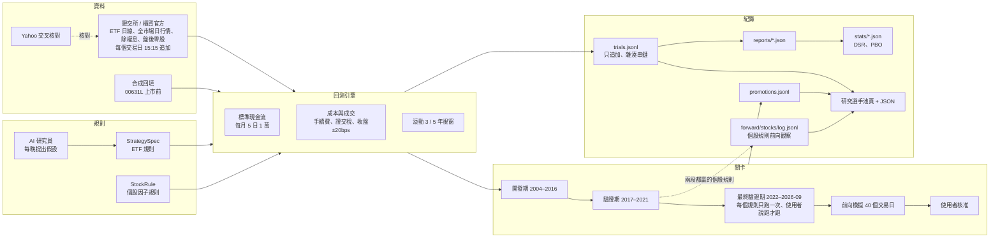
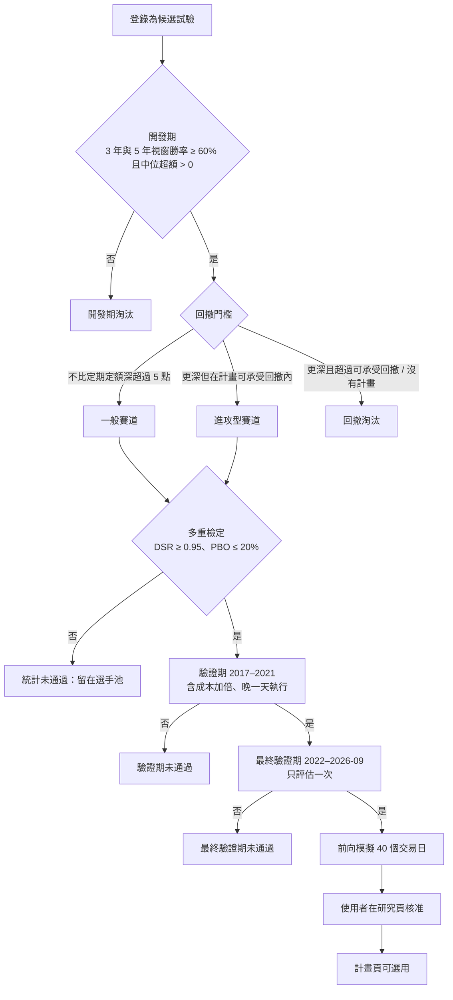
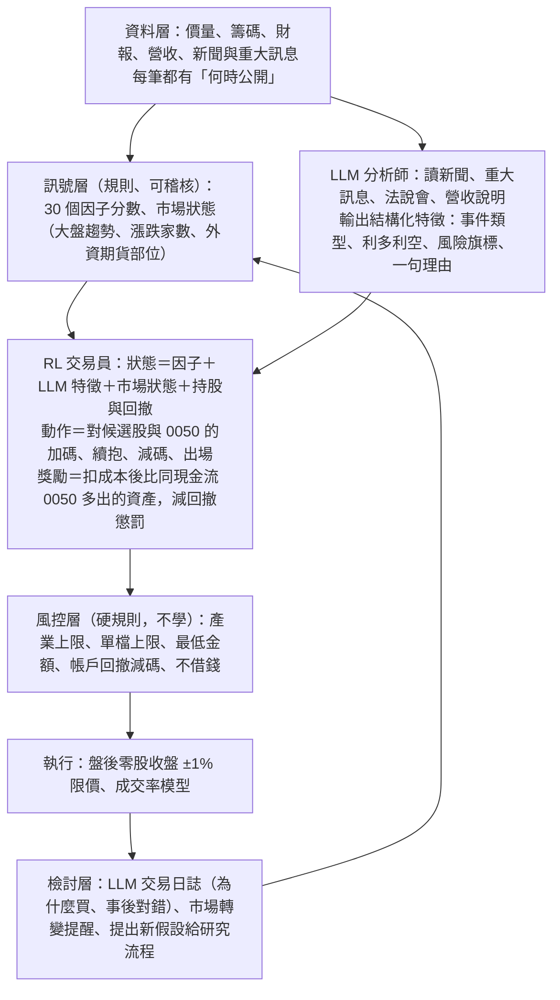

# 研究方法與研究路線圖

更新：2026-10-04。本檔是研究怎麼做、做到哪裡、接下來做什麼的唯一說明；每一個試過的規則與它的狀態在網站「研究 › 研究選手池」（`/research/pool`，機器可讀版 `/research/pool.json`）。數字以選手池與開發歷程為準，本檔的數字是 2026-10-04 的快照。

## 1. 研究要回答的問題

在相同的現金流、相同的成本、相同的盤後零股執行假設下，有沒有規則能長期勝過「每月 5 日把錢全部買進 0050」？規則必須事先寫成設定檔，不能指名個股；AI 是研究員，不是交易員；真實下單永久關閉。使用者 2026-10-03 的原則：只做上市股票、不借錢不融資、槓桿型 ETF 可以當工具、以投入的錢為主，風險由使用者在系統外控制。使用者 2026-10-04 決定實際配置：**每月投入的八成照定期定額買 0050，兩成走策略**；之後使用者說明策略帳戶的算法：先有啟動資金（先用 30 萬），之後每月定期定額投入，整個帳戶都可以買賣、獲利再投入；研究的主問題是「怎樣操作這個帳戶，才能比同樣的錢定期定額買 0050 滾得更多」。使用者也要求：不要只差一點參數的相似策略，要多種因子、自己找出哪個強哪個弱。

## 2. 架構

模組：`research/history/`（資料）、`research/spec.py`（ETF 規則）、`research/stock_rules.py`（個股規則）、`research/engine.py` 與 `research/legacy_challenger.py`（回測）、`research/compare.py`（對基準）、`research/registry.py`（試驗登錄）、`research/significance.py` 與 `statistics.py`（檢定）、`research/promotion.py`（關卡與帳本）、`research/pool.py`（選手池）、`research/agent/`（AI 研究員）、`research/forward.py`（ETF 前向模擬）、`research/stock_forward.py`（個股規則前向觀察）。

## 3. 資料

| 資料 | 來源 | 範圍 | 位置 |
|---|---|---|---|
| ETF 日線 18 個序列（0050、006208、0056、0051、0052、0053、0055、0057、00631L、00646、00662、00713、00878、00919、00679B、00687B、加權指數、報酬指數） | 證交所／櫃買官方，Yahoo 交叉核對 | 2004-02-11 起（各自上市日起） | `instance/research/history/daily/*.parquet` |
| 全市場上市普通股日行情（含後來下市的 179 檔） | 證交所每日收盤行情（MI_INDEX ALLBUT0999） | 2004-02-11～今，5,552 個交易日、470 萬列、1,261 檔 | `instance/research/history/stocks/twse/<年>.parquet` |
| 除權息、分割 | 證交所／櫃買除權息表；官方未註記的分割在目錄宣告 | 2003 起 | `history/raw/twse_ex_rights`、`actions.json` |
| 盤後零股成交分布與各限價成交率 | 證交所 TWT53U 抽樣 | 2010 起每 10 個交易日 | `history/odd_lot.json` |
| 00631L 上市前（2004–2014-10） | 合成：0050 含息日報酬 × 2 − 3.5%／年（成本校準自 2014–2026 真實追蹤差） | — | 標示 `synthetic`，manifest 有校準 |
| 櫃買個股 | 尚未（網站 2026-10-03 連不上） | — | 待做 |
| 財報、月營收、本益比 | 尚未（FinMind 免費等級有，每小時 600 次） | — | 待做 |
| 個股三大法人買賣超 | 證交所 T86、FinMind（2026-10-04 實測） | 2012-05-02 起（更早沒有） | 待做（R13） |
| 個股外資持股比率 | FinMind `TaiwanStockShareholding`（實測） | 2004-02-12 起 | 待做（R13） |
| 個股融資融券 | FinMind `TaiwanStockMarginPurchaseShortSale`（實測） | 2001 起 | 待做（R13） |
| 市場整體三大法人買賣金額 | 證交所 BFI82U（實測） | 2004-04-07 起 | 待做（R13） |
| 新聞、政治事件 | 沒有可回溯到 2004 年、標明當時何時公開的資料 | — | 無法回測；只能從現在起收集、前向觀察 |
| 下載中（2026-10-04 起）：外資持股、月營收、本益比／淨值比／殖利率、融資融券、三大法人 | FinMind 免費等級，每檔一次抓全歷史，每小時約 560 次，平日 13:30–15:30 暫停讓給每日流程 | 1,26x 檔 × 5 種，約 11 小時 | `history/raw/finmind/<資料集>/<代號>.json.gz`；進度在研究頁「執行中的程式」 |

資料規則：研究用資料只讀；每日新增的行情不改變開發期的資料指紋；資料修正或目錄擴充後重跑，舊紀錄保留。

## 4. 比較方式

- **策略帳戶的基準**（使用者 2026-10-04 決定，個股規則的主要比較）：先有一筆啟動資金（研究先用 30 萬），之後每月 5 日定期定額投入 1 萬；帳戶裡所有的錢（投入的加上賺賠的）都可以買賣、獲利再投入。比較對象是同樣的現金流（啟動資金＋每月）全部買 0050。滾動視窗也一樣：每個起點放 30 萬、之後每月 1 萬，3 年或 5 年後比。選手池預設用這個基準（`/research/pool`；`?basis=dca` 看每月投入、`?basis=lump_sum` 看一次投入）。
- 舊基準（2026-10-04 前的試驗、ETF 規則、八成定期定額那部分）：每月 5 日投入 10,000 元，當天以盤後零股全部買進 0050；股利留到下次一起投入。2026-10-04 前的「一次投入」試算，滾動視窗其實是每月投入算的（引擎 1.2.0 前的錯誤），不採用。
- 超額 =（規則期末資產 − 基準期末資產）÷ 投入金額。全期與滾動 3 年、5 年視窗（每個月起算一次）都算；勝率 = 超額 > 0 的視窗比例；另看中位與最差視窗。
- 最大回撤以單位淨值算（排除新資金的影響）；XIRR 是資金加權報酬。
- 成本：手續費 0.1425%（保守估計每筆最低 20 元；國泰、台新最低 1 元，個股規則一律用國泰），賣出證交稅個股 0.3%、ETF 0.1%、債券 ETF 免；成交價＝收盤 ± 20 bps 進位到升降單位；今日建議的委託限價是收盤 ± 1%（只決定買不買得到）。
- 個股規則：可選股票須收盤 ≥ 10 元、近 20 日日均成交值 ≥ 2,000 萬元、上市 ≥ 252 個交易日；下市的股票以最後成交價計；期間前兩年暖機。

## 5. 規則怎麼寫、怎麼試

- ETF 規則（`StrategySpec`）：投入時點、投入金額倍數（均線、回撤）、固定配置與再平衡、趨勢控制（跌破均線改防守配置或現金）、ETF 輪動與核心＋衛星。
- 個股規則（`StockRule`）：單一或混合因子（12-1 月動能、6 月動能、1 月反轉、60 日低波動、接近 52 週高點、近 12 月殖利率，百分位排名加權）、前 N 名等權、每月或每季換股、緩衝（留到跌出前 N×倍數才賣）；降低交易的設定（R3）：最短持有（新買的至少留幾次檢查，不再合格仍賣）、加碼門檻（低於目標超過幾成才加碼，缺口大的先買）、每筆最低金額。
- 因子庫（2026-10-04 擴充）：原本 6 個加上 3 個月動能、1 週反轉、1 年低波動、近 1 個月最大單日漲幅低、成交值大、成交值放大、站上 200 日均線幅度，共 13 個價格與成交因子；籌碼與基本面因子等 FinMind 資料下載完加入。
- 因子強弱分析（`research/factors.py`，`python -m quant_platform.research factors`）：每月 5 日把合格股票依因子排名，算和下個月報酬的排序相關（平均、t 值、正的月份比例）與前五分之一減後五分之一的報酬，分開發期、驗證期、最終驗證期、2020 年前後、2024 年後報告，判定強／不穩／弱／反向；研究頁「因子強弱」分頁。這是描述，不登錄為試驗。
- 每個個股規則都記錄交易量：費稅佔投入（整段期間手續費＋證交稅 ÷ 投入）、每年周轉率（一年賣出金額 ÷ 平均資產）、每年費稅佔平均資產、每月下單筆數。
- 來源：事先固定的規則批次（ETF 三批 131 個；個股兩批 26 個、大掃描 492 個、持有與加碼規則 40 個）、AI 研究員每晚最多 3 輪 12 個試驗（看不到驗證期與最終驗證期）。
- 大掃描分兩階段：先只算全期間（幾秒一個），再對前 40 名算完整視窗並跑驗證期。
- 每個不同的規則都登錄為一次試驗，計入多重檢定（同一規則在新資料版本重跑只算一次；穩健性變體不算）。
- 空頭減碼附帶版本（2026-10-25 起，「空頭減碼第三版」照事先寫的判定通過）：每一批新規則（`daily --name`）與大規模搜尋的最後名單（`scan`、`scan-large`，結果記在搜尋摘要的 `half_twins`）評完後，過門檻、100% 個股、本身沒有大盤濾網或減碼的規則，自動補評「加權指數跌破 200 日均線就減碼一半」的版本（`daily.half_twins`，`--no-half` 可關；減碼批次 `bearguard*` 本身不補）。兩個版本都是試驗、都照一般等級評分，過門檻的都進名單與前向。

## 6. 關卡

- 多重檢定：Deflated Sharpe Ratio 以「不同規則數」當試驗次數；PBO 以 CSCV 算。2026-10-03 累計 679 個不同規則；ETF 規則最佳 DSR 0.17、個股規則最佳 0.02（`stats/stocks-development-*.json`，PBO 10%），門檻 0.95——目前沒有規則通過統計門檻。
- 驗證期可以在統計門檻之外先跑（檢查規則是否只在開發期有效）。最終驗證（2022–2026-09）每個規則只跑一次：跑過就等於看過答案，之後改規則再跑就不算數，所以使用者說「跑」才跑（2026-10-04 第一次跑，4 個規則）。
- 兩段期間都贏的個股規則自動進入前向觀察（R2），（2026-10-17 起改成每月滾動：只用截止日以前的資料挑，帳戶一律從截止日隔天起算；以下為當時的寫法）從加入那天起每個交易日記錄，不等最終驗證；這和關卡裡「前向模擬 40 個交易日」是同一份紀錄，但晉級仍要依序過關。
- 前向模擬的結果只觀察，不用來挑規則。

## 7. 2026-10-03 的結論

### 目前結論（網站研究總覽顯示這一段；最近更新 2026-10-28）

- **2026-10-28 一輪最佳化的結論**（研究方法 §7 各段）：
  - 空頭防護：**「跌破 200 日均線就減碼一半」仍是最好的**。第六版（跌破時改選防禦股）錢留住 85%～98% 但回撤反而深 1～2 點——在低點換股、又錯過反彈；第七版（減碼多少看大盤波動）也沒過——2020-10 起的錢只有減碼一半的 98.9%，波動落後，剛跌破均線時還沒砍；第八版（1 個月與 3 個月趨勢轉正就回補）也沒過——2020-10 起只多 0.7%、大跌時多跌 1 點，空頭反彈被洗。三版更細的擇時都輸固定減碼一半。第九版改看帳戶自己離高點多遠（跌 30% 不持股）：回撤淺 3.5 點，但錢只剩 56%——這些規則 38% 的月份離高點超過 7.5%，下一個月平均仍賺 3.6%，回撤控制在還會賺錢的時候減碼。第十版改看規則自己一年賺賠（只在整年賠錢時再減一半），排隊中。
  - 強化學習：學「持股數」（三版）與「換股時機」都輸給固定做法——**深度學習名單持有 20 檔是比 10 檔更好的取捨**（錢約八成、回撤淺約 13 點），而且每週照名單換比抱舊名單好；逐檔「看成本才換股」仍比整組照換好（21 對中位數 +5.4%）。第一個有正面結果的是**成交執行**（開盤後一分鐘看跳空決定，每筆多 0.09%），但只有整股用得上，零股（09:10 才撮合）沒有；零股換成三個時點（09:10、13:00、收盤）也沒過，前向帳戶 9/1 起 2,634 筆收盤買單證實**零股 09:10 賣、收盤買就是最好的**（拖到後面賣少拿 0.13%～0.17%、提早到 13:00 買貴 0.05%～0.09%）。
  - 機器學習：**模型 M（加市場狀態）在 2021～2025 比模型 K 準 15%**，單獨的規則多賺 17%～48%（仍 T2）；和深度學習合併時模型 K 較好。近年加權（模型 L）反而變差：舊資料的規律還有用。
  - **最強的空頭策略**（使用者 10/28 問；選手池的取捨前緣）：**#7152、#7190**——掃描規則（不買股東大增或獲利衰退最多的五分之一，前 20 名、開盤賣收盤買）＋**加權指數跌破 200 日均線就不持股**。回測 3,291／3,521 萬、2020-10 起 1,129／1,154 萬（0050 377 萬）；2020 年 1～3 月 −5.3%／−6.6%（0050 −19.1%）、2022 −17.3%／−16.8%（0050 −21.6%）、2025 年 1～4 月 −11.4%／−10.1%（0050 −12.7%）；2020-10 以後最大回撤 −19.3%／−19.8%（0050 −29.5%）。一般 T0 候選。加上深度學習的組合 #7324（4,653 萬）三次也都少跌。**前向（9/1～10/27，大盤沒跌破均線、防護沒觸發）全部賣掉落後 0050 1.5／1.9 萬**——在沒有空頭的期間它們的股票跌得比 0050 多；深度學習前 10 名多 1.4 萬。空頭防護的效果要等下一次跌破均線才看得到。
  - 一般 T0 候選裡回撤比 0050 淺的高報酬規則：**#8560 模型 K＋深度學習前一成、不設最短持有、減碼一半**——3,241 萬、2020-10 起 1,045 萬（0050 377 萬）、最大回撤 −33.0%（0050 −34.0%）。
  - 組合：**第十輪過——#9768（深度學習第二版・前一成三個版本各約三分之一）7,145 萬、0050 最大那次跌時多跌 3.9 點，站上取捨前緣**（前緣頂端 #7339 8,219 萬、多跌 8.1 點）；第一階段改成「前緣壓不過才留」之後才找得到。
  - 新因子：**季報盈餘驚喜、盈餘加速 2020-10 以後預測力是每股盈餘成長的 3 倍**；盈餘加速進下一輪大搜尋，盈餘驚喜改測取代每股盈餘成長（257 個規則逐一換）。
  - T2 規則補減碼一半：227 個裡 11 個變 T0 候選（#9721 2,203 萬、回撤 −28.8%），沒有上前緣。
  - 重現性：深度模型的檔案沒進輸入指紋、名單用上市資料評上市＋上櫃規則，兩個漏洞已修；每週日抽 30 個重算（第一次 0 個不一樣）。

- **大空頭防護：加權指數跌破 200 日均線就把個股減碼一半**（2026-10-24～25，空頭減碼三版，研究方法 §7）：2007 年起的壓力測試裡，2008 金融海嘯 20 個頂尖策略沒有一個撐過（跌 56%～75%，0050 55%）。試了 8 種減碼方式：全部出場的濾網（200 日均線、10 個月均線）擋得住 2008，但在 2011、2015、2018 的修正被洗出場、錢少一半以上；均線下彎才出場與分段減碼都沒有更好。照一般評分（2015-06 起），「減碼一半」在 55 個規則上錢留住約 8 成、最大回撤淺 4～5 點，51／55 在 0050 跌最多那次比原版少跌；#7150（#6773 加減碼一半）6,002 萬（原版 6,195 萬）上前緣，#7217（#6498）從高風險變成一般 T0 候選。之後每批新規則的過門檻規則都自動補評減碼一半版本。2015 年後只有 2022 一次大空頭，效果還要看前向。
- **「不新買股東大增的股票」讓前 20 名的規則一致變好；一般 T0 候選裡錢最多的換成 #6784**（2026-10-22 中午，否決第二版）：#6509（近 52 週高＋深度模型2前一成＋模型 C，開盤賣、收盤買）加上「不新買 4 週股東人數增加最多的五分之一」——5,778 萬（原 4,303 萬，+34%；0050 同樣現金流 982 萬）、回撤 −36.8%（0050 −34.0%），一般 T0 候選（原本最多的是組合 #6759 4,366 萬），但 0050 大跌時最糟多跌 7.8 點（2018 下半年）。同樣的否決讓 #6492 +28%、#6093 的設定 +25%。「不新買融資快斷頭的股票」讓 #6490、#6090 少賺 8～10%，但 0050 大跌時多跌的從 8 點降到 5～6 點，兩個都站上取捨前緣。
- **跌市最穩又多賺的組合 #7091**（2026-10-22 晚，組合搜尋第六輪：開發期改到截止日）：外資持股＋新高次數＋股利 65%＋深度學習前一成・不買融資快斷頭 35%——4,496 萬（0050 同樣現金流 982 萬）、回撤 −37.4%、0050 每次大跌最糟只多跌 0.9 點，一般 T0 候選、站上前緣。用截止日以前的資料挑，以前向為準。
- **組合換成股東否決版的子策略：#6979 4,720 萬，一般 T0 候選裡錢最多、站上前緣**（2026-10-22 晚）：#6741（近 52 週高＋深度模型與深度學習前一成的組合，開盤賣收盤買）把子策略換成「不新買股東大增」的版本——4,184 萬 → 4,720 萬，回撤 −41.3% → −38.9%，0050 大跌時最糟多跌 4.6 點。28 個組合換了 24 個變好（中位數 +10.4%）；但換進去的版本是同一段期間挑的，偏樂觀，以前向為準。股東否決在深度學習類 91 個規則裡 54 個變好；共識清單類全部變差，不用。
- **研究知識庫**（2026-10-22，使用者：失敗紀錄都要記起來，讓後面的人用 AI 問）：研究總覽側邊欄「知識庫」——3,625 筆紀錄（失敗 2,223 筆），BGE-M3 語意向量＋關鍵字混合搜尋（Qdrant），AI 只根據紀錄回答並附出處。
- **「開盤賣、收盤買」讓多數策略多賺**（2026-10-22，來自盤中成交時機研究）：分 K 顯示策略要賣的股票隔天開盤賣比收盤多拿約 0.5%、要買的收盤買比開盤便宜約 0.3%；新的成交方式（收盤後決定，隔天開盤賣、隔天收盤買）補齊到 175 個過門檻的單一規則：63% 錢變多、中位數 +4.3%、回撤不變。**期末最多的換成 #6490**（深度學習前 10 名，開盤賣、收盤買）6,750 萬、回撤 −47.9%、高風險（0050 大跌時最糟多跌 8.2 點）；**最好的一般 T0 候選換成 #6759**（#6490 30%＋跌市穩 #6503 70%，84 個組合全部換成新成交方式時找到）4,366 萬、0050 大跌時只多跌 3.2 點；84 個組合 68% 錢變多、中位數 +4.7%、回撤反而淺 0.3 點。
- **FinMind 付費資料**（2026-10-21 起 Sponsor）：集保「股東人數減少」「散戶減少」與「融資維持率高」是強因子，但單獨或簡單搭配都輸 0050；放進機器學習才有用——模型 I（＋集保）月線上續抱 #6439 1,692 萬（模型 H 同框架 1,137 萬、T2），模型 J（再加融資維持率、借貸、鉅額）#6483 1,938 萬、回撤 −37.7%、一般 T0 候選，模型 J＋深度學習 #6485 3,246 萬、開盤賣收盤買版 #6493 3,793 萬。加進深度學習（dl-2.7.0）、加權或過濾進最強的深度學習框架都沒過。
- **長短歷史權重**（2026-10-22）：用 1,974 個規則驗證，挑規則時 2015 起全部等權最準；只看最近 5 年的準確度是全部的 98%，所以開了短歷史賽道（2021 年後才有的資料，例如主力集中度）。

- **期末最多的換成 #6090**（2026-10-21 晚，成交時點補齊時找到）：#5983（深度學習前 10 名、固定持有 20 天）改成**隔天收盤成交**——6,697 萬（0050 同樣現金流 982 萬）、2020-10 起 1,019 萬、回撤 −47.6%、T0 候選（高風險）；0050 大跌時最糟多跌 7.7 點，比 #5983 的 10.4 點少——錢更多、跌市更穩，#5983 被它同時勝過。成本加倍時 #5983 仍有 3,147 萬（穩健性檢查）。三種成交時點沒有一種對所有策略都最好（172 個策略：隔天開盤 64、當天盤後 61、隔天收盤 47）。
- **取捨前緣的穩健性**（2026-10-21 12:36，`robustness --trials`，診斷、不登錄；0050 同樣現金流 982 萬）：成本全部加倍（手續費、最低手續費、滑價；證交稅照法定）與晚一個交易日收盤成交。#5983 加倍 3,147 萬、晚一天 6,697 萬，兩種都仍是 T0 候選（高風險）；#4941、#5050 成本加倍後回撤 −49.5%／−51.9% 掉到 T1（比 0050 深超過 15 點）——#5983 比它們穩。組合：#6087 加倍 2,567 萬、晚一天 3,544 萬，兩種都仍是一般 T0 候選；#5163 2,544／3,089 萬，一般；#6086 2,769／3,961 萬，但回撤 −39.6%／−39.1% 比 0050 深超過 5 點，變成高風險；#5054 加倍 1,881 萬，一般。結論：要錢最多選 #5983（高風險）；要一般等級又經得起較差成交的是 #6087。
- **最好的一般 T0 候選換成組合 #6086**（2026-10-20 深夜）：#5983（深度學習前 10 名、固定持有 20 天）30%＋跌市穩 #5106 70%——3,564 萬（0050 同樣現金流 982 萬）、2020-10 起 925 萬、最大回撤 −38.4%（0050 −34.0%）、0050 跌 10% 以上時最糟只多跌 2.0 點。#5983 單獨 5,256 萬但多跌 10.4 點；分七成給跌市穩的規則，留下約三分之二的錢、跌市多跌從 10.4 點降到 2.0 點。再加共識清單的 #6087 3,125 萬、1.8 點。兩個都勝過之前的 #5155、#5163。
- **期末最多的換成 #5983**（2026-10-20 晚，持有方式補齊時找到）：深度學習第二版・前一成「前 10 名、前 30 名內續抱、看成本才換股、依預測下跌機率配置、漲過目標 2 倍賣回」改成**固定持有 20 天**——5,256 萬（0050 同樣現金流 982 萬；原本最高 #4941 3,904 萬）、2020-10 起 1,012 萬、回撤 −48.0%、T0 候選（高風險）；0050 大跌時最糟多跌 10.4 點（2019-12～2020-03），比 #4941 的 9.8 點多一點，所以在取捨前緣的最頂端、紅色標示。同一個策略不設最短持有只有 2,650 萬（T1，10/20 凌晨的 deep2top10 就是這個版本）、月線上續抱 1,977 萬（T2）：前 10 名集中持有，換股太勤時成本把多賺的吃掉，固定持有 20 天減少換手。注意：這是 758 個試驗裡最好的一個，回測數字偏樂觀；它已在本月名單上，前向帳戶 9/1 起 33 個交易日 343,389 元（0050 314,519 元，全部賣掉比 0050 多 28,068 元）。
- **持有方式當成策略研究之後，找到兩個更好的組合帳戶**（2026-10-20）：同一個組合，子帳戶全部改成「不設最短持有」（掉出名單就賣）——#5155 深度學習 36%＋跌市穩 64%：3,462 萬（原 #4938 2,876 萬）、回撤 −42.0%、0050 大跌時最糟多跌 2.3 點；#5163 共識 38%＋深度學習 22%＋跌市穩 40%：3,062 萬（原 #4940 2,722 萬）、回撤 −35.2%、多跌 1.8 點、一般 T0 候選。取捨前緣現在是 #4941 3,904 萬 → #5050 3,870 萬 → **#5155 3,462 萬** → **#5163 3,062 萬** → #5054 2,873 萬（跌市少跌 0.3）→ #5119 → #5053 → #4415。各家族最適合的持有方式不同：深度學習、共識、組合帳戶是不設最短持有，機器學習、多因子是固定 20 天，低波動、價值是月線上續抱（網站「研究 › 策略角色 › 持有方式」）。
- **持有方式是策略，不是規則；月線上續抱沒有比較賺**（2026-10-20 更正）：同一個策略換三種持有方式，最新引擎的每一個單一規則都補齊之後（10/20 22:10），542 個策略裡期末最多的是固定持有 20 天 218 個、月線上續抱 207 個、不設最短持有 117 個（只看過門檻的 163 個：70／47／46）；沒有一種持有方式對所有策略都最好——深度學習（9／12）與共識清單（10／16）多半是不設最短持有、機器學習與多因子多半是固定 20 天、低波動與價值殖利率是月線上續抱（網站「研究 › 策略角色 › 持有方式」）。10/13 決定「新規則預設月線上續抱」時的數字本來就顯示月線上續抱比較差（33／76、0.94 倍），那是判斷錯誤；10/14 之後的搜尋因此只測了月線上續抱，現在的大規模串流搜尋三種都展開。
- **最好的一般 T0 候選換成組合 #5054**（2026-10-20，組合搜尋第二輪）：深度學習 #4939 38%＋近 52 週高＋EPS 成長＋日內動能（贏家續抱版 #5052）62%，2,873 萬（0050 同樣現金流 982 萬）、最大回撤 −34.4%（0050 −34.0%）、0050 跌 10% 以上時最糟一次反而少跌 0.3 點——和 #4938 一樣多錢，但不是高風險。錢與跌市的取捨前緣：#4941 3,904 萬（多跌 9.8 點）→ #5050 3,870 萬（9.2）→ #4589 3,062 萬（8.9）→ #4938 2,876 萬（3.5）→ **#5054 2,873 萬（少跌 0.3）** → #5053 1,625 萬（少跌 1.2）→ #4415 1,361 萬（少跌 2.4）。前向（9/1 起 32 個交易日）：#5050 比 0050 +8.5%、#4941 與 #4938 +8.1%、#5054 +5.2%；今天全部賣掉各比 0050 多拿 1.6～2.6 萬元。
- **10/20 每個家族各做一輪最佳化**（細節見「最佳化紀錄」分頁）：過——機器學習模型 H（#5040，一般 T0 候選）、組合 #5054。沒過——深度學習 2.4.0（波動調整標籤）、後設標籤（勝率 45%→48%，但期末少一半：擋掉大贏家）、技術機器人第三版（只看價量的深度學習，5 年只有 3 年達標）、RL 3.2／3.3（2018 起贏自己的平均，但 1 年視窗不穩）、產業動能家族（強弱約 0，85.8 萬個候選沒有 T0）、看成本換股全面套用、贏家續抱單獨套用。學到的：深度學習的優勢大部分來自價量序列本身；規則的錢在少數大贏家，**勝率高不等於賺得多**；把深度學習和跌市穩的規則放在同一個帳戶，比改單一規則更能壓住跌市。

- **錢與跌市的取捨前緣**（2026-10-18 晚）：過門檻的規則裡沒有別的同時賺更多又少跌的 9 個——要錢：#4941 3,904 萬（跌市最糟多跌 9.8 點，高風險）、#4589 3,062 萬（8.9 點）；兼顧：#4938 2,876 萬（3.5 點）、#4940 2,722 萬（1.1 點、一般 T0）；要穩：#4949、#4946、#4594、#4957、#4415。組合搜尋（15 萬個兩檔／三檔組合，只用開發期挑 20 個）全部是 T0 候選，但沒有勝過 #4938 的；用現有資料，這條取捨線大致已經找齊，接下來要新資料（集保大戶、券商分點要 FinMind 付費）或前向觀察的確認。
- **錢多又不在跌市多跌：組合帳戶**（2026-10-18）：深度學習 36%＋跌市穩的 #4547 64%（#4938）2,876 萬、回撤 −42%、0050 大跌時最糟多跌 3.5 點，過事先登錄的門檻；再加共識清單三家一起（#4940）2,722 萬、回撤 −35.0%（一般 T0 候選）、最糟只多跌 1.1 點。期末最高的過門檻規則是深度學習加「漲過目標 2 倍賣回」（#4941，3,904 萬，高風險、跌市最糟多跌 9.8 點）。三個都從 9/1 起前向觀察；深度學習改隔天成交反而變差。
- **這個月的名單與前向帳戶**（2026-10-18 重新挑選，截止 8/31）：86 個過門檻（50 個 T0 候選、36 個 T0 候選（高風險）），前向帳戶 88 個全部 9/1 起，31 個交易日 65 個暫時贏 0050。跌市不多跌的大搜尋只找到 4 個最後名單（1 個高風險候選、其餘輸或小贏 0050）：穩的大多不賺錢。深度學習規則最深的回撤是 2021-06～2022-09 熱門股回落（0050 那時沒大跌），和共識清單（2018 下半年）、#4547（都不深）時間不同；組合帳戶開始進每月滾動，並試兩個「分散跌點」的組合（結果見第 7 節最後）。
- **跌市時的表現**（使用者 2026-10-18：回撤上限是為了避免市場不好時比 0050 跌得多、失去信心做錯決定；`research/downside.py`，研究總覽「跌市時的表現」分頁）：0050 下跌的月份，大部分過門檻的規則平均跌得比 0050 少（0050 平均 −3.6%）；但在 0050 每次跌 10% 以上的期間，期末最高的幾個最糟會多跌 5～9 個百分點（#4589 T0 共識清單 2018 下半年 −22.2% 對 −13.3%；深度學習 #4916 2020 疫情 −26.9% 對 −19.1%）。#4547、#4586（外資持股＋新高次數＋股利調升＋技術模型）最糟只多跌 2.8 與 0.5 個百分點，是跌市時最不會讓人心慌的一組，期末 2,402 萬與 2,003 萬。
- **回撤上限放寬並標註高風險**（使用者 2026-10-18：錢賺得多就可以）：回撤比 0050 深 5～15 個百分點、其他門檻都過的規則升為「T0 候選（高風險）」，進每月滾動與前向觀察，頁面紅色標示。深度學習看成本換股的組合帳戶 #4932（2,866 萬、−39.4%）、模型 G 看成本換股 #4914（1,711 萬、−42.3%）等因此成為高風險候選；回撤更深的（#4916 −53.7%）仍是 T1。

- **深度學習第二版＋看成本換股是目前最強的訊號，但都卡在回撤**（2026-10-17）：單獨的規則 4,238 萬（0050 982 萬）、回撤 −54%；選股端壓回撤的方法（依下跌機率配置、分群上限、去掉波動的風險否決、只挑大型股、學習出場第二版）都過不了。最接近的是「T0 共識清單 63%＋深度 37%」的帳戶：2,866 萬、2020-10 起 768 萬、回撤 −39.45%，比 T0 上限（0050 −34.0% 加 5 個百分點）深 0.4 個百分點，T1。

- **前向觀察每月滾動**（使用者 2026-10-16／10-17）：截止日＝兩個月前的月底；只用截止日以前的資料挑規則、重訓模型，前向帳戶一律從截止日隔天起算。10 月：截止 8/31，599 個規則有 50 個過門檻，加 2 個新聞對照實驗共 52 個帳戶，2026-09-01 起 31 個交易日，44 個暫時贏 0050。
- **深度學習第二版過了模型門檻**（2026-10-17）：dl-2.1.0（學「之後 20 日會不會進當天前 10%」）2016～2020 前 20 名平均多賺 +1.50%，模型 G（gbm-2.2.0）+1.25%；2021～2025 也比較好（平均 +2.5% 對 +1.4%）。但直接做成規則換股太多（費稅佔投入 95%）、2020-10 起輸 0050，T2。下一步照文獻加「不交易區」與和模型 G 合併。

- **只看 100% 個股**（使用者 2026-10-09）：0050 是使用者自己另外持有的部位，「一半放 0050」之類的規則只是把它混進來、數字變好看，不是策略本身的本事。含 0050 的 72 個規則（包括之前的 5 個 T0 候選）全部不採用、停止前向觀察；之後只研究 100% 個股的規則。
- **100% 個股的 T0 候選 32 個**（2026-10-16，引擎 1.4.2；0050 同樣現金流 982 萬）：全部規則都照當時的台股交易規則重跑過（漲停買不到、跌停與停牌賣不掉、整股與零股、下市沒賣就歸零、股利與健保、颱風休市的除權息、每筆手續費），429,149 筆買賣逐筆稽核 0 違規；1.4.2 修掉了「因子值相同的股票照股票代號排名」的偏差。期末最高的是新的「外資持股＋新高次數＋股利調升＋技術模型」（#3919，2,591 萬、回撤 −31.8%），其次是 T0 共識清單（2,142～2,280 萬）；回撤最淺的是近 52 週高＋EPS 成長＋日內動能（#3604，1,894 萬、−24.1%）。這些都是從大量候選裡挑出來的（DSR 接近 0），最乾淨的證據是開發期共識（成員只用 2020-09 以前挑）與前向觀察。全部從 2026-10-01 起前向觀察，持有方式一律「月線上續抱」，已做過的決定固定、不被之後的資料改寫。
- **追強勢股的規則回撤深是本質**：20 檔正在漲的股票會一起回落。使用者決定回撤門檻維持（不比 0050 深超過 5 個百分點）。到目前試過的賣出／減碼方式：15% 移動停損、大盤跌破 200 日均線、帳戶跌破自己的 200 日均線、學習出場、依自己的波動減碼到現金——都沒有在不犧牲更多報酬下把回撤壓進門檻。只挑低波動的股票回撤可以壓到 −23%，但報酬大輸 0050。
- **只在大型股裡挑**（2026-10-09）：市值前 100 大挑 20 檔（不放 0050、也不照市值比例）。大型股讓趨勢規則回撤變淺、成本降到三分之一以下（費稅佔投入 13%～17%，全市場版 32%～60%），代價是 2015–2019 小型股強的年份與 2024 台積電獨漲的年份落後。8 個規則：1 個 T0 候選（上一條）、3 個 T1（每檔等額的趨勢 1,477 萬、回撤 −44%；趨勢＋月營收年增 1,443 萬、回撤 −45%；機器學習＋趨勢各半 回撤 −39.2%）、其餘 T3。
- **因子**：價格趨勢類（站上 200 日均線、6 個月動能、52 週高點）、機器學習、借券賣出餘額低能贏 0050；股利調升做成組合找到 2 個 T0 候選（單獨偏弱）。借券費率高、注意股與處置股、現金增資比較適合當「排除」的濾網；反轉、低波動、價值殖利率、營收財報單獨做、日曆時間、因子動能都輸或沒有預測力。
- **強化學習**（2026-10-16 更新）：分配器與部位調整的 6 個版本都等於固定比例；技術機器人 2.0、全部因子的 2.1 都是 T3（背答案）。**機器人 3.0 是 T0 候選**（引擎 1.4.3）：8 個強訊號區塊的權重由機器人逐年學，2018 起比 0050 +354.6%、2020-10 起 +246.8%，同樣 8 個區塊平均是 +255.9%／+105.2%——機器人在引擎裡贏了自己的對照。但 3.0 的區塊是用 2015-06～2020-10 挑的、測試從 2018 起，2018～2020 不是乾淨的樣本外，乾淨的是 2020-10 起；3.1（每年只用那年以前的資料挑區塊）沒贏自己的對照（+63.3% 對平均 +114.4%），所以 3.0 的優勢很可能來自挑區塊時看過測試年；逐年挑槽位的平均本身是 T0 候選。完全自由的 4.0、4.1 都是 T3（−360.6%、−344.3%）。目前沒有乾淨的證據顯示 RL 比簡單平均好。
- **成本**：100% 個股的趨勢規則每月約 12～15 筆委託、費稅約投入的 32%～60%；機器學習每月約 30～37 筆、費稅約 113%～131%。
- **AI 的角色**（2026-10-09 起）：LLM 每晚把新聞標題整理成事件欄位，只用在「利空不買」與對照組的前向實驗（100% 個股版本）；AI 研究員每週提出最多 2 個 100% 個股的規則、只看 2015-06～2020-09，本身也有一個前向帳戶「AI 研究員（整體）」。
- **外部做法搬過來沒有用**（2026-10-10）：依台股量化公開做法與文獻事先登錄 6 個規則（營收公布後換股、趨勢連續性、日內動能、產業殘差動能、不買樂透型股票、FinLab 型四因子），全部沒過；最接近的是四因子（1,208 萬、兩段都贏 0050、回撤 −36.9%，但 1 年／3 年視窗勝率 43%／50%）。在這段台股，最簡單的「站上 200 日均線」仍是最好的訊號。
- **搜尋規模**（使用者 2026-10-10：沒測過上千上萬個方法不要說找不到，也不要用一樣的參數充數）：大規模兩階段搜尋已跑過約 190 萬個候選（每輪只放新的因子家族，最後名單要和以前的都不同），統計記錄在選手池。
- **買得到嗎（R4）**：盤後零股 80%～90% 在限價（收盤 ±1%）內成交、成交價中位數就是收盤；風險是漲停日的買單與委託量（帳戶大了整張改盤後定價）。

### 最佳化紀錄（網站研究總覽「最佳化紀錄」分頁顯示；最新在上）

使用者 2026-10-20：持續優化每一個策略，要看得到結果。每個試驗做完就在這裡加一行；細節在下面第 7 節各段。判定：過＝照事先寫的門檻通過；沒過＝照實記錄、不採用；進行中＝背景還在跑。

| 日期 | 家族 | 做了什麼 | 結果 | 判定 |
|---|---|---|---|---|
| 2026-10-28 | 規則 | 季報盈餘驚喜家族（`earnings`）：盈餘驚喜、盈餘加速、盈餘連續成長，因子強弱與新穎性閘門 | 驚喜、加速「強」（2020-10 起排序相關 0.019，每股盈餘成長 0.006）；加速過閘門、驚喜與連續成長和每股盈餘成長太像被擋 | 加速併進加分點那一輪 |
| 2026-10-28 | 規則 | 盈餘驚喜取代每股盈餘成長（`surpriseswap`，257 個過門檻的規則逐一換） | 排隊（14:40 後） | 進行中 |
| 2026-10-28 | 機器學習 | 模型 O（`modelo`，gbm-2.10.0）：模型 M 加上盈餘驚喜、盈餘加速、盈餘連續成長三個特徵 | 排隊（14:40 起訓練） | 進行中 |
| 2026-10-28 | 壓力測試 | 空頭防護第十版（`bear10`）：減碼一半＋規則自己比一年前賠錢再減一半，55 個規則 | 排隊（等第九版、盈餘驚喜比對、組合搜尋第十一輪） | 進行中 |
| 2026-10-28 | 壓力測試 | 空頭防護第九版（`bear9`）：減碼一半＋帳戶自己的回撤控制（離高點每多跌 7.5% 少持有 1/4，跌 30% 不持股），55 個規則 | 2020-10 起的錢是減碼一半的 55.8%（門檻 102%）；回撤淺 3.5 點、0050 大跌時少跌 2.45 點；過門檻 16／55（減碼一半 46）：規則 38% 的月份離高點超過 7.5%，下一個月平均仍賺 3.6% | 沒過 |
| 2026-10-28 | 壓力測試 | T2 規則補減碼一半版本（`t2half_a`／`_b`／`t2halfend`，227 個） | T0 候選 11（一般 7、高風險 4）、T1 3、T2 187、T3 26；沒有站上前緣；#9721 2,203 萬、回撤 −28.8% | 附帶版本補齊 |
| 2026-10-28 | 深度學習 | 舊版本用 2021～2025 重判（`deepregate`）：dl-2.0／2.2／2.4／2.7／3.0 原樣重訓，各自原本的門檻改看 2021～2025，三種持有方式 | 等顯示卡 | 進行中 |
| 2026-10-28 | 技術機器人 | 技術分析機器人第四版（`techdeep4`）：只看價量的深度學習（dl-2.5.1＝dl-2.5.0），門檻改看 2021～2025，三種持有方式 | 等顯示卡 | 進行中 |
| 2026-10-28 | 組合 | 組合搜尋第十一輪（`blendfour`）：第十輪留下的三檔組合各加一檔 | 排隊（等第十輪的評分與空頭防護第九版） | 進行中 |
| 2026-10-28 | 組合 | 組合搜尋第十輪（`blendfrontier`）：第一階段只留選手池前緣壓不過的組合、近似規則 0.95 | 7.16 億個組合、16,148 個過第一階段、8 個最後名單全是 T0 候選；**#9768 上前緣**（深度學習三個版本，7,145 萬、0050 大跌時多跌 3.9 點） | 過 |
| 2026-10-28 | 組合 | 組合搜尋第九輪（`blendrecent`）：門檻改成 2020-10 以後贏 0050、排序 2015～2020 只佔四分之一，池 1,576 個、6.52 億個組合 | 1.35 億個過第一階段、5 個進引擎都是一般 T0 候選（#9531 5,495 萬、#9537 回撤 −26.0%），沒有站上前緣（14 類太粗、只湊出 5 個） | 沒過 |
| 2026-10-28 | 強化學習 | RL 第八版（`fwdminutes`）：買單 13:00 或收盤，只用 9/1 以前的分 K 學，測前向帳戶 9/1 起的收盤買單 | 2,634 筆、36 天：每筆少賺 0.051%（按交易日 t −1.44）；一律 13:00 少賺 0.085%——收盤買比較好 | 沒過（零股維持 09:10 賣、收盤買） |
| 2026-10-28 | 強化學習 | RL 第七版（`rl-execution --multi`）：零股在 09:10、13:00 或收盤成交，賣單 09:10 決定、買單 13:00 決定（分 K 3,982 天，2023 起） | 合計每筆多賺 0.033%（t 1.88）；買單 0.043%（t 3.09）、賣單 0.024%（t 0.73）；一律 13:00 賣少拿 0.17% | 沒過（買單方向對、幅度不夠） |
| 2026-10-28 | 模型 | 模型 M 單獨＋減碼一半（`modelmhalf`，三種持有方式） | #9534 月線上續抱：一般 T0 候選，2020-10 起 494 萬、回撤 −34.7%（原版 −44.7%）；另兩個仍 T2（3 年視窗 56%、44%） | 過（1 個） |
| 2026-10-28 | 壓力測試 | 空頭防護第八版（`bear8`）：跌破 200 日均線減碼一半，加權指數 1 個月、3 個月趨勢轉正各回補 1/4，55 個規則 | 2020-10 起的錢是減碼一半的 100.7%（門檻 102%）、0050 大跌時多跌 1.03 點：空頭反彈被洗 | 沒過 |
| 2026-10-28 | 壓力測試 | 空頭防護第七版（`bear7`）：跌破 200 日均線依大盤波動減碼（持有 50%／75%／100%），55 個規則 | 2020-10 起的錢是減碼一半的 98.9%（門檻 102%）、回撤淺 0.1 點、0050 大跌時多跌 0.65 點；2015-06 起 102% | 沒過 |
| 2026-10-28 | 模型 | 模型 M（`modelm`，gbm-2.9.0）：模型 K 加市場狀態（大盤趨勢、波動、上漲家數、報酬分散、融資維持率） | 門檻過（2021～2025 前 20 名 1.57% 對 1.37%）；單獨規則比模型 K 多 17%～48% 但仍 T2；加深度學習時模型 K 較好 | 過門檻（單獨較好） |
| 2026-10-28 | 模型 | 模型 L（`modell`，gbm-2.8.0）：模型 K 的訓練樣本依時間加權（每 3 年減半），門檻看 2021～2025 | 2021～2025 前 20 名每 20 天多賺 1.15%，模型 K 1.37%；2016～2020 也較差 | 沒過 |
| 2026-10-28 | 壓力測試 | 空頭防護第六版（`bear6`）：跌破 200 日均線改用防禦因子選股，兩組 × 55 個規則 | 低波動高品質：錢 85%、回撤深 1.8 點；跌市穩：錢 98%、回撤深 1.1 點；都沒比減碼一半好 | 沒過 |
| 2026-10-28 | 強化學習 | RL 第四版（`rl4`）：情境式拉霸機每週決定深度學習持有 10／20／30 檔，離線逐年學 | 2018～2020-10 贏三種固定（1.20% 對最好 1.06%／週）；2021 起輸固定 10 檔（1.38% 對 1.58%），急跌沒避開 | 沒過 |
| 2026-10-28 | 強化學習 | RL 第四版第二版：每週線上更新（LinUCB）、扣下跌風險，看帳戶的錢與回撤 | 2021 起 11.3 倍、−36.9%；固定 20 檔 18.3 倍、−35.7% 同時勝過它（幾乎都選 30 檔） | 沒過 |
| 2026-10-28 | 強化學習 | RL 第四版第三版：狀態加深度風險模型、前 10 檔回撤、融資維持率 | 2021 起 16.8 倍、−37.1%；仍輸固定 20 檔；持股數這個動作先停，改做換股時機 | 沒過 |
| 2026-10-28 | 強化學習 | RL 第五版（`rl-switch`）：每週決定照新名單換股或維持，深度學習前 20 檔 | 2021 起 11.9 倍、−50.7%；每週照換 18.3 倍、−35.7% 同時勝過；名單過期得快 | 沒過 |
| 2026-10-28 | 強化學習 | RL 第六版（`rl-execution`）：開盤後看到跳空，決定現在成交或等收盤（分 K 4,000 天，2023 起） | 開盤後一分鐘：每筆多賺 0.092%（t 4.2）；改用零股做得到的 09:10：0.025%（t 0.9） | 整股過、零股沒過（帳戶以零股為主，暫不採用） |
| 2026-10-28 | 規則 | 選股條件緩衝第二版（`band`）：持股低於門檻七成才因不符條件賣出 | 2020-10 起錢中位數 100.0%（2 多 11 少）；大型股 6 個全變差；被迫賣出少 19% | 沒過 |
| 2026-10-24 | 壓力測試 | 大空頭壓力測試（`stress`）：20 個策略從 2007 年跑過 9 次空頭（0050 跌 15% 以上），模型 2004 年起逐年重訓 | 2008 撐過 0／20（跌 56%～75%、0050 55%）；2022 20／20；最多 6／9（#7091、#6979、#5054、#6139）；長期 19／20 贏 0050 | 描述（沒有每次都撐過的） |
| 2026-10-24 | 壓力測試 | 空頭減碼檢驗（`protect`）：同樣 20 個策略各加一種減碼（大盤 200 日、10 個月均線、12 個月動能、15% 停損、依波動減碼），2007 起與 2015-06 起 | 五種都沒有讓撐過次數變多；200 日均線讓 2008 撐過 17／20、回撤中位數 −66% → −37%，但 2015 修正 17 → 2，2015-06 起留住 69% | 沒有幫助（第一版） |
| 2026-10-26 | 規則 | 選股條件只管買進（`entryonly`）：55 個固定規則各加 `eligibility` "entry"，成交值等門檻只擋買進 | 錢中位數 100.0%、22 個不變、16 好 17 壞；#7339（#6490）8,219 萬（+22%）、#7340 上前緣，#7047 −30% | 沒有一致的好處（維持現狀；新版本照常進名單） |
| 2026-10-25 | 組合 | 組合搜尋第八輪（`blendguard`）：只組加了 200 日均線防護（減碼一半或不持股）的規則，開發期到截止日 | 15 個進引擎、13 個一般 T0 候選；#7324 4,653 萬、0050 最大那次跌時少跌 4.2 點，站上取捨前緣，原本前緣上的 #7091、#6979、#5054、#7144 被比下去 | 過 |
| 2026-10-26 | 搜尋 | 全段大搜尋（`fullscan`，`research/scan_full.py`）：2015-06～截止日全段初篩、要同時贏 2020-10 以後的 0050；89 個訊號（含付費資料 10 個）1～5 個一組，約 1.12 億個不同的個股策略設定；過初篩的挑上千個用回測引擎完整重跑 | 跑之前寫判定；背景執行中 | 進行中 |
| 2026-10-27 | 規則 | 全部過門檻規則補「跌破 200 日均線減碼一半」版本（`halftwins_a`／`_b`）：10/25 以前與高風險的過門檻規則都沒補過，1,119 個 | 575 個過門檻（T0 候選 434、高風險 141）；錢留住 2015-06 起 83%、2020-10 起 98%；回撤淺 5.4 點；1,070 個在 0050 最大那次跌時少跌；202 個高風險變一般 T0 候選；前緣 0 | 過（照判定進名單；附帶版本維持） |
| 2026-10-26 | 模型 | 模型 K（`modelk`）：全部付費資料一起訓練（多八大行庫、券商集中度、當沖、融資成本），門檻對修正後的模型 J，6 個規則（三種持有方式） | 過門檻；#7441（＋深度學習、不設最短持有）4,249 萬、高風險 T0 候選，回撤 −43% | 過（高風險） |
| 2026-10-25 | 壓力測試 | 空頭防護第五版（`bearguard5`）：減碼一半的時機改由深度風險模型（全市場預測風險在近 3 年最高五分之一）決定，20 個策略 | 6／20 過門檻、錢留住 35%；模型叫減碼的時間落在大漲年（2017 74%、2024 80%），2018、2022 空頭年 0% | 沒過；附帶版本維持 200 日均線減碼一半 |
| 2026-10-25 | 壓力測試 | 空頭防護第四版（`bearguard4`）：大盤跌破年線時才用深度風險模型賣高風險股，單獨與加減碼一半，20 個策略 | 單獨：錢留住 74%、0050 最大那次跌時多跌 1.0 點、6／20 比原版好；加減碼一半：錢是減碼一半的 81%、少跌只多 0.1 點 | 沒過（第一版）；下一版用模型決定整體部位 |
| 2026-10-25 | 壓力測試 | 空頭減碼第三版（`bearguard3`、`protect`）：減碼一半加到七類各錢最多的 5 個（35 個）；分段減碼（跌破減一半、比一年高點低 20% 全出）加到 20 個策略 | 擴大範圍：30／35 過門檻、錢留住 78%、34／35 比原版少跌；分段減碼：錢是減碼一半的 82%、少跌一樣，2008 撐過 15／20 但 2015 只剩 5 | 減碼一半通過，列為每批的附帶版本；分段減碼沒有更好 |
| 2026-10-24 | 壓力測試 | 空頭減碼第二版（`protect`、`bearguard_a`／`bearguard_b`）：均線下彎才出場、跌破只減一半；60 個加了減碼的版本照一般流程評分 | 均線下彎：2018、2020 全軍覆沒，留住 51%；減碼一半：留住 83%、20 個都仍贏 0050，但 2008 只撐過 9／20。一般評分 60 個：減碼一半 18／20 過門檻、錢留住 80%、回撤淺 4.9 點，#7150 上前緣；200 日均線 14／20、留住 57%；均線下彎 8／20 | 壓力測試沒有幫助；一般評分：減碼一半最好，42 個進前向 |
| 2026-10-24 | 組合 | 組合搜尋第七輪（`blendsteady`）：只組截止日以前五個時期都贏 0050 的策略 | 4 個都是一般 T0 候選；#7144 1,915 萬、回撤比 0050 淺、大跌時少跌 1.8 點，上前緣；#7141 3,349 萬 | 過 |
| 2026-10-24 | 深度學習 | 一年一訓與每月重訓各半（`deephalf`，前緣最頂端 3 個框架） | 3 個都變差（−10%～−47%），2024 年後也沒比較好；深度學習維持一年一訓 | 沒過 |
| 2026-10-24 | 強化學習 | RL 機器人 3.5 三種持有方式＋開盤賣收盤買（`robot35s`，6 個） | 機器人不設最短持有 #7134 1,836 萬一般 T0 候選（回撤 −35.2%），但輸槽位平均 #7137 2,135 萬；不在前緣 | 沒過 |
| 2026-10-23 | 強化學習 | RL 機器人 3.5（`robot35`）：3.3 的槽位加上付費資料（集保籌碼、融資與借貸、模型 I／J）——回答「各類有沒有用付費資料重新優化」 | #7130 1,139 萬、T2；比 3.3（1,198 萬）少 5%，回撤 −34.9% 淺 7 點；2020-10 起輸自己的對照 | 沒過 |
| 2026-10-23 | 否決 | 付費資料否決補到趨勢與 RL（`paidveto`）：趨勢 8 個 × 股東否決、融資否決，RL 類 6 個 × 股東否決 | 趨勢股東否決 1／8、融資否決 0／8（大型股沒效果）；RL 2／6（#7128 2,466 萬 +21%、#6897 +32%） | 沒過（各有個別變好） |
| 2026-10-23 | 新資料（分點） | 分點（`branches`）：每月只用之前的資料挑出「大買之後會漲」的分點與隔日沖分點，做成「分點跟著買」「隔日沖少」兩個因子（判定跑之前寫在第 7 節） | 程式與測試完成；分點下載約 10/29 完成後自動跑（流程等下載結束） | 進行中 |
| 2026-10-23 | 新資料（八大行庫） | 第二版（`govbank2`）：官股異常大買（自己前 250 天最大 1%）當事件，看之後 20 日 | 一般日 +0.83%／+0.98%（t 4～5），護盤日沒效果；門檻 1% 差一點沒過；下一版放進模型當特徵 | 沒過（差一點） |
| 2026-10-23 | 大規模搜尋 | 第四輪（`bigscanroll`）：開發期到截止日 2026-08，50 個訊號 3～4 個一組，299.9 萬個 | 不近似的只剩 1 個：#7111 3,408 萬一般 T0 候選，不在前緣；這批訊號的組合已搜得差不多 | 過（勉強） |
| 2026-10-22 | 組合 | 組合搜尋第六輪（`blendroll`：開發期改到本月截止日 2026-08，和每月名單一致） | 19 個一般 T0 候選；#7091 4,496 萬、0050 大跌時只多跌 0.9 點，上前緣（樣本內，以前向為準） | 過 |
| 2026-10-22 | 組合 | 組合搜尋第五輪（策略池 874 個含否決版，1.11 億個組合） | 20 個最後名單都是 T0 候選，最多 3,089 萬，沒有上前緣（開發期看不出否決版 2020 年後的好處） | 沒過 |
| 2026-10-22 | 否決 | 第六版（`veto6`）：股東＋獲利一起（8 個）、借券賣出最多與借券費率最高（各 20 個深度學習規則） | he 3／8 過，只有 #7024 5,828 萬兩個都贏；s1、l1 各 1／20 過（中位數 −22%、−25%）；#7047 一般 T0 候選上前緣 | 部分 |
| 2026-10-22 | 否決 | 組合（`vetoblends_a`／`_b`）：28 個組合的子策略換成判定為過的股東否決版 | 24／28 過、中位數 +10.4%；#6979 4,720 萬一般 T0 候選、上前緣（子策略是同期間挑的，偏樂觀） | 過 |
| 2026-10-22 | 否決 | 第五版（`veto5`）：離年線最遠（t1）、獲利衰退最多（e1）的五分之一不新買，各套 20 個最賺的深度學習規則 | t1 0／20 過（中位數 −18%，跌深的股票是模型抓到的反彈）；e1 8／20 過（中位數 −2.3%，#7005 +20%）；都不如股東否決 | 部分 |
| 2026-10-22 | 否決 | 第四版（`veto4`）：股東否決補到其他 29 個深度學習前 20 名規則 | 19／26 過、中位數 +7.5%；深度學習類合計 91 個中 54 個變好（中位數 +5.9%）；#6946、#6942 一般 T0 候選 +31%～34% | 過 |
| 2026-10-22 | 否決 | 第三版（`veto3_a`／`_b`）：股東否決補到最有錢的 120 個前 20 名規則；股東＋融資兩個否決一起（23 個） | 股東否決 40／120 過，但只對深度學習有效（62 個中 33 個變好、中位數 +2.2%；共識類全部變差）；#6876 3,766 萬（+56%）一般 T0 候選、#6834 +70%；兩個一起只過 2／23 | 部分 |
| 2026-10-22 | 否決 | 第二版（`veto2`）：融資快斷頭的不新買（m1）套 10 個最賺的單一規則；股東大增的不新買（h2）補 3 個 | 6／13 過：#6784 5,778 萬一般 T0 候選裡最多（+34%、回撤淺 4.3 點）；#6773、#6774 跌市少跌、上前緣；#6783 +28% | 過 |
| 2026-10-22 | 新資料（八大行庫） | 官股買超、官股逢跌買兩個個股因子；全市場官股淨買超當大盤訊號（`govbank`） | 個股因子都弱（短歷史）；20 日大盤訊號過了條件但最差的是中間一組、沒有機制，不做成濾網、改前向觀察 | 沒過 |
| 2026-10-22 | 大規模搜尋 | 第三輪（`bigscan3`）：每組至少一個新訊號，140.9 萬個 | 和以前不近似的只剩 2 個（T2、T3），沒有新的 T0 候選；新訊號在等權平均裡被稀釋 | 沒過 |
| 2026-10-22 | 成交時點 | 開盤賣做不做得到（`openfeas`、`opentight`）：零股 09:10、開盤量 | 09:10 賣多 0.34%（開盤 0.30%），回測不用改；開盤上限收緊到 0.2%：#6490 −5.8%、#6759 −0.4%，等級不變 | 診斷 |
| 2026-10-22 | 成交時點 | 前向初步對照：開盤賣收盤買對原版（382 組，9/1～10/21） | 贏 191、輸 191，差距中位數 0.00%；前向還看不出差別 | 診斷 |
| 2026-10-22 | 引擎 | 1.6.0 交易所漲跌停價（`engine160`：2015-06 起和推算不同的 16,283 個股票×交易日） | 打開後漲跌停價與鎖死判斷不同 0 個（原 139 個）；FinMind 2015-06 以前是 ±10%（錯），不用；10/31 晚上打開 | 進行中 |
| 2026-10-22 | 大盤訊號 | 大盤融資維持率、外資台指期淨部位（水準與 20 日變化）能不能提早看出 0050 大跌 | 4 個訊號在兩段期間最差的組別都不同，沒用；不做成濾網 | 沒過 |
| 2026-10-22 | 組合 | 84 個過門檻的組合全部換成子策略的開盤賣、收盤買版本（比例不變） | 68% 錢變多、中位數 +4.7%、回撤淺 0.3 點；#6759 4,366 萬成為最好的一般 T0 候選 | 過 |
| 2026-10-22 | 組合 | 組合搜尋第四輪（策略池含開盤賣收盤買與模型 I／J，3,745.9 萬個組合） | 16 個過門檻；#6676 1,609 萬、跌市少跌 2.2 點，上前緣 | 過 |
| 2026-10-22 | 組合 | 前緣組合 #6365、#6366 的子策略換成開盤賣、收盤買版本 | #6665 4,277 萬（原 4,215）、回撤淺 0.7 點，在前緣上；#6666 3,855 萬（原 3,461，+11%）、回撤淺 1.5 點 | 過 |
| 2026-10-22 | 成交時點 | 開盤賣、收盤買補齊到每一個過門檻的單一規則（167 個） | 63% 錢變多、中位數 +4.3%、回撤不變；前緣新增 #6490、#6509、#6642 | 過 |
| 2026-10-22 | 成交時點 | 新成交方式「開盤賣、收盤買」（來自盤中成交時機研究），8 個最強的單一規則 | 7 個過：#6490 6,750 萬（前緣新頂端）、#6491 5,158 萬（+32%）、#6492 4,745 萬（+23%）、#6493 3,793 萬（+17%、回撤更淺） | 過 |
| 2026-10-22 | 成交時機 | 分 K 研究：前 10 名策略 4,000 筆買賣，隔天各時點相對收盤 | 賣在開盤多拿 0.46%（t=6.1）、買在收盤比開盤便宜 0.27%；單一時點沒過，導出開盤賣、收盤買 | 診斷 |
| 2026-10-22 | 組合 | 模型 J＋深度學習放進 4 個最強的深度學習框架（#6486～#6489） | 回撤淺 0.7～6.8 點但錢只剩 36%～69%；不在前緣上 | 沒過 |
| 2026-10-22 | 新資料（FinMind） | 模型 J（模型 I＋融資維持率、借貸、鉅額）與 3 個規則 | 門檻過（1.444% 對 1.374%）；#6483 1,938 萬、−37.7%、一般 T0 候選；#6485（＋深度學習）3,246 萬、−44.6% | 過（#6483、#6485） |
| 2026-10-22 | 新資料（集保） | 第五版：深度學習 dl-2.7.0（dl-2.1.0 的特徵換成含集保的模型 I 特徵） | 開發期門檻沒過（1.343% 對 1.496%），沒有做規則 | 沒過 |
| 2026-10-22 | 新資料（FinMind） | 付費資料六個因子的強弱 | 融資維持率高強（2015～2020 前五分之一 +7.0%/年）；主力買超短歷史判定強；鉅額交易、不限用途借貸弱；融資沒套牢和融資維持率是同一個排名 | 進行中（新策略在跑） |
| 2026-10-22 | 新資料（集保） | 第四版：模型 I（模型 H＋4 個集保因子，逐年滾動）與它的 3 個規則 | 開發期門檻過（1.374% 對 1.254%）；月線上續抱 #6439 1,692 萬、−41.1%，比模型 H 同框架（1,137 萬、−47.4%、T2）好 | 過（#6439） |
| 2026-10-22 | 新資料（集保） | 第三版：4 個最強的深度學習規則不新買散戶或股東 4 週增加最多的五分之一（過濾，8 個） | 最接近 #6435：4,060 萬（原 3,911 萬）、回撤淺 1.9 點（門檻 2 點），但跌市多跌 9.7 點；前 10 名的規則錢少一半；第四版改讓模型學 | 沒過 |
| 2026-10-22 | 新資料（集保） | 第二版：最強的 4 個深度學習規則排名加上股東人數減少或散戶減少（同權重，8 個） | 錢少 60%～80%（例如 #6090 6,697 → 1,549 萬）；只有 #6426 是 T0 候選（高風險）但錢剩 28%；第三版改當過濾 | 沒過 |
| 2026-10-22 | 新資料（集保） | 第一版：兩個強的集保因子單獨、配舊因子、配深度學習，三種持有方式（54 個） | #6396 股東人數減少＋深度學習（月線上續抱）1,688 萬、回撤 −46.9%，比只用深度學習的 #4912（1,377 萬、−57.0%）好 | 過（#6396） |
| 2026-10-21 | 新資料（FinMind） | 集保分散表 2010 起四個因子的強弱；付費資料六個因子與新資料策略在背景 | 股東人數減少、散戶減少兩個強；大戶比例與大戶增加弱 | 進行中 |
| 2026-10-21 | 研究方法 | 長歷史與短歷史的權重（1,974 個規則、33 個時間點） | 全部等權最好（排序相關 0.329）；最近 5 年是全部的 98% → 開短歷史賽道 | 過（短歷史賽道） |
| 2026-10-21 | 組合 | #6090（深度學習前 10 名隔天收盤成交）放進組合：＋跌市穩、＋共識＋跌市穩（`next10blend`，#6365、#6366） | #6365 4,215 萬、回撤 −38.4%、跌市多跌 3.4 點，一般 T0 候選中錢最多；#6366 3,461 萬、1.9 點；兩個都在前緣上 | 過 |
| 2026-10-21 | 成交時點 | 過門檻的 160 個策略補齊三種成交時點（275 個回測，`exec_a`／`exec_b`） | 208 個 T0 候選（101 高風險）；#6090（#5983 隔天收盤成交）6,697 萬、跌市多跌 7.7 點，前緣新頂端；#6093、#6139 也上前緣 | 過（前緣新頂端） |
| 2026-10-21 | 穩健性 | 取捨前緣 8 個規則成本加倍、晚一天成交（診斷） | #5983 兩種都仍高風險 T0 候選（3,147／6,697 萬）；#4941、#5050 成本加倍掉到 T1；#6087、#5163 兩種都仍一般；#6086 變高風險 | 診斷 |
| 2026-10-21 | 搜尋 | 大規模串流搜尋第二輪：第一輪最常過篩的 50 個訊號每 5 個一組 × 全市場 × 2 種配置 × 2 種決策頻率 × 3 種持有方式（2,542.5 萬個；第二階段 10/21 23:44 補跑，規則上限改成 5 個因子） | 822.0 萬個過第一階段，但和以前 1,339 個最後名單不近似的只有 1 個：#6367 T2（2015-06 起比 0050 多 59%、2020-10 起少 65%） | 沒過 |
| 2026-10-21 | 搜尋 | 大規模串流搜尋第一輪：3～4 個訊號一組 × 3 種持有方式 × 8 種設定（2,331.9 萬個） | 103.6 萬個過第一階段，但和以前 1,188 個最後名單不近似的只有 2 個：#6088 T3、#6089 T2 | 沒過 |
| 2026-10-20 | 組合 | #5983 深度學習前 10 名放進組合：＋跌市穩、＋共識＋跌市穩（`top10blend`，#6086、#6087） | #6086 3,564 萬、回撤 −38.4%、跌市最糟多跌 2.0 點，**最好的一般 T0 候選**；#6087 3,125 萬、1.8 點；兩個都在取捨前緣上，勝過 #5155、#5163 | 過 |
| 2026-10-20 | 組合 | 組合搜尋第三輪：持有方式補齊後的組合池重新找兩檔／三檔組合（#6066～#6085） | 19 個 T0 候選，但沒有一個在取捨前緣上；帶 #5983 的組合在第一階段被「跌市不多跌 1 點」擋下 | 沒過 |
| 2026-10-20 | 持有方式 | 其他只跑過一種持有方式的 379 個策略補另外兩種（758 個回測，`holding4_a`／`holding4_b`，#5308～#6065） | 7 個從沒過變成 T0 候選（2 個一般、5 個高風險）；#5983 深度學習前 10 名固定 20 天 5,256 萬，取捨前緣新頂端 | 過（前緣新頂端） |
| 2026-10-20 | 持有方式 | 過門檻的 99 個策略補齊三種持有方式（83 個回測，`holding3`，#5225～#5307） | 19 個 T0 候選、15 個高風險；前緣多一個 #5271（1,370 萬、跌市反而少跌 2.1 點）；#5254 換成不設最短持有從 1,587 萬變 2,868 萬 | 過（前緣多一個） |
| 2026-10-20 | 規則 | 70 個過門檻規則加「看成本才換股」（#4968～#5039） | 只有 16 個變好；期末中位數 1,455 萬 → 1,016 萬，44 個 T0 候選剩 17 個：慢換股的規則被擋掉該換的股票 | 沒過（不當預設） |
| 2026-10-20 | 合併 | 深度學習＋T0 共識＋模型 G 各三分之一（#4990） | 1,830 萬、回撤 −41.9%、跌市最糟多跌 6.6 點，高風險候選但被 #4938 同時勝過 | 沒過 |
| 2026-10-20 | 深度學習 | 後設標籤：第二層模型判斷深度學習前 40 名「這次買會不會贏 0050」，預測會輸的不買（#5042、#5043） | 模型門檻過（留下的勝率 48.1% 對全部 45.0%、平均多贏 1.3 點）；但規則期末少一半：#5042 2,000 萬（#4941 3,904 萬）、#5043 2,066 萬（#4913 3,659 萬）——擋掉了少數大贏家 | 沒過 |
| 2026-10-20 | 搜尋 | 大規模串流搜尋：70 個訊號的 3、4 個一組 × 全市場／大型股 × 等額／依波動 × 每天／每週 × 三種持有方式，共 2,331.9 萬個策略 | 背景搜尋中（約一天） | 進行中 |
| 2026-10-20 | LLM | LLM 交易員前向實驗：每天收盤後從 #5163 三個子帳戶的前 20 名挑最多 20 檔（讀名次、因子、新聞），對照組同樣候選用固定規則 | 10/20 15:35 起每個交易日決定、隔天收盤成交；滿 60 個交易日判定 | 進行中 |
| 2026-10-20 | 持有方式 | 每個家族最好的 3 個（含 RL 機器人、技術分析機器人）與最好的 5 個組合帳戶各跑三種持有方式 | 組合帳戶 5 個裡 4 個「不設最短持有」最多：#5155（深度學習 36%＋跌市穩 64%）3,462 萬、#5163（共識＋深度學習＋跌市穩）3,062 萬一般 T0 候選，兩個都上了取捨前緣，取代 #4938、#4940；RL 3.0 不設最短持有 1,071 萬成為一般 T0 候選；技術分析機器人三種都 T3 | 過（兩個上前緣） |
| 2026-10-20 | 持有方式 | 最好的 30 個策略各跑三種持有方式（固定 20 天、月線上續抱、不設最短持有），並排比較 | 三種都跑過的 85 個策略：期末最多的是固定 20 天 44 個、不設最短持有 28 個、月線上續抱 13 個；10/13「預設月線上續抱」的決定和數據不符（當時月線上續抱就比較差），已更正 | 描述 |
| 2026-10-20 | 分工 | 四角色組合帳戶兩個（#5074：深度學習進攻＋共識／穩健／跌市穩防守；#5077：深度學習與機器學習進攻＋兩個防守） | #5074 一般 T0 候選 2,545 萬、2020-10 起 704 萬（#5054 584 萬）、回撤 −32.7%（比 0050 淺），但跌市最糟多跌 2.7 點、被 #5054 勝過；#5077 2,251 萬——機器學習當第二進攻手不如共識當防守 | 沒過（照常進名單） |
| 2026-10-20 | 強化學習 | 機器人 3.4：只分配三個角色（深度學習進攻、趨勢因子、跌市穩防守）的權重（#5075、#5076） | 機器人 480 萬贏自己的平均 303 萬，但兩個都輸 0050（T3）：把角色的分數混成一個分數選股會互相抵消 | 沒過 |
| 2026-10-20 | 分析 | 分工診斷：各角色在不同市場狀況的表現、相關、持股重疊 | 深度學習負責進攻（0050 大漲月唯一贏的）、因子規則負責防守（大跌月贏 0050）；事先的狀態看不出何時該防守；機器學習和深度學習同風格（相關 0.79）但持股不同 | 描述 |
| 2026-10-20 | 機器學習 | 模型 G 每月重訓（gbm-2.4.0）：同模型 G 的 57 個特徵與集成，每個月用之前結束的標籤重新訓練 | 2016～2020 前 20 名多賺 0.78%，一年一訓 1.25%：較好的年份 4 個、較差 6 個；重訓越頻繁雜訊越多 | 沒過 |
| 2026-10-20 | 深度學習 | 每月重訓（dl-2.6.0）：同 dl-2.1.0，每個月用之前結束的標籤重新訓練（更正 10-21：前向帳戶當時並沒有每月重訓——只有機器學習模型重訓到截止日，深度學習仍是逐年模型；10-21 補上） | 模型門檻過（前 20 名 1.54% 對 1.50%）；規則 #5078 2,098 萬對一年一訓 #4941 3,904 萬，差距在 2015～2020，2020-10 起 793 對 813 萬 | 沒過 |
| 2026-10-20 | 組合 | 組合搜尋第二輪：加入這一輪新的 T0 候選重新找兩檔／三檔組合（#5054～#5073） | #5054 深度學習 #4939 38%＋#5052（近 52 週高＋EPS＋日內動能、贏家續抱）62%：2,873 萬、回撤 −34.4%（0050 −34.0%）、0050 大跌時最糟反而少跌 0.3 點——和 #4938 一樣多錢、不是高風險；在前緣上。其他 19 個 T0 候選不在前緣 | 過 |
| 2026-10-20 | 規則 | 贏家續抱：前緣上 4 個單一規則，掉出保留區時比買進價漲 50% 以上且在月線上就繼續抱（#5050～#5053） | 穩健型兩個長期多 17%～19%（#5052 2,013 萬對 1,717 萬、#5053 1,625 萬對 1,361 萬），但 2020-10 起沒變好；深度學習 3,870 對 3,904 萬、共識 2,418 對 3,062 萬。四個仍是 T0 候選 | 沒過（照常進名單） |
| 2026-10-20 | 強化學習 | 機器人 3.3：同 3.2，2015-06 起算、2018 以前用 9 槽平均（#5046、#5047） | 980 萬（0050 982 萬）、T3；2015～2017 的平均權重輸很多；2018 以後同 3.2。3.3 是依錯誤的判讀做的（見 3.2 更正） | 沒過 |
| 2026-10-20 | 強化學習 | 機器人 3.2：3.1 的逐年槽位，模型槽加入模型 G 與深度學習，再加「跌市穩」槽（#5044、#5045） | 帳戶從 2018-01-08（第一個有分數的日子）起算：754 萬對 0050 654 萬、2020-10 起 478 萬對 377 萬，兩段都贏自己的 9 槽平均（632 萬、366 萬）；T2：1 年視窗勝率只有 36%、回撤 −39% | 沒過（RL 有進步） |
| 2026-10-20 | 技術機器人 | 第三版：只看價量的深度學習（dl-2.5.0，不給籌碼與財報） | 前 20 名多賺平均 1.22%（純技術提升樹 1.07%），但 5 年只有 3 年 ≥ 0.6%（2016 0.4%、2018 −0.1%），沒做規則；深度學習的優勢大部分來自價量本身（完整版約 1.25%） | 沒過 |
| 2026-10-20 | 規則 | 產業動能家族：產業 6 個月、產業 1 個月、同產業落後補漲（#5048、#5049） | 強弱：不穩／弱（排序相關約 0）；落後補漲和 1 週反轉相關 0.94 被擋；搜尋 85.8 萬個候選、2 個最後名單：T2、T3，沒有 T0；下一版：產業當濾網（只在強產業裡挑）或產業內的相對強弱 | 沒過 |
| 2026-10-20 | 新資料 | 董監質押（觀測站 IRB180，2015 起每月）事件研究 | 質押過半每週約 14 檔，之後 20 日比平均 +0.05%（t＝0.27），沒有效果 | 沒過 |
| 2026-10-20 | 機器學習 | 模型 H：模型 G 加上內部人申報、庫藏股與董監質押特徵（#5040、#5041） | 模型門檻險過（前 20 名多賺 1.254% 對 1.246%）；#5040 1,647 萬、回撤 −38.9%，比模型 G 的 #4914（1,711 萬、−42.3%）錢少 4%、回撤淺 3.4 點，從高風險變一般 T0 候選；月線續抱版 T2 | 過（進每月滾動），不在前緣 |
| 2026-10-20 | 深度學習 | 2.4.0：學「以自己波動調整後」的前一成 | 2016～2020 前 20 名多賺 1.15%，輸模型 G 的 1.25%，沒做規則 | 沒過 |
| 2026-10-20 | 深度學習 | 只持有前 10 名（#4967） | 2,650 萬（#4941 3,904 萬）、回撤 −51.5%，T1 | 沒過 |
| 2026-10-20 | 深度學習 | 同波動組內排名、去掉押高波動（#4965、#4966） | 361 萬、964 萬，輸 0050（T3）：深度學習的錢主要來自押高波動 | 沒過 |
| 2026-10-20 | 強化學習 | 5.0：讓機器人決定集中或分散 | 診斷：任何狀態下都是前 10 名最好，機器人只會學到固定前 10 名 | 不做 |
| 2026-10-20 | 預測 | 預測明天 0050 漲跌（邏輯迴歸、梯度提升樹） | 2020-10 起猜對 49%～50%，照預測進出大輸一直抱著 | 不採用 |
| 2026-10-20 | 分析 | 77 個因子的相關 | 6 群＋41 個獨立；深度學習與低波動相關 −0.70 | 描述 |
| 2026-10-19 | 新資料 | 內部人申報賣股、庫藏股買回事件研究 | 內部人 2020-10 後方向相反；庫藏股不明顯 | 沒過 |
| 2026-10-18 | 組合 | 組合搜尋：15 萬個兩檔／三檔組合挑 20 個 | 20 個全是 T0 候選，沒有勝過 #4938；3 個在取捨前緣 | 部分（全部進前向） |
| 2026-10-18 | 組合 | 深度學習 36%＋跌市穩的 #4547 64%（#4938） | 2,876 萬、回撤 −42%、跌市最糟多跌 3.5 點 | 過 |
| 2026-10-18 | 組合 | 共識＋深度學習＋#4547（#4940） | 2,722 萬、回撤 −35%，一般 T0 候選 | 沒過（錢略少），但在前緣 |
| 2026-10-18 | 深度學習 | 漲過目標 2 倍賣回（#4941） | 3,904 萬、回撤 −46.8%：期末最高的過門檻規則 | 沒過登錄門檻，升為高風險候選 |
| 2026-10-18 | 深度學習 | 隔天收盤／開盤成交 | 3,702／3,769 萬（原本 4,238 萬） | 沒過 |
| 2026-10-18 | 搜尋 | 跌市不多跌的大搜尋 | 4 個最後名單、1 個高風險候選 | 收穫少 |
| 2026-10-18 | 深度學習 | 3.0 跨股注意力、2.2.0 加上櫃訓練 | 都沒贏 2.1.0 | 沒過 |

### 2026-10-03（舊設計）

- ETF 規則 131 個：時點、定期不定額、換標的、趨勢控制、ETF 輪動、核心＋衛星、板塊輪動——沒有一個同時通過視窗與統計門檻；最接近的是「每月 16／26 日買」（開發期 3 年勝率 71%，DSR 0.17）。槓桿型（00631L 固定比例）報酬高於基準但回撤深（全數定投 −84%），且對合成成本假設敏感。
- 舊版機器學習模型：排序訊號有資訊（5 日排序相關 0.03），但優勢來自 2026 年才選進股票池的小公司（倖存者偏差），用當時大型股重算就不贏。
- 個股規則 510 個：動能、反轉、高殖利率、低波動單獨都輸；**只有「接近 52 週高點」有效**。大掃描裡開發期最好的規則（混合三因子、每季換股，開發期 +100%～+129%）在驗證期多半輸 10%～26%——這是過度擬合的實況。
- **兩段獨立期間都贏的規則**：「接近 52 週高點、前 30 名、每月檢查、留到跌出前 90 才賣」——開發期 +22%（3 年勝率 84%、中位 +7%），驗證期 +27%（年化 28.4% 對 22.3%，勝率 76%、中位 +9.5%、最差 −16%），回撤都不比 0050 深；成本加倍後優勢大幅縮小（開發期 −10%、驗證期 +4.5%）。一次投入 30 萬：2005–2016 變 121 萬（0050 68 萬），2017–2021 變 83 萬（0050 71 萬）。費稅佔投入：開發期 23%、驗證期 13%（一年把整個組合換 4～6 次、每月約 28～38 筆委託）。
- **持有與加碼規則（R3，40 個規則，每月投入基準）**：這兩條是策略本身的規則（使用者 10/04 指正：不是「降成本」），交易變少只是副作用。19 個過開發期門檻（21 個因回撤比 0050 深超過 5 個百分點被擋），跑驗證期後只剩 3 個兩段都贏。最好的是「前 30 名、每月檢查、留到跌出前 90、新買的至少留 6 個月、落後目標三成以上才加碼、每筆至少 1,000 元」：開發期 +49%（3 年勝率 77%、中位 +8%，最大回撤 −60% 對 0050 −56%），驗證期 +18%（年化 26.3% 對 22.3%，3 年勝率 68%、中位 +8.7%、最差 −21%）；費稅佔投入從 23% 降到 11%（驗證期 13% → 4%），周轉從一年 4.1 次降到 1.9 次，委託從每月 28 筆降到 11 筆。只加「落後三成才加碼」的版本費稅幾乎不變（賣出才是成本大宗），但委託從 28 筆降到 22 筆。統計上仍不顯著：月超額平均 +0.41%，95% 區間 −0.13%～+0.98%，DSR 0.00。
- 教訓：單獨「最短持有 3 個月」或改成每季換股，開發期大幅變好（+39%～+96%），驗證期卻輸 5%～16%；放寬到前 150、前 250 才賣，回撤變深或驗證期輸。開發期越好看的設定越容易在驗證期輸，這和大掃描一樣是過度擬合。驗收目標「費稅 < 投入的 3%」沒有達到：費稅佔投入會隨資產變大而上升（12 年期間資產長到投入的 1.8 倍），只有一年換不到一次的設定才接近 3%，而它們都過不了門檻。
- 驗證期已經被用來篩選很多規則（R3 跑了 19 個），它不再是完全沒看過的資料；真正沒看過的只剩最終驗證（2022–2026-09）與 10/05 起的前向觀察。
- 兩段都贏的 4 個個股規則從 2026-10-03 起自動進入前向觀察（第一筆紀錄 10/05，當天是第一個投入日）。

### 最終驗證（2026-10-04，使用者說跑）

4 個兩段都贏的規則各跑一次 2022-01～2026-09（試驗 #1148～#1151，國泰手續費），**全部輸給 0050 定期定額**：

| 規則 | 期末（投入 57 萬） | 0050 | 比 0050 | 年化 | 3 年視窗勝率 |
|---|---|---|---|---|---|
| 52 週高點、前 30、每月、留到跌出前 90 | 128.6 萬 | 169.2 萬 | −71% | 35.4% 對 48.3% | 0／22 |
| 同上＋落後三成才加碼 | 130.2 萬 | 169.2 萬 | −69% | 36.0% | 0／22 |
| 同上＋新買的至少留 6 個月 | 113.2 萬 | 169.2 萬 | −98% | 29.6% | 0／22 |
| 52 週高點、前 50、每季 | 136.9 萬 | 169.2 萬 | −57% | 38.3% | 0／22 |

一次投入 30 萬（2022-01 起）：冠軍規則 91.7 萬，0050 103.5 萬。0050 在 2025-06 一拆四，基準的資產在分割前後連續（59.6 萬 → 60.1 萬），沒有算錯。

為什麼輸——不是規則在 2022–2023 失效，而是 2024 年起台積電獨漲：

| 年 | 冠軍規則比 0050（各月超額相加，約略的百分點） |
|---|---|
| 2020、2021 | +8、+14 |
| 2022（空頭，台積電跌） | +21 |
| 2023 | +12.5 |
| 2024 | −24 |
| 2025 | −18 |
| 2026 1–9 月 | −2.6 |

最終驗證期間台積電含息 +315%、0050 +246%、加權指數 18,500 → 47,940。0050 裡台積電權重很高；平均分配 30～50 檔的規則等於少押台積電，台積電一枝獨秀時一定追不上。開發期（台積電 +520%、0050 +127%）與驗證期（+294%、+137%）規則能贏，是因為那時中型股也一起漲。

### 因子強弱（2026-10-04，13 個價格與成交因子、259 個月）

看分數最高五分之一（規則只買前段）每年比所有合格股票平均、比 0050 多或少幾個百分點（未扣成本）：

| 因子 | 判定 | 比平均：開發／驗證／最終／2024 後 | 比 0050：開發／驗證／最終／2024 後 |
|---|---|---|---|
| 站上 200 日均線幅度 | 強 | +4.7／+8.9／+11.9／+14.7 | +5.7／+7.9／−2.9／−16.9 |
| 接近 52 週高點 | 強 | +7.3／+5.5／+9.4／+10.5 | +8.3／+4.6／−5.4／−21.1 |
| 6 個月動能 | 強 | +3.4／+6.7／+10.2／+12.9 | +4.4／+5.8／−4.6／−18.6 |
| 3 個月動能 | 強 | +3.8／+6.6／+8.3／+11.2 | +4.8／+5.7／−6.5／−20.3 |
| 成交值大 | 不穩 | −4.7／+3.9／+12.9／+21.8 | −3.6／+2.9／−1.9／−9.8 |
| 殖利率、低波動、反轉、不追飆股 | 弱或不穩 | 2017 年後前段都輸平均 | 最終驗證期每年輸 17～21 |

- 趨勢與動能類（200 日均線、52 週高點、3／6 個月動能）在三段期間選出的股票都比一般股票會漲，是最穩的因子；殖利率與低波動整體排序準（排序相關 t 3～4），但前段在 2017 年後反而落後。
- **但 2022 年起，所有因子的前段都輸 0050**，2024 年後每年輸 10～41 個百分點：0050 被台積電帶著漲，比一般股票多得太多。只換股不持有台積電（或 0050），在這種市場一定追不上。
- 所以下一步不是再找更強的單一因子，而是讓策略帳戶保留 0050／台積電的權重（核心），只用趨勢與動能因子決定加碼哪些股票或何時調整比重；也要試市值或成交值加權，而不是等權。

### 期間切分合理嗎（使用者 2026-10-04 問：疫情後市場大不同）

- 切分本身沒有偷看：開發 2004–2016、驗證 2017–2021、最終驗證 2022–2026-09。疫情後的市場剛好全在最終驗證期，所以這次最終驗證就是在回答「新市場還有沒有用」——答案是沒有。
- 真正的分水嶺不是疫情本身（2020、2021 規則還贏），而是 2024 年起的 AI 行情讓指數集中在台積電。用 2004–2016 找到的「中型股輪動」型規則，假設的市場結構已經變了。
- 弱點：開發期資料老（13 年前到 25 年前）；最終驗證期只有 4 年 9 個月，22 個 3 年視窗彼此重疊，實際上只算一兩個獨立樣本；而且被一檔股票主導。
- 現在三段歷史都看過了。之後新規則不能再宣稱 2022–2026 是「沒看過的資料」（研究者已經知道台積電獨漲），唯一真正沒看過的是 10/05 起的前向觀察。之後的做法（R9）：每個新規則都分「2020 前／2020 後」「含／不含台積電」報告；以「0050 核心＋衛星」為主要比較對象，而不是用 30 檔取代 0050（R8）。

### 長歷史與短歷史的權重（2026-10-21，使用者：2015 到現在其實也很久了，評估長資料跟短歷史的權重要用哪一個）

先寫好的設計與判定（跑之前寫，`research/window_weight.py`）：

- 要回答：(a) 主賽道（2015-06 起）挑規則時，舊的年份和近幾年要不要不同權重；(b) 只有 2021-06 起才有的資料（分點、主力集中度、八大行庫），用 5 年的歷史挑規則可不可信、要打多少折。
- 母體：選手池裡每個 100% 個股的每天決策規則與組合（最新的報告，不含 0050、不含自由 RL），2015-06 起每個月對同樣的錢買 0050 的月報酬差（`monthly_active_returns`，和投入金額無關）。只用 2015-07 以前就開始的規則，讓每種視窗都算得出來。
- 時間點：2017-08 起每 3 個月一個月底，到 2025-08（之後 12 個月要有資料），共 33 個。
- 每個規則在每個時間點的分數（都只用那個時間點以前的月份）：(1) 視窗長度 12、24、36、48、60、84 個月與全部的平均月超額；(2) 長短加權：w×全部＋(1−w)×最近 60 個月，w＝0、0.25、0.5、0.75、1；(3) 指數衰減，半衰期 12、24、36、60 個月與不衰減。
- 結果：時間點之後 12 個月的月超額加總。指標：每個時間點分數和結果的排序相關（Spearman），取平均、t 值、勝過「全部等權」的時間點比例；分數前 10% 的規則之後 12 個月的平均超額與贏 0050 的比例。
- 判定 (a)：某種加權或衰減的平均排序相關比「全部等權」高 0.03 以上，而且在 60% 以上的時間點比較好 → 建議主賽道改用它（這是 §7 規範變更，要使用者同意）；否則維持全部等權。
- 判定 (b)：可信度比 r＝「最近 60 個月」的平均排序相關 ÷「全部」的平均排序相關（只看全部超過 84 個月的時間點，和現在 5 年對 11 年的比例接近）。r ≥ 0.8 → 短歷史賽道可行：2021-07 起贏 0050、超額乘上 r 之後仍為正、滾動 1 年視窗勝率 ≥ 60%（比主賽道的 50% 嚴）、回撤門檻同主賽道；r < 0.8 → 短歷史資料只做描述與前向觀察，不拿來挑規則。開賽道前要使用者同意。
- 已知偏誤：很多規則是在 2015-06～2020-09 開發期挑出來的，早年的超額有一部分是挑選造成的雜訊，會讓「舊年份的預測力」看起來比較差；時間點之後的 12 個月彼此重疊，33 個時間點實際上不到 33 個獨立樣本。結果照實寫，兩點一起說明。

結果（2026-10-21 23:05，`window-weight`，1,974 個規則、2015-06～2026-09，33 個時間點，`instance/research/diagnostics/window-weight-20261021-230526.json`）：

| 挑選時看的歷史 | 平均排序相關（t） | 7 年以上歷史的時間點 | 分數前 10% 之後 12 個月 | 其中贏 0050 |
|---|---|---|---|---|
| 最近 12 個月 | 0.196（6.7） | 0.209 | +4.4% | 54% |
| 最近 24 個月 | 0.283（10.9） | 0.322 | +6.6% | 60% |
| 最近 36 個月 | 0.319（12.3） | 0.326 | +8.6% | 62% |
| 最近 60 個月 | 0.321（11.5） | 0.387 | +8.6% | 62% |
| 最近 84 個月 | 0.330（12.1） | 0.398 | +9.4% | 63% |
| 全部、等權 | **0.329（12.3）** | **0.394** | **+9.3%** | **63%** |
| 全部＋最近 60 個月各半 | 0.327 | 0.393 | +9.1% | 63% |
| 半衰期 60 個月 | 0.329 | 0.393 | +9.1% | 63% |
| 半衰期 12 個月 | 0.290 | 0.338 | +7.2% | 60% |

- 判定 (a)：最好的是最近 84 個月（比全部多 0.002，只有 18% 的時間點較好），沒過「多 0.03、60% 時間點」的門檻 → **主賽道維持 2015-06 起全部等權**。越短的視窗越差：只看 1～2 年挑出來的，之後一年贏 0050 的比例只有 54%～60%。
- 判定 (b)：可信度比 r＝0.387÷0.394＝**0.981 ≥ 0.8** → 5 年的歷史排規則幾乎和 11 年一樣準，**短歷史賽道可行**。使用者 2026-10-21 已明確要求做短歷史賽道（「繼續做你本來就應該要做短歷史賽道」），照先寫好的門檻開（需求 §7、`daily.short_track`）：帳戶起點在 2020-10-26 以後的規則（用到 2021 年才有的資料），以自己的起點起算贏 0050（超額乘 0.981）、不另外檢查 2020-10 起、1 年視窗勝率 ≥ 60%、3 年視窗與回撤同主賽道；理由寫「短歷史賽道（起點月份）」。r 接近 1，打折實際上不改變過不過，只是照實記錄。
- 限制：見上面「已知偏誤」；而且這是規則之間的排序，不代表單一規則的絕對報酬在 5 年的歷史下一樣可靠——短歷史賽道的規則照樣要每月滾動、串接前向滿 60 個交易日才升 T0。
- 逐個時間點（7 年以上歷史的 13 個）：「最近 5 年」÷「全部」的比值 0.67～1.09，13 個裡 11 個 ≥ 0.8；低點都在 2024 年（0.67、0.81、0.87），那時兩種排序都很弱。另一個發現：2023-08～2025-02 的 7 個時間點，不論用哪種歷史挑出來的前 10%，之後 12 個月平均都輸 0050（−0.4%～−24%）——2024 年台積電帶動 0050 的那段，個股策略幾乎全輸；挑選方法改不了這件事。

### FinMind 付費資料的因子與策略（2026-10-21，使用者付了 Sponsor：請繼續研究；強弱結果出來前寫）

- 資料（每檔一次抓整段歷史，2026-10-21 23:01 起下載）：股東持股分級 2010 起（每週）、個股融資維持率與融資平均成本 2001 起、借貸款項擔保品（不限用途借貸餘額）2006 起、鉅額交易 2005 起、主力集中度（前 15 大分點）2021-06-28 起；漲跌停價、還原股價、暫停交易拿來核對引擎。
- 10 個新因子（`chips.HOLDER_FACTORS`、`chips.PAID_FACTORS`，每天的表從下一個交易日起才用，集保週表從資料日加 3 天後）：千張大戶比例、大戶 4 週增加、股東人數 4 週減少、散戶 4 週減少、融資維持率高、融資沒套牢（收盤÷融資成本−1）、不限用途借貸 20 日沒增加、鉅額交易 20 日溢價、鉅額交易 20 日量、主力 5 日買超（短歷史）。不放進既有模型的特徵、也先不放進大規模搜尋，等強弱結果。
- 強弱：`factors --recent --only`（2015-06 起每週排名、看之後 20 個交易日）；判定照原本的「強／反向／不穩／弱」；主力買超只有 2021 起，看「2020-10 起」與「2024 起」兩欄的前五分之一都多 2 個百分點以上算強（都少 2 點以上算反向）。
- 策略（`daily.new_data_batch`，流程 `newdata`）：每個強（或反向，反著用）的新因子：單獨、和 6 個最強的舊因子（強、依開發期 t；2026-10-21 跑之前改：不用月營收、同一類最多一個——原本挑出的 6 個有 3 個是月營收）各配一個、和深度學習前一成配、和最強的兩個舊因子三個一起；加上那 6 個舊因子單獨（同樣的框架，給比較用）；全部每週決策、前 20 名、同產業最多 3 成，三種持有方式都跑。
- 集保的強弱（2026-10-21 23:55，`strength-20261021-235518-recent.json`；分散表 2010-01-29～2026-10-16、4,200 檔、1,849 萬列）：股東人數 4 週減少**強**（前五分之一每年比平均 2015～2020 +3.5%、2020-10 起 +7.5%、2024 起 +11.1%，全期 t=6.2）；散戶（未滿 10 張）4 週減少**強**（+3.8%／+8.5%／+12.6%，t=5.1）；千張大戶 4 週增加弱（2020 前 −0.8%、之後 +6.0%）；千張大戶比例弱（三段都比平均少）。籌碼集中要看股東變少、散戶離開，不是大戶比例本身；2020 年後更明顯。
- 判定：每個策略照選手池等級（主力買超的走短歷史賽道）；新資料「有用」＝至少一個含新因子的策略是 T0 候選（含高風險），而且比同持有方式的「舊因子單獨」期末多、回撤深不超過 2 個百分點。過門檻的照每月滾動進前向觀察。沒有強的新因子就照實寫「這批資料單獨沒有強訊號」，下一步改試事件型用法（例如大戶連 3 週增加、融資維持率跌破 140% 之後 20 天），不寫結案。

### 盤中成交時機（2026-10-21，使用者 10/16：盤前或盤中買會不會比較有效；跑之前寫）

- 做法（`research/intraday.py`，流程 `intraday`）：選手池過門檻、期末最多錢的 10 個單一規則（不含組合、自由 RL），2021-01 起每天的持股變化就是買進／賣出的決定（收盤後做）；隨機抽 4,000 筆（買賣各半、固定種子），抓決定隔天的分 K（FinMind，2018-12 起）。比較隔天的開盤、開盤 30 分鐘均價、全天均價（09:00～13:24）、13:24 最後一分鐘，相對隔天收盤：買進付得比收盤少就是賺，賣出拿得比收盤多就是賺。
- 判定（先寫好）：某個時點買賣合計平均每筆多賺 0.1% 以上、t ≥ 2，而且買、賣兩邊各自都是正的 → 值得做成新的成交時點（引擎要用分 K，只能從 2018-12 起回測，會走短歷史賽道，另開工作包）；否則照實記錄，成交時點維持當天盤後、隔天收盤、隔天開盤三種。
- 限制：只是同一筆決定換一個成交價，不改變選股；分 K 是整股市場，零股盤中的價格與流動性不一樣（帳戶多半買零股），結果只代表價格方向。

### 集保因子第一版結果與第二版（2026-10-22）

- 第一版（`newdata-now`，#6368～#6421，54 個）：兩個強的集保因子（股東人數減少、散戶減少）單獨、配 4 個舊因子（自營商自行買超、近 52 週高、EPS 成長、量能放大）、配深度學習前一成、三個一起，加上舊因子單獨對照，三種持有方式；每週決策、前 20 名、同產業最多 3 成。只有「股東人數減少＋深度學習前一成」過：#6396（月線上續抱）1,688 萬、回撤 −46.9%，T0 候選（高風險），同框架只用深度學習的 #4912 是 1,377 萬、−57.0%、T2——錢更多、回撤淺 10 點，**照判定算有用**；#6395（固定 20 天）1,433 萬、−44.5%，也是 T0 候選（高風險），但只用深度學習的 #5953 有 3,397 萬（−55.9%），錢少一半不算。其餘 51 個（集保因子單獨、配其他舊因子、舊因子單獨）在這個單純的框架下都大輸 0050（−57%～−460%），和以前單一因子規則的結果一樣。
- 第二版（`holders2`，跑之前寫）：取捨前緣上最賺的 4 個深度學習單一規則（#6090、#5983、#6093、#4941）各用自己的框架（看成本才換股、依預測下跌機率配置、自己的成交時點與持有方式），排名加上股東人數減少或散戶減少（同權重），8 個。判定：T0 候選（含高風險）而且在錢與跌市的取捨前緣上，或期末至少原規則的 95% 而回撤淺 2 個百分點以上，算過。

- 第二版結果（`holders2`，#6422～#6429）：**沒過**。同權重加進排名後錢都大減：#6090 6,697 → 1,549 萬（股東）／1,012 萬（散戶）、#5983 5,256 → 1,228／695 萬、#6093 3,911 → 1,088／833 萬、#4941 3,904 → 761／602 萬；只有 #6426（#6093 ＋股東人數減少）是 T0 候選（高風險），回撤 −49.0% → −42.6%，但錢只剩 28%。原因：集保因子的排序相關約 0.02，深度學習前一成的訊號強得多，同權重相加把深度學習排在最前面的股票擠掉。
- 第三版（`holders3`，跑之前寫）：文獻上弱訊號多半當過濾而不是平均——深度學習的排名不動，只是**不新買**這 4 週散戶比例升最多（`exclude="h1"`，`retail_down_4w` 最低的五分之一）或股東人數增最多（`"h2"`，`holders_down_4w` 最低的五分之一）的股票，持股照原規則；同樣 4 個規則各兩種，8 個。這兩個五分之一之後每年比平均約少 2%～3%（強弱報告的前減後）。判定同第二版：T0 候選（含高風險）且在取捨前緣上，或期末至少原規則 95% 而回撤淺 2 個百分點以上。

- 第三版結果（`holders3`，#6430～#6437）：**沒過**（照判定）。過濾比加權好很多，但最接近的 #6435（#6093 不買股東大增的五分之一）4,060 萬（原 3,911 萬，+3.8%）、回撤 −47.1%（原 −49.0%，淺 1.9 點，門檻 2 點），而且 0050 大跌時多跌 9.7 點（原 6.6 點）；#6437（#4941 不買股東大增）4,046 萬（+3.6%）但回撤更深；#6436（#4941 不買散戶大增）3,753 萬（96%）、淺 1.8 點；#6090、#5983 兩個前 10 名的規則加過濾後錢少一半。8 個裡 7 個是 T0 候選（高風險），照規則進每月名單與前向。
- 第四版（`modeli`，跑之前寫）：不再由人決定權重或門檻，改讓機器學習模型學——模型 I（gbm-2.5.0）＝模型 H（gbm-2.3.0）的集成與全部特徵，再加 4 個集保因子；逐年滾動訓練（每年只用之前的資料）。門檻：2016～2020 前 20 名平均多賺不輸模型 H（`model_ensemble.gate`）；過了才做規則——模型 H 的兩個框架（看成本才換股、月線上續抱）與「模型 I＋深度學習前一成」各半。規則判定：選手池等級；有用＝比同框架的模型 H 規則期末多、回撤深不超過 2 個百分點。付費資料的因子等強弱出來後另做模型 J。

- 第四版結果（`modeli`，#6438～#6440）：模型 I 過了開發期門檻（2016～2020 前 20 名每 20 天平均多賺 1.374%，模型 H 1.254%）。**有用**：月線上續抱框架 #6439 1,692 萬、回撤 −41.1%、T0 候選（高風險），同框架模型 H 的 #5041 只有 1,137 萬、−47.4%、T2；看成本才換股框架 #6438 1,854 萬、−41.8%，比模型 H 的 #5040（1,647 萬、−38.9%）多 13% 但回撤深 2.9 點（不算）；模型 I＋深度學習 #6440 1,987 萬、−47.2%。三個都進每月名單與前向，模型 I 也補重訓到 8/31（`rolling --step models --missing-only`）。
- 第五版（`deep27`，跑之前寫）：深度學習 dl-2.7.0＝dl-2.1.0 完全相同，只是快照特徵改用模型 I 的 65 個（含集保）；先訓練 2016～2020，門檻是平均前 20 名多賺不輸 dl-2.1.0 而且 5 年中至少 4 年 ≥ 0.6%（和 dl-2.6.0 同一個門檻），過了才訓練其他年份、做規則：4 個最強的深度學習規則（#6090、#5983、#6093、#4941）各用自己的框架、只把 dl-2.1.0 換成 dl-2.7.0。判定：比原規則期末多、回撤深不超過 2 個百分點；或至少原規則 95% 而回撤淺 2 個百分點以上；或在取捨前緣上。

- 第五版結果（`deep27`）：**沒過**。dl-2.7.0（dl-2.1.0 的快照特徵換成模型 I 的 65 個）2016～2020 前 20 名每 20 天平均多賺 1.343%，dl-2.1.0 是 1.496%（5 年都在 0.6% 以上，但平均輸）；照門檻沒有訓練其他年份、沒有做規則。集保特徵幫得上提升樹（模型 I），幫不上深度學習——深度學習的序列已經看得到法人與融資的每日變化，再加 4 個每週更新的分散表欄位反而多了雜訊。下一步不再往深度學習塞集保特徵。

### FinMind 付費資料六個因子的強弱（2026-10-22 03:09，`strength-20261022-030944-recent.json`）

| 因子 | 判定 | 前五分之一每年比平均：2015～2020／2020-10 起／2024 起 | 說明 |
|---|---|---|---|
| 融資維持率高 | **強** | +7.0%／+7.9%／+13.1%（前減後 +11%～+27%） | 2015～2020 前五分之一還比 0050 多 4.8% |
| 融資戶沒有套牢 | 強 | 和融資維持率完全一樣 | 維持率＝市值÷融資金額，融資金額＝融資成本的六成，所以兩者排名相同；只用融資維持率（`new_data_signs` 跑之前排除） |
| 主力買超（短歷史） | 強（短歷史判定） | —／+3.1%／+7.5% | 排序相關只有 0.0025（t=0.5），前五分之一有超額但整體排名弱，走短歷史賽道 |
| 鉅額交易量 | 弱 | −1.0%／+4.5%／+7.7% | 排序相關高（0.039、t=9.6），但沒有鉅額的股票同分，五分之一切不開 |
| 鉅額交易溢價 | 弱 | −0.7%／−0.5%／0.0% | 沒有訊號 |
| 不限用途借貸沒增加 | 弱 | −2.1%／−0.6%／+0.2% | 排序相關 −0.016（t=−6.1）：借貸增加的反而比較好，但前五分之一沒到反向的門檻 |

- 新資料策略（`newdata`）因此用：股東人數減少、散戶減少、融資維持率高、主力買超（短歷史），各自單獨、配 4 個舊因子、配深度學習、三個一起，三種持有方式；集保的 54 個已跑過會沿用，新跑融資維持率與主力買超各 21 個。

- 新資料策略結果（`newdata`，#6441 起）：融資維持率高、主力買超（短歷史）的 42 個策略全部沒過（41 個 T3、1 個 T2：融資維持率高＋深度學習固定 20 天，2020-10 起輸 0050）；集保的 54 個沿用第一版結果。和集保一樣，單獨或簡單搭配在這個框架下都輸 0050。
- 模型 J（`modelj`，跑之前寫）：模型 I 的 65 個特徵再加融資維持率高、不限用途借貸、鉅額交易溢價、鉅額交易量（主力買超只有 2021 起、融資沒套牢和融資維持率同排名，都不放）；逐年滾動訓練；門檻：2016～2020 前 20 名平均多賺不輸模型 I；過了才做模型 I 的三個框架。有用＝比同框架的模型 I 規則期末多、回撤深不超過 2 個百分點。

- 模型 J 結果（`modelj`，#6483～#6485）：過開發期門檻（1.444% 對模型 I 1.374%）。**有用**（2 個框架）：看成本才換股 #6483 1,938 萬、回撤 −37.7%、0050 大跌時只多跌 2.1 點，**一般 T0 候選**（模型 I 同框架 1,854 萬、−41.8%；模型 H 1,647 萬、−38.9%）；模型 J＋深度學習 #6485 3,246 萬、−44.6%（模型 I＋深度學習 1,987 萬、−47.2%）；月線上續抱 #6484 1,371 萬、−42.4% 比模型 I 差。都進每月名單與前向，模型 J 已補重訓到 8/31。
- 模型 J＋深度學習放進最強的框架（`jdeep`，跑之前寫）：#6485 在單純的看成本才換股框架下比只用深度學習（#4913 3,659 萬、−56.4%）少賺 11% 但回撤淺 12 點；現在放進 4 個最強的深度學習規則（#6090、#5983、#6093、#4941）自己的框架（依預測下跌機率配置、自己的成交時點、持有方式、前 10／20 名），排名＝深度學習與模型 J 各半。判定：比原規則期末多、回撤深不超過 2 個百分點；或至少原規則 95% 而回撤淺 2 個百分點以上；或在取捨前緣上。

- 結果（`jdeep`，#6486～#6489）：**沒過**。4 個都讓回撤變淺（0.7～6.8 點），但錢只剩原規則的 36%～69%：#6090 6,697 → 2,436 萬、#5983 5,256 → 2,679 萬（−48.0% → −41.2%）、#6093 3,911 → 2,691 萬（−49.0% → −43.1%）、#4941 3,904 → 2,600 萬；都不在取捨前緣上（#5054 2,873 萬、跌市不多跌，同時勝過它們）。在最強的框架裡，模型 J 把深度學習排在最前面的股票稀釋掉了，和集保第二版一樣。模型 J 的用處是自己單獨（#6483）或在單純框架和深度學習各半（#6485）。

- 結果（2026-10-22 05:07，`intraday-20261022-050715.json`；#4941、#5050、#5983、#6090、#6091、#6093、#6434～#6437 的 13,686 個決定抽 4,000 筆，分 K 全部抓到）：相對隔天收盤，**買進**在開盤 −0.27%（t=−2.9）、開盤 30 分鐘均價 −0.33%、全天均價 −0.23%、13:24 +0.06%；**賣出**在開盤 +0.46%（t=6.1）、開盤 30 分鐘 +0.57%（t=9.0）、全天 +0.33%、13:24 +0.02%。照判定（同一個時點買賣兩邊都要賺、合計 ≥ 0.1% 且 t ≥ 2）沒有一個時點過。但兩邊方向相反：策略要賣的股票隔天一路往下（早上賣多拿約 0.5%），要買的股票隔天收盤比開盤便宜——所以第二版是「開盤賣、收盤買」，只要日線的開盤與收盤，2015 起都能回測（不需要分 K）。

### 開盤賣、收盤買（2026-10-22，跑之前寫）

- 引擎（`DailyRule.execution="split"`）：收盤後決定，隔天開盤集合競價賣、隔天收盤集合競價買（兩邊都晚一天，委託量上限同隔天成交）；賣出遇開盤跌停賣不掉、買進遇收盤漲停買不到，隔天再試。同一天先賣後買，賣的錢當天可以用（台股款券 T+2 同日軋差）。
- 規則（`daily.split_batch`，流程 `split`）：取捨前緣與期末最多錢的單一規則 #6090、#5983、#6093、#4941、#5050、#6485、#6483、#6139、#5271、#4415，只改成交方式；只差成交時點的視為同一個（例如 #6090 與 #5983）。
- 判定：比原規則期末多、回撤深不超過 2 個百分點；或在取捨前緣上。也報告和同規則三種舊成交時點最好的那個比。

- 結果（`split`，#6490～#6497）：**8 個裡 7 個過**。#6490（#6090 的設定）6,750 萬、−47.9%，**取捨前緣新頂端**（#6090 6,697 萬）；#6491（#6093／#4941 的設定）5,158 萬（原 3,911／3,904 萬，+32%）、−48.5%；#6492（#5050）4,745 萬（原 3,870，+23%）；#6493（#6485）3,793 萬（原 3,246，+17%）、回撤反而淺 3 點；#6494（#6483）2,239 萬（原 1,938，+16%）、回撤深 1.6 點變高風險；#6496（#5271）1,599 萬（原 1,370，+17%）、一般 T0 候選；#6495（#6139）1,810 萬（原 1,790）；只有 #6497（#4415）回撤深 3.2 點沒過。原因和成交時機研究一致：要賣的股票隔天開盤賣比收盤多拿約 0.5%，要買的收盤買比開盤便宜。
- 補齊（`split_a`／`split_b`，跑之前寫）：2026-10-22 06:00 以前登錄、過門檻的每一個單一規則（175 個，扣掉已有的 8 個共 167 個）都補一個「開盤賣、收盤買」版本，其他設定不變。成交時點是策略自己的選擇（和持有方式一樣，平台不替規則換），所以每個照選手池等級判定，T0 候選照常進每月名單與前向。整體報告：期末錢變多的比例、中位數變化、回撤變化。

- 補齊結果（`split_a`／`split_b`，#6498 起，07:18 完成）：175 個過門檻的單一規則（含先前 8 個）裡 **110 個（63%）錢變多**，99 個照判定過（錢變多、回撤深不超過 2 點）；期末金額中位數 +4.3%、平均 +7.8%，回撤中位數幾乎不變（−0.06 點）。新版本 166 個是 T0 候選（一般 83、高風險 83），都進每月名單與前向。取捨前緣新增 #6490（6,750 萬，頂端）、#6509（近 52 週高＋深度學習＋模型 C，4,303 萬）、#6642（1,343 萬，跌市比 0050 少跌 2.6 點）。
- 組合（`splitblend`，跑之前寫）：前緣上的組合 #6365（深度學習前 10 名＋跌市穩）與 #6366（共識＋深度學習前 10 名＋跌市穩）把每個子策略換成開盤賣、收盤買的版本（#6490、#6503 跌市穩 3,130 萬、#6505 共識 3,137 萬），比例照原本的方法（開發期月報酬波動的風險平價）重算。判定：T0 候選且在取捨前緣上，或比原組合期末多、回撤深不超過 2 個百分點。

- 組合結果（`splitblend`，#6665、#6666）：**兩個都過**。#6665（深度學習前 10 名 #6490 31%＋跌市穩 #6503 69%）4,277 萬（原 #6365 4,215 萬）、回撤 −37.7%（原 −38.4%），一般 T0 候選、在取捨前緣上；#6666（共識 #6505 37%＋#6490 19%＋跌市穩 43%）3,855 萬（原 #6366 3,461 萬，+11%）、回撤 −36.8%（原 −38.3%）。

- 組合搜尋第六輪（`blendroll`，2026-10-22 20:3x，跑之前寫）：同第五輪的方法，但第一階段的開發期改成**本月截止日（2026-08）以前的全部月份**（`blend_scan.rolling_batch`）——和單一規則的每月名單一樣，用截止日以前的資料挑、9/1 起的前向才是檢驗。判定同前：最後名單裡有 T0 候選站上取捨前緣算過；另外報告和第五輪最後名單重疊幾個。注意：回測期間的成績對這種挑法是樣本內，要以前向為準；每月換截止日時重跑一次（11 月：9/30）。
  - 結果（20:32，#7091～#7110）：874 個規則、1.11 億個組合、到截止日過篩 610.5 萬個，20 個最後名單：一般 T0 候選 19 個、高風險 1 個。**照判定過了**：**#7091 4,496 萬、回撤 −37.4%、0050 大跌時最糟只多跌 0.9 點，站上取捨前緣**——外資持股＋新高次數＋股利（#5122）65%＋深度學習前一成・不買融資快斷頭（#6774）35%；比跌市最穩的 #6759（4,366 萬、多跌 3.2 點）錢多、跌市更穩。和第五輪的最後名單沒有重疊（開發期換成到截止日，挑出來的完全不同）。用截止日以前的資料挑，回測是樣本內，以 9/1 起的前向為準；11 月換截止日（9/30）時再跑一輪。
- 組合搜尋第五輪（`blendscan`，2026-10-22 19:3x，跑之前寫）：策略池多了否決第二～六版的規則（股東否決版的深度學習規則、#6784、#6834、#6876、#7024 等）與股東否決版的組合；方法與判定同第四輪（開發期月報酬風險平價、開發期贏 0050 且 0050 大跌時不多跌 1 點以上、彼此不近似，20 個最後名單進引擎；已登錄過的跳過；最後名單裡有 T0 候選站上取捨前緣算過）。注意：否決版的子策略有一部分是用同一段期間挑的，組合的開發期成績偏樂觀，以前向為準。
  - 結果（19:38，#7071～#7090）：874 個規則、1.11 億個兩檔／三檔組合、開發期過篩 1,190.5 萬個，20 個最後名單全是 T0 候選（一般 14、高風險 6），但最多的 #7071 3,089 萬，**沒有站上取捨前緣，照判定沒過**。原因：搜尋只用 2015～2020 開發期挑組合（避免偷看），否決版規則多出來的錢多半在 2020 年後；開發期看不出來的好處，這種搜尋找不到。下一版：組合搜尋改用每月滾動的方式（截止日以前的全部資料挑），和單一規則的每月名單一致。
- 組合搜尋第四輪（`blendscan`，2026-10-22 08:0x，跑之前寫）：策略池多了 166 個開盤賣、收盤買的版本與模型 I／J 的規則，照第一～三輪同一套方法（開發期月報酬風險平價、開發期贏 0050 且 0050 大跌時不多跌 1 點以上、彼此不近似，20 個最後名單進引擎；已登錄過的組合跳過）。判定同前：最後名單裡有 T0 候選站上取捨前緣算過。

- 第四輪結果（08:43）：策略池 608 個規則、**3,745.9 萬個兩檔／三檔組合**、472.2 萬個過第一階段、20 個最後名單、16 個過門檻；**#6676**（成交值大＋券資比＋日內動能 #6549 44%＋RSI＋營益率增＋日內動能 #6642 56%）1,609 萬、0050 大跌時反而少跌 2.2 點，站上取捨前緣「穩」的一端（取代 #5271 1,370 萬）→ 過。

- 所有組合（`splitblends`，跑之前寫）：2026-10-22 06:00 以前登錄、過門檻的每一個組合帳戶（不含 0050），子策略有過門檻的「開盤賣、收盤買」版本就換掉，比例照原樣（只看成交方式的效果）；沒有子策略可換的不做。每個照選手池等級判定，整體報告錢變多的比例、中位數變化與回撤變化；站上取捨前緣的照常記錄。

- 所有組合結果（`splitblends_a`／`_b`，#6677 起，10:0x）：84 個過門檻的組合換了子策略的成交方式，**57 個（68%）錢變多**、56 個照判定過；期末金額中位數 +4.7%、回撤中位數反而淺 0.3 點；84 個都還是 T0 候選（一般 62、高風險 22）。**最好的一般 T0 候選換成 #6759**（#6086 的子策略換成 #6490 與 #6503，比例 30%／70%）4,366 萬、0050 大跌時多跌 3.2 點，同時勝過 #6665；前緣另新增 #6695（#4948 的開盤賣收盤買版）2,986 萬。

- 前向初步對照（2026-10-22 11:3x，診斷；`build/forward_split_compare.py`）：每月名單上同時有原版與「開盤賣、收盤買」版的前向帳戶（都從 9/1 起、補做到 10/21，34 個交易日）配成 382 組，比全部賣掉後的現金：**開盤賣收盤買贏 191 組、輸 191 組，差距中位數 0.00%、平均 +0.31%**（最差 −5.3%、最好 +5.7%）。前向還看不出差別；34 個交易日太短，而且成交時機研究的樣本含 9 月（不完全沒看過）。照規則以串接前向紀錄判定（≥60 個交易日），不因此改名單；12 月再看一次。

### 大規模串流搜尋第三輪：新資訊（2026-10-22，跑之前寫）

- 為什麼：前兩輪（3～5 個舊訊號一組，共 4,874.4 萬個）只找到 3 個和以前最後名單不近似的；舊訊號的組合空間已經搜得差不多，新的組合要靠新資訊。
- 做法（`scan-large --require-any`，流程 `bigscan3`）：第一輪最常過篩的 50 個訊號，加上 5 個新的——股東人數減少、散戶減少、融資維持率高（強弱報告「強」）、模型 I、模型 J（都過開發期門檻）；3 個與 4 個一組，**每組至少含一個新訊號**；全市場 × 等額／依波動 × 每天／每週 × 三種持有方式。約 140.9 萬個。第一階段只用 2015-06～2020-09，最後名單 80 個（穩定度排序、彼此與以前 1,339 個最後名單不近似）進完整引擎、登錄、照選手池等級判定；T0 候選照常進每月滾動與前向。
- 判定：最後名單裡有和以前不近似的 T0 候選算過；過的再補開盤賣、收盤買版本。
- 結果（11:24，`scan-large-1.0.0-20261022-101142`，73 分鐘）：140.9 萬個、過快篩 40.6 萬個（三種持有方式各約三分之一），但**和以前 1,430 個最後名單不近似的只剩 2 個**：#6771（深度2月訓＋融資增加＋RSI＋散戶減少，不設最短持有）T2，2015-06 起贏 0050、2020-10 起輸；#6772（自營商＋深度模型2前一成＋本益比低＋模型 J）T3。**第一版沒找到新的 T0 候選。** 原因：新訊號和 2～3 個強訊號等權平均時，選出來的股票和以前的組合幾乎一樣（排名相關 0.9 以上），新資訊被稀釋；模型 I／J 本身也和以前的模型很像。下一版（集保第三版顯示否決比加權好很多、在 4 個深度學習規則上差一點過：#6435 錢 +3.8%、回撤淺 1.9 點，門檻 2 點）：新訊號不當平均的一員，改當**否決**（不新買散戶大增、股東大增、融資維持率最低的五分之一）套在前緣與期末最多錢的規則上（不只 4 個深度學習規則）；或只和不同家族的訊號組（每組最多一個模型分數）。

### 大規模串流搜尋第四輪：開發期到截止日（2026-10-22，跑之前寫）

- 為什麼：組合搜尋把開發期從 2020-09 改到本月截止日（2026-08）後，找到開發期挑不到的 #7091（上前緣）；單一規則的大規模搜尋也一直只用 2015～2020 挑，2020 年後才變好的組合找不到。每月名單本來就用截止日以前的全部資料評分，搜尋也該一致。
- 做法（`scan-large --dev-end cutoff`，流程 `bigscanroll`）：第一階段的開發期改成 2015-06～本月截止日（2026-08-31）；訊號、組法同第三輪但不限新訊號——第一輪最常過篩的 50 個訊號，3～4 個一組、全部上市、三種持有方式，約 140.9 萬個；最後名單 80 個（穩定度排序、彼此與以前的最後名單不近似）進完整引擎、登錄、照選手池等級判定。
- 判定（跑之前寫）：最後名單裡有和以前不近似的 T0 候選（含高風險）算過；站上取捨前緣另外記錄。用截止日以前的資料挑，回測是樣本內，以前向為準；有效試驗數照實計入多重檢定。
- 結果（`bigscanroll`，2026-10-22 21:18～10-23 01:58，280 分鐘；`scan-large-1.0.0-20261022-211830`）：50 個訊號 3～4 個一組 × 三種持有方式 × 4 種設定＝**299.9 萬個**（不限新訊號，所以比第三輪多），過第一階段 40.7 萬個，但**和以前 1,432 個最後名單不近似的只剩 1 個**：#7111（近 52 週高＋深度模型2前一成＋深度2月訓＋融資增加，不設最短持有）3,408 萬、回撤 −37.0%、一般 T0 候選，0050 大跌時最糟多跌 7.0 點，不在前緣上。照判定勉強算過。結論：第一輪最常過篩的 50 個訊號，換開發期也組不出新東西——這個訊號集合的組合空間已經搜得差不多；之後的搜尋要靠新的訊號（分點、八大行庫事件）或新的機制（否決、每月滾動的組合），不再重排同一批訊號。

### 八大行庫第二版：官股異常大買的事件研究（2026-10-23，跑之前寫）

- 為什麼：第一版的兩個因子（20 日累計）都弱；八大行庫平常買的多是權值股，要看的是「平常不太買、突然大買」的時候。
- 做法（`research/govbank_events.py`，流程 `govbank2`）：某檔某天官股買減賣金額大於 0、而且是它自己前 250 個交易日裡最大的 1%，就是一個事件；當天晚上才公布，從隔一個交易日的收盤起算，看之後 5、20 個交易日比同時間全部合格上市股平均多賺多少。事件當天加權指數跌 1.5% 以上（護盤）和其他日子分開看。期間 2022-07～2023-12 與 2024-01～2026-08（資料 2021-06-30 起，先要 250 天）。
- 判定（跑之前寫）：全部事件、護盤日事件或一般日事件，任一種在兩段期間的 20 日超額都 ≥ +1%、t ≥ 2 → 做成買進訊號（因子或加分）；都 ≤ −1%、t ≤ −2 → 做成否決；其他 → 沒用。過了的才做規則。
- 結果（02:36，`govbank-events-20261023-023614.json`）：**照判定沒用，但差一點**。全部事件（2022-07～2023-12 4,431 個、2024 起 9,393 個）之後 20 個交易日比平均多 **+0.77%（t=3.8）／+0.87%（t=4.8）**，5 日 +0.28%／+0.38%；一般日的事件 +0.83%／+0.98%（t 4.0／5.1）；**護盤日（加權指數跌 1.5% 以上）的事件沒有效果**（−0.3%／0.0%）。兩段方向一致、統計上顯著，但沒到事先定的 1%；而且事件常在同一段時間成群出現，t 值偏樂觀。下一版：不單獨做規則，把「近 20 日有官股異常大買」當特徵放進下一版機器學習模型（短歷史，2022-07 起），照模型門檻判定。

### 大空頭壓力測試：2008 年金融海嘯撐得過嗎（2026-10-24，跑之前寫）

- 為什麼：使用者 10/24：「我要去測你的這些策略在每一次的大空頭的時候有沒有辦法撐過去，2008 年的金融海嘯你撐得過嗎」。規則都是用 2015-06 以後的資料挑的，2007～2014 是它們從沒看過的年份——這是測試、不是挑選（不改等級、不拿來挑規則，遵守「不用 2005～2015 的資料挑規則」）。
- 做法（`research/stress.py`，流程 `stress`）：
  - 策略：取捨前緣、五個時期都贏 0050 的前 5 個、各類最好的（過門檻）——共 20 個（單一規則與組合；組合每個子策略依比例投入）。共識清單（讀其他規則的排名）與機器人自己的分數（2018 起才訓練）這次不測。
  - 模型：策略用到的 6 個模型（dl-2.1.0、gbm-1.1.0、gbm-1.2.0、gbm-1.3.0、gbm-2.1.0、gbm-2.2.0）用 2004 年起的資料逐年重訓，2007 年的模型只看到 2006 年底，存在 `models_long`（正式研究的模型不動）。
  - 帳戶：30 萬＋每月 5 日 1 萬，兩個起點：2007-01-02，以及 2007-10-31（金融海嘯前的高點，最壞的進場時機）。同樣的錢買 0050 對照。
  - 大空頭：0050（扣掉投入的錢）從高點跌 20% 以上（每天的資料）；每一次看策略同一段跌多少、要多久回到 0050 高點那天的水準（從自己的低點之後算），0050 自己多久回來。
- 判定（跑之前寫，不改等級）：**撐過 2008**＝2007～2009 那次大空頭裡，跌幅不比 0050 深超過 10 個百分點，而且回到原來水準不比 0050 晚；任何一次大空頭多跌超過 10 個百分點的標「大空頭多跌」。另外報告 2007 起全期期末對 0050。
- **擴大成每一種空頭情境**（使用者 10/24：我不要只有 2008 的，應該要很多空頭情境，你都要分析給我；結果出來之前改，判定方式同上）：情境＝0050 從高點跌 15% 以上的每一次（跌 20% 以上叫大空頭、15～20% 叫修正；40 個交易日內跌到底叫急殺、更久叫慢跌）；每個策略在每一次都判定撐過沒有（同上：不比 0050 多跌 10 點以上、回到原來水準不比 0050 晚），列出撐過幾次、每一次都撐過的；每一次空頭也模擬「剛好在高點那天才開始投資」的新帳戶：最多虧到投入金額的幾成、多久回本，和 0050 同樣進場比。2007-10 高點進場是其中一個情境（原本另外的「2007-10 起」帳戶併進來）。
- 限制：2011 年以前沒有減資資料；注意處置股、當沖比例 2014 年起才有，集保 2010 年起才有（之前這些條件不作用）；2007 年的模型只學了約 2 年。
- 結果（`stress`，10/24 17:58～19:03，`instance/research/stress/stress-20261024-190336.json`；網站研究儀表板「每一次空頭撐得過嗎」）：
  - 9 個情境（0050 扣掉投入的錢）：2007-10～2008-11 −55%（大空頭、慢跌）、2011 −23%、2015 −21%、2018-08～2019-01 −18%（修正）、2020-01～03 −28%（急殺）、2022 −34%、2024-07～08 −21%（急殺）、2025-01～04 −28%、2026-06～07 −15%（修正、急殺）。
  - **2008：20 個策略沒有一個撐過**——跌 56%～75%（0050 55%），跌最少的 #6139 −56% 也比 0050 晚回到原來的水準；深度學習的前 10 名（#6490、#6090、#6773、#6774）跌 74%～75%。
  - 每一次撐過的策略數：2008 0／20、2011 18、2015 17、2018 10、2020 15、**2022 20／20**、2024 15、2025 0、2026 0。2025 有 13 個跌得沒有比 0050 多 10 點，沒過是因為回得比 0050 慢（0050 靠台積電 191 天就回來）；2026 那次有 17 個到 9/30 還沒回到原來的水準（資料到這天為止）。
  - 撐過最多次（6／9）：#7091、#6979、#5054、#6139——都是取捨前緣上「跌市穩」的那一端；深度學習前 10 名 4／9。沒有一個每一次都撐過。
  - **長期還是大贏**：2007-01 起 30 萬＋每月 1 萬，0050 2,473 萬；20 個裡 19 個贏（#6774 15,783 萬、#6773 15,438 萬、#6490 13,039 萬、#7091 8,565 萬，#6642 2,243 萬輸），代價是最大回撤 −58%～−82%（0050 −55%）。
  - **在空頭前的最高點才進場**：2007-10 高點進場，0050 最多虧 52%、749 天回本；深度學習前 10 名最多虧 69%，但 570 天就回本（反彈快），9 個策略回本比 0050 快、11 個比較慢（#7024 1,955 天）。
  - 結論：這些策略在台股的系統性大崩盤（2008）、和台積電主導的快速反彈（2025）都輸 0050；在 2011、2015、2022 這類慢跌裡大多比 0050 穩。2008 的結果在規則沒看過的年份，是乾淨的檢驗。對使用者「市場不好時不要比 0050 跌得多」的要求，現在沒有一個策略能在每一次空頭都做到；最接近的是跌市穩的組合 #7091（4,496 萬、回撤比 0050 只深一點、0050 大跌時多跌 0.9 點）。下一版（不改判定）：研究「大空頭來時降低個股曝險」的做法——之前的大盤濾網、帳戶濾網（R7）在 2015 起的回測讓報酬變少；用 2007 起的資料重新檢驗它們在 2008、2011、2025 的作用。
- 試跑（10/24，程式驗證）：趨勢動能最好的 #6599（大型股站上 200 日均線）2008 跌 65.4%、0050 55.3%（多跌 10.1 點），2017-09 才回到 2007 高點的水準（0050 2011-01）——照判定撐不過 2008；2007 起期末 3,511 萬、0050 2,473 萬。

### 空頭減碼檢驗：大空頭來時降低持股，在 2008、2011、2025 幫得上忙嗎（2026-10-24，跑之前寫）

- 為什麼：壓力測試發現 2008 年 20 個策略沒有一個撐過、2025 年也全部輸 0050。以前試過的減碼方式（大盤濾網、停損、依波動減碼，R7）只用 2015 年以後的資料測，結論是報酬變少；那段期間只有一次大空頭（2022）。用 2007 年起的資料重新看：它們在 2008、2011、2025 能不能讓策略撐過、代價多大。
- 這次只是檢驗：減碼方式全部是文獻上的標準做法、參數事先固定，不在 2007～2014 試參數，也不拿這些年份挑規則。
- 做法（`stress.protect`，流程 `protect`）：上一輪壓力測試的 20 個策略，各加一種減碼方式重跑（組合的每個子策略都加）：
  1. 加權指數收盤跌破 200 日均線就不持股（R7，每天看）。
  2. 每月最後一個交易日，加權指數跌破最近 10 個月底收盤的平均就不持股，到下個月底再看（Faber 2007；一個月看一次，比每天看少被洗）。新選項 `market_filter` "taiex_10m"。
  3. 每月最後一個交易日，加權指數比 12 個月前低就不持股，到下個月底再看（Antonacci 2014 絕對動能；Moskowitz、Ooi、Pedersen 2012 時間序列動能）。新選項 "taiex_12m"。
  4. 跌離買進後最高價 15% 就賣、20 個交易日不買回（R7）。
  5. 依自己的波動減碼到現金（vol_scale v1）。
  - 不持股的錢放現金，不放 0050（策略一律 100% 個股）；帳戶濾網（跌破自己的 200 日均線就換 0050）因為會買 0050，不測。策略本來就有的減碼方式不重複加。
  - 每個都跑 2007-01 起與 2015-06 起兩個帳戶（30 萬＋每月 1 萬），用同樣的 9 次空頭情境與同樣的「撐過」判定（不比 0050 多跌 10 點以上、回到原來水準不比 0050 晚）。
- 判定（跑之前寫，不改等級）：每種減碼方式看 20 個策略的中位數。
  - **空頭有幫助**：撐過的次數中位數比沒加多 2 次以上，而且一半以上的策略撐過 2008。
  - **代價可接受**：2015-06 起的期末中位數不少於沒加時的 80%，而且 2007 起的期末中位數仍贏 0050。
  - 兩個都做到：把這種減碼方式加到策略上，當新規則照一般流程評分（2015-06 起的開發期、2020-10 起的檢查、每月滾動的前向），不因為 2008 表現好就直接升級。只做到「空頭有幫助」：記錄代價，下一版研究怎麼縮短空手的時間。都沒做到：記錄失敗原因與下一版。
- 結果（`protect`，10/24 22:23～22:32，`instance/research/stress/protect-20261024-223234.json`；研究儀表板「每一次空頭撐得過嗎」浮動視窗）：**照判定五種都「沒有幫助」**——撐過次數的中位數沒有增加（200 日均線、10 個月均線、依波動減碼 ±0 次，停損 −1，一年動能 −2）。第一次執行（22:21）大盤濾網與停損沒有作用：它們在排名那一步決定賣出，程式重用了沒加的排名；發現後停掉、改成重新排名再跑。
  - **2008 真的擋得住**：撐過 2008 的從 0／20 變成 200 日均線 17、10 個月均線 19、依波動減碼 17；2025 只有 200 日均線有用（0 → 13）。一年動能太慢（2008 0 個）；停損擋不住整個大盤一起跌（0 個）。
  - **修正時反而更慢回來**：200 日均線在 2015（17 → 2）、2011（18 → 11）；10 個月均線在 2018（10 → 1）、2020 急殺（15 → 0）——跌破就全部賣掉，回升時還沒買回，回到原來水準比 0050 慢。2007 年以來 200 日均線進出 134 次、10 個月均線 32 次，都約有 28% 的時間不持股。
  - **回撤大幅變淺、錢變少**：最大回撤中位數 −66% → 200 日均線 −37%（0050 −55%）、10 個月均線 −43%、依波動減碼 −44%；2007 起期末中位數 6,336 萬 → 3,363 萬（200 日均線，20 個裡 16 個仍贏 0050 的 2,473 萬）、2,451 萬（10 個月）、2,629 萬（依波動）；2015-06 起留住 69%（200 日）、47%（10 個月）、39%（一年動能）、49%（停損）、39%（依波動）。
  - 個別：五個時期都贏的 #7024 加 200 日均線，期末 4,291 萬（沒加 5,506 萬）、最大回撤 −29%（0050 −55%）、撐過 6／9 含 2008、2015-06 起留住 87%；#6784、#6903 撐過 7／9、留住 87%。深度學習前 10 名（#6490 等）加了只剩三成（1.30 億 → 4,227 萬），回撤 −78% → −45%。
  - 第一版失敗原因：全有全無的濾網在大空頭救命，在修正時被洗出場、錯過反彈；深度學習這類高報酬策略靠反彈賺錢，代價特別大。下一版見「空頭減碼第二版」。

### 空頭減碼第二版：長期趨勢轉弱才出場、或只減一半；並照一般流程評分（2026-10-24，跑之前寫）

- 為什麼：第一版的 200 日均線濾網在 2008、2025 有效，但在 2011、2015 修正時被洗出場；文獻上均線規則的主要成本就是盤整與修正時的來回（Zakamulin 2017），常見改法是要求長期趨勢也轉向才出場。另一個方向是不全出、只減一部分（Moreira & Muir 2017：依風險調整曝險，而不是全有全無）。
- 做法：
  1. 「均線下彎才出場」（`market_filter` "taiex_200s"）：加權指數收盤低於 200 日均線，而且 200 日均線比 20 個交易日前低，才不持股；任一條件不成立就買回。上升趨勢裡的短暫跌破不賣。
  2. 「跌破 200 日均線減碼一半」（`vol_scale` "taiex_half"）：加權指數低於 200 日均線時個股部位只放一半、另一半現金；站回就全部買回。
  - 壓力測試（`protect`，同 20 個策略、2007 起與 2015-06 起、9 次空頭、判定同第一版）：第一版五種和這兩種一起重跑，放在同一份報告。
  - **一般評分**（流程 `bearguard_a`、`bearguard_b`）：20 個策略各加「200 日均線就不持股」「均線下彎才不持股」「減碼一半」三種，共 60 個新規則（組合的每個子策略都加，持有方式照原策略），照一般流程評分（2015-06 起開發期、2020-10 起檢查、標準等級），過門檻的照常進每月滾動名單與前向觀察。60 個全部評，不因為 2008 的結果挑哪幾個評（遵守不用 2015 年以前的資料挑規則）；第一版判定沒過，但一般評分本來就是決定規則能不能用的標準，這 60 個計入試驗數。
- 判定（跑之前寫）：壓力測試同第一版（空頭有幫助＋代價可接受才算值得）；一般評分照等級，不另外放寬。另外報告：同一個策略加了以後，2015-06 起的期末、最大回撤、0050 大跌時多跌幾點各差多少。
- 壓力測試結果（`protect`，10/24 22:38～22:49，`instance/research/stress/protect-20261024-224937.json`，七種一起）：照判定兩種都「沒有幫助」。
  - **均線下彎才出場**：2008 一樣撐過 17／20，但 2018 修正（10 → 0）、2020 急殺（15 → 0）全軍覆沒——等均線下彎時已經跌到底附近才賣、回升後均線還沒轉上又晚買回；撐過次數中位數 −1，2015-06 起只留住 51%。比單純的 200 日均線更差（進出 50 次、20% 的時間不持股）。
  - **跌破只減一半**：**代價可接受**（2015-06 起留住 83%、2007 起期末中位數 4,871 萬仍贏 0050，20 個都贏），但空頭幫助不夠（撐過次數中位數 ±0、2008 撐過 9／20，不到一半）。2020 急殺 20／20 全部撐過、2011 18、2018 11；2008 同段跌幅中位數 −63% → −50%（0050 −55%），最大回撤 −66% → −54%。
  - 個別：深度學習前 10 名 #6773 加「減碼一半」，2007 起 1.13 億（沒加 1.54 億）、撐過 7／9 含 2008、最大回撤 −65%（沒加 −78%）、2015-06 起留住 80%；五個時期都贏的 #7024 留住 92%、回撤 −49%。
  - 第二版失敗原因：確認下跌太慢；只減一半保住了錢但擋不夠。兩者都還有「回到原來水準比 0050 慢」的問題——撐過的判定要求回本不比 0050 晚，而 0050 在 2025 靠台積電 6 個月就回來。
- 一般評分結果（`bearguard_a`、`bearguard_b`、`bearguard`，10/24 22:38～10/25 00:20；開發期 2015-06 起，0050 同樣現金流 982 萬、最大回撤 −34%）：60 個全部評完（分兩批時第二批挑到另一份名單，漏 19 個、多 2 個疊加版 #7182、#7185，已用固定編號補齊，見開發歷程）。和各自的原版比（中位數）：

  | 減碼方式 | 過門檻 | 一般 T0 候選 | 錢留住 | 最大回撤 | 0050 最大那次跌時多跌 | 比原版少跌的 | 上前緣 |
  |---|---|---|---|---|---|---|---|
  | 跌破 200 日均線就不持股 | 14／20 | 9 | 57% | 淺 5.2 點 | 少 6.2 點 | 20／20 | 2（#7190、#7152） |
  | 跌破下彎的 200 日均線才不持股 | 8／20 | 7 | 43% | 深 0.7 點 | **多 8.2 點** | 0／20 | 0 |
  | 跌破 200 日均線就減碼一半 | **18／20** | 11 | **80%** | 淺 4.9 點 | 少 1.9 點 | 17／20 | 1（#7150） |

  - 原版 20 個都過門檻；加了以後 60 個全部仍贏 0050（均線下彎 17／20）。
  - **減碼一半是取捨最好的**：#7150（#6773 加減碼一半）6,002 萬（原版 6,195 萬）、回撤 −44%（−47%），0050 最大那次跌時從多跌 5.7 點變成少跌 2.2 點，上前緣；#7153、#7191、#7156（五個時期都贏的三個加減碼一半）約 4,200 萬（原版約 5,800 萬）、回撤 −27%（−37%）。
  - **200 日均線不持股**跌市最穩：#7152（#7024）3,291 萬、回撤 −27%、0050 最大那次跌時少跌 7.5 點；#7190（#6784）3,521 萬、回撤 −28%、少跌 5.7 點，兩個上前緣。深度學習前 10 名加了只剩四成（6,750 萬 → 2,700 萬）。
  - **均線下彎才出場**在每一個策略都讓跌市更差（確認下跌時已經跌深），第二版這一種失敗。
  - 前向：62 個（含 2 個疊加版）裡 42 個通過 10 月名單截止日（8/31）的門檻，從 9/1 起前向觀察；9 月以來加權指數都在 200 日均線上，減碼還沒動作，前向和原版一樣。
  - 結論：第二版兩種在 2007 起的壓力測試照判定都沒過；但照一般評分（2015-06 起），「減碼一半」幾乎不少賺、又讓 0050 大跌時少跌，是目前最好的空頭防護。2015 年後只有一次大空頭（2022），它的好處主要來自 2022 與 2025；還沒經過前向的大空頭驗證。下一版：把「減碼一半」加到其他過門檻的規則（不只這 20 個）照一般流程評分，並研究「跌破時減碼一半、確認大空頭（例如 0050 從高點跌 20%）才全出」的分段做法；新版判定跑之前寫。

### 空頭減碼第三版：減碼一半加到更多規則、分段減碼（2026-10-25，跑之前寫）

- 為什麼：第二版的一般評分裡，「跌破 200 日均線就減碼一半」18／20 過門檻、錢留住 80%、0050 大跌時少跌，但只測了壓力測試那 20 個策略（多半是取捨前緣上的）。要知道它是不是對一般規則也有效，以及在大空頭能不能再擋多一點。
- 做法（流程 `bearguard3`，策略清單用固定編號）：
  1. **擴大範圍**：七類（組合、深度學習、T0 共識清單、機器學習、RL 機器人、多因子、趨勢動能）各取錢最多的 5 個過門檻、100% 個股、2015-06 起的規則（不含那 20 個與已加減碼的），共 35 個（`BEAR_HALF_WIDE`，10/25 00:25 依當時的選手池選定），各加「跌破 200 日均線就減碼一半」。
  2. **分段減碼**（`vol_scale` "taiex_staged"）：加權指數跌破 200 日均線時個股部位減一半；同時比最近 250 個交易日的最高收盤低 20% 以上（確認是大空頭）就全部改現金；站回 200 日均線就全部買回。加到那 20 個策略上，和第二版的三種直接比。壓力測試（`protect`）也加這一種，判定同第一版。
  - 照一般流程評分（2015-06 起），過門檻的照常進每月滾動名單與前向；跑完整理「和原版比」（`stress-guards`）。
- 判定（跑之前寫）：
  - 擴大範圍：35 個的中位數「錢留住 ≥ 75%」而且「0050 最大那次跌時比原版少跌的 ≥ 三分之二」→ 減碼一半列為之後新規則批次的標準附帶版本（原版與減碼一半一起評）；沒做到 → 記錄它只對哪些規則有效、原因。
  - 分段減碼：和同 20 個策略的「減碼一半」比，0050 最大那次跌時再少跌 2 點以上、錢留住 ≥ 70% → 比減碼一半好；壓力測試另外報告 2008 撐過幾個。2015 年後只有 2022 一次大空頭（加權指數從高點跌約 32%），分段減碼的「全出」在開發期大概只動作這一次——結果要看前向。
- 一般評分結果（`bearguard3` 10/25 00:27～01:27，`stress-guards` → `instance/research/stress/guards-20261025-012714.json`；研究儀表板空頭浮動視窗）：
  - **擴大範圍：照判定通過**。35 個裡 30 個過門檻（原版 35 個都過；沒過的 5 個是趨勢動能類，錢反而變多但等級掉到 T2）、錢留住中位數 78%（≥ 75%）、最大回撤淺 4.3 點、0050 最大那次跌時少跌 4.5 點，**34／35 比原版少跌**（≥ 三分之二）。#6498、#6741、#6540 從「高風險」變成一般 T0 候選（例：#7217＝#6498 加減碼一半，4,428 萬、回撤 −39%，0050 最大那次跌時多跌 12.0 → 2.6 點）。→ 減碼一半列為之後新規則批次的標準附帶版本（見第 5 節）。
  - **分段減碼：沒有比減碼一半好**。同 20 個策略，錢是減碼一半的 82%、0050 最大那次跌時少跌的程度一樣（中位數差 0.0 點）；14／20 過門檻、錢留住 65%。比一年高點低 20% 才全出，在 2015 年後只有 2022 一次，而那次全出的時候已經跌了一大段、回升又慢買回。
  - 壓力測試（`protect` 重跑，01:28～01:38，`protect-20261025-013847.json`；第一次重跑 00:27 挑到不同的 15 個策略、不能比，移到 `not-comparable/`，改成固定的 20 個）：前七種的結果和第二版一模一樣（可重現）。**分段減碼照判定「沒有幫助」**：2008 撐過 15／20（同段跌幅中位數 −63% → −34%），但 2011 18 → 7、2015 17 → 5，撐過次數中位數 −0.5；2015-06 起留住 71%（< 80%）。
  - 第三版結論：減碼一半是目前最好的防護（錢留住約 8 成、0050 大跌時少跌），但擋不住 2008 那種 55% 的系統性崩盤（2008 只撐過 9／20）；要擋 2008 就得全部出場，代價是修正時被洗出場、錢少一半。兩者沒有辦法兼得——這和文獻上趨勢濾網「降低尾端風險、犧牲報酬」的結果一致。下一版方向：不用大盤，而用個股自己的下跌風險（深度風險模型 dl_risk 在大盤跌破年線時才啟動的否決），或在前向觀察裡等下一次大空頭驗證減碼一半；判定跑之前寫。

### 空頭防護第四版：只在大盤跌破年線時才用深度風險模型賣掉高風險股（2026-10-25，跑之前寫）

- 為什麼：第三版結論——減碼一半是目前最好的防護，但擋不住 2008。以前深度風險模型（預測 20 日內跌 15% 以上，AUC 0.738）「一直開著」當濾網，讓策略變差（最可能大跌的也是策略賺錢的強勢股，§7「深度學習風險濾網沒有用」，方向沒有結案）。文獻上動能股的崩跌集中在空頭時期（Daniel & Moskowitz 2016），所以只在空頭時啟動。
- 做法（`risk_veto` "dl1m"，流程 `bearguard4`，策略清單用固定的 20 個 `BEAR_GUARD_ORIGINS`）：加權指數收盤低於 200 日均線時，當天風險最高一成的股票不新買、持股進入風險最高 5% 就賣（和 "dl1x" 一樣）；站上均線時不作用。兩個版本：單獨用、和「減碼一半」一起用。照一般流程評分（2015-06 起），過門檻的進名單與前向；`stress-guards` 整理和原版比。深度風險模型沒有從 2004 年重訓，這版不跑 2007 起的壓力測試。
- 判定（跑之前寫）：
  - 單獨用：20 個的中位數錢留住 ≥ 90%、0050 最大那次跌時比原版少跌的 ≥ 三分之二 → 當成便宜的防護（之後和減碼一半一起附帶評）。
  - 加減碼一半：和同 20 個的「減碼一半」比，0050 最大那次跌時再少跌 1 點以上、錢至少是減碼一半的 95% → 取代減碼一半成為附帶版本。
  - 都沒做到 → 記錄原因；方向的下一版改用風險模型調整整體曝險（不只賣個股）。
- 結果（`bearguard4` 10/25 01:43～02:36，`instance/research/stress/guards-20261025-023558.json`）：**照判定兩個都沒過**。
  - 單獨用：16／20 過門檻、錢留住 74%（< 90%）、最大回撤只淺 1.0 點，0050 最大那次跌時反而多跌 1.0 點，只有 6／20 比原版少跌（< 三分之二）；#6773、#6774 加了以後掉到 T1。
  - 加減碼一半：13／20 過門檻，錢是同 20 個「減碼一半」的 81%（< 95%），0050 最大那次跌時只再少跌 0.1 點（< 1 點）。
  - 失敗原因：大盤跌破年線時，風險模型分數最高的多半是已經跌了一段、波動最大的股票，也是反彈最快的；這時賣掉等於賣在低點、錯過反彈，和「一直開著」的版本一樣傷到賺錢的股票。下一版（第五版）：不賣個股，改用持股的平均預測風險決定整體部位（風險越高、個股部位越少，類似減碼一半但由模型決定減多少）；判定跑之前寫。目前的防護仍是「減碼一半」。

### 空頭防護第五版：減碼一半的時機改由深度風險模型決定（2026-10-25，跑之前寫）

- 為什麼：第四版（空頭時賣高風險股）沒過；目前最好的「減碼一半」用加權指數的 200 日均線決定什麼時候減。深度風險模型預測個股 20 日內跌 15% 以上準（AUC 0.738），全市場的預測風險可能比均線更早看到大跌——只換「什麼時候減」，減多少（一半）不變，直接比時機。
- 做法（`vol_scale` "risk_half"，流程 `bearguard5`，固定的 20 個策略）：每天取全部股票預測跌 15% 機率的中位數，落在最近 750 個交易日最高的五分之一（滿 250 天才開始）時個股部位只放一半、另一半現金，否則全部投入。設定事先固定、不試別的比例。照一般流程評分（2015-06 起），過門檻的進名單與前向。深度風險模型沒有 2004 年起的版本，不跑 2007 起的壓力測試。
- 判定（跑之前寫）：和同 20 個的「減碼一半（200 日均線）」比，0050 最大那次跌時再少跌 1 點以上、錢至少是它的 95% → 取代 200 日均線成為附帶版本的時機；否則記錄原因，附帶版本維持 200 日均線。
- 結果（`bearguard5` 10/25 02:39～03:26，`guards-20261025-032559.json`）：**照判定沒過，而且差很多**。6／20 過門檻、錢只留住 35%（200 日均線的減碼一半 80%）；和減碼一半比，錢是它的 42%、0050 最大那次跌時多跌 2.1 點。
  - 原因（2015-06～2026-09 每天的減碼狀態）：模型叫減碼的時間占 35%（200 日均線 25%），而且**全落在大漲的年份**——2016 54%、2017 74%、2021 65%、2024 80%、2025 60%、2026 69%；真正的空頭年 2018、2022 是 0%。全市場預測大跌機率的中位數反映的是「最近波動大不大」，大漲時波動也大；個股層級準（AUC 0.738）不代表彙總成大盤時機也準。
  - 空頭防護五版的結論：**附帶版本維持「加權指數跌破 200 日均線就減碼一半」**。全出的濾網擋得住 2008 但修正時被洗出場；確認下跌、分段、賣高風險股、模型決定時機都沒有更好。這個方向接下來看前向：下一次加權指數跌破 200 日均線時，比較原版與減碼一半版本的前向帳戶（42＋個帳戶已在觀察）。

### 選股條件只管買進（2026-10-26，跑之前寫）

- 為什麼：10/26 前向帳戶核對時發現，1,187 筆「不再符合選股條件」的強制賣出裡，907 筆是 4 檔近 20 日平均成交值在 2,000 萬元門檻上下跳動的股票（建國 5515、旺旺保 2816、三商 2905、根基 2546）——平均剛超過門檻那天買進，過幾天跌到 1,990 萬就被迫賣出，一來一回只付了成本。引擎有「選股條件只管買進」（`eligibility` "entry"：股價、成交值、上市時間的門檻只擋新的買進，持股照規則自己的出場方式賣），一直沒測過。
- 做法（流程 `entryonly`）：固定的 55 個規則（壓力測試的 20 個 `BEAR_GUARD_ORIGINS`、七類各錢最多的 5 個 `BEAR_HALF_WIDE`）各加這個選項（組合的每個子策略都加），照一般流程評分（2015-06 起），過門檻的進名單與前向；`stress-guards` 整理和原版比。
- 判定（跑之前寫）：55 個的中位數，錢至少是原版的 100.5%，而且最大回撤沒有深超過 1 個百分點 → 之後新規則批次一起評這個版本（和減碼一半一樣附帶）；錢少於原版或回撤深超過 1 點 → 記錄原因，維持現狀。風險：成交值變得很小的持股要等規則自己的出場才賣，報告裡另外列出持有過低成交值股票的情況。
- 結果（`entryonly` 10/26 02:32～03:37，`guards-*.json` 的 entry_only）：**照判定沒有一致的好處，維持現狀**。55 個裡 53 個過門檻；錢的中位數 100.0%（< 100.5%）、最大回撤中位數不變；22 個完全一樣（這段期間沒碰到成交值卡在門檻邊緣），16 個變好、17 個變差。差異很大：#6642 1,343 萬 → 1,859 萬（+38%）、#6490 6,750 萬 → **#7339 8,219 萬（+22%，上取捨前緣）**、#6773 → #7341 +13%、#6090 → #7340 +7%（上前緣）；#5983 → #7368 −21%、#7047 → #7350 −30%。每週決策的深度學習規則多半變好（不再被迫賣掉剛買的、成交值在門檻邊緣的股票），其他規則有好有壞（低成交值的持股抱到規則出場，有時跌更多）。這些版本照一般評分進名單與前向；#7339 是因為回測變好才被注意的，以前向為準。下一版：只對「每週決策」的規則附帶，或改成成交值低於門檻七成才強制賣出的緩衝做法；判定跑之前寫。

### 全部過門檻規則補「跌破 200 日均線減碼一半」版本（2026-10-27，跑之前寫）

- 為什麼：空頭防護第二～三版（10/24～25）決定每批過門檻的規則自動補評減碼一半版本（錢留住約 8 成、0050 大跌時少跌），但 10/25 以前的規則沒有回頭補，而且每天決策的批次只替「完全過門檻」的補、把高風險 T0 候選排除——回撤最深、最需要它的反而沒有。10/27 查到 1,312 個過門檻規則裡 1,119 個沒有減碼一半版本（模型 K 的 4 個也沒有，§7「模型 K」的下一版說法因此更正）。
- 做法（`daily.all_half_twins`，流程 `halftwins_a`／`halftwins_b` 兩個程序同時、`halftwinsend` 等兩個都完再評名單與前向）：每個缺的都補評；「過門檻」改成含高風險（和大搜尋一致）。
- 判定（跑之前寫）：照一般門檻分級進每月名單；報告補評的個數、過門檻個數、錢留住的比例中位數、0050 最大那次跌時少跌的個數與點數、站上取捨前緣的個數。
- 結果（`halftwins_a`／`halftwins_b` 10/27 01:48～04:31，#7442～#8560；`halftwinsend` 評名單、開前向、看板 08:20 完成；`build/halftwins_compare.py` 依設定配對原版，不是依名稱）：
  - **補評 1,119 個**（原版 576 個 T0 候選、543 個高風險）；**575 個過門檻**（T0 候選 434、高風險 141），T2 508、T3 36。
  - 錢留住（期末全部賣掉的錢、減碼一半版本 ÷ 原版，中位數）：**2015-06 起 82.7%**（四分之一到四分之三 78%～88%）；**2020-10 起 98%**，389 個比原版多——減碼一半少賺的幾乎都在 2015-06～2020-09。
  - 最大回撤中位數 −33.8%（原版 −38.7%、0050 −34.0%），淺 5.4 點，1,069 個變淺；比 0050 深 5 點以上的從 543 個降到 207 個。
  - 0050 最大那次跌時：**1,070／1,119 比原版少跌**，中位數少跌 3.6 點；沒有比 0050 多跌的從 71 個變成 390 個。
  - 原版是高風險的 543 個裡，**202 個變成一般 T0 候選**。
  - 掉到 T2／T3 的 543 個：主要原因是 2015-06 起的 1 年視窗勝率不到一半（423 個），其次是 3 年視窗（83）、2015-06 起輸 0050（36）；其中 **531 個 2020-10 起贏 0050、回撤在 15 點內**——等使用者決定的「每月名單門檻改以 2020-10 以後為主」會影響它們。
  - 取捨前緣：0 個站上（前緣仍是 #7324 等加了防護的組合）。
  - 例外：#7443（組合：全部 T0 候選平均分配＋減碼一半）錢只剩原版的 40%。原因不是減碼一半：原版 #2189 在選手池的最新結果是舊引擎 1.2.0（1,735 萬、T0 候選），10 月名單用現行引擎 1.5.0 評是 T3（截止日 718 萬）。選手池顯示的是過期結果；全部 100% 個股規則裡只有這一個。修正見下一點，比對數字不含這一對（1,118 對）。
  - 過門檻的照判定進 10 月名單（4,189 個規則、1,920 個過截止日門檻），前向從 9/1 起算。
  - 結論：在全部 1,118 個上和 55 個的小規模結果一致——錢留住約 8 成、回撤淺約 5 點、0050 最大那次跌時 96% 少跌；而且 2020-10 以後幾乎不少賺。附帶版本維持。下一步：前向裡等加權指數下一次跌破 200 日均線，比較原版與減碼一半版本的前向帳戶（同一批策略兩個版本都在觀察）。
  - 第二批（換門檻後新過門檻、還沒有減碼一半版本的 18 個；`halftwins_a`／`_b` 10/27 20:48～20:55，#8934～#8951；`halftwinsend` 名單、前向、看板 22:07 完成；`build/halftwins_compare2.py`）：**過門檻 9 個**（T0 候選 8、高風險 1）、T2 4、T3 5；錢留住 2015-06 起 87.1%、**2020-10 起 95.6%**（4 個比原版多）；最大回撤中位數淺 6.2 點（16 個變淺）；0050 最大那次跌時 **18／18 少跌**（中位數 2.3 點）；原版是高風險的 9 個裡 5 個變成一般 T0 候選；取捨前緣 0 個。掉到 T3 的 5 個（3 個是四因子：近 3 個月營收年增＋6 個月動能＋ROE＋60 日低波動）原版 2020-10 起只小贏 0050，減碼一半少賺 3～14% 就變成輸 0050（是 0050 的 92～99%）。和第一批一致，附帶版本維持。10 月名單 4,215 個規則、1,843 個過截止日門檻（名單後段 1,377 個贏 0050）。

### 分級門檻改以 2020-10 以後為主（2026-10-27，跑之前寫）

- 為什麼（使用者 10/26）：「2015 到 2020 和 2020 到現在交易的風氣已經差了很多很多」「2015 到 2020 甚至你要降低，短歷史賽道你應該要加重權重的去看」。大搜尋的初篩 10/26 已照改，但每月名單與選手池的分級門檻仍要求 2015-06 起贏 0050 與 2015-06 起的 3 年／1 年視窗；10/27 助理再問要不要跟著改，使用者：「問我幹嘛」。
- 做法（`daily.gate`、`research/windows2020.py`，流程 `gate2020`）：
  - 新門檻：2020-10 起（2020-10-26 開的帳戶）贏 0050；2020-11 以後每個月開始的 3 年視窗勝率 ≥ 60% 且中位為正、1 年視窗勝率 ≥ 50%；最大回撤（整段，2020-03 的崩跌也算）不比 0050 深 5 點（5～15 點是高風險）。2015-06～2020-09 只列出來參考。短歷史賽道（帳戶起點在 2020-10-26 以後）不變。
  - 以後每個回測的視窗都另外存 2020-11 以後的那部分（`since_2020`），不用多算。之前的結果沒有，用回測引擎只跑 2020-11 以後的視窗補算；**同時重算整段帳戶，期末金額要和原結果一元不差才採用**（真實資料 3 個試跑都一樣），不一樣的（輸入在登錄後變過）整個重評或重跑。
  - 先補 10 月名單（4,189 個規則，截止 8/31）→ 重新分級 → 名單後段測試、前向帳戶（新過的從 9/1 起算、不過的停）、看板；再補選手池每個規則的最新結果（截止 9/30，存在登錄檔旁的 `windows_since_2020.jsonl`，登錄檔本身不改、雜湊鏈不動）→ 引擎重現不了的整個重跑 → 統計 → 前向核對。
- 判定（跑之前寫）：這不是一個新策略試驗，而是換門檻；報告名單裡等級變動的個數（各等級進出）、新過門檻與不再過門檻的個數、新開與停掉的前向帳戶、選手池裡引擎重現不了的個數。風險：只看約 6 年（2020-10～2026-08）挑規則，比看 11 年更容易挑到只是運氣好的；以 9/1 起的串接前向為準（升 T0 仍要 60 個交易日不輸 0050）。
- 結果：名單（`gate2020` 1-list，10/27 09:45～13:29，兩個程序）：4,184 個規則（另 5 個是同設定重複列）全部補算，期末金額 4,181 個一元不差、3 個對不上的整個重評，0 個失敗。
  - 過門檻 1,917 → **1,818**：新過 341 個（掃描 131、組合 69、深度學習 49、T0 共識 36、機器學習 20、RL 機器人 12…），不再過 440 個（掃描 187、組合 111、機器學習 30、深度學習 28、T0 共識 25、大型股 17…）。
  - 等級：T0 候選 1,158 → 1,187、T0 候選（高風險）759 → 631、T2 858 → 899、T3 1,331 → 1,394、T1 78 → 73。移動最多的是 T2 → T0 候選 266、T0 候選 → T2 248、高風險 → T2 192、T2 → T3 139（從 2015 起算贏、2020-10 起輸）。
  - 不再過的幾乎都是「2020-11 以後開始的 3 年視窗勝率不到 60%」：早年贏得多、2023 年以後追不上 0050。例：T0 共識清單 #4272 從 2015 起算 3 年視窗勝率 77%，2020-11 以後的 35 個只剩 49%。
  - 16 個從 T3 升上來（從 2015 起算輸、2020-10 起贏），多半是用借券費率、外資持股的掃描規則（付費資料 2020 年以後才有，早年沒用到）。
  - 減碼一半版本（#7442～#8560，1,119 個）受益最多：過門檻 585 → **810**（T0 候選 444 → 647、高風險 141 → 163、T2 501 → 295、T3 33 → 14）——它們少賺的幾乎都在 2015-06～2020-09（上一節：2020-10 起錢留住 98%），舊門檻用 2015 起的 1 年視窗把它們擋掉。
  - 用了哪些因子（單一規則，`build/gate2020_factors.py`；只算名單上至少 15 個規則用到的因子；名單是挑過的，比例只用來比前後）：換門檻後過門檻比例**變高最多**的是借券費率低（27% → 55%）、模型 H（35% → 61%）、股利調升（53% → 71%）、技術模型集成（58% → 75%）、模型集成、模型 I、ROE、60 日新高次數（42% → 53%）、借券賣出少、外資持股；**變低最多**的是開發期共識清單（36% → 0%）、60 日區間位置（33% → 0%）、股東減少（52% → 34%）、營業利益率變化（18% → 2%）、隔夜反轉、深度學習每月重訓、財報模型、模型 60 日、均線交叉、200 日趨勢。也就是 2020-10 以後還有效的偏向付費籌碼（借券）、股利與新高動能，和 2015～2020 有效的財報變化、均線趨勢不同——下一輪大搜尋的訊號優先順序照這個調。
  - 新過門檻的要補減碼一半版本（`all_half_twins`，流程 `halftwins_a`／`halftwins_b`／`halftwinsend` 已排在 `gate2020` 之後）；選手池的結果見下。
- 結果：名單後段與前向（`gate2020` 2-holdout 13:29～13:43、3-forward 13:43～13:59、4-board 13:59～14:22）：**新開 343 個前向帳戶**（單一規則 266、組合 77，全部從 9/1 起算、補做 9/1 以後的決定），**停掉 452 個**（原本 T0 候選 248、高風險 192、T1 12；紀錄保留、只標停止）。觀察中的帳戶 1,899 個，全部從 9/1 起、到 10/22 共 35 個交易日：全部賣掉的話 **1,545 個不輸 0050**；拿回的錢中位數 32.6 萬（投入 32 萬，0050 31.2 萬）。看板 1,883 個符合回測預期、6 個強於預期、0 個警示。
- 結果：選手池與前向核對（`gate2020` 5-registry 14:43～18:29、6-stale 18:29～20:01、7-stats 20:01～20:24、8-audit 20:24～20:45）：選手池 4,186 個最新結果，**3,600 個補上 2020-11 以後的視窗**（期末金額一元不差），**586 個引擎重算和登錄的不一樣**（輸入在登錄後改過：模型重訓、付費資料補齊、防偷看修正），整個重跑（`windows_stale`，594 個結果含 8 個減碼一半版本，189 個過門檻）。補完後選手池 4,212 個 100% 個股規則：T0 候選 1,133、高風險 625、T1 71、T2 951、T3 1,432（過門檻 1,758 個）。前向核對 1,899 個帳戶、34,330 個決策日，**8 個不一樣**（結束碼 1）：(1) 1 個（外資持股增＋融資增加＋模型B）從 9/1 起 27 天全部不一樣——**程式錯誤**：每月名單讓「停掉以後又過門檻」的帳戶重新開始時（`stock_forward.sync`），只封存帳上紀錄、沒封存決定；它在 10/21 模型 B 重訓到 8/31 時已停掉，所以照搬了重訓以前的決定。修正：重新開始一律連決定一起封存（`_archive_decisions`，手動重開本來就有）；(2) 7 個只有 10/27 一天差一檔（5 個讀模型 J＋深度學習前一成、深度學習第二版、近 52 週高＋模型C）——10/27 的決定是 13:57 盤後單用證交所 13:50 的收盤表做的，核對用 15:16 重抓的正式資料；例如 2348 海悅 10/27 成交值 8,392 萬，20 日平均 2,070 萬剛好跨過 2,000 萬的門檻（不含當天是 1,760 萬），13:50 那份表如果成交值較少就不夠格。13:50 的表被 15:16 同名覆蓋，無法直接證明。處理：8 個帳戶紀錄與決定封存後從 9/1 重新記錄（`forward --restart-audited`）；以後盤後單把讀的那份表存在 `orders/<日期>.table.json`，前向核對遇到不一樣時列出那幾檔在兩份表的收盤、成交量、成交值（`after_close.revisions`）。**下一步（跑之前寫）**：連續 10 個交易日比對 13:50 的表和正式資料；如果成交量／成交值確實常在 13:50 以後變動（例如含盤後定價交易），同日收盤決策用到當天量能的因子與門檻要改用 13:50 拿得到的數字（或前一天），引擎改版、全部重跑——這是回測的小偷看，不是前向的問題；如果幾乎不變，就是單日巧合，照現在的做法每次封存重記。

### 選股條件的緩衝：持股低於門檻七成才賣（2026-10-27，跑之前寫）

- 為什麼：「選股條件只管買進」（上面，10/26）照判定沒有一致的好處——它讓成交值在門檻邊緣跳動的持股不再被迫賣出（每週決策的深度學習規則多半變好，#7339 +22%），但也讓成交值真的變很小的持股抱到規則自己出場，有時跌更多（#7350 −30%）。第一版失敗的原因是「完全不管」太極端；下一版照文獻用緩衝帶：指數公司的成分股調整都有緩衝區（新進要排得更前、既有的要掉得更後才剔除，減少來回換股）；Novy-Marx & Velikov（2016）的買進／持有門檻分開（buy/hold spread）是降低異常報酬交易成本最有效的做法。
- 做法（`eligibility` "band"、`daily.band_batch`，流程 `band`）：新買進仍要完整門檻（股價 10 元、近 20 日平均成交值 2,000 萬、上市一年；只買大型股的規則是前 N 大）；持股只要股價與成交值還在門檻的七成以上（7 元、1,400 萬；大型股是前 N÷0.7 大），就照樣排名、照規則自己的保留區與持有方式決定去留，低於七成才因「不符條件」賣出。同樣的 55 個規則（`BEAR_GUARD_ORIGINS`、`BEAR_HALF_WIDE`，和第一版可以直接比；組合的每個子策略都加），照一般流程評分進名單與前向；`stress-guards` 整理和原版、第一版比。分級門檻與大搜尋都用同一套，判定也以 2020-10 以後為主。
- 判定（跑之前寫）：55 個的中位數，**2020-10 起的帳戶期末錢至少是原版的 100.5%**，而且整段最大回撤沒有深超過 1 個百分點 → 之後新規則批次一起評這個版本（和減碼一半一樣附帶）；另外報告 2015-06 起的錢、和第一版（只管買進）比、因「不符條件」賣出的次數少了多少。錢少於原版或回撤深超過 1 點 → 記錄原因，維持現狀，下一版考慮只在每週決策的規則用。
- 排程：逐筆模擬同時最多兩個程序，等 `gate2020` 與減碼一半補評（`halftwins_*`，也寫每月名單）跑完才開始，約 1 小時。
- 結果（`band` 10/27 22:08～23:42，#8952～#9006；`build/band_compare.py` 依設定配對原版；被迫賣出次數 `bandsells` 23:46～23:55，`stress-guards --sells band`）：**照判定沒過，維持現狀**。
  - 2020-10 起帳戶期末的錢（緩衝版 ÷ 原版，55 個的中位數）**100.0%**（< 100.5%）：2 個比原版多、11 個少、42 個一樣。原始比對算出 15 個少，其中 4 個（#6090、#6365、#5983、#4589 的緩衝版）的原版登錄結果已過期（見下一節「重現性」），緩衝版和原版用現在的輸入重算一元不差，所以不算。2015-06 起也是 100.0%。最大回撤 8 個深超過 1 個百分點，2 個變淺。過門檻 45 個（原版 46），#8999 從 T0 候選掉到 T3。取捨前緣 0 個新的（#8954、#8955 在前緣上，但和原版一模一樣）。
  - 和第一版（只管買進）比：2020-10 起中位數也是 100.0%，緩衝版 17 個較多、20 個較少。
  - 因「不再符合選股條件」被迫賣出（55 個規則加組合的子策略，不重複算 52 個，2015-06～2026-09）：原版 7,762 次（全部賣出 73,992 次）→ 緩衝版 **6,303 次（少 19%）**。依類別：大型股 6 個 1,140 → 134 次（少 88%）、掃描 18 個 2,631 → 2,178 次（少 17%）、**讀模型分數的 28 個 3,991 → 3,991 次（完全沒變）**——模型只替符合門檻的股票算分數，持股一掉到門檻下就「沒有分數」，緩衝帶留不住。第一版的 7,117 次不能直接比：只管買進時，不在排名裡的持股離開保留區，原因也寫成「不再符合選股條件」。
  - 為什麼沒用：(1) 大型股 6 個全部變差（2020-10 起的錢剩原版的 89%～92%、回撤深 2～6 點）——緩衝讓市值掉出前 100 大、排到 101～143 名的股票留著，這些股票之後繼續跌；第一版對它們幾乎沒影響，因為掉出前 100 大的股票不在排名裡，照樣離開保留區。(2) 掃描的「近 52 週高＋EPS 成長＋日內動能」兩個少 24%～28%——成交值掉到門檻和七成之間的持股留著，之後跌更多。(3) 讀模型的規則根本不受影響（上一點）。被迫賣出在這段期間帶有資訊：市值掉出前 100 大、成交值掉到門檻下的股票，留著之後繼續跌，像短期的輸家續跌。文獻的方向其實相反：Amihud（2002）流動性意外變差的當下股價跌，但流動性差的股票之後的預期報酬較高（流動性溢酬；樣本外重做時多半不顯著）；被指數剔除的股票之後幾年反而跑贏（Research Affiliates 2024〈Nixed〉，美國、以年計，作者有相關基金）。我們的規則持有期以週、月計，和這些以年計的結果不同。
  - 下一版：不再用回測挑放寬的幅度（兩版都沒有一致的好處，再挑一次就是在同一段資料上找參數）；也不做「成交值萎縮就賣」——文獻預期方向相反（上一點），期望值低。改用前向資料回答「被迫賣出對不對」：前向帳戶每一筆因「不再符合選股條件」賣出的股票，記錄賣出後 20／60 個交易日比同一天留著的持股多賺或少賺多少；累積到 2027 年 1 月（約 100 個交易日）再決定要不要做第三版（`forward-forced`，`research/forced_followup.py`，每週日稽核流程跑）。第一次（10/28，前向 9/1～10/27）：滿 20 個交易日的被迫賣出 1,053 筆（76 個不同的股票日），**賣掉的比同一天留著的持股少賺 1.51%（中位數）、69% 賣對**；60 個交易日的還沒有。模型規則若要測緩衝，得先讓模型替門檻七成以上的持股也算分數，另列。

### 空頭防護第七版：跌破 200 日均線時，減碼多少由大盤波動決定（2026-10-28，跑之前寫）

- 為什麼：第六版（換防禦股）沒過，減碼一半仍是最好的空頭防護，但它一律砍 50%：慢慢跌、波動不大的時候也砍，站回均線前少賺很多（2015-06 起錢留住約 8 成）。文獻（Moreira & Muir 2017）：依波動調整部位——波動大時部位小，平靜時照常，風險調整後報酬較好；急跌（2020-03、2025-04）通常伴隨波動暴增，正是該砍的時候。
- 做法（`vol_scale` "taiex_vol"、`daily.bear7_batch`，流程 `bear7`）：加權指數在 200 日均線上照常；跌破時，持股比例＝加權指數平常的 20 日波動（近 750 個交易日的中位數）÷ 現在的 20 日波動，最多 1、最少一半，往下取到 1/4（只有 50%、75%、100% 三種，避免天天調）。同樣的 55 個規則，照一般流程評分進名單與前向。
- 判定（跑之前寫）：和**同一個規則的減碼一半版本**比（55 個都有），中位數——2020-10 起的錢至少是減碼一半的 102%，而且最大回撤不比減碼一半深超過 1 點、0050 最大那次跌時不比減碼一半多跌超過 1 點 → 取代減碼一半成為附帶版本；否則照實記錄，減碼一半維持。
- 結果（`bear7` 1-rules 10/28 05:32～05:54，55 個；`stress/guards-20261028-055709.json`，和同一個規則的減碼一半版本逐一配對，`build/bear7_pairs.json`）：**沒過，減碼一半維持**。
  - 2020-10 起的錢中位數是減碼一半的 **98.9%**（門檻 102%；18 個多、37 個少，個別 92%～116%）。
  - 最大回撤中位數淺 0.1 點（33 個淺、22 個深）；0050 最大那次跌時中位數多跌 0.65 點（18 個少跌、37 個多跌）。
  - 2015-06 起的錢是減碼一半的 102.2%（這段只當參考）；過門檻 48／55（減碼一半 46／55）。
  - 原因：波動是落後指標。跌破均線的頭幾週波動還沒放大，持股留 75%～100%，吃到第一段跌（2025-03 加權指數跌 9% 時平均持股 90%、2022-09 跌 9% 時 75%、2022-12 跌 6% 時 89%）；等波動放大才砍到一半，常常已經接近低點；2022-11 反彈 14% 時又只持有約六成。2020-10 以後跌破均線的 288 天裡，148 天持有一半、96 天 75%、44 天全部。Moreira & Muir（2017）的效果是美股大盤的月資料；Cederburg、O'Doherty、Wang & Yan（2020）也發現依波動調整部位在即時的樣本外多半贏不了不調整的版本。
  - 下一版（第八版，下一節）：不看波動，改看趨勢決定回補多少。減碼一半的代價在回補慢：要等站回 200 日均線才全部買回。

### 季報盈餘驚喜家族（2026-10-28，跑之前寫）

- 為什麼：盈餘公布後股價朝驚喜的方向繼續漂移約一季（Bernard & Thomas 1989，公布後漂移；Foster, Olsen & Shevlin 1984 的標準化驚喜），是文獻上最常被重做成功的現象之一。平台的財報因子只有「每股盈餘比去年同季成長」（`eps_growth`，以去年同季為分母），沒有「比預期好多少」、「是不是在加速」、「連續幾季」。月營收不是這一家族的中心（使用者 10/10：月營收是落後指標），只用季報每股盈餘。
- 做法（`fundamentals.EARNINGS_FACTORS`）：三個因子，每一季的值從法定公告期限隔天才能用（和其他財報因子一樣，比多數公司實際公布晚，回測不會早看到；代價是公布到期限之間的漂移吃不到）：
  - `eps_surprise` 盈餘驚喜：每股盈餘比去年同季的增減，扣掉之前 8 季（至少 4 季）這個增減的平均，÷ 它們的標準差（季節隨機漫步加趨勢，Foster 等 1984）。
  - `eps_accel` 盈餘加速：這季的增減減上一季的增減，÷ 同一個標準差（He & Narayanamoorthy 2020：盈餘加速在驚喜之外還能預測報酬）。
  - `eps_streak` 盈餘連續成長：連續幾季比去年同季高（最多 8；Loh & Warachka 2012：連續的驚喜漂移得更久）。
  三個不放進 `FACTOR_LABELS`（模型、RL 機器人、因子動能與搜尋的因子清單都從它產生，加進去會讓它們每月重訓時換了輸入）；規則可以用（`RULE_FACTORS`）、防偷看檢查會查。寫的時候先看過整體的排序相關（全部季度混在一起，不是閘門的算法）：盈餘驚喜和 `eps_growth` 0.79、連續成長 0.81、盈餘加速 0.50。
- 步驟（流程 `earnings`）：(1) 因子強弱（`factors --recent --only`，2015-06 起每週排名、看之後 20 個交易日，分 2015-06～2020-10 與 2020-10 起）；(2) 新穎性閘門（`factors --novelty`：和既有每個訊號每週排序相關的平均 < 0.7 才收，不看報酬）；(3) 通過閘門的併進全段大搜尋加分點訊號的那一輪（分點約 10/30 下載完），每個候選至少含一個新訊號，其餘照全段大搜尋（2015-06 到截止日、2020-10 起贏 0050 當門檻、2015～2020 排序只佔四分之一）——那一輪的判定跑之前另寫。
- 判定（跑之前寫）：因子強弱只是描述；閘門擋下的寫原因（和哪個因子太像）。搜尋的最後名單有 T0 候選（含高風險）就照常進每月名單與前向；站上取捨前緣才算比現有的好；沒有就寫第一版沒過、原因與下一版。
- 結果（`earnings` 10:59～11:25；`factors/strength-20261028-110033-recent.json`、`scans/novelty-20261028-112505.json`）：

  | 因子 | 強弱 | 排序相關（t），2015-06～2020-10 | 2020-10 起 | 2024 起 | 前五分之一比平均每年，2020-10 起 | 新穎性閘門 |
  |---|---|---|---|---|---|---|
  | 盈餘驚喜 `eps_surprise` | 強 | 0.0023（0.4） | **0.0187（3.5）** | 0.0230（4.0） | +7.8% | 擋下：和 `eps_growth` 0.78 |
  | 盈餘加速 `eps_accel` | 強 | 0.0068（1.5） | **0.0185（4.5）** | 0.0209（4.2） | +5.9% | **通過**：最高 0.48（`eps_growth`） |
  | 盈餘連續成長 `eps_streak` | 弱 | 0.0057（0.9） | 0.0111（2.2） | 0.0319（5.1） | +1.0% | 擋下：和 `eps_growth` 0.77 |
  | 對照：`eps_growth`（既有） | 強 | 0.0018（0.3） | 0.0061（1.1） | 0.0250（4.2） | +3.2% | — |

  - 2020-10 以後，盈餘驚喜與盈餘加速預測之後 20 個交易日的能力是既有「每股盈餘成長」的 3 倍（排序相關 0.019 對 0.006），2015～2020 都不明顯——和使用者 10/26「2015～2020 和現在的風氣差很多」一致。前五分之一比 0050 仍少（2020-10 起 −2.6%、−4.6%；這段 0050 每年 +25% 以上，因子本身不是要贏 0050，是拿來組合）。
  - 盈餘加速照登錄的設計併進全段大搜尋加分點的那一輪。
  - 盈餘驚喜被閘門擋下（排名和每股盈餘成長太像），但它預測得更好——**下一步（跑之前寫）：把它當每股盈餘成長的替代品**。選手池裡每個過門檻（含高風險）、100% 個股、讀 `eps_growth` 的規則（單一規則 123 個、組合 134 個，組合裡讀它的子策略都換），各做一個「每股盈餘成長換成盈餘驚喜、同樣權重、其他都不變」的版本，共 257 個（`daily.surprise_swaps`、流程 `surpriseswap`；12:00～14:40 不開始，避開盤後單）；照一般流程評分、進名單與前向；`factors --swap eps_growth,eps_surprise` 和原版逐一配對。判定：中位數——2020-10 起的錢至少是原版的 102%，而且最大回撤不比原版深超過 1 點、0050 最大那次跌時不比原版多跌超過 1 點 → 之後的搜尋用盈餘驚喜取代每股盈餘成長；否則照實記錄，每股盈餘成長照用。站上取捨前緣的照常列出。

### 空頭防護第九版：減碼一半＋帳戶自己的回撤控制（2026-10-28，跑之前寫）

- 為什麼：第六～八版都在調「看大盤什麼時候減碼、減多少」，三版都輸固定的減碼一半（第八版的原因是空頭反彈被洗）。這一版不看大盤擇時的細節，看**帳戶自己離高點多遠**：Grossman & Zhou（1993）證明在「帳戶不能跌破歷史高點 ×（1 − 容許回撤）」的限制下，最適的持股比例和帳戶離這條底線的距離成正比（Black & Perold 1992 的 CPPI 是同一類）。它管的是規則自己的跌（例如小型股、某類因子失靈），大盤沒跌破均線時也會減碼；大盤的減碼一半照留。
- 做法（`vol_scale` "own_drawdown"、`daily.bear9_batch`，流程 `bear9`）：持股比例＝「減碼一半」的比例（加權指數在 200 日均線上 1、下面一半）和「1 −（帳戶離自己最高點跌了多少 ÷ 30%）」兩者取小，往上取到 1/4（離高點 7.5% 以內全部持有、7.5～15% 持有 75%、15～22.5% 一半、22.5～30% 四分之一、跌超過 30% 不持股，錢留現金）。「帳戶」是同一個規則加減碼一半、從資料開始一年後（`SHADOW_WARMUP`）跑的帳戶，用單位淨值算（每月投入不會蓋掉跌幅）；收盤知道、下一個交易日做。30% 是 0050 在 2020-10 以後（門檻那一段）最大的一次跌幅（同樣現金流的帳戶 −29.5%，取整數），跑之前定、不在資料上挑。同樣的 55 個規則（組合的每個子策略都加），照一般流程評分進名單與前向；`stress-guards --pair bear_drawdown` 和減碼一半逐一比。
- 判定（跑之前寫，和第七、八版一樣）：和**同一個規則的減碼一半版本**比，中位數——2020-10 起的錢至少是減碼一半的 102%，而且最大回撤不比減碼一半深超過 1 點、0050 最大那次跌時不比減碼一半多跌超過 1 點 → 取代減碼一半成為附帶版本；否則照實記錄，減碼一半維持。另外報告最大回撤變淺幾個（這一版的目的就是回撤）。
- 事先知道的風險：急跌後的 V 型反彈（2020-04、2025-05）帳戶還在離高點 20% 以上的地方，持股只有一半以下，反彈拿得少；Grossman & Zhou 的原始設定在帳戶碰到底線後永遠不持股，這裡用「規則照常跑的帳戶」算回撤，規則自己回升後就會買回，不會卡死。
- 結果（`bear9` 1-rules 10/28 12:52～13:16，55 個，#9776～#9830；`stress-guards --pair bear_drawdown`，`stress/pairs-bear_drawdown-20261028-134244.json`）：**沒過，減碼一半維持**。
  - 2020-10 起的錢中位數只有減碼一半的 **55.8%**（門檻 102%；55 個沒有一個多，最好的 #9814 也只有 77%）；2015-06 起 42.0%。
  - 回撤確實變淺：最大回撤中位數**淺 3.5 點**（48／55 變淺）、0050 最大那次跌時**少跌 2.45 點**（42／55 少跌）。但過門檻只剩 16／55（減碼一半 46）：29 個 T0 候選與高風險 T0 候選掉成 T2、T3，2020-11 以後的 1 年、3 年視窗輸 0050 太多次。沒有一個站上取捨前緣。
  - 原因（用減碼一半版本的月底淨值估算）：這些規則**有 38% 的月份離自己的高點超過 7.5%**——對一年波動 30% 左右的個股規則，跌 7.5%～15% 是平常的起伏，不是空頭。而且這些月份的**下一個月平均仍賺 3.6%**（其他月份 4.7%）：規則自己的報酬幾乎沒有「跌了會再跌」的延續性，回撤控制在還會賺錢的時候減碼。月底估算的平均持股上限約 84%，但減掉的剛好是跌深後的反彈月，錢少了 44%。Kaminski & Lo（2014）：停損只有在報酬有延續性（動能）時才加分；Rej, Seager & Bouchaud（2018）：夏普值 1 左右的策略，20%～30% 的回撤本來就常見，固定 30% 的回撤預算對這些規則太緊。
  - 下一版（第十版，跑之前另寫判定）：不看「離高點多遠」，看**規則自己的一年動能**——Gupta & Kelly（2019）、Ehsani & Linnainmaa（2022）：一個因子過去一年賺錢，下一個月通常繼續賺；過去一年賠錢的，之後的報酬接近零。一年賠錢比「離高點 7.5%」少見得多，只在規則真的失靈（例如它的因子整年不靈）時才減碼。

### 空頭防護第十版：減碼一半＋規則自己比一年前賠錢就再減一半（2026-10-28，跑之前寫）

- 為什麼：第九版（帳戶自己的回撤控制）錢只剩 56%——規則常常離高點 7.5% 以上，但下一個月平均仍賺 3.6%，回撤控制在還會賺錢的時候減碼。這一版換成**規則自己的一年動能**（Gupta & Kelly 2019「Factor Momentum Everywhere」；Ehsani & Linnainmaa 2022 動能其實是因子動能；Moskowitz, Ooi & Pedersen 2012 一年的時間序列動能）：只有規則自己比一年前賠錢時才減碼，平常的起伏不管。
- 做法（`vol_scale` "own_trend"、`daily.bear10_batch`，流程 `bear10`）：持股比例＝「減碼一半」的比例（加權指數在 200 日均線上 1、下面一半）×（同一個規則加減碼一半的帳戶，單位淨值比 250 個交易日前低就 ×½，否則 ×1）：大盤沒跌破、規則一年賠錢 → 一半；大盤跌破、規則一年賺錢 → 一半；兩個都壞 → 四分之一。帳戶和第九版一樣（從資料開始一年後跑、單位淨值、收盤知道下一個交易日做）。250 與 ½ 直接用文獻的一年與減碼一半，不在資料上挑。同樣的 55 個規則，照一般流程評分進名單與前向；`stress-guards --pair bear_own_trend` 和減碼一半逐一比。等第九版、盈餘驚喜比對與組合搜尋第十一輪跑完再開始（逐筆模擬同時最多兩個程序）。
- 判定（跑之前寫，和第七～九版一樣）：和**同一個規則的減碼一半版本**比，中位數——2020-10 起的錢至少是減碼一半的 102%，而且最大回撤不比減碼一半深超過 1 點、0050 最大那次跌時不比減碼一半多跌超過 1 點 → 取代減碼一半成為附帶版本；否則照實記錄，減碼一半維持。另外報告：一年賠錢而減碼的時間佔多少、那些時間減碼一半版本後來賺還是賠；有幾個站上取捨前緣。
- 事先知道的風險：規則一年賠錢通常已經跌了一大段（例如 2022 年底），這時減碼可能剛好錯過之後的反彈（和第九版同樣的問題，只是少很多次）；2015 年以後的資料裡規則一年賠錢的時間不多，效果可能很小。

### 空頭防護第八版：跌破 200 日均線減碼一半，1 個月與 3 個月趨勢轉正就回補（2026-10-28，跑之前寫）

- 為什麼：第七版沒過（波動落後）。減碼一半要等加權指數站回 200 日均線才全部買回，跌破後的急彈（2020-04～06、2022-11、2025-05）只拿到一半。Hurst, Ooi & Pedersen（2017，百年的趨勢追蹤）把 1、3、12 個月的趨勢訊號等權合併，比只用一個週期穩；12 個月那個訊號約等於 200 日均線本身，這一版補上 1 個月與 3 個月。帳戶仍是 100% 個股。
- 做法（`vol_scale` "taiex_trend"、`daily.bear8_batch`，流程 `bear8`）：加權指數在 200 日均線上照常全部持有；跌破時，持股比例＝一半，近 20 個交易日加權指數漲就加 1/4、近 60 個交易日漲再加 1/4（兩個都跌：一半；一漲一跌：75%；兩個都漲：全部）。同樣的 55 個規則（組合的每個子策略都加），照一般流程評分進名單與前向；`stress-guards` 和減碼一半逐一比。沒有在資料上挑 20／60 這兩個長度——直接用文獻的 1 個月與 3 個月。
- 判定（跑之前寫，和第七版一樣）：和**同一個規則的減碼一半版本**比，中位數——2020-10 起的錢至少是減碼一半的 102%，而且最大回撤不比減碼一半深超過 1 點、0050 最大那次跌時不比減碼一半多跌超過 1 點 → 取代減碼一半成為附帶版本；否則照實記錄，減碼一半維持。
- 結果（`bear8` 1-rules 10/28 07:32～07:54，55 個；`stress-guards --pair bear_trend`，`stress/pairs-bear_trend-*.json`）：**沒過，減碼一半維持**。
  - 2020-10 起的錢中位數是減碼一半的 **100.7%**（門檻 102%；31 個多、24 個少）；2015-06 起 103.6%（只參考）；最大回撤中位數一樣；**0050 最大那次跌時多跌 1.03 點**（只有 5 個少跌），也超過「不多跌超過 1 點」；過門檻 47／55（減碼一半 46）。
  - 原因：空頭裡的反彈讓 1 個月趨勢轉正、買回去，接著又跌。2022 年 6 月大盤跌 11% 時平均持股 60%（減碼一半 50%）、8 月反彈後加到 74% 接著 9 月跌 9%、12 月 84% 接著跌 6%；賺到的是 2022-11（漲 14%，持股 72%）與 2025 年 5～6 月的反彈。一進一出幾乎抵銷，大跌時反而多跌。
  - 個別規則：深度學習前 10 名這一類，趨勢回補版有兩個站上取捨前緣——#9478（#6773 的版本）6,091 萬、2020-10 起 1,388 萬、0050 最大那次跌時少跌 1.6 點（減碼一半版 #7150 6,002 萬、少跌 2.2 點），#9477（#6090 的版本）6,389 萬、多跌 5.7 點；都是高風險 T0 候選，照一般流程進名單與前向。中位數沒過，附帶版本不換。
  - 三版「更聰明的減碼」（第六版換防禦股、第七版看波動、第八版看短期趨勢）都輸固定的減碼一半。文獻也是：擇時規則的細節越多、樣本外越不穩（Cederburg 等 2020 對依波動調整；趨勢過濾在單一市場的空頭反彈會被洗）。
  - 下一版（第九版，跑之前另寫判定）：不再調「看大盤擇時」的細節，改從帳戶自己的回撤控制——Grossman & Zhou（1993）在最大回撤限制下的最適投資：持股比例隨帳戶淨值離「歷史高點 ×（1 − 容許回撤）」的距離縮小（Black & Perold 1992 的 CPPI 同一類），和減碼一半一起用；比較對象同樣是減碼一半版本。減碼一半本身的效果要等下一次跌破均線，在前向帳戶裡看（每個過門檻的規則都有減碼一半的前向帳戶）。
- 同一個流程另外跑（`modelmhalf`）：模型 M 單獨的三個規則（#9408、#9410、#9411，T2，只差在 2020-11 以後的 3 年視窗勝率）加減碼一半。判定（跑之前寫）：減碼一半版本過門檻（T0 候選）的就照一般流程進名單與前向；三個都沒過就寫原因，模型 M 單獨的規則等前向。
  - 結果（`bear8` 2-modelm 07:54～07:58，#9532～#9535）：**1 個過**——**#9534（月線上續抱＋減碼一半）一般 T0 候選**：1,329 萬、2020-10 起 494 萬（0050 377 萬）、最大回撤 −34.7%（原版 #9410 −44.7%、T2），照一般流程進名單與前向。#9532（持有 20 天）483 萬、回撤 −31.0%、#9535（不設最短持有）466 萬、−31.0%，仍是 T2：2020-11 以後的 3 年視窗勝率 56%、44%（要 60%）。減碼一半讓模型 M 單獨的回撤淺 10 點以上，但持有 20 天與不設最短持有的 3 年視窗仍然輸 0050 太多次。

### 空頭防護第六版：大盤跌破 200 日均線時改用防禦因子選股（2026-10-28，跑之前寫）

- 為什麼（使用者 10/28：最強的空頭的策略呢）：五版空頭防護裡只有「跌破 200 日均線減碼一半」留下來（錢留住 2015-06 起約 8 成、2020-10 起約 98%，0050 最大那次跌時少跌約 3.6 點）；它是用「少持股」換少跌。文獻的另一條路是「換持股」：動能策略最大的虧損在空頭後的反彈（Daniel & Moskowitz 2016），低波動與高品質股票在空頭時比較抗跌（Frazzini & Pedersen 2014 低風險、Asness, Frazzini & Pedersen 2019 品質）。帳戶仍是 100% 個股，不持有 0050。
- 做法（`DailyRule.bear_factors`、`daily.bear6_batch`，流程 `bear6`）：加權指數收盤在 200 日均線下時，決策日改用防禦因子排名（持股照規則自己的保留區與持有方式換過去），站回均線後換回原本的因子。兩組防禦因子：(1) 文獻：60 日低波動＋毛利率＋負債比低；(2) 平台跌市最穩的規則 #4547 的因子：外資持股＋新高次數＋股利調升＋技術模型（同一段資料挑的，偏樂觀）。同樣的 55 個規則（`BEAR_GUARD_ORIGINS`、`BEAR_HALF_WIDE`；組合的每個子策略都加），共 110 個，照一般流程評分進名單與前向；`stress-guards` 和原版、減碼一半比。
- 判定（跑之前寫）：每一組防禦因子分開看，55 個的中位數——**2020-10 起帳戶期末的錢至少是原版的 100%**、**0050 最大那次跌時比原版少跌的至少 60%、少跌中位數至少 2 點**、整段最大回撤中位數不比原版深 → 過，之後新規則批次一起評這個版本（和減碼一半一樣附帶）。另外和減碼一半比：錢比減碼一半多、少跌差不多，就是更好的空頭防護。沒過寫原因與下一版。
- 試跑（10/28 02:00，#6490 一個）：低波動高品質版 2020-10 起 966 萬、回撤 −50.2%；跌市穩版 1,315 萬、−50.5%（原版回撤 −47.9%）——這一個兩組都沒有比較好；判定看 55 個的中位數。
- 結果（`bear6` 1-rules 10/28 01:44～03:39，110 個加過門檻的減碼一半版本；`stress/guards-20261028-034015.json`，原版用同設定最新的結果比）：**兩組都沒過**。
  - 低波動高品質：2020-10 起的錢中位數 **85.2%**（6 個比原版多）、最大回撤**深 1.8 點**、0050 最大那次跌時 29／55 少跌、中位數只少 0.2 點；過門檻 38／55。
  - 跌市穩：錢 **98.4%**（22 個多）、回撤深 1.1 點、22／55 少跌、中位數 0 點；過門檻 40／55。
  - 對照減碼一半（同一張表的 20 個）：錢 94.8%、回撤**淺 4.9 點**、17／20 少跌、中位數 1.9 點——仍是最好的空頭防護。
  - 原因：跌破 200 日均線時大盤通常已經跌了一段，這時把持股換成防禦股等於在低點換手（多一次來回成本），站回均線時又換回原本的股票，錯過反彈最快的那段；台股 2020、2022 的急跌防禦股也一起跌，沒有明顯少跌。文獻的「動能在空頭反彈時崩」講的是空頭後的反彈期，不是跌破均線的那一刻。
  - 下一版：不再在空頭時換股。改研究減碼的比例——減碼一半是固定 50%；文獻（Moreira & Muir 2017，依波動調整部位）是波動愈大部位愈小。10/24 試過「依各策略自己的波動減碼」沒用；下一版改用**大盤自己**的 20 日實現波動決定跌破均線時減碼 0～50%，跑之前寫判定。

### 重現性：深度模型沒進輸入指紋、上市＋上櫃規則用了上市資料（2026-10-28，結果與修正）

- 起因：寫上一節的比對時，4 個緩衝版的排名和原版逐日相同，錢卻少 1%～2%。追下去：分級門檻補算（10/27 `gate2020` 5-registry）找到 586 個「引擎重算和登錄的不一樣」的結果，**只有 364 個真的重新登錄**；另外 **222 個**的輸入指紋沒變，重跑時登錄檔照「同樣的輸入不重跑」直接回傳舊結果，選手池到現在還顯示舊數字、用舊視窗分級。
- 原因一（210 個，讀深度模型的規則）：`model.digest` 只算 `.pkl` 檔，深度學習與深度風險模型存的是 `.pt` 網路與 `.npz` 分數，從來沒進輸入指紋。10/21 21:38 的 commit（9f40f3c「風險模型也重訓到每月截止日」）讓 9 月的交易日改用 8/31 重訓的分數——這本身沒錯，前向本來就這樣算，回測現在才和前向一致——但指紋不變，舊結果就一直被當成有效。用二分法確認：#4337 用 10/16 的程式加現在的資料，算出的錢和登錄的一元不差；用 9f40f3c 以後的程式就變成新的數字，而且只有 2026-09 那個月不一樣。
- 原因二（9 個「每天（上市＋上櫃）」規則）：每月名單的評分（`rolling._init`）、名單後段（`rolling.refresh`）和這次的補算（`windows2020._init`）都只載入上市股票，上市＋上櫃的規則一直被拿上市資料評分。選手池登錄的結果是對的（`daily` 有依股票池載入）；補算拿上市資料重算，對不上，才被誤列為過期。10 月名單裡這 9 個是 T1～T3，沒有前向帳戶。
- 原因三（3 個因子動能規則）：「最近一年最強的 5 個因子」從全部基本因子裡挑，基本因子清單隨新資料（付費資料、集保）一直變多，清單本身不在輸入裡。
- 修正（`build/stale_diff.py` 診斷、`build/stale_classify.py` 分類）：(1) `model.digest` 加進深度模型的 `.pt`、`.npz` 與每月重訓的檔案（只有 `.pkl` 的資料夾指紋不變）；(2) 名單評分、名單後段、補算都依規則自己的股票池載入（每個程序每個股票池載入一次）；(3) 因子動能的輸入加上它挑選的基本因子清單，以及這些因子讀的資料表。
- 重做（流程 `reproduce`，10/28 00:38 起）：10 月名單的 9 個上市＋上櫃規則整個重評 → 名單後段與前向（新過門檻的從 9/1 起算）→ 222 個過期結果重跑（已經重新登錄過的不再跑）→ 上市＋上櫃規則補 2020-11 以後的視窗 → 統計 → 看板 → 空頭防護與選股條件緩衝的比對重算。
- 判定（跑之前寫）：這是修正，不是新策略。報告重新登錄的個數、等級變動（各等級進出）、選手池前 20 名有沒有換、10 月名單 9 個規則的新等級；有規則因此新過門檻就照一般流程開前向。
- 以後（10/28 完成）：每週日的稽核流程（`audit`）加「選手池的結果重算得出來」（`reproduce-check`，`research/reproduce_check.py`）：隨機抽 30 個選手池的最新結果，各用自己的股票池重算，期末金額要和登錄的一元不差；結果在研究總覽的正確性檢查，每天 16:00 需求檢查核對 8 天內 0 個不一樣。
- 結果（名單部分，`reproduce` 1-list 00:38～00:47）：10 月名單 9 個上市＋上櫃規則用上市＋上櫃的資料整個重評，**全部是 T3**（原本 T1 2 個、T2 3 個、T3 4 個；2020-10 起都輸 0050，例如「站上 200 日均線的幅度」266 萬 < 0050 357 萬），名單後段與前向沒有新過門檻的。
- 結果（過期結果，`reproduce` 4-stale 00:47～01:44、`stalefix` 03:49～04:04）：222 個過期結果裡 207 個重跑後重新登錄；剩下 15 個的輸入指紋沒變——9 個用自己的股票池重算期末金額一元不差（原本是補算時用上市資料才對不上），補上 2020-11 以後的視窗、移出過期清單（`windows2020 --target stale`）；6 個強制重跑（登錄檔遇到列在過期清單的指紋改成重跑，不再回傳舊結果）：3 個深度學習同波動組內排名少 1%～3%、仍是 T3，3 個組合搜尋一元不差、仍是 T0 候選。
  - 10/28 合計 213 個新結果（#9007～#9420），期末金額中位數是舊結果的 99.7%（10%～90%：97.8%～100.9%；個別 −14%～+49%）。照現在的門檻（2020-11 以後的視窗）分：T0 候選 35、高風險 59、T1 34、T2 45、T3 40。原本顯示 T0 候選或高風險的 29 個變成 T2——舊結果沒有 2020-11 以後的視窗，以前顯示的是舊門檻的等級；4 個 T2 變成高風險。這些都不在 10 月名單的前向帳戶裡（名單另外評過）。
  - 過期清單的 577 個現在全部有新的登錄結果。
- 抽樣重算（`reproduce-check` 10/28 04:01，`audit/reproduce-20261028-040143.json`）：選手池 4,457 個最新結果抽 30 個，**0 個不一樣**。以後每週日稽核流程都跑。

### 防偷看檢查：鉅額交易量與模型 J（2026-10-26，結果）

- 起因：10/20 以後新加的 19 個因子（付費資料、3 個新模型）沒有做過截斷檢查；補跑（`leakcheck` 10/26 21:08～21:59，106 個因子 × 5 天）抓到 `block_volume_20`（每天 31～67 檔：全部歷史算是 0、截到當天算是空值）與 `ml_gbm_j`（模型 J 用鉅額交易量當特徵）。
- 原因：付費資料「沒有紀錄就是 0」只替表裡出現過的股票補 0——偷看了「這檔以後會有鉅額交易」。修正：資料開始後每一檔沒有紀錄都是 0（`chips._paid`）；八大行庫用同一個補法，檢查沒有差異，照樣改。
- 重做（`leakfix`、`leakfixend`）：模型 J 與 RL 3.5 重訓；讀它們的 41 個規則重跑（輸入多了版本標記，是新試驗 #7397～#7435）；10 月名單重評 41 個；34 個前向帳戶封存後從 9/1 重新記錄。再檢查（10/27 00:33，107 個因子 × 5 天）**0 個差異**；前向核對（01:44）1,414 個帳戶、26,031 個決策日 **0 個不一樣**。
- 影響：41 個規則修正後期末金額中位數 +8.8%（個別 −15%～+20%），等級 34 個沒變、7 個變動（2 個 T0 候選 → 高風險、1 個高風險 → T0 候選、2 個高風險 → T1、1 個 T1 → 高風險、1 個 T0 候選 → T2）——偷看沒有讓成績系統性變好，但個別規則的錢與等級變了，所以全部重做。
- 以後：截斷檢查每週日跟交易稽核一起跑；新因子加進來的那一輪就要檢查。

### RL 第四版：機器人決定集中還是分散（2026-10-28，跑之前寫）

- 為什麼（使用者 10/28：RL 機器人有沒有要繼續優化）：機器人 3.0～3.5 學的是「各槽位給多少權重」，六版都贏不了槽位平均（文獻也是：學出來的權重很少贏等權）。3.5 的下一版寫的是「不再學權重，改學什麼時候換股或持股數」。持股數有現成的對照：深度學習前 10 名（#6490 錢最多但回撤 −47.9%）、前 20 名回撤較淺——如果模型最近準、大盤平穩時集中，不準、波動大時分散，可能同時多賺又少跌。
- 做法（`research/rl_concentration.py`，指令 `rl-concentration`）：情境式拉霸機（單步強化學習：狀態→動作→獎勵）。每週一個決策：持有深度學習分數前 10、20 或 30 名。狀態只用當天以前的資料：加權指數距 200 日均線、20 日波動、分數前 10 名和第 21～30 名的差距、前 10 名在最近 12 個已知結果的週裡贏前 30 名多少、近 20 日上漲股票的比例。獎勵：選的那組之後 5 個交易日的報酬減掉合格股票中位數，再扣換股成本（整組換掉扣 0.5%）。每年用之前的年份學（每個動作一個提升樹估價值），選估價值最高的。
- 判定（跑之前寫）：第一步離線，**2021 起每週平均獎勵要高於三種固定持股數，也高於「去年最好的那一種」**，才做成引擎裡的規則（固定 30 名的排名、依機器人選的數目持有），照一般門檻分級、三種持有方式都比。沒過寫原因與下一版。
- 結果（`rl4` 10/28 02:24～02:28，`rl/concentration-20261028-022805.json`）：**第一版沒過**。每週平均獎勵（%，減合格股票中位數、扣換股成本）：2018～2020-10 機器人 **1.20**，贏固定 10 檔 0.99、20 檔 1.06、30 檔 0.96；**2021 起機器人 1.38，輸固定 10 檔 1.58**、20 檔 1.45、去年最好的 1.49（贏 30 檔 1.27）。逐年：2021、2023 機器人多半選 20 檔（33／49、23／48 週），正好是集中最賺的年份（10 檔 2.46%、1.58%）；2024 選 10 檔（40 週），那年 30 檔最好。最差連續 4 週和一直 10 檔一樣（−26.9%），**沒有避開急跌**。
  - 原因：狀態（大盤趨勢、波動、分數差距、最近 12 週誰贏、上漲家數）預測不了「這週集中會不會比分散好」；2016～2020 學到的關係在 2021 後反過來。獎勵只看平均報酬，機器人沒有理由去躲急跌——而改持股數的目的本來是降回撤。
  - 下一版（依文獻改）：獎勵扣掉下跌風險（例如減掉該週跌幅的平方，讓急跌的代價比平均報酬重），每週線上更新而不是一年學一次（LinUCB；Li et al. 2010 的情境式拉霸機），判定改看帳戶層級：錢不少於固定 10 檔的 95%、最大回撤至少淺 3 點。
- 第二版（2026-10-28，跑之前寫；`rl-concentration --online`）：同樣的狀態與三個動作；LinUCB（每個動作一個線性估價值加上不確定性加分 α＝0.5，狀態用到當週為止的平均與標準差標準化），每週拿到上一週的結果就更新，從 2016 開始一路學、不分年。學習用的獎勵＝那組的超額報酬（扣成本）減 5 ×（那週絕對報酬跌幅的平方）——跌 10% 的週多扣 5 個百分點；以百分點計（測試時發現用小數，不確定性加分會蓋過動作之間的差距、一直亂試）。判定（離線、帳戶層級）：每週用選的那組的絕對報酬（扣成本）複利成帳戶，**2021 起期末倍數至少是固定 10 檔的 95%、最大回撤至少淺 3 個百分點**才做成引擎規則；2018～2020-10 一併報告。
- 第二版結果（10/28 02:33，`rl/concentration-online-20261028-023337.json`）：**沒過**。2021 起（每週照選的那組調整的帳戶，沒有引擎裡的漲跌停、零股等限制，只用來互相比）：機器人 11.3 倍、最大回撤 −36.9%；固定 10 檔 23.4 倍、−48.4%；**固定 20 檔 18.3 倍、−35.7%**；固定 30 檔 12.1 倍、−40.0%。機器人 281 週選 30 檔 225 週——扣下跌風險之後學成「幾乎都分散」，錢只剩固定 10 檔的 48%，回撤也沒比固定 20 檔淺：**固定 20 檔同時勝過機器人**。2018～2020-10：機器人 2.74 倍、−41.4%，固定 20 檔 2.77 倍、−42.3%，差不多。
  - 原因：兩版的狀態都看不出「哪一週會急跌」（急跌週機器人和固定的一樣跌）；懲罰只會讓它整體變保守，不會讓它在對的時候保守。
  - 學到的：深度學習名單持有 20 檔是比 10 檔更好的取捨（錢約八成、回撤淺約 13 點）；平台上已有前 10 名（#6490）與前 20 名的版本，前向兩個都在觀察。
  - 下一版：狀態加進真正和急跌有關的資訊——深度風險模型對全市場的預測風險、前 10 檔自己近 20 日的回撤、融資維持率（議題「股市融資槓桿」已在抓）；懲罰的倍數不在同一段資料上挑。三版都輸固定持股數的話，RL 在「持股數」這個動作上就停，改試「換股時機」（第 3.5 版寫的另一個方向）。
- 第三版（2026-10-28，跑之前寫；`rl-concentration --crash`）：第二版的做法（LinUCB、每週更新、扣下跌風險 5 倍、α 0.5、百分點）不變，狀態加三個：深度風險模型全市場下跌機率中位數（對自己近 3 年標準化）、前 10 檔自己距 20 日高點的跌幅、大盤融資維持率（2018 起；之前當平均）。判定同第二版：2021 起期末倍數至少固定 10 檔的 95%、最大回撤淺 3 點以上。
- 第三版結果（10/28 02:43，`rl/concentration-crash-20261028-024333.json`）：**沒過**。2021 起機器人 16.8 倍、−37.1%（第二版 11.3 倍）；固定 10 檔 23.4 倍、−48.4%，固定 20 檔 18.3 倍、−35.7%——錢只有固定 10 檔的 72%，固定 20 檔仍同時勝過它。2018～2020-10：機器人 2.32 倍、−44.1%，比固定 20 檔（2.77 倍、−42.3%）差。急跌相關的狀態讓它多賺了一半，但還是輸「固定 20 檔」。
  - 照第二版寫的規則：三版都輸固定持股數，**RL 在「持股數」這個動作上先停**。結論寫進研究總覽：深度學習名單持有 20 檔是目前最好的取捨。
  - 下一個 RL 方向：「換股時機」——每週由機器人決定照規則換股或維持現有持股（狀態加持股和新名單的分數差、預估成本），對照是「看成本才換股」（規則版）與每週照換；跑之前寫判定。

### RL 第五版：換股時機（2026-10-28，跑之前寫）

- 為什麼：第四版三次都輸固定持股數，持股數這個動作先停；換股時機是 3.5 寫下的另一個方向，也是成本的主要來源（深度學習規則費稅常超過投入的一半）。
- 做法（`research/rl_switch.py`，指令 `rl-switch`）：深度學習前 20 檔，每週兩個動作——照新名單換（整組換掉扣 0.5%）或維持現有持股。狀態：新名單和現有持股的分數差、要換掉的比例、加權指數距 200 日均線、20 日波動、深度風險模型全市場讀數。LinUCB、每週更新、扣下跌風險（同 RL 第四版第二、三版的設定，不另外挑）。
- 判定（跑之前寫，離線）：2021 起帳戶期末倍數**不少於每週照換、也不少於每 4 週換一次**，最大回撤不比每週照換深超過 2 點 → 做成引擎規則；2018～2020-10 一併報告。
- 結果（10/28 02:48，`rl/switch-20261028-024849.json`）：**沒過**。2021 起機器人 11.9 倍、−50.7%（37% 的週換股）；**每週照換 18.3 倍、−35.7%**；每 4 週換 10.0 倍、−47.7%。2018～2020-10 機器人 2.17 倍，每週照換 2.77 倍。
  - 原因與學到的：深度學習的名單過期得很快——少換股省下的成本，遠小於抱著舊名單的損失，而且舊名單在急跌時跌得更深。對深度學習規則，「每週照換」同時是錢最多、回撤最淺的做法。但這是「整組換或整組不換」；平台的「看成本才換股」是逐檔換（只換分數差夠大的）。選手池裡 21 對同設定的深度學習規則（引擎、10/28 查）：看成本才換股 2020-10 起的錢中位數多 5.4%、12／21 較好、回撤一樣——逐檔看成本仍然比整組照換好，維持現行做法。
  - RL 下一個方向：九個版本（分配、部位、出場、槽位權重、持股數、換股時機）都輸給簡單的固定做法。剩下文獻裡有正面證據的是**成交執行**（同一筆單在盤中什麼時候下）：平台的分 K 研究已經看到開盤賣多拿 0.46%、收盤買便宜 0.27%；下一版讓 RL 依開盤缺口與前一天波動決定每筆單在開盤、09:10 或收盤成交，對照固定的開盤賣、收盤買。跑之前寫判定。

### RL 第六版：成交執行——開盤後看到跳空再決定現在成交或等收盤（2026-10-28，跑之前寫）

- 為什麼：RL 在「持有什麼」上九版都輸固定做法；成交執行是文獻與平台分 K 都看得到結構的地方：隔夜跳空在盤中常部分回吐（Lou, Polk & Skouras 2019），平台最強規則的賣單在開盤賣比收盤多拿 0.46%、買單收盤買便宜 0.27%。
- 做法（`research/rl_execution.py`，指令 `rl-execution`）：成交時機研究抓過分 K 的 4,000 個股票日（2021 起；當時沒記買或賣，所以每一天同時當賣單與買單研究，價格一樣、賺賠相反）。開盤後一分鐘（看得到跳空）決定：現在成交（09:00 那一分鐘的收盤價）或等收盤。狀態：開盤跳空、前一天漲跌、20 日波動、20 日動能。每一邊一個估值模型，逐年用之前的年份學（2021～2022 學、2023 起測），預估現在成交比收盤好就現在成交。
- 判定（跑之前寫）：2023 起買賣合計，每筆比規則現在的固定做法（開盤集合競價賣、收盤買）**多賺 0.05% 以上、t ≥ 2** → 做成前向與實際下單的成交方式（分 K 2018-12 才有，回測不能用，只走前向）；否則照實記錄。
- 結果（`rl-execution` 10/28 03:05，`rl/execution-20261028-030523.json`，4,662 筆、2023 起）：**照判定過**——合計每筆比固定做法多賺 **0.092%（t 4.16）**；賣單多賺 0.118%（t 3.65，91% 選開盤後一分鐘賣：跳空後在第一分鐘賣比開盤集合競價好）、買單多賺 0.066%（t 2.18，12% 選開盤後一分鐘買）。同一天同時當買單和賣單，合計的 t 偏高，兩邊分開也都過 2。
- **可行性檢查（同一天，`--odd-lot`，`rl/execution-0910-20261028-030644.json`）**：平台帳戶多半買賣零股，盤中零股最早 09:10 才第一次撮合，開盤後一分鐘的價格零股拿不到。改用 09:10 的價格（狀態加開盤到 09:10 的漲跌）：合計多賺只剩 0.025%（t 0.92）、賣單 0.026%（t 0.57）、買單 0.024%（t 0.81）——**零股沒過**。
- 結論：優勢只在開盤後第一分鐘，零股吃不到。帳戶目前以零股為主，**不採用**；帳戶大到整股成交時（平台已有「整張改盤後定價」的判斷），賣單改成「開盤後一分鐘看跳空決定」值得做，到時候先在前向驗證。RL 在成交執行這個動作是第一個有正面結果的，但對現在的帳戶用不上。

### T2 規則補減碼一半版本（2026-10-28，跑之前寫）

- 為什麼：模型 M 單獨的 3 個 T2 規則加了減碼一半，1 個變成一般 T0 候選（#9534，回撤 −44.7% → −34.7%）。T2 的意思是 2020-10 起贏 0050、但 2020-11 以後的 3 年或 1 年視窗、或最大回撤沒過——減碼一半通常讓回撤淺 4～10 點、讓包含 2022 的視窗少輸。10/27 只替過門檻的規則補了減碼一半（1,119 個），T2 的沒補。
- 做法（`daily.t2_half_twins`，批次 `t2half_a`／`t2half_b` 依規則指紋各一半，流程 `t2half_a`、`t2half_b`、`t2halfend`）：選手池每個最新結果是 T2、100% 個股、還沒有減碼一半版本的規則（單一規則與組合；組合的每個子策略都加），共 227 個（寫的時候算的）；等空頭防護第八版、組合搜尋第九輪與前向核對跑完再開始（逐筆模擬同時最多兩個程序）；之後照一般流程評分、進每月名單、前向從 9/1 起。
- 判定（跑之前寫）：這是附帶版本的補齊，不是新策略；報告幾個變成 T0 候選（一般／高風險）、幾個站上取捨前緣。注意：挑的是「差一點過門檻」的規則，又是同一段資料，變成 T0 候選的偏樂觀，以前向為準。
- 結果（`t2half_a`／`_b` 10:16～10:55，#9539～#9765，227 個）：**11 個變成 T0 候選（一般 7、高風險 4）、3 個 T1，187 個仍是 T2、26 個變 T3**（減碼一半讓 2020-10 起的錢少到不贏 0050）；**沒有一個站上取捨前緣**（前緣 10 個，最低的 #7152 3,291 萬、0050 最大那次跌時少跌 7.5 點）。
  - 最值得看的：**#9721**（8 個強訊號區塊平均・不買股東大增的五分之一、當天盤後成交、固定持有 20 天＋減碼一半）一般 T0 候選，2,203 萬、2020-10 起 667 萬（0050 377 萬）、**最大回撤 −28.8%（0050 −34.0%）**，0050 最大那次跌時多跌 4.8 點；#9742（深度學習第二版・前一成每月重訓、月線上續抱＋減碼一半）高風險 1,973 萬。
  - 其他一般 T0 候選：#9611（新高次數＋模型 C＋RSI＋站上 200 日線，1,198 萬、−35.9%）、#9663（券資比＋借券賣出低＋股利調升＋模型 D，1,057 萬、−30.4%、多跌 0.95 點）、#9542、#9747、#9582／#9581（RL 機器人 3.0 固定持有 20 天的兩個版本，785／775 萬）。
  - 減碼一半能把只卡在視窗或回撤的 T2 拉過門檻的比例是 11／227（5%）——多數 T2 卡在 2020-11 以後的 3 年視窗勝率，減碼一半救不了；照常進每月名單與前向（從 9/1 起）。

### 深度學習舊版本用 2021～2025 重判（2026-10-28，跑之前寫）

- 為什麼：同上一節的理由（使用者 10/26～27：2015～2020 不當門檻，同類的地方直接照做）。除了技術機器人，還有 5 個深度學習版本當年被 2016～2020 的門檻擋下、2021 以後從沒訓練：dl-2.0.0（Huber＋ListNet 損失；1.02% 對 gbm-2.2.0 1.25%）、dl-2.2.0（加上櫃與小型股訓練；1.54% 對 dl-2.1.0 1.50%，但第三版門檻要多 0.2 點且 4 年較好）、dl-2.4.0（學以波動調整的前一成；1.15% 對 1.25%）、dl-2.7.0（特徵加集保；1.34% 對 dl-2.1.0 1.50%）、dl-3.0.0（同一天的股票互相比較的注意力；1.10% 對 1.50%）。這些是真正不同的設計（損失、訓練股票、標籤、資料、架構），不是只差一點參數。
- 做法（`model_deep2.REGATED`：新版本 dl-2.0.1、dl-2.2.1、dl-2.4.1、dl-2.7.1、dl-3.0.1 載入時複製舊版本的全部設定，只有門檻年份不同；因子 `ml_deep2_r`、`ml_deep2_wide_r`、`ml_deep2_riskadj_r`、`ml_deep2_holders_r`、`ml_deep3_r`；`daily.deep_regate_batch`，流程 `deepregate`）：每個先訓練 2021～2025，各自照**原本登記的門檻**判（一般門檻：平均不輸原本的對照、5 年至少 4 年 ≥ 0.6%；dl-2.2.0 與 dl-3.0.0 的第三版門檻：平均至少比 dl-2.1.0 多 0.2 點、5 年至少 4 年比它好），只是年份換成 2021～2025；過了才補其他年份、做規則。規則用技術分析機器人第四版的框架（前 20 名、同產業最多 3 成、每週決策、前 60 名內續抱、看成本才換股），三種持有方式各一個；過門檻的照常補評減碼一半、進每月名單、前向從 9/1 起。顯示卡一次只跑一個訓練：排在技術分析機器人第四版之後，也等全段大搜尋第一階段讓出顯示卡；5 個依序約 10～15 小時。
- 判定（跑之前寫）：模型照上面各自的門檻；規則是 T0 候選（含高風險）算過，站上取捨前緣、或同框架比深度學習第二版・前一成（dl-2.1.0）多錢，才算比現有的好。沒過的寫原因與下一版；舊版本與它們 2016～2020 的紀錄不動。
- 提升樹不用重訓（沒過門檻的也訓練了每一年），同一天直接用 2021～2025 重看：當年沒過的模型 G 每月重訓（gbm-2.4.0）2021～2025 前 20 名平均 1.04%、模型 G 1.35%，仍沒過；模型 L 本來就看 2021～2025。2021～2025 最高的是最早的超額報酬模型 B（gbm-1.1.0，30 個特徵）1.81%、5 年都 ≥ 0.6%（模型 K 1.37%），但它早就有規則（選手池 164 個用到它）：單獨的 #8617 2020-10 起 470 萬、最大回撤 −50.3%，T2——前 20 名多賺，回撤撐不住。沒有新的規則要做。

### 技術分析機器人第四版：只看價量的深度學習，門檻改看 2021～2025（2026-10-28，跑之前寫）

- 為什麼：技術分析機器人從 10/20 以後沒有再動。第三版（dl-2.5.0，深度學習第二版・前一成只給價量）2016～2020 前 20 名平均 1.22% 已經高於純技術提升樹 gbm-2.1.0 的 1.07%，只因 2016、2018 兩年不到 0.6% 被 2016～2020 的門檻擋下，2021 以後的年份根本沒訓練。使用者 10/26～27 把門檻改成以 2020-10 以後為主（2015～2020 不當門檻），同類的地方直接照做；模型 L、M 已經改看 2021～2025，技術機器人照同一套重判。
- 做法（`model_deep2.RECENT_GATED`、版本 dl-2.5.1、因子 `ml_tech_deep_r`、`daily.tech_deep4_batch`，流程 `techdeep4`）：模型和第三版一模一樣（60 日價量序列＋20 個技術因子、10 個種子、逐年只用之前結束的標籤），**先訓練 2021～2025**，過門檻才補其他年份。規則用第三版的框架（前 20 名、同產業最多 3 成、每週決策、前 60 名內續抱、看成本才換股），三種持有方式（持有 20 天、月線上續抱、不設最短持有）各一個；過門檻的規則照常補評減碼一半、進每月名單、前向從 9/1 起。顯示卡現在被全段大搜尋第一階段佔著，流程等它跑完才訓練。
- 判定（跑之前寫）：**2021～2025 前 20 名之後 20 日多賺的平均不輸 gbm-2.1.0 同期（1.22%），而且 5 年裡至少 4 年 ≥ 0.6%**（一次來回的成本）→ 做規則；規則是 T0 候選（含高風險）才算過，站上取捨前緣才算比現有的好。沒過寫原因與下一版。

### 組合搜尋第十輪：只留不被前緣壓過的組合（2026-10-28，跑之前寫）

- 為什麼：第九輪 5 個最後名單都是 T0 候選，但都落在取捨前緣內側——第一階段只要求「贏 0050、0050 大跌時不多跌 1 點」，排前面的都是前緣上那兩類規則的組合；而且相關 0.9 只分出 14 類，只湊得出 5 個。這一輪直接拿目標（取捨前緣）當第一階段的條件，不是調參數。
- 做法（`blend_scan.frontier_batch`、`search(frontier=True)`，流程 `blendfrontier`）：同第九輪的池、月份（2015-06 到截止日 2026-08）、門檻（2020-10 起的時間加權報酬贏 0050）與排序（2015～2020 佔四分之一）；不同的是 (1) 「0050 大跌時不多跌 1 點」換成**選手池裡沒有任何一個規則同時錢比它多、0050 最大那次跌比它少跌**（同一段月份算，和網站的取捨前緣同一個標準），回撤放寬到不比 0050 深 15 點（高風險等級的範圍，前緣的高報酬端是高風險）；(2) 近似規則改用相關 0.95（59 類）。前 20 個進引擎，照一般門檻分級、進每月名單、前向從 9/1 起。試跑（只算兩檔，130 萬個，3 秒）：351 個不被壓過、7 個最後名單。
- 判定（跑之前寫，和第四～九輪一樣）：最後名單裡有 T0 候選（含高風險）在引擎裡站上取捨前緣 → 過。樣本內挑的，以前向為準。
- 結果（`blendfrontier` 1-blends 10:55～11:48，#9766～#9775）：**過**。池 1,626 個規則、7.16 億個兩檔／三檔組合，16,148 個過第一階段（贏 0050、前緣壓不過、回撤不比 0050 深 15 點），相關 0.95 合併後只剩 8 個最後名單——**8 個全部是 T0 候選**（一般 3、高風險 5），另補 2 個減碼一半版本（都是一般 T0 候選）。
  - **#9768 站上取捨前緣**（高風險 T0 候選）：深度學習第二版・前一成三個版本各約三分之一（#7150 34%＋#7339 30%＋#7364 36%），**7,145 萬**、2020-10 起 1,271 萬（0050 377 萬）、最大回撤 −40.8%，0050 最大那次跌時多跌 **3.9 點**——錢只比前緣頂端 #7339（8,219 萬、多跌 8.1 點）、#7340（7,191 萬、7.2 點）少，跌市少跌一半；把 #9477、#6773 擠下前緣。三個子策略同一個模型、不同的持有與出場設定，組在一起分散的是「什麼時候賣」。
  - 一般 T0 候選裡值得看的：#9774（#9766 的減碼一半版：掃描・不買股東大增 #6784 41%＋深度學習 #7339 28%＋#9223 31%）5,327 萬、回撤 −37.0%；#9775（深度學習 #6786 45%＋掃描 #7024 55%＋減碼一半）4,202 萬、**回撤 −30.9%（比 0050 淺）**、多跌 1.9 點；#9771（掃描 #7190＋模型 K＋深度學習 #8925＋掃描 #9481）3,900 萬、回撤 −27.4%、0050 大跌時少跌 2.3 點——都被前緣上的 #7324（4,653 萬、少跌 4.2 點）壓過。
  - 為什麼這一輪成：第一階段直接拿「前緣壓不過」當條件，過的組合都是在錢或跌市上至少有一邊比現有的好；第九輪只要求「不多跌 1 點」，排前面的都是前緣內側。照常進每月名單與前向（從 9/1 起）；樣本內挑的，以前向為準。
  - 下一輪（第十一輪，下一節）：在第十輪留下的三檔組合上加第四檔；每月滾動時照第十輪的設計重跑（池會多每月新過門檻的規則）。

### 組合搜尋第十一輪：前緣壓不過的三檔組合再加一檔（2026-10-28，跑之前寫）

- 為什麼：第十輪的 8 個最後名單全是 T0 候選、#9768 上前緣；最好的都是「進攻（深度學習）＋防守（掃描、不買股東大增）」或同一個模型的不同出場設定。四檔可以多放一個不同角色（例如兩個不同出場的深度學習＋兩個防守），但 1,626 個規則的四檔組合有 2.9 千億個，不能全算。
- 做法（`blend_scan.four_batch`、`search(extend=True)`，流程 `blendfour`）：和第十輪完全一樣算完兩檔與三檔（2015-06 到截止日 2026-08、門檻 2020-10 起贏 0050、排序 2015～2020 佔四分之一、前緣壓不過、回撤不比 0050 深 15 點、近似規則 0.95），再把留下的每個三檔組合各加一個編號在它三檔之後的規則（每個四檔組合只算一次）、照同樣的條件判；比例同樣依波動的風險平價。四檔和兩檔、三檔一起排序取最後名單，前 20 個進引擎、照一般門檻分級、進每月名單與前向（從 9/1 起）。這是「先留三檔再加一檔」的貪婪做法：不在留下的三檔組合裡的四檔組合不會被算到，照實寫。
- 判定（跑之前寫，和第四～十輪一樣）：最後名單裡有 T0 候選（含高風險）在引擎裡站上取捨前緣 → 過；另外報告有沒有四檔的組合上前緣（這一輪的目的）。樣本內挑的，以前向為準。

### 組合搜尋第九輪：以 2020-10 以後為主（2026-10-28，跑之前寫）

- 為什麼：使用者 10/26～27 把大搜尋與分級門檻都改成以 2020-10 以後為主（2015～2020 不當門檻、排序只佔四分之一），並說同類的地方直接照做；組合搜尋的第一階段還是用「整段開發期贏 0050」當門檻、整段超額排序。10/25 第八輪以後選手池也多了減碼一半版本（1,119 個補評）、模型 K／M、深度學習加股東否決、RL 3.5 等新候選。
- 做法（`blend_scan.recent_batch`，流程 `blendrecent`）：池＝現行引擎、2015-06 起、上市、T0 候選（含高風險）與 T1 的單一規則，現在 1,576 個；每個兩檔、三檔組合（約 6.5 億個；開發期月報酬相關 0.9 以上的近似規則不放在同一個組合，1,576 個規則只分成 14 類）；份額照開發期月報酬風險平價；開發期到本月截止日（2026-08）。第一階段門檻：**2020-10 到截止日的時間加權報酬贏 0050**、整段月底最大回撤不比 0050 深超過 5 點、0050 每次跌 10% 以上時不多跌超過 1 點（後兩項和以前一樣）；排序＝四分之一 × 2015-06～2020-09 每年超額＋四分之三 × 2020-10 以後每年超額（和全段大搜尋同一套，`scan_full.EARLY_WEIGHT`）。前 20 個（每一類最多進 5 個、兩個最後名單不共用兩類、已登錄過的跳過）進引擎，照一般門檻分級、進每月名單、前向從 9/1 起。程式改成分塊產生組合、只留最好的 30 萬個（6.5 億個三檔組合一次放不進記憶體）。
- 試跑（只算兩檔，124 萬個，4 秒）：28 萬個過第一階段；排第一的是 #7190（不買股東大增的掃描規則）62%＋#7339（深度學習前一成）38%，2020-10 以後每年比 0050 多 30.9%。
- 判定（跑之前寫，和第四～八輪一樣）：最後名單裡有一般 T0 候選站上取捨前緣（期末的錢對 0050 大跌時多跌幾點）→ 過；另外報告和第六、八輪最後名單重疊幾個。2020-10 以後的成績在挑選時已經看過（樣本內），以前向為準。
- 結果（`blendrecent` 1-blends 07:30～07:59，`blend_scan/finalists-92902adb3500.json`，#9531、#9533、#9536～#9538）：第一階段 6.52 億個組合、**1.35 億個**過（2020-10 起贏 0050、回撤與跌市條件），但只有 **5 個**進引擎；5 個都是一般 T0 候選，**沒有一個站上取捨前緣——照判定沒過**。
  - #9531（#7190 不買股東大增的掃描 62%＋深度學習前一成 #7339 38%）5,495 萬、2020-10 起 1,211 萬、回撤 −35.8%、0050 最大那次跌多跌 0.4 點；#9533（跌市穩＋兩個不買股東大增的掃描）3,767 萬、1,075 萬、−27.0%；#9538 3,636 萬、1,014 萬、−28.4%；#9537 3,425 萬、958 萬、**−26.0%**；#9536 4,266 萬、957 萬、−36.9%。和前緣上的 #7324（4,653 萬、少跌 4.2 點）比，錢多的跌市較差、跌市好的錢較少。
  - 和第六、八輪最後名單沒有一組重疊，但有 3～4 個共用成員（#7190、#6784）。
  - 原因：(1) 1,576 個規則照「開發期月報酬相關 0.9 以上」只分成 14 類，「每類最多 5 個、兩個最後名單不共用兩類」只湊得出 5 個；(2) 改成 2020-10 為主排序後，排前面的都是「不買股東大增的掃描＋深度學習」——這兩類的好組合（#7324、#7190、#7152）已經在前緣上，再組出來的落在前緣內側。
  - 下一版：近似規則改用相關 0.95 分類（0.9 太粗），最後名單補滿 20 個；並把第一階段的「跌市不多跌 1 點」改成和前緣比——只留下在開發期就站上（或接近）前緣的組合。判定同前；跑之前另寫。

### RL 第七版：零股的成交時點——09:10、13:00 或收盤（2026-10-28，跑之前寫）

- 為什麼：第六版的優勢只在開盤後第一分鐘；帳戶多半是零股，盤中零股最早 09:10 撮合，只比「09:10 或收盤」兩個時點時沒過。但盤中零股每分鐘撮合到 13:30 收盤競價，可以選的時點不只兩個。文獻：RL 成交執行把一天切成幾個決策點、依當下狀態決定什麼時候成交（Nevmyvaka, Feng & Kearns 2006）；盤中報酬有可預測的結構——大盤第一個半小時的報酬預測最後半小時（Gao, Han, Li & Zhou 2018），個股同一個時段的報酬會延續（Heston, Korajczyk & Sadka 2010）。
- 做法（`rl_execution.multi`，`rl-execution --multi`）：同樣 4,000 個股票日（2021 起，每一天當賣單也當買單）。賣單的基準是 09:10（零股做「開盤賣」實際拿得到的，10/22 `openfeas` 確認和開盤差不多）；機器人在 09:10 決定 09:10、13:00 或收盤賣：13:00 與收盤各一個估值模型（比 09:10 多賺多少；狀態：開盤跳空、開盤到 09:10 的漲跌、前一天漲跌、20 日波動、20 日動能），選預估最好的，兩個都不比 09:10 好就 09:10 賣。買單的基準是收盤（規則現在的做法）；機器人在 13:00 決定現在買或收盤買（狀態多了第一個半小時的漲跌、開盤到 13:00 的漲跌）。逐年用之前的年份學，2023 起測；另外報告固定做法（一律 13:00、一律收盤賣）。
- 判定（跑之前寫）：2023 起買賣合計，每筆比基準（09:10 賣、收盤買）多賺 0.05% 以上、t ≥ 2，而且買、賣兩邊各自都不是負的 → 做成前向帳戶零股的成交方式（分 K 2018-12 才有，回測不能用，只走前向）；如果固定做法（例如一律 13:00 買）也有同樣的好處，用固定做法（更簡單）。都沒過就照實記錄。
- 結果（`rl-execution --multi` 10/28 06:08，`rl/execution-multi-20261028-060850.json`，3,982 個股票日、2023 起各 2,331 筆）：**沒過**——買賣合計每筆比基準多賺 **0.033%（t 1.88）**，門檻 0.05%、t ≥ 2。
  - 賣單：機器人多賺 0.024%（t 0.73），1,912 筆選 09:10、226 筆 13:00、193 筆收盤。固定做法更清楚：一律 13:00 賣**少拿 0.17%**（t −2.51）、一律收盤賣少拿 0.13%（t −1.94）——**零股在 09:10 就賣是對的**，和 10/22「開盤賣」的研究一致，拖到後面只會更差。
  - 買單：機器人在 13:00 判斷、47% 選 13:00 買，每筆多賺 **0.043%（t 3.09）**；一律 13:00 買多賺 0.031%（t 1.71）。方向和文獻（早盤漲的股票尾盤還會再漲，先買比較便宜）一致，但幅度不到門檻，只靠 2023 起 2,331 筆。
  - 原因：分 K 只有 4,000 個股票日，平均每筆的差距只有幾個基點，機器人分得出來的部分很小；賣單的狀態（09:10 以前的資訊）預測不了後面的走勢。
  - 下一版：只做買單（「13:00 或收盤買」），不在同一份資料上調；需要新的樣本外資料：每天收盤後抓前向帳戶當天買單的分 K（S9-W37），2027 年 1 月再用同一個判定看一次。同一天發現 9/1 以來的前向買單就有約 3,000 個股票日、多半不在這 4,000 個裡，可以先補抓、先檢驗一次（下一節）。

### RL 第八版：買單 13:00 或收盤，用前向帳戶的買單檢驗（2026-10-28，跑之前寫）

- 為什麼：第七版的買單（13:00 判斷要不要先買）方向對、t 3.09，但每筆 0.043% 不到門檻，而且是在同一份分 K 上學與測。前向帳戶 9/1 起每天的買單是規則真正下的單，模型從沒看過，是乾淨的樣本外資料。
- 做法（`intraday.forward_buys`／`fetch_forward`，指令 `forward-minutes`；`rl_execution.forward_test`，指令 `rl-execution --forward-test`；流程 `fwdminutes`）：補抓 9/1 起前向帳戶每天買進的股票的分 K（一個股票一天一次）；之後 worker 每個交易日 19:40 抓最近 7 天的（排程 `forward_minutes`）。買單模型和第七版一樣（狀態：跳空、前一天漲跌、20 日波動、20 日動能、第一個半小時、開盤到 13:00；預估 13:00 買比收盤便宜就 13:00 買），**只用 2026-09-01 以前的分 K 學**，測 9/1 起前向帳戶在收盤成交的買單（成交價和當天最後一根分 K 差 0.2% 以內；開盤成交的不算）。
- 判定（跑之前寫）：每筆平均比收盤買多賺 **0.05% 以上**，而且**按交易日分群的 t ≥ 2**（同一天很多帳戶買的股票一起漲跌，逐筆的 t 會高估；每天先平均、再看天數之間的 t）→ 前向帳戶的零股買單改成「13:00 看模型決定、否則收盤買」，先在前向記錄（真實下單永久關閉）；另外報告「一律 13:00 買」。沒過就照實記錄，2027-01 資料更多時再看一次（同一個判定）。
- 第一次跑（`fwdminutes` 07:53，`rl/execution-forward-20261028-075408.json`）**認錯了收盤買單**：補抓了 9/1 起 36 天、3,090 個股票日的分 K（新抓 3,069、失敗 0），但「成交價和最後一根分 K 差 0.2% 以內」只認到 25 筆——前向帳戶記的買價是收盤價加 20 個基點滑價、再往上取到檔位（`costs.fill_price`），差距中位數 0.29%。這 25 筆（12 天）機器人每筆 −0.06%、按交易日 t −1.34，樣本太少不算判定。修正：收盤成交改成「買價等於引擎從當天收盤價算出的成交價」，判定門檻不變，重跑一次。
- 結果（07:56，`rl/execution-forward-20261028-075615.json`；2026-08 以前的分 K 3,947 個股票日學，9/1 起前向帳戶收盤成交的買單 2,634 筆、36 個交易日測）：**沒過，而且方向相反**——機器人（44% 選 13:00 買）每筆比收盤買**少賺 0.051%**（逐筆 t −4.94、按交易日 t −1.44）；一律 13:00 買少賺 0.085%（按交易日 t −1.50）。第七版在舊分 K 上看到的買單好處，在模型沒看過的前向買單上不成立。
  - 結論：零股照現在的做法最好——**09:10 賣（第七版：拖到後面少拿 0.13%～0.17%）、收盤買（第八版：提早到 13:00 反而貴）**。RL 在零股成交時點上不再做；整股開盤後一分鐘賣（第六版過了）等帳戶大到用整張成交時再在前向驗證。worker 每天照抓前向買單的分 K，2027-01 用同一個判定再看一次。
  - RL 下一個方向（還沒寫判定）：如果空頭防護第八版（趨勢回補）證實「跌破均線後持有多少」有結構，讓情境式拉霸機學這個比例（50%／75%／100%，狀態用 1／3 個月趨勢、波動、融資維持率），對照第八版的固定規則；第八版沒過就不做。

### 模型 L：近年的訓練樣本加重（2026-10-28，跑之前寫）

- 為什麼（使用者 10/26：2015 到 2020 和 2020 到現在交易的風氣差很多，短歷史要加重；10/28：機器學習有沒有繼續優化）：模型 K 逐年滾動訓練時，2010 年的樣本和去年的樣本一樣重。市場結構會變（散戶當沖、ETF、AI 集中），文獻做法是讓舊樣本的權重隨時間遞減（時間衰減加權；非平穩資料的常見處理）。這不是換參數，是換訓練方式：同樣的特徵與集成，只有樣本權重不同。
- 做法（`model.py` "ml_gbm_l"、gbm-2.8.0，`model_ensemble.fit_year(weights=)`，流程 `modell`）：模型 K 的特徵與集成（多種子提升樹、前五分之一分類器、脊迴歸、60 日），每個訓練週的權重＝0.5 ^（距離要預測那一年第一個交易日的交易日數 ÷ 750），約每 3 年減半。
- 判定（跑之前寫）：**2021～2025 每年前 20 名多賺的平均不少於模型 K（gbm-2.7.0）**才算過門檻、才做規則（門檻改看 2021～2025，因為這一版就是要在近年比較好；2016～2020 一併報告）；規則同模型 K：模型 L 單獨、模型 L＋深度學習前一成，各三種持有方式（持有 20 天、月線上續抱、不設最短持有），每週決策，共 6 個，照一般門檻分級、進每月名單、前向從 9/1 起；和模型 K 的同框架規則比 2020-10 起的錢。沒過門檻寫原因與下一版。
- 結果（`modell` 1-model 10/28 01:53～03:40）：**沒過門檻**，沒有做規則。2021～2025 前 20 名每 20 天平均多賺 **1.15%**（模型 K 1.37%）；2016～2020 也較差（1.25% 對 1.47%）；2026 4.6% 對 6.3%。逐年只有 2018、2022、2025 略好。
  - 原因：每 3 年權重減半，等於訓練時只剩最近幾年的樣本有份量，模型變得比較吵；舊資料裡的規律在 2021 後大多還有用——「風氣變了」不是「以前學到的都失效」。
  - 下一版（模型 M）：不降舊樣本的權重，改把市場狀態放進特徵，讓樹模型自己學「什麼市場狀態下哪些因子有效」（Gu, Kelly & Xiu 2020 把個股特徵和總體變數交乘）。

### 模型 O：模型 M 加上季報盈餘驚喜家族（2026-10-28，跑之前寫）

- 為什麼（使用者 10/28：機器學習有沒有繼續優化）：同一天的「季報盈餘驚喜家族」強弱分析（本節「季報盈餘驚喜」）——盈餘驚喜（SUE）與盈餘加速在 2020-10 以後的排名相關約是每股盈餘成長的 3 倍（0.019 對 0.006），但它們不在 `FACTOR_LABELS` 裡，**模型 A～M 從來沒看過**。文獻：盈餘公布後的漂移（Bernard & Thomas 1989）是最穩的異常之一；Novy-Marx（2015）發現價格動能大半其實是盈餘動能。樹模型可以學「盈餘驚喜在什麼市場狀態、什麼籌碼下有效」，比單一規則用它更完整。
- 做法（`model.py` "ml_gbm_o"、gbm-2.10.0、特徵 `extended_o`，流程 `modelo`）：模型 M 的特徵、集成與訓練方式完全不變，只多三個特徵：盈餘驚喜 `eps_surprise`、盈餘加速 `eps_accel`、盈餘連續成長 `eps_streak`（法定公告期限隔天才能用，和其他財報因子一樣）。
- 判定（跑之前寫，同模型 L、M）：**2021～2025 每年前 20 名多賺的平均不少於模型 M（gbm-2.9.0）**才做 6 個規則（模型 O 單獨、＋深度學習前一成，各三種持有方式，每週決策），照一般門檻分級、進每月名單、前向從 9/1 起；和模型 M 的同框架規則比 2020-10 起的錢。2016～2020 一併報告。沒過門檻寫原因與下一版。
- 事先知道的風險：三個因子一季才變一次，上市不久、歷史不到 4 季變化的股票沒有盈餘驚喜，樹模型可能很少用它們；模型 M 已經有每股盈餘成長，資訊有重疊（盈餘驚喜和它的平均每週排名相關 0.78）。

### 模型 M：模型 K 加上市場狀態（2026-10-28，跑之前寫）

- 做法（`model.py` "ml_gbm_m"、gbm-2.9.0、`model.market_state`，流程 `modelm`）：模型 K 的特徵與集成，再加 5 個市場狀態——加權指數距 200 日均線、20 日波動、近 20 日上漲股票的比例、股票 20 日報酬的分散度、大盤融資維持率（2018 起）。每一個是當天全部股票同一個值，用它在自己過去 750 個交易日裡的百分位表示（只用當天以前）。
- 判定（跑之前寫）：同模型 L——**2021～2025 每年前 20 名多賺的平均不少於模型 K** 才做 6 個規則（單獨、＋深度學習前一成，各三種持有方式），照一般門檻分級進名單與前向；2016～2020 一併報告。
- 門檻結果（`modelm` 1-model 10/28 03:45～03:57）：**過門檻**。2021～2025 前 20 名每 20 天平均多賺 **1.57%**（模型 K 1.37%，多 15%），5 年裡 4 年較好（2022 0.55% 對 0.19%、2023 1.42% 對 1.33%、2024 1.24% 對 1.02%、2025 1.73% 對 1.33%；2021 2.91% 對 2.96%）；2016～2020 1.43% 對 1.47%（略差）；2026 5.8% 對 6.3%。市場狀態讓模型在近年比較準，正好是 2020-10 以後的門檻要看的那一段。6 個規則照判定開始跑（03:57）。
- 規則結果（`modelm` 2-rules 03:57～04:03，#9408～#9418，含過門檻的 3 個減碼一半版本）：和模型 K 同框架比 2020-10 起的錢——**單獨時模型 M 全部較好**：持有 20 天 476 萬對 371 萬（+28%）、月線上續抱 483 萬對 326 萬（+48%）、不設最短持有 457 萬對 391 萬（+17%），但三個都是 T2（2020-11 以後的 3 年視窗勝率 42%～56%，不到 60%）。**加深度學習時模型 K 較好**：不設最短持有 1,062 萬對 #9414 837 萬、持有 20 天 887 萬對 712 萬、月線上續抱 689 萬對 646 萬；模型 M＋深度學習三個都過門檻（T0 候選（高風險）），減碼一半版本 #9415～#9418 一般 T0 候選。
  - 解讀：深度學習第二版本身已經有三個市場特徵（大盤離 200 日線、20 日報酬、上漲比例），合併後市場資訊重複；機器學習單獨用時，市場狀態補上了它原本沒有的「什麼時候哪些因子有效」。
  - 同一次比對看到：**模型 K＋深度學習前一成、不設最短持有、減碼一半 #8560**——3,241 萬、2020-10 起 1,045 萬（0050 377 萬）、最大回撤 **−33.0%（比 0050 的 −34.0% 淺）**、一般 T0 候選，已在每月名單與前向。
  - 下一版：分點資料（約 10/30 下載完）放進模型 M 的特徵另訓一版（模型 N）；機器學習單獨的規則卡在 3 年視窗，試「模型 M＋減碼一半」以外，先看前向。

### 模型 K：全部付費資料一起訓練（2026-10-26，跑之前寫）

- 為什麼（使用者 10/26：付費的資料你練了沒，也沒有練）：模型 J 只放了付費資料裡歷史長的三種（融資維持率、不限用途借貸、鉅額交易）；八大行庫、券商集中度（2021 起）、當沖、融資成本沒有進任何模型。
- 做法（`model.py` "ml_gbm_k"、gbm-2.7.0，流程 `modelk`，等 `leakfix` 跑完才開始）：模型 J 的集成做法、逐年滾動訓練，特徵是全部因子扣掉月營收、產業與分點（分點約 10/30 下載完）——74 個，比模型 J 多八大行庫 2 個、券商集中度、當沖少、融資成本（資料開始前是空值，模型自己處理）。
- 判定（跑之前寫）：2016～2020 每年前 20 名多賺不少於 gbm-2.6.0（修正後的模型 J）才算過門檻、才做規則；規則是模型 K 單獨、模型 K＋深度學習前一成，各三種持有方式（持有 20 天、月線上續抱、不設最短持有），每週決策，共 6 個；照一般門檻分級、進每月名單、前向從 9/1 起。沒過門檻寫原因與下一版。
- 結果（`modelk`，10/27 00:56～，#7436～#7441）：**過門檻**（2016～2020 前 20 名每 20 天多賺 1.472%，修正後的模型 J 1.422%）。模型 K＋深度學習前一成：不設最短持有 **#7441 4,249 萬**（2020-10 起的帳戶 1,085 萬，0050 377 萬）、持有 20 天 #7439 3,432 萬、月線上續抱 #7440 2,549 萬，都是 T0 候選（高風險）：回撤 −43%～−46%（0050 −34%），0050 最大那次跌時多跌 6.5～8 點；同框架的模型 J（修正後 #7402）3,737 萬。模型 K 單獨：持有 20 天 #7436 1,194 萬（高風險），月線上續抱、不設最短持有是 T2（2020-10 起輸 0050 或一年視窗不到一半）。三種持有方式裡，加深度學習時「不設最短持有」最多。進每月名單、前向從 9/1 起。
  - 下一版：回撤太深（全部比 0050 深 9～12 點）——補「跌破 200 日均線減碼一半」版本（10/27 查到每天決策的批次沒替高風險的補，已改並補評，見下一節）；分點資料 10/30 下載完放進模型 K 的特徵另訓一版。

### 全段大搜尋：不用 2015～2020 初篩、一億個以上、含付費資料（2026-10-26，跑之前寫）

- 為什麼（使用者 10/26）：「2015 到 2020 和 2020 到現在交易的風氣已經差了很多很多，你用 2015～2020 做初篩，要嘛就全部都測過一遍」「你也沒有上億的策略，只有五千七百多萬」「過門檻的怎麼可能只有 26 個」「付費的資料你練了沒」「對我做最嚴格最完整最全面最細節的計算，不要做半套」。查證：21 輪大搜尋有 20 輪（5,410 萬個）只用 2015-06～2020-09 初篩；最近一輪的 50 個訊號沒有任何付費資料因子；1,023 萬個過初篩，但每輪最多只挑 80 個（共 333 個）完整回測——26 個過門檻是因為只完整測了 333 個，不是 5,711 萬個都測過。兩段時間確實不同：39 個因子裡 9 個方向反過來，2020-10 以後成交值大（−0.5% → +12.2%）、外資買超（−0.1% → +8.9%）、6 個月動能（+4.4% → +13.2%）、站上 200 日均線（+6.1% → +14.7%）變強，低波動（−3.5% → −6.4%）、高殖利率（−2.1% → −5.5%）、1 個月反轉（−1.1% → −6.1%）變弱（每年前 1/5 比全市場多賺，`factors/strength-20261010-002712-recent.json`）。
- 做法（`research/scan_full.py`，流程 `fullscan`）：
  - 訊號 89 個：原本可搜的 75 個（因子與過了門檻的模型，模型 J 用 10/26 防偷看修正後重訓的）＋之前沒進搜尋的 14 個（大戶持股比率、大戶持股增加、不限用途借貸沒增加、融資成本、鉅額交易溢價、鉅額交易量、券商集中度、八大行庫買超、八大行庫逢低買、當沖少、庫藏股、內部人申報少、質押少、質押多）。不搜：月營收 3 個（落後指標）、市值（不變相複製 0050）、風險模型 2 個（否決用）、分點（10/30 下載完另跑一輪）、沒過門檻的模型 8 個。
  - a 段：1～4 個訊號一組（2,559,195 組）；b 段：a 段過初篩最常出現的 50 個訊號 5 個一組（2,118,760 組）。每組 × 全部上市或市值前 100 × 等權或依波動 × 每天或每週決策 × 持有 20 天、月線上續抱、不設最短持有（24 種）＝a 段 61,420,680 個、b 段 50,850,240 個，**合計 112,270,920 個不同的個股策略設定**（組合帳戶不算）。
  - 第一階段（GPU，兩個程序同時跑；產業上限那一步改成先看排名前 160 名、不夠才看全部，和舊算法逐筆相同、快 2.6 倍；再改寫法 GPU 時間少 26%）：期間 2015-06-01～本月截止日 2026-08-31。**10/26 23:10 改（使用者：2015 到 2020 甚至你要降低，短歷史賽道你應該要加重權重的去看）**：過初篩＝**2020-10 以後贏 0050、2020-10 以後的一年視窗至少贏一半**、全段回撤不比 0050 深 15 點以上（2020 與 2022 的大跌都算）；2015～2020 的報酬不是門檻。第一版條件（還要求全段贏 0050）跑了約 120 萬個後停掉，輸出搬到 `superseded-screen-20261026` 不用。
  - 第二階段：過初篩的依分數排序（**分數＝0.25 × 2015-06～2020-09 每年比 0050 多多少＋0.75 × 2020-10 以後每年比 0050 多多少**），取前 60,000 個重算每日超額，依序挑出和已選的、和以前搜尋過的規則每日超額相關都不超過 0.9 的，每段最多 1,500 個，全部用回測引擎完整重跑（兩個程序同時）並登錄成試驗；過門檻的再補「跌破 200 日均線減碼一半」版本。
  - 之後：每月名單（截止日 2026-08-31）評這些新規則、過的從 9/1 起前向、看板、防偷看檢查、前向核對、初篩對完整回測。
- 判定（跑之前寫）：每個完整回測的規則照一般門檻分級，T0 候選（含高風險）進每月名單；報告每段的設定數、過初篩數、完整回測數、各等級數、有效試驗數（多重檢定），以及初篩和完整回測差多少。初篩和每月名單都用到截止日的資料，回測成績是樣本內；**能不能用以 9/1 起的前向為準**（串接滿 60 個交易日不輸 0050 才是 T0，最快 11/30）。
- 時間（實測）：全段初篩每分鐘約 19,500 個（單一程序），兩個程序同時跑預計 a 段約 30～40 小時、b 段約 25～35 小時；完整回測每個規則約 10～12 秒，兩個程序同時每小時約 600 個。
- 執行紀錄（10/27）：**a 段 02:50 在算到 5,447,602 個時出錯停下**（存進度檔時檔案正被別的程序打開，Windows 拒絕覆寫；兩個程序同時停）。流程沒有停，接著開跑 b 段——b 段的 50 個訊號是用只跑了 9% 的 a 段挑的，不符合跑之前寫的「a 段最常過的 50 個」。08:25 發現，停掉 b 段（已算 9,085,344 個，另存 `scans/superseded-b-from-partial-a-20261027`），修正：覆寫被拒時重試、b 段要等 a 段兩個程序都跑完才挑訊號、任一段失敗流程就停下並標「失敗」（每天 16:00 需求檢查會列出）。a 段 08:31 從進度檔接著跑。a 段跑完挑出的 50 個訊號如果和另存的一樣，接回那 908 萬個的進度；不一樣就全部重算。

### 組合搜尋第八輪：只組加了大盤防護的規則（2026-10-25，跑之前寫）

- 為什麼：空頭防護研究（上面五版）找到「加權指數跌破 200 日均線就減碼一半」在 55 個規則上錢留住約 8 成、0050 大跌時少跌；「跌破就不持股」錢少一半但跌市最穩（#7152、#7190 上前緣）。取捨前緣上錢多又跌市穩的多半是組合（#7091、#6979、#5054），把已經加了防護的規則再組合，可能同時保住錢、又比 0050 少跌。
- 做法（`blend_scan.guarded_batch`，流程 `blendguard`）：組合搜尋第六輪（`blendroll`）的做法，開發期到本月截止日 2026-08；策略池只放加了「200 日均線減碼一半」（`vol_scale` "taiex_half"）或「200 日均線不持股」（`market_filter` "taiex_200"）的過門檻單一規則。兩檔、三檔組合，照第一輪的條件（開發期贏 0050、回撤不比 0050 深超過 5 點、0050 每次大跌最多多跌 1 點），同族限制後最後名單最多 20 個進引擎。
- 判定（跑之前寫）：最後名單是 T0 候選（含高風險）就進每月名單；報告站上取捨前緣的個數，以及和取捨前緣上原有組合（#7091、#6979、#5054、#7144）比錢與 0050 最大那次跌時多跌幾點。開發期就是挑選期，回測是樣本內，以前向為準。
- 結果（`blendguard`，10/25 22:49～23:42，#7324～#7338；10/26 補寫）：64 個加了防護的規則、43,680 個兩檔／三檔組合、13,754 個開發期過條件，同族限制後 15 個進引擎；**13 個是一般 T0 候選**（#7337、#7338 是 T2：一年視窗勝率 44%、48% 不到一半），照判定進每月名單（`rolling --step select --only-new`）。**#7324 4,653 萬、回撤 −34.5%、0050 最大那次跌時少跌 4.2 點，站上取捨前緣**（#7150 深度學習前一成＋減碼一半 41%、#7190 不買股東大增的五分＋減碼一半 59%）；和原有組合比：#7091 4,496 萬（多跌 0.9 點）、#6979 4,720 萬（多跌 4.6 點）、#5054 2,873 萬（少跌 0.3 點）、#7144 1,915 萬（少跌 1.8 點）都不在前緣上了——#7324 錢差不多或更多、跌市更穩。13 個裡 4 個在 0050 最大那次跌時沒有多跌（#7324、#7329 +0.1、#7331 +1.0、#7334 +0.9 點），其餘最多多跌 1.3 點。開發期就是挑選期，回測是樣本內；以前向為準：#7324 從 9/1 起照規則做，到 10/22 全部賣掉賠 8,385 元，比同樣的錢買 0050 少 493 元。
  - 下一版：把「每個時期都贏 0050」（第七輪）和「加了防護」兩個條件一起當成策略池的條件，看能不能同時保住各時期與跌市；組合裡深度學習的比重受同族限制，文獻（風險平價、最小變異）建議用跌市時的相關性而不是平常的相關性決定比重。

### 組合搜尋第七輪：只組「每個時期都贏 0050」的策略（2026-10-24，跑之前寫）

- 為什麼：各時期分析找到 71 個五個時期都贏 0050 的規則（#7024 5,828 萬，2024 年後每年仍多 30 點）；期末最多的 #6490 則把超額集中在 2020～2021。用每個時期都贏的策略組合，可能同時保住錢、各時期都穩、0050 大跌時不多跌。
- 做法（`blend_scan.consistent_batch`，流程 `blendsteady`）：組合搜尋第六輪（`blendroll`）的做法，開發期到本月截止日 2026-08；策略池只放「截止日以前五個時期（2015～2016、2017～2019、2020～2021、2022～2023、2024～2026-08）每年都贏 0050」的過門檻規則——判斷只用截止日以前的月底資料，9/1 起的前向不看。兩檔、三檔組合，照第一輪的條件（開發期贏 0050、回撤不比 0050 深超過 5 點、0050 每次大跌最多多跌 1 點），最後名單 20 個進引擎。
- 判定（跑之前寫）：最後名單是 T0 候選（含高風險）就進每月名單；站上取捨前緣另外記錄；組合本身五個時期都贏 0050 的比例也報告。開發期就是挑選期，回測是樣本內，以前向為準。
- 結果（`blendsteady`，10/24 17:10～17:18，#7141～#7144）：111 個規則、227,920 個組合、1,974 個開發期過條件，但同族限制後只剩 4 個進引擎，**4 個都是一般 T0 候選**。**#7144 1,915 萬、回撤 −32.9%（比 0050 淺）、0050 大跌時最糟還少跌 1.8 點，站上取捨前緣**（營益率增＋日內動能＋模型 48%、#6873 股東否決版 52%）；#7141 3,349 萬、多跌 1.0 點；#7142 2,925 萬、#7143 2,801 萬。

### 深度學習一年一訓與每月重訓各半（2026-10-24，跑之前寫）

- 為什麼：使用者 10/23 問 2020 年後交易方式是不是不一樣、同樣的策略還適不適用；各時期分析顯示深度學習是唯一在 2024～2026-09 仍贏 0050 的家族（中位數每年 +6.9 點），但一年只訓練一次的模型在市場換風格時反應慢。每月重訓的 dl-2.6.0 模型門檻過（1.54% 對 1.50%），單獨做規則時早年（資料少、每月重訓雜訊大）輸一年一訓、2020-10 起差不多。兩個平均可能保留一年一訓的穩、又跟上新的風格（文獻：多個模型合併通常比單一模型穩）。
- 做法（`daily.deep_monthly_half_batch`，流程 `deephalf`）：取捨前緣期末最多的三個框架 #6490（前 10 名、開盤賣收盤買、固定持有 20 天）、#6491（前 20 名、不設最短持有）、#6773（#6490＋融資否決），因子改成 dl-2.1.0（一年一訓）與 dl-2.6.0（每月重訓）的前一成分數各半，其他設定不變。共 3 個。
- 判定（跑之前寫）：每個比自己的原規則期末多、回撤深不超過 2 個百分點，或站上取捨前緣＝過；另外報告 2024～2026-09 每年比 0050 有沒有比原規則好（各時期分析）。
- 結果（`deephalf`，10/24 16:56～，#7138～#7140）：**第一版沒過，3 個都變差**。#6490 → #7138 6,750 → 3,604 萬（−47%）、#6491 → #7139 5,158 → 3,135 萬（−39%）、#6773 → #7140 6,195 → 5,604 萬（−10%、回撤深 6.9 點、變 T1）；2024～2026-09 每年比 0050 也變差（+14.5 → +0.9、+10.8 → +1.9、+21.2 → +16.0 點）。每月重訓的分數在選前 10、20 名時把一年一訓挑中的股票擠掉，市場換風格的那幾年也沒有比較快跟上。結論：深度學習維持一年一訓；「跟上新風格」不是靠重訓頻率。下一版（不急）：把各時期都贏 0050 當挑規則的條件之一（見下面「各時期都贏」）。
- 各時期都贏 0050（2026-10-24，描述、不是試驗）：2,785 個規則裡五個時期（2015-06～2016、2017～2019、2020～2021、2022～2023、2024～2026-09）每年都比 0050 好的有 71 個（過門檻 70；深度學習 45、組合 16、機器學習 5、RL 4、多因子 1）；最多的是 #7024 5,828 萬（一般 T0 候選，五段每年 +7.0、+6.5、+79.2、+18.5、+30.2 點）、#6784 5,778 萬。期末最多的 #6490 只輸 2015～2016（深度學習那時資料最少）。四段贏的過門檻規則 487 個，輸的那段多半是 2015～2016（332）或 2024～2026-09（133）。網站研究儀表板「同一個策略在不同時期還適用嗎」列出來。

### RL 機器人 3.5：加上付費資料的槽位（2026-10-23，跑之前寫）

- 為什麼：使用者 10/23 問「策略類別有用新的付費資料做訓練嗎、有去做重新的優化嗎」；研究儀表板顯示 RL 機器人 90 個規則只有 4 個用到付費資料（否決），機器人本身沒有。付費資料裡股東人數減少、散戶減少、融資維持率在因子強弱是強的，模型 I、J 也過了模型門檻。
- 做法（`rl_timing.SLOTS_35`、`block-rl-3.5.0`，流程 `robot35`）：3.3 的 9 個逐年槽位（2018 以前沒有紀錄可學的年份用槽位平均）加兩個付費資料槽位——「集保籌碼」（股東人數減少、散戶減少、千張大戶增加）、「融資與借貸」（融資維持率高、不限用途借貸沒增加）——模型槽加模型 I、J；每個槽位的因子仍是每年只用那年以前的紀錄挑。規則同 3.3（前 20 名、同產業最多 3 成、每週決策、月線上續抱）。
- 判定（跑之前寫）：同 3.2／3.3——兩段期間都贏自己的對照（11 個槽位平均）而且是 T0 候選（含高風險）才算過；另外和 3.3 比：機器人期末比 3.3 的機器人多、回撤深不超過 2 個百分點＝付費資料有幫助。
- 結果（`robot35`，10/23 23:22～10/24 00:24，#7130、#7131）：**第一版沒過**。機器人 #7130 期末 1,139 萬、2020-10 起 465 萬、回撤 −34.9%（0050 −34.0%），T2；對照（11 個槽位平均）#7131 1,113 萬、2020-10 起 501 萬、回撤 −49.2%——2015 起贏對照、2020-10 起輸對照。和 3.3 比（同框架最新 #6035 1,198 萬、回撤 −42.2%）：錢少 5%，所以照判定付費資料**沒有讓它多賺**；但回撤淺了 7.3 個百分點、幾乎和 0050 一樣深，是 RL 類回撤最淺的機器人。機器人每年都有用到付費槽位（2024～2026 選到散戶減少或股東人數減少、融資維持率、模型 J）。原因：月線上續抱的框架本身在 RL 類最弱（RL 類最好的都是開盤賣收盤買、不設最短持有或固定 20 天）。下一版：三種持有方式＋開盤賣收盤買（`robot35s`，下一段）。
- 三種持有方式（`robot35s`，2026-10-24，跑之前寫）：機器人 3.5 與對照各用三種持有方式（固定持有 20 天、月線上續抱、不設最短持有），開盤賣、收盤買，共 6 個。判定：某一種持有方式的機器人兩段都贏同持有方式的對照、而且是 T0 候選＝過。（3.5 第一版只用了月線上續抱，違反「新規則三種持有方式都要比」，補做。）
- 結果（`robot35s`，10/24 16:00～16:46，#7132～#7137）：**沒過**——沒有一種持有方式的機器人兩段都贏同持有方式的對照又是 T0 候選。固定持有 20 天：機器人 #7132 1,628 萬（T2）贏對照 #7135 1,451 萬；月線上續抱：機器人 #7133 1,251 萬輸對照 #7136 1,583 萬；**不設最短持有：機器人 #7134 1,836 萬、一般 T0 候選、回撤 −35.2%（0050 −34.0%）**，但輸對照 #7137 2,135 萬（T0 候選（高風險））。和以前一樣，機器人學出來的權重贏不了槽位平均（3.0～3.5 都是）；#7134 是 3.x 機器人第一次在新框架過門檻，自動進每月名單。#7134、#7137 都不在取捨前緣（0050 大跌時最糟多跌 8.5、7.0 點）。下一版：RL 不再學槽位權重（文獻：等權常常贏學出來的權重），改學「什麼時候換股」或持股數（第 9 節 RL 待規劃）。

### 付費資料否決補到趨勢與 RL（2026-10-23，跑之前寫）

- 為什麼：同上，儀表板顯示趨勢動能 0 個、RL 類 4 個規則用到付費資料；股東否決在深度學習有效（91 個中 54 個變好），在共識清單類變差，趨勢與 RL 類還沒試過。
- 做法（`daily.paid_veto_batch`，流程 `paidveto`）：趨勢動能 8 個過門檻、沒有否決的規則（#6599、#6594、#6280、#6268、#4789、#4790、#6624、#5797）各加「不買股東大增的五分之一」（h2）與「不買融資快斷頭的五分之一」（m1）；RL 類期末最多的 6 個過門檻規則（#6542、#6534、#6135、#6136、#5173、#6640）加 h2。共 22 個。
- 判定（跑之前寫）：每個比自己的原規則期末多、回撤深不超過 2 個百分點＝過；一類裡過半才算這個否決適合這一類。
- 結果（`paidveto`，10/23 23:22～10/24 00:09，#7112～#7129）：**都不適合這兩類**（照判定沒過半）。趨勢動能：股東否決 1／8 過（#6624 → #7118 1,224 → 1,359 萬、+11%、回撤淺 6.3 點，其他 7 個 −8%～−15%）；融資否決 0／8，其中 6 個大型股規則結果完全一樣（市值前 100 大幾乎不會落在融資快斷頭的五分之一）。RL 類：6 個裡 #6542、#6534、#6135、#6136 的股東否決版 10/22 否決第三版已經做過（#6822、#6847、#6893、#6897，1 個過），這次實際新跑 2 個：#5173 → #7128 2,033 → 2,466 萬（+21%、回撤深 1.3 點）過、仍是一般 T0 候選；#6640 → #7129 −19% 沒過；合計 2／6。登錄時沒注意到 4 個已經做過，照實記錄。結論：股東否決只對深度學習穩定有效（91 個中 54 個），趨勢與 RL 類各有個別規則變好，不是普遍。

### 分點：跟著「買了會漲」的分點、避開隔日沖（2026-10-23，跑之前寫）

- 為什麼：分點（券商分公司）每天的買賣是台股特有的資料。有些分點的大額交易帶有資訊（文獻：在地券商、主力），也有專做「隔日沖」的分點（今天買、明天開盤賣），它們大買之後隔天常被倒貨。平台現有的「主力買超」只看前 15 大分點有多集中、不看是誰，短歷史賽道 21 個規則全部 T3。這次看「是誰在買」。
- 資料：FinMind 分點日報（流程 `fmdaily_a`／`fmdaily_b`，2021-06-30 起；2021 年以來每年成交值前 300 大上市普通股的聯集，約 555 檔；每檔每天每個分點的買、賣金額）。
- 做法（`research/branches.py`，流程 `branches`；每個月只用那個月以前、結果已經知道的資料挑分點）：
  - 大額交易：某分點某天在某檔的買減賣金額，絕對值至少是那檔當天成交金額的 0.5%。
  - 跟著買的分點：大額交易之後（當天晚上才公布，從隔一個交易日收盤起算）20 個交易日，那檔比同時間全部合格上市股平均多賺多少；買超算正、賣超算反向（賣超之後跌也算對）。到上個月底結果已知的大額交易至少 200 筆、t ≥ 3 的分點，取 t 最大的 50 個（隔日沖分點不算）。
  - 隔日沖分點：大額買超的隔天賣回的比例（隔天的賣超金額，最多算到前一天的買超）至少 50%、這種買超日至少 100 天，比例最高的 30 個。
  - 2021-07～2022-06 只用來挑，2022-07 起每個月用之前挑出的分點。
  - 兩個個股因子（當天晚上公布、隔一個交易日才用；`history/paid/BranchSignals.parquet`）：「分點跟著買」`branch_informed_20`（20 日內跟著買的分點的買減賣 ÷ 成交金額）、「隔日沖少」`low_daytrade_5`（5 日內隔日沖分點的買超 ÷ 成交金額，反向）。只有約 555 檔有值。
- 判定（跑之前寫）：照短歷史賽道的因子強弱（`factors --recent --only`；2020-10～2023 與 2024 起兩段，前五分之一每年比平均多 2 個百分點以上、兩段都過＝強）。強 → 做規則：單獨、和最強的舊因子各一組、和深度學習一組，三種持有方式，走短歷史賽道；「隔日沖少」強也做成否決（不新買隔日沖買超最多的五分之一，套 20 個最賺的深度學習規則）。弱或不穩 → 不做規則，寫下一版（分點×個股的配對、或事件研究）。另外報告、不當判定：挑出來的跟著買分點在之後月份的大額交易 20 日超額（樣本外延續），與隔日沖大買後隔天、5 天的超額。
- 限制：分點要 FinMind 付費方案（到 11/21）；有用的話要續訂才能每天更新，寫進續訂建議。
- 工程驗證（10/23 21:2x，只有已下載完的 88 檔，**不是判定、設定沒有因此改**；`branches-20261023-212358.json`）：程式跑得動（每檔第一次讀約 7 秒，之後讀快取；88 檔約 5 分鐘）；每月挑出跟著買的分點 4～12 個、隔日沖分點 9～17 個；訊號 9 萬列。部分資料下，挑出的分點之後的大額交易 20 日超額 2022-07～2023 +0.42%（t 4.7）、2024 起 +0.03%（t 0.5）；隔日沖大買後 5 日 2024 起 −0.31%（t −2.5）。正式結果等全部 555 檔（流程 `branches`，已排隊等下載完）。

### 否決第二版：融資快斷頭的不新買（2026-10-22，跑之前寫）

- 為什麼：大掃描第三輪顯示新訊號放進等權平均會被稀釋；集保第三版顯示同樣的弱訊號當**否決**好很多（差一點過）；而且「開盤賣、收盤買」補齊時，有股東否決的 #6499（6,473 萬、回撤 −45.5%）比同設定沒否決的 #6491（5,158 萬、−48.5%）錢多 25%、回撤淺 3 點。融資維持率（強弱報告「強」，前五分之一每年多 7%～8%）是新資訊，最低的五分之一最接近斷頭（130%）、容易被追繳賣壓。
- 做法（`daily.veto2_batch`，流程 `veto2`）：新的否決 `exclude="m1"`——不新買融資維持率最低五分之一的股票（沒有融資的股票不受影響；持股照原規則）。套在**過門檻、沒有否決、期末最多錢的 10 個單一規則**：#6490、#6090、#5983、#6491、#6492、#6091、#6509、#6501、#6093、#4941；另外 3 個還沒有股東否決版本的（#6492、#6509、#6501）補 `h2`。共 13 個，其他設定不變。否決用到的資料（融資表、集保表）從這次起算進試驗輸入（`rule_inputs`）。
- 判定（跑之前寫）：和原規則比，(1) 期末錢變多且回撤深不超過 2 個百分點，或 (2) 期末至少原規則 95% 且回撤淺 2 個百分點以上，或 (3) 站上取捨前緣 → 過。整體報告錢變多的比例與中位數變化。T0 候選（含高風險）照常進每月名單與前向。
- 結果（`veto2`，#6773～#6785，11:35 回測完）：**13 個過 6 個**（13 個全是 T0 候選，含高風險）。
  - 融資否決 m1（10 個過 4 個；錢變多 2 個、中位數 −6%）：#6773（#6490 的設定）6,195 萬（原 6,750 萬，−8%），但 0050 大跌時最糟只多跌 5.7 點（原 8.2 點）、**站上取捨前緣**；#6774（#6090）6,027 萬（原 6,697 萬，−10%），最糟多跌 4.9 點（原 7.7 點）、**站上前緣**；#6775（#5983）5,525 萬（原 5,256 萬，+5%）、回撤 −44.5%（原 −48.0%，淺 3.5 點）；#6777（#6492）4,910 萬（+3.5%）、淺 1.3 點。沒過：#6776、#6778、#6779、#6780（−18%）、#6781（−22%）、#6782。融資否決的效果主要在跌市（不買快斷頭的股票，大跌時少跌），代價是少賺。
  - 股東否決 h2（3 個過 2 個）：**#6784（#6509 的設定）5,778 萬（原 4,303 萬，+34%）、回撤 −36.8%（原 −41.1%），一般 T0 候選裡錢最多**（原本最多的是組合 #6759 4,366 萬），但 0050 大跌時最糟多跌 7.8 點（2018-08～12），不在前緣上；#6783（#6492）6,058 萬（原 4,745 萬，+28%）、淺 2.3 點；#6785（#6501）錢 +1.6% 但回撤深 2.8 點，沒過。加上補齊時的 #6499（#6093 的設定加 h2，6,473 萬，原 5,158 萬），股東否決在前 20 名的規則上一致變好。
  - 下一版：股東否決（h2）補到所有過門檻、前 20 名、還沒有否決的單一規則與組合的子策略；融資＋股東兩個否決一起用（新選項）看能不能同時多賺又少跌。

### 否決第三版：股東否決補齊、兩個否決一起（2026-10-22，跑之前寫）

- 為什麼：第二版與補齊時，股東否決（h2：不新買 4 週股東人數增最多的五分之一）在前 20 名的規則上 4 個有 3 個大幅變好（#6784 +34%、#6783 +28%、#6499 +25%），只有 #6785 回撤變深；融資否決（m1）讓跌市少跌但常少賺。兩個否決一起用沒試過。
- 做法（`daily.veto3_batch`，流程 `veto3_a`／`veto3_b`）：14:4x 凍結名單——過門檻（T0 候選含高風險）、前 20 名、沒有任何否決的單一上市規則共 549 個，依期末取最多的 **120 個加 h2**；新選項 `exclude="hm"`（兩個否決任一個就不新買）套在其中最多的 20 個與 #6490、#6090、#5983（前 10 名、融資否決讓它們跌市少跌的三個），共 143 個，其他設定不變。只取 120 個是為了省電：第二版顯示效果和期末金額無關的證據還不夠，先看最有錢的；效果一致再補剩下的 429 個。
- 判定（跑之前寫）：同第二版——和原規則比，(1) 錢變多且回撤深不超過 2 個百分點，或 (2) 期末至少 95% 且回撤淺 2 個百分點以上，或 (3) 站上取捨前緣 → 過。整體報告 h2 與 hm 各自錢變多的比例、中位數變化、回撤變化；hm 另外和同一規則的 h2、m1 版本比。T0 候選照常進每月名單與前向。

- 結果（`veto3_a`／`veto3_b`，#6786～#6928，15:12 回測完）：**股東否決不是普遍有效，只對深度學習的排名有效。**
  - 股東否決 h2（120 個過 40 個；錢變多 41 個、中位數 −10%、回撤中位數淺 1 點）：**深度學習類 62 個裡 33 個錢變多、32 個過，中位數 +2.2%**；共識清單類 27 個全部變差（中位數 −30%）；其他（因子、模型組合）31 個只有 8 個變好（中位數 −16%）。最好的：#6834（#6518 的設定）4,521 萬（+70%）、#6876（#6112）3,766 萬（+56%、一般 T0 候選）、#6784（#6509）5,778 萬（+34%）、#6783（#6492）+28%、#6786（#6491）+26%。原因推測：深度學習前幾名裡常混進散戶追進的股票（股東人數暴增），把它們拿掉有用；共識與因子規則本來就偏好籌碼穩定的股票，再否決只是少了好股票、多換手。
  - 兩個否決一起 hm（23 個過 2 個；中位數 −16%）：和同一個規則的股東否決版比，20 組有 19 組比較差——融資否決加上去反而傷；#6490、#6090（前 10 名）加 hm 後掉到 T1（−45%～−49%）。只過 #6903（#6509，5,742 萬，和 #6784 幾乎一樣）與 #6907。
  - 下一版：股東否決只補到**深度學習類**、過門檻、前 20 名、還沒有否決的其他單一規則（第三版只做了期末最多的 120 個裡的 62 個）；共識與因子規則不再試這個否決。融資否決（m1）只在前 10 名的深度學習規則上讓跌市少跌（#6773、#6774 上前緣），不和股東否決合用。
- 第四版（`veto4`，15:2x，跑之前寫）：股東否決補到其他 29 個過門檻、前 20 名、沒有否決、在第三版之前登錄的深度學習類單一規則（`daily.VETO4_H2`）。判定同第二版；另外報告深度學習類合計（第三版 62 個＋這 29 個）錢變多的比例與中位數。
  - 結果（`veto4`，#6929 起，15:4x）：26 個（另 3 個和以前同設定，沿用）**過 19 個**、錢變多 18 個、中位數 +7.5%；最好的 #6934（#6530 的設定）+35%、#6946（#4933）2,121 萬 +34%、回撤淺 3.9 點（一般 T0 候選）、#6942（#5038）+31%（一般 T0 候選）。**深度學習類合計 91 個：54 個錢變多也過判定，中位數 +5.9%**——股東否決對深度學習選股有效，在更大的範圍裡站得住；共識與因子規則不用。
- 組合結果（`vetoblends_a`／`_b`，#6960 起，17:1x）：28 個組合（16:00 以前登錄、子策略有判定為過的股東否決版）**過 24 個**、錢變多 24 個、中位數 +10.4%。**#6979 4,720 萬、一般 T0 候選、站上取捨前緣**（#6741 的子策略換成股東否決版；#6741 4,184 萬、回撤 −41.3% → −38.9%，0050 大跌時最糟多跌 4.6 點）——一般 T0 候選裡錢最多的組合（原本 #6759 4,366 萬）。#6976 3,929 萬（+28%）、#6966 3,529 萬（+22%）。注意：換進去的子策略是用同一段期間判定為過才挑的，組合的回測偏樂觀；以每月滾動的前向紀錄為準。
- 組合（`vetoblends_a`／`vetoblends_b`，等 `veto3` 跑完自動開始；跑之前寫）：2026-10-22 16:00 以前登錄、過門檻、不含 0050 的每一個組合帳戶，子策略有股東否決版（同設定加 h2）**而且那個版本照上面的判定是「過」**就換掉，比例照原樣；（15:0x 改，組合還沒跑：第三版前 82 個股東否決只有 21 個錢變多、中位數 −12%，全部換進去多半變差、白費電。因為是用同一段期間挑過的版本，組合的回測會偏樂觀，以前向為準。）沒有子策略可換的不做。判定同上（錢變多且回撤深不超過 2 點，或期末至少 95% 且回撤淺 2 點以上，或站上取捨前緣），整體報告錢變多的比例與中位數變化。

### 否決第五版：價格與財報的最差五分之一（2026-10-22，跑之前寫）

- 為什麼：股東否決在深度學習類 91 個規則裡 54 個變好（中位數 +5.9%）——深度學習前幾名裡混進的壞股票，拿掉有用。因子強弱報告裡，最差五分之一在 2015～2020 與 2020-10 起都明顯落後、又和股東資料不同類的：**離 200 日均線最遠**（`trend_200` 最低五分之一，之後每年比平均少 4.1%／12.2%）與**每股盈餘衰退最多**（`eps_growth` 最低五分之一，少 3.5%／7.8%）。月營收的最差五分之一更差，但月營收是落後指標、不以它為中心（使用者 10/10），不用。
- 做法（`daily.veto5_batch`，流程 `veto5`，等組合否決跑完才開始）：新的否決 `exclude="t1"`（不新買離年線最遠的五分之一）與 `"e1"`（不新買獲利衰退最多的五分之一），各套在期末最多的 20 個深度學習類前 20 名規則（`VETO5_RULES`），共 40 個。
- 判定（跑之前寫）：同第二版（錢變多且回撤深不超過 2 點，或期末至少 95% 且回撤淺 2 點以上，或站上取捨前緣）；整體報告兩種否決各自錢變多的比例與中位數，並和同一規則的股東否決版比。
- 結果（`veto5`，#6955 起，17:5x）：**離年線最遠的否決（t1）20 個全部沒過**，錢都沒變多、中位數 −18%——深度學習挑中、但遠在年線下的股票之後反而會漲（跌深反彈是模型抓到的一部分），把它們拿掉是錯的。**獲利衰退最多的否決（e1）20 個過 8 個**、中位數 −2.3%；最好的 #7005（#6509 的設定）5,182 萬（+20%），#7022（#6117）+16%、#7015（#6514）+14%；和同一規則的股東否決版比 17 組只贏 6 組。第一版結論：對深度學習規則，股東否決最好、獲利否決次之、價格否決有害。下一版：獲利否決只用在它過的那 8 個規則的設定上和股東否決合用（新選項，先寫判定）；價格類否決不再試在深度學習規則上。

### 否決第六版：股東＋獲利、借券兩種（2026-10-22，跑之前寫）

- 為什麼：第五版獲利衰退否決在 8 個設定上過；股東否決在深度學習類普遍有效——兩個一起（任一個就不新買）看能不能更好（融資＋股東一起是失敗的，這次照實再試一種組合）。借券資料的最差五分之一：借券賣出最多（`low_sbl_short` 最低五分之一，之後每年比平均少 2.1%／4.2%，兩段都落後）、借券費率最高（`low_lending_fee_60` 最低五分之一，2015～2020 −0.4%、2020-10 起 −12%）。
- 做法（`daily.veto6_batch`，流程 `veto6`）：新選項 `exclude="he"`（股東大增或獲利衰退最多，任一個就不新買）套在獲利否決過的 8 個設定（`VETO6_HE`）；`"s1"`（不新買借券賣出最多的五分之一）與 `"l1"`（不新買借券費率最高的五分之一）各套在第五版的 20 個深度學習規則。共 48 個。
- 判定（跑之前寫）：同第二版；he 另外和同一規則的 h2、e1 版本比（要比兩個都好才算組合有用）；s1、l1 報告錢變多的比例與中位數，並和股東否決比。
- 結果（`veto6`，#7023～#7070，18:42 回測完）：**股東＋獲利一起（he）8 個過 3 個，只有 #6509 的設定兩個都贏**——#7024 5,828 萬（+35%、回撤淺 3.8 點；股東否決版 #6784 5,778 萬、獲利否決版 #7005 5,182 萬），其他 7 個都不如單用較好的那一個。**借券賣出最多（s1）20 個過 1 個、中位數 −22%；借券費率最高（l1）20 個過 1 個、中位數 −25%**：借券被放空多、借券貴的股票正是深度學習挑中後會反彈的，拿掉有害；例外 #7047（#6120 的設定加 s1）3,289 萬、一般 T0 候選、站上前緣，#7065（#6523 加 l1）+37%。否決這條線到第六版的結論：對深度學習只有股東否決普遍有效（91 個中 54 個變好），獲利否決次之，價格、借券否決有害，兩個否決合用多半不如單用。下一步不再細分否決；改做組合搜尋第五輪（策略池多了股東否決版的好規則）。

### 大盤訊號能不能提早看出大跌（2026-10-22，跑之前寫）

- 為什麼：使用者在意「0050 大跌時策略跌更多」；以前的大盤濾網（加權指數跌破 200 日均線就不持股）沒有幫助。
- 做法（`research/market_signals.py`、`market-signals`，只用已下載的資料）：大盤融資維持率（2002 起）的水準與 20 日變化、外資台指期淨未平倉（2018-06 起，多單減空單）的水準與 20 日變化；每個值用「到當天為止所有更早的值」算百分位、分五組（不看未來），資料日的隔一個交易日起才用。結果用 0050 含息報酬指數：之後 20、60 個交易日的報酬，與 60 個交易日內會不會從當天跌 10% 以上。
- 判定（跑之前寫）：2015-06～2020-09 與 2020-10～2026-08 兩段，最差那一組的 60 日報酬都比該段平均低 3 個百分點以上、而且大跌比例都是平均的 1.5 倍以上，才算有用；有用的才做成策略的大盤濾網（新選項）照常回測。

- 結果（10:45，`market-signals-20261022-104559.json`）：**4 個都沒用**。融資維持率水準：2020-10 起偏低的第 2 組 60 日內大跌比例 60%（平均 20%，多半是 2022 年空頭），但 2015～2020 最差的是第 3 組（31%，平均 14%），兩段不是同一組；20 日變化、外資台指期淨部位的水準與 20 日變化也都是兩段最差的組別不同。照判定不做成濾網。下一版（要再評估樣本數）：幾個訊號同時轉壞才算、或只看融資維持率跌破 150% 這類少見的危機事件。

### 開盤賣做不做得到（2026-10-22，跑之前寫）

- 為什麼：「開盤賣、收盤買」讓 63% 的策略多賺，但 (1) 零股不能參加 09:00 開盤集合競價（盤中零股 09:10 起撮合），帳戶多半是零股；(2) 引擎讓隔天成交的委託最多佔當天成交值 0.5%，開盤集合競價只佔全天一小部分，大帳戶可能吃不下。
- 做法（`intraday.feasibility`，流程 `openfeas`，用已抓的分 K，不下載）：同一批抽樣（固定種子）的 2,000 筆賣出，比較開盤價與 09:10 那一分鐘的收盤（零股第一次撮合的近似）相對收盤的差；開盤集合競價佔全天成交值的比例；引擎上限（全天 0.5%）換算成開盤量的幾成；30 萬、300 萬、3,000 萬、6,750 萬帳戶分 10 檔或 20 檔時，一整個部位超過開盤量一成、四分之一、一半的比例。
- 判定（先寫好）：09:10 賣的平均好處至少是開盤賣的一半 → 零股用 09:10 也站得住，「開盤賣」的回測不用改；不到一半 → 要另做「整股開盤、零股 09:10」的成交方式重算。引擎上限換算成開盤量的中位數超過 25% → 開盤成交的委託上限要改用開盤量（新引擎版本）。

- 結果（10:50，`open-feasibility-20261022-105011.json`；抽樣的賣出裡當天有分 K 的 731 筆）：
  - 開盤賣比收盤賣平均多 +0.30%（中位數 +0.52%）；09:10 零股第一次撮合的近似平均多 +0.34%（中位數 +0.43%）——不比開盤少。**照判定，零股在 09:10 賣也站得住，「開盤賣」的回測不用改。**
  - 開盤集合競價佔全天成交值：中位數 2.8%、平均 3.5%。引擎上限（全天 0.5%）換算成開盤量：中位數 17.6%、平均 28%、四分之三位數 29%。**中位數沒超過 25%，照判定不改引擎**；但四分之一的賣出在回測裡可以吃到開盤量三成左右，大帳戶的開盤成交偏樂觀，列為限制。
  - 帳戶大小（一整個部位對開盤量）：30 萬分 10 檔時超過一成的 8.3%、超過一半的 1.5%；300 萬 34%／13%；3,000 萬 70%／46%；6,750 萬 83%／58%。使用者現在的規模吃得下；回測後段幾千萬的帳戶靠引擎上限分批賣（引擎本來就這樣做），期末越大越要打折看。
  - 接著做（診斷，不算試驗；`opentight`，11:2x 開始）：前緣上用開盤賣的 #6490、#6759、#6695，把開盤成交上限從全天 0.5% 收緊到 0.2%（約等於收盤競價拿到的比例；引擎加 `OPEN_PARTICIPATION`，預設不變、結果不變），另加成本加倍；結果放研究總覽「穩健性檢查」。
  - 結果（11:2x）：**收緊後等級都沒變**。#6490 6,750 萬 → 6,356 萬（−5.8%，回撤 −47.4%，仍是高風險 T0 候選）；#6759 4,366 萬 → 4,348 萬（−0.4%，仍是一般 T0 候選）；#6695 2,986 萬 → 3,033 萬（+1.6%）。開盤量的限制只影響期末最大的帳戶、影響約 6% 以內。另外成本加倍：#6490 4,714 萬、#6759 3,078 萬（回撤 −39.6%，變高風險）、#6695 1,981 萬，三個都還是 T0 候選（含高風險）。

### 八大行庫（官股）（2026-10-22，跑之前寫）

- 為什麼：使用者 10/22 問「還有什麼要加入分析的」，清單第 2 項。八大行庫替國家基金進出，大跌時常進場護盤；FinMind 只在付費期間給（一天一次全市場），10/22 11:13 下載完 2021-06-30 起 1,292 個交易日、0 錯誤。
- 資料（`history/paid.py` `build_govbank` → `paid/TaiwanStockGovernmentBankBuySell.parquet`）：每檔每天八家合計的買賣股數與金額；當天晚上公布，**隔一個交易日起才用**（和其他付費表同一個規則）。
- 個股因子（`chips.GOVBANK_FACTORS`）：`govbank_net_20` 官股買超（20 日買減賣金額 ÷ 市值）；`govbank_dip_buy_20` 官股逢跌買（只算股價收跌那幾天的買減賣 ÷ 市值，護盤式的買）。兩個是不同的想法（一直在買 vs. 跌的時候才買），不是只差參數。模型 I／J 的輸入不變（訓練時沒有它們）。
- 判定一（因子強弱，`factors --recent --only`）：資料 2021 起，沒有 2015～2020 那一欄，改看**不重疊**的兩段——2020-10～2023（實際 2021-07 起）與 2024 起——前五分之一每年比平均多 2 個百分點以上兩段都做到 → 強（短歷史）；兩段都少 2 點以上 → 反向（短歷史）。（主力買超原本看「2020-10 起」與「2024 起」，兩欄重疊；從這次起短歷史因子一律用不重疊的兩段，`factors.short_verdict`。）強或反向的才做規則，走短歷史賽道（帳戶 2021-07 起）；弱或不穩的不做。
- 判定二（大盤，`market-signals`）：全市場官股買減賣 ÷ 全市場成交值，5 日與 20 日兩個版本；百分位要 250 天才有，所以看 2022-07～2023-12 與 2024-01～2026-08 兩段，條件和其他大盤訊號一樣（最差那一組 60 日報酬比平均低 3 點以上、大跌比例 1.5 倍以上，兩段都做到）。做到的才做成大盤濾網。
- 流程 `govbank`：建表 → 兩個因子的強弱 → 大盤訊號；結果寫在下面。

- 結果（11:23，`strength-20261022-112311-recent.json`、`market-signals-20261022-112314.json`）：
  - **個股因子兩個都是弱（短歷史），照判定不做規則。** 官股買超（`govbank_net_20`）：前五分之一每年比平均 2020-10～2023 +0.4%、2024 起 −2.6%，排序相關 −0.005（t=−1.0）。官股逢跌買（`govbank_dip_buy_20`）：2020-10～2023 −0.5%、2024 起 +4.3%（2026 年 +12%），排序相關 −0.028（t=−4.3，買越多的之後反而略差）。第一版失敗的原因：八大行庫護盤買的多半是權值股，目的是撐大盤、不是挑會漲的股票；「逢跌買」只在 2024 起有效，兩段不一致。下一版：(1) 改成事件研究——某檔官股買超是它自己過去一年的極端值（前 1%）那天起 5、20 個交易日的超額報酬，分大盤跌和沒跌兩種情況；(2) 逢跌買 2024 起的效果放進前向觀察看會不會持續。
  - **大盤訊號：20 日版過了寫好的條件，但不做成濾網。** 兩段最差的都是第 3 組（中間五分之一）：2022-07～2023-12 之後 60 日平均 +2.8%（平均 +6.0%）、60 日內大跌比例 21.9%（平均 11.3%）；2024-01～2026-08 +6.3%（平均 12.6%）、31.7%（平均 20.2%）。5 日版不過。不做的原因：(1) 最差的是中間那一組，不是官股買最多或賣最多的時候——沒有說得通的機制，比較像樣本小造成的（第一段只有 344 天、60 日報酬重疊，獨立的觀察不到 10 個）；(2) 資料 2021 起，整段都用來找這個訊號，沒有沒看過的期間可以回測，回測一定好看、沒有意義。寫好的條件漏了「最差的必須是兩端的組別」——**下一版的大盤訊號判定（從下一個新訊號起）加上：最差的組別必須是第 1 或第 5 組、兩段同一端**。這個訊號改成前向觀察：每月重跑 `market-signals` 看第 3 組之後的 0050 是否仍然比較差（FinMind 付費 11/21 到期，要繼續觀察就要續訂，寫進續訂建議）。

## 8. 已淘汰的方向與原因

| 方向 | 原因 |
|---|---|
| 投入時點（每月 6／16／26 日） | 差異在 0.1% 以內，統計上分不出 |
| 定期不定額（均線、回撤倍數） | 閒置現金拖累，3 年勝率 7%～65% |
| 0050 對 0056 輪動、板塊輪動 | 全部落後；台股板塊動能在 2008–2016 不存在，買最強板塊最差 |
| 趨勢控制（跌破均線改現金或防守） | 回撤變小但年化少 3～5 個百分點、換股成本高 |
| 核心＋衛星 | 略低於基準 |
| 個股 12-1 月動能、6 月動能、1 月反轉、高殖利率 | 開發期回撤 −70%～−80%，勝率 0%～35%；反轉與殖利率最差 |
| 個股低波動 | 回撤小但報酬輸 |
| 每季換股的 52 週高點（開發期最好） | 驗證期輸，判定為參數碰巧 |
| 52 週高點加「最短持有 3 個月」或改每季換股（R3） | 開發期 +39%～+96%，驗證期輸 5%～16% |
| 52 週高點放寬到跌出前 150／250 才賣（R3） | 開發期回撤比 0050 深 5 個百分點以上，或驗證期 3 年勝率 12%～52% |
| 舊版 ML 選股 | 倖存者偏差 |
| 用 30～50 檔等權個股取代 0050（52 週高點全族，2026-10-04 最終驗證） | 2024 年起台積電獨漲，2022–2026 輸 0050 57%～98%；只有 2022–2023 贏 |
| 趨勢規則加上櫃股票（R6，2026-10-05） | 期末變少、回撤變深（−45% → −55%）；上櫃小型股只多波動 |
| 趨勢規則加 15% 移動停損（R7，2026-10-05） | 交易筆數變 2.4 倍、期末輸 0050、回撤沒變小 |
| 趨勢規則加大盤 200 日均線濾網（R7，2026-10-05） | 最深的回撤是熱門股自己崩跌、大盤沒跌，濾網擋不到；空手 680 天、期末少三分之一 |
| 趨勢規則加「帳戶跌破自己的 200 日均線就換 0050」（R7b，2026-10-06） | 訊號太慢、換過去 0050 也在跌、反覆換進換出；期末輸 0050，回撤反而 −58% |
| 機器學習用報酬「排名」當標籤（gbm-1.0.0，2026-10-06） | 學成防守型（低波動、高殖利率），IC 為正但前 20 名追不到大漲股，大輸 0050；改用超額報酬標籤 |
| 單一財報因子做 20 檔規則（2026-10-06） | 10 個全部 T3：財報一季才變一次，選到的多是高品質但不漲的股票；只在機器學習模型裡當特徵 |
| RL 調整個股／0050 比例（rl-overlay-1.0.0，2026-10-06） | 樣本外年化 26.4%，輸固定一半 0050（33.0%）；下跌年少賠、上漲年跟不上，每年換 26～79 次 |
| RL 調整部位、換部位更貴（rl-overlay-1.1.0，2026-10-07） | 年化 31.2%，仍輸固定一半 0050（32.9%），回撤只少 3 點；學到的接近固定一半 |
| RL 在家族間分配（rl-sleeves-1.0.0、1.1.0，2026-10-09） | 等於固定「各 1/4、一半 0050」（32.2% 對 32.1%）；RL 在本平台前 5 個版本都沒有贏過固定比例；之後依使用者 10/16 重開（RL 3.0～4.1、自由機器人，見第 9 節），還沒有贏 |
| 依自己的波動減碼到現金（vol_scale v1，2026-10-09） | 回撤只淺 4 點、期末少三分之二；三個規則全 T3 |
| 「更好的動能」：趨勢連續性、日內動能、產業殘差動能（2026-10-10） | 文獻與台股研究支持，但在 2015–2026 都輸單純的站上 200 日均線（T3） |
| 營收公布後每月換股（2026-10-10） | 大型股趨勢骨架改成月換後從 1,151 萬掉到 892 萬（T3） |
| 不買樂透型股票（高特質波動、近月暴漲，2026-10-10） | 擋掉真正的贏家，期末少四成、回撤只淺 2 點（T2） |
| 只挑低波動的股票（趨勢或機器學習＋低波動，2026-10-09） | 回撤 −22%～−23%，但大輸 0050（T3） |
| 月營收加速單獨做規則（2026-10-09） | 強弱分析判定強，但前段比 0050 少；20 檔每週換股 −408%（一半 0050 −217%），T3 |
| 機器學習預測 60 日（gbm-1.3.0，2026-10-09） | 成本降一半，但前 20 名挑不出領先股，兩個規則都輸 0050（T3） |
| 學習個股出場（exit-1.0.0，2026-10-07） | 樣本外分不出該賣哪檔（10 年只有 4 年賣掉的比留著的差，平均差距 0.6%＝一趟成本）；每天照模型賣，每月 384 筆委託，帳戶被成本磨光（43 萬、回撤 −100%） |

## 9. 研究路線圖（給下一個接手的模型）

**2026-10-04 使用者指正**：策略每天都可以交易，不該只在每月 5 日；2005 年的市場制度（漲跌幅 7%、集合競價、沒有當沖與盤中零股）和現在差很多，不該拿來挑規則。研究重新設計見路線圖 S9-W02：以 2015-06 之後挑規則、另外檢查 2020-10 之後、每天都能決策、滾動前進評估；2015 年以前只當壓力測試參考。下面 R1–R16 依新設計重做。

### AI 方法評估（2026-10-09）

使用者問：有了 AI 之後哪些方法績效還不錯、AI 跟交易怎麼結合（例如 AI 代理交易）。完整報告：[AI 交易方法 實證與架構](../reports/AI%20交易方法%20實證與架構.md)（系統頁專案資訊「AI 方法評估」；筆記在 `research_notes/AI 交易方法 實證與架構/`）。結論：在嚴格樣本外（模型截止日之後、獨立重測、扣成本）站得住的只有橫斷面機器學習與 LLM 讀新聞產生訊號，淨效果都小；LLM 交易代理、LLM 自動挖因子、時間序列基礎模型、深度強化學習在獨立重測或真錢比賽都沒有穩定贏被動基準。本平台的架構：量化引擎做決定，LLM 只提供可稽核的輸入（事件欄位、說明、稽核），硬規則把關，使用者自己下單。期望值排序：① 機器學習改預測 60 日（gbm-1.3.0，2026-10-09 執行：成本降一半但兩個規則都 T3，未通過）② LLM 事件特徵（上表 D 段）③ AI 研究員改造後重開（稽核、寫程式、少量事先登錄的假設，全部進試驗帳；等使用者決定）④ 波動度預測先對 HAR ⑤ LLM 寫委託說明 ⑥ RL 先停（使用者 10/16 重開，見第 9 節） ⑦ LLM 代理直接下單不做。LLM 元件的評估規約：模型讀過的歷史一律算樣本內；即時評分存檔；遮名稱不算防護；防漏靠工具設計（故意偷看的策略也能通過 DSR、PBO）；每個提示詞版本、模型、門檻都進試驗帳。

### RL＋LLM 選股專家架構（提案，2026-10-04）

使用者問：能不能做一個像資深交易高手的 RL＋LLM 選股專家。評估如下，尚未實作。

**資料盤點（2026-10-04）**

| 資料 | 狀態 |
|---|---|
| 上市股每日價量（2004 起、含下市）、ETF 18 檔、除權息 | 有，每天自動更新 |
| 外資持股、融資融券、本益比／淨值比、月營收（上市，2001～2005 起） | 有 |
| 三大法人買賣超（2012-05 起）、產業別 | 有 |
| 上櫃個股股價 | 有（2026-10-05）：FinMind `TaiwanStockPrice` 2000 起、1,068 檔（含下市），`history/stocks/tpex/`；之後每天由櫃買官方行情追加 |
| 季財報（損益 2000 起、資產負債 2012 起） | 有（2026-10-06）：上市＋上櫃 2,613 檔的損益表與資產負債表；現金流量表下載中。五個財報因子以法定公告期限隔天才能用（`research/fundamentals.py`） |
| 期貨法人未平倉（台指期 2018 起）、下市清單 | 缺；FinMind 免費可補 |
| 新聞、重大訊息、法說會 | 歷史拿不到（FinMind 新聞不能查一段期間）；只能從現在起每天收集 |
| 盤後零股個股成交率、盤中分鐘資料 | 缺（R4；分鐘資料不在研究範圍） |

**架構（六層）**

**強化學習的訓練量（使用者 2026-10-05 問：每次訓練交易不同，等於不同情境，應該也算訓練次數）**：對一半。RL 每一回合做的決定不同，會走出不同的持股、現金與成本路徑，這些確實是新的訓練樣本，可以學「自己的動作會造成什麼結果」（何時出場、部位多大、交易成本）。但市場本身每一回合都是同一段歷史：2015-06 起約 2,700 個交易日、每天約 600 檔可選股票，股價怎麼走不會因為訓練次數變多而改變。訓練回合越多，越容易把「哪一天哪一檔會漲」背下來。所以訓練時要打散情境（隨機起點與長度、每回合隨機抽一部分股票、區塊重抽歷史報酬、加入雜訊），而判斷好壞一律用沒看過的期間（滾動前進的測試段）與前向觀察。

**兩個最大的風險**

1. LLM 的「事後之明」：語言模型訓練時已經讀過 2015～2025 年發生的事（哪家公司後來大漲、哪家出事），拿它回測歷史會偷看答案。所以 LLM 的部分不能用歷史回測證明，只能從現在起前向收集、前向評估；它在歷史回測裡只能做不需要判斷的事（例如把文字整理成類別）。
2. 強化學習容易背答案：2015-06 起約 2,700 個交易日、相鄰幾天高度相關，交易成本又大（買賣一趟約 1%）。對策：不從零學，而是疊在已知有效的趨勢規則上（只學加碼、減碼、出場的調整）；動作少、限制由風控層執行；滾動前進訓練；多個隨機種子；必須在驗證與前向觀察贏過 T1 趨勢規則才算數。

**分段做法與驗收**

| 段 | 內容 | 驗收 |
|---|---|---|
| A 補資料（2026-10-05 開始） | 上櫃股價、季財報（上市＋上櫃）、上櫃籌碼、期貨法人部位、下市清單（FinMind 免費，背景下載 `scripts\\research-pipeline.ps1 -Name data-a`）；新聞從 10/05 起每個交易日 14:40 收集前一個交易日（成交值前 150 檔與前向觀察持股，`research/news.py`） | 時點一致；上櫃納入股票池 |
| B 監督式基準（2026-10-06：`research/model.py`，`gbm-1.0.0` 排名標籤 T3、`gbm-1.1.0` 超額報酬標籤 T2、`gbm-1.2.0` 含財報的一半 0050 版是第一個 T0 候選，結果見第 7 節） | 30 個因子在當天合格股票中的百分位當特徵、之後 20 個交易日報酬的排名當標籤，每週一筆樣本；每年一個梯度提升模型（scikit-learn `HistGradientBoostingRegressor`，設定事先固定），只用標籤在那一年之前就結束的樣本訓練；分數當成因子 `ml_gbm`，規則照分數選前 20 名（同產業最多 3 成；全部或一半 0050；等額或依波動度配置，4 個規則）；樣本外診斷（每週 IC、前五分之一的排名差）在 `research/models/gbm-1.0.0/meta.json`；財報因子下載完加入成下一版 | 跟 T1 趨勢規則同門檻比較；這是 RL 要贏的對手之一 |
| C RL 交易員（C1 部位調整 2026-10-06：`research/rl.py`，`rl-overlay-1.0.0` 未通過驗收；2026-10-07 `rl-overlay-1.1.0` 換部位更貴、C1b 學習個股出場 `exit-1.0.0` 都未通過；2026-10-09 C3 `research/rl_sleeves.py`（`rl-sleeves-1.0.0`、`1.1.0`）在三個家族之間每天分配，等於固定比例，未通過；C 段第一輪沒過、之後重開 RL 3.x／4.x，見第 7、9 節） | 環境就是現有每天決策引擎；先學出場與部位大小。C1：底層是最好的 T1 規則（站上 200 日均線、前 20 名、同產業最多 3 成、依波動度配置），RL 每個交易日收盤後只決定個股佔帳戶 0%／50%／100%（其餘 0050，每移動 100% 成本 0.5%）；獎勵＝當天比 0050 多的對數報酬減一半的回撤加深；狀態＝規則帳戶與 0050 的 5／20／60 日報酬、20 日波動、250 日回撤、兩者差距、站上 200 日均線比例、加權指數比 200 日均線、目前部位與帳戶回撤（只用訓練年份正規化）；PPO、隨機起點 250 個交易日、狀態加雜訊、設定事先固定；滾動前進（預測 Y 年只用 Y 年以前訓練）、5 個種子平均；合成資料的固定情境測試學得出來（樣本外 +139% 對一直持股 −10%）。C1b：每天對每檔持股預測「留著比換成規則的下一名多賺多少」（之後 20 個交易日、12 個收盤時已知的狀態、逐年滾動訓練的梯度提升），少於一趟成本 0.6% 就賣、20 個交易日內不買回 | 滾動前進的測試段（2017 起）贏 T1 規則、回撤不更深 |
| D LLM 分析師（2026-10-09 使用者同意、上限每月 5 美元；`research/news_events.py`、worker 21:45；否決與對照兩個帳戶 10/12 起前向） | 每天替收集到的**全部**新聞與重大訊息（約 150 檔，不只候選股）評分成事先固定的欄位：事件類型（財測、股利、營收、併購或處分、訴訟或違約、處置或警示、人事、產品、其他）、利多或利空、有沒有具體數字、比預期好或差、風險旗標；當天存成 Parquet、記錄模型版本，換模型只往後用、不回頭重算。先事先登錄一條利空否決規則（例如出現重大利空旗標的股票不買、持股提前檢查），同一引擎並排跑「有否決」與「沒否決」兩個影子帳戶；只觀察、不決策。估計每月 5～30 美元（批次 API 夜間跑） | 評估一年（假設每週 IC 0.03、標準差 0.10，約 44 週 t 才到 2）：事件分數的每週 IC、被否決的股票之後的表現；夠強才變成模型特徵 |
| E 整合（2026-10-09 修正：RL 那一層三次都贏不了固定比例，改用現有引擎） | 梯度提升模型與組合帳戶做決定＋LLM 事件否決（只能刪除或延後，不能新增股票或改金額）＋硬風控；LLM 另外寫每筆委託的說明與交易日誌 | 前向觀察 60 個交易日不輸 0050 → T0；60 天只能確認「沒壞」，超額要更長的前向紀錄 |

### 新設計（2026-10-04 起，`research/daily.py`）

- 期間：2015-06-01～2026-09-30 挑規則，2020-10-26～2026-09-30 另外重算一次；2015 年以前不用來挑規則。
- 帳戶：啟動資金 30 萬、每月 5 日 1 萬，整個帳戶都能買賣；比同樣現金流買 0050。
- 決策：每個交易日收盤後把合格股票依因子排名（一個或多個因子，百分位相加，負的權重表示反過來用）；持股跌出前 N × 保留倍數、而且已持有至少 20 個交易日才賣；新進榜的當天買；已持有的只在投入日加碼；每筆至少 1,000 元；可設一部分（例如一半）一直放 0050。
- 因子：13 個價格與成交因子加 6 個技術指標（均線交叉 20／60、RSI 14、MACD 柱狀體、KD 的 K 值 9 日、布林通道 %B、接近 55 日高點），共 19 個；RSI、KD、布林也測反向（買超賣）。籌碼與基本面下載完再加。
- 門檻：2015-06 起與 2020-10 起都贏 0050；滾動 3 年視窗勝率 ≥ 60% 且中位為正；1 年視窗勝率 ≥ 50%；最大回撤不比 0050 深超過 5 個百分點。過門檻的規則自動進入前向觀察。
- 因子強弱（新設計版）：每週排名一次，看之後 20 個交易日；分 2015-06 起、2015-06～2020-10、2020-10 起、2024 起報告（`python -m quant_platform.research factors --recent`）。
- 第一批（`daily --name factors`）：每個因子一個規則（前 20 名），再加一半放 0050 的版本，共 44 個；只差因子、不做參數微調。

**2026-10-04 結果（新設計第一批）**

因子強弱（每週排名、看 20 個交易日，前段比平均每年）：趨勢與動能類最強——站上 200 日均線 +10.4%、52 週高點 +10.0%、6 個月動能 +8.8%、RSI +8.1%、3 個月動能 +7.9%，2015–2020 與 2020 年後都成立；技術指標 KD、均線交叉、布林、55 日突破、MACD 也是正的但較弱；低波動、殖利率、反轉、不追飆股在近期是反向（前段比平均少 3～5 個百分點）。2024 年後所有因子的前段仍輸 0050。

規則（啟動資金 30 萬＋每月 1 萬，2015-06 起投入 166 萬）：44 個都沒有全部過門檻。最接近的兩個只差回撤：

| 規則 | 2015-06 起期末 | 0050 | 2020-10 起比 0050 | 1 年／3 年視窗勝率 | 最大回撤（0050） | 年化（0050） |
|---|---|---|---|---|---|---|
| 站上 200 日均線、前 20 名 | 1,652 萬 | 991 萬 | +39% | 60%／78% | −52%（−34%） | 31.9%（24.8%） |
| 同上、一半放 0050 | 1,333 萬 | 991 萬 | +49% | 60%／81% | −42%（−34%） | 28.9%（24.8%） |

- 逐年比 0050（百分點）：2015 +4、2016 −20、2017 +34、2018 −13、2019 +9、2020 +39、2021 +53、2022 +18、2023 +24、2024 +3、2025 −25、2026（1–9 月）+14。
- 回撤的來源：追趨勢會集中在同一個熱門類股；2026-07 持有的被動元件股（國巨、華新科、禾伸堂、大毅等）一個月跌 26%～61%，帳戶從 2,069 萬跌到 1,215 萬（加權指數同月 −6.5%）。檢查過不是資料錯誤（沒有除權息或分割調整，是類股崩跌）。
- 一半放 0050 把回撤從 −52% 降到 −42%，2020-10 起反而多賺；費稅佔投入從 49% 降到 17%。
- 6 個月動能（1,317 萬、一半 0050 1,197 萬）、成交值大（1,065 萬～1,085 萬，2020-10 起 +78%～+136%，但視窗勝率不到一半）次之。
- 注意：這 44 個規則和因子強弱都用同一段資料，最好的結果一定偏樂觀；兩個只差回撤的規則已加入前向觀察（2026-10-04 起，標示「只差回撤門檻」），以真實行情判斷。是否接受 −42%～−52% 的回撤由使用者決定（計畫頁的可承受回撤，或直接告知）。
- 下一步：限制同一類股的比重（產業上限，R7）、趨勢＋流動性的混合、核心比例，看能不能把回撤壓到門檻內而不犧牲報酬；籌碼與基本面下載完加入。

**選手池分級與產業上限（2026-10-04，使用者要求）**

分級：T3 輸 0050；T2 只有部分期間贏；T1 兩段都贏、視窗也夠但回撤比 0050 深超過 5 個百分點；T0 候選全部門檻都過；T0 再加串接滾動前向紀錄滿 60 個交易日仍不輸 0050（2026-10-19 使用者選定，需求「每月滾動」那條）。

產業上限（`risk` 批次，8 個規則）：

| 站上 200 日均線、前 20 名 | 2015-06 起期末（0050 991 萬） | 2020-10 起比 0050 | 1 年／3 年視窗勝率 | 最大回撤（0050 −34%） | 等級 |
|---|---|---|---|---|---|
| 不設上限 | 1,652 萬 | +39% | 60%／78% | −52% | T1 |
| 同產業最多 3 成 | 1,794 萬 | +32% | 60%／82% | −45% | T1 |
| 同產業最多 2 成 | 2,064 萬 | +106% | 63%／78% | −50% | T1 |
| 一半放 0050 | 1,333 萬 | +49% | 60%／81% | −42% | T1 |
| 一半放 0050、同產業最多 3 成 | 1,431 萬 | +23% | 62%／84% | −39.0% | T1（門檻 −39.0%，差不到 0.1 個百分點） |
| 一半放 0050、同產業最多 2 成 | 1,526 萬 | +58% | 63%／85% | −41% | T1 |

- 產業上限讓報酬變高、回撤變小，但回撤不隨上限單調變化（上限改變了選到的股票）。52 週高點加上限反而輸 0050；趨勢＋成交值大 1,078 萬～1,170 萬。
- 停止繼續微調參數（每多試一組就多一次碰巧的機會）。再降回撤要換機制：帳戶或市場跌破某條件時減碼（R7 風險覆蓋），或籌碼與基本面因子加入後重組。
- 所有 T1 規則自動進入前向觀察（下一個交易日 15:30）。

**籌碼與基本面因子（R13，2026-10-04）**

資料：FinMind 免費等級 1,261 檔 × 5 種（外資持股、本益比／淨值比、融資融券、三大法人、月營收），6,305 次請求、0 錯誤，整理成 `history/chips/*.parquet`（`python -m quant_platform.research.history chips`）。時點：外資持股、法人、融資、本益比當天晚上才公布，用前一個交易日的值；月營收用公告日（`create_time`）隔天起，沒有公告日的用次月 11 日。新增 11 個因子（共 30 個）：外資持股比率、外資持股增加、外資買超、投信買超、融資增加、券資比、本益比倒數、淨值比倒數、月營收年增、近 3 個月營收年增、市值。

| 因子 | 判定 | 前段比平均：2015-06 起／2015–2020／2020-10 起／2024 起 |
|---|---|---|
| 融資餘額增加 | 強 | +7.3／+5.2／+9.2／+10.3 |
| 月營收年增率 | 強 | +6.7／+5.5／+7.9／+11.4 |
| 近 3 個月營收年增 | 強 | +5.4／+4.5／+6.3／+11.7 |
| 投信買超 | 強 | +4.5／+4.5／+4.4／+4.7 |
| 外資買超、外資持股增加 | 弱 | 2020 前約 0，2020-10 起 +9～+10，2024 起 +15 |
| 市值（大型股） | 不穩 | 2020 前 −3，2020-10 起 +5.5，2024 起 +11.6 |
| 本益比倒數、淨值比倒數 | 弱 | 0 到 −4 |

- 但做成規則（前 20 名、每天）26 個全部是 T3：籌碼數字每天變，前 20 名一直換，費稅和雜訊吃掉優勢；因子分析的前五分之一約 120 檔、每週換一次，兩者不同。
- 趨勢加籌碼確認（同產業最多 3 成）：趨勢＋月營收年增 1,571 萬、2020-10 起多 125%，但回撤 −54.5%（T1，沒有比單純趨勢好）；趨勢＋投信買超、趨勢＋外資買超是 T3（費稅佔投入 68%～80%）。
- 統計（`stats --family daily`，84 個每天決策規則）：最好的「站上 200 日均線、同產業最多 2 成」月超額平均 +1.15%，95% 區間 −0.15%～+2.78%，DSR 0.00；PBO 9%（不太像從一堆規則裡碰巧挑到）。報酬大但波動也大，11 年的資料還不足以在統計上確認；答案要看前向觀察。
- 目前最好的仍是「站上 200 日均線、前 20 名、同產業最多 3 成」（1,794 萬、回撤 −45%，T1）。

**資料版本修正（2026-10-05）**：每天決策規則的資料版本原本會每晚改變（0050 序列與今年的除權息檔每天 15:15 重寫，連帶整份檔案的雜湊改變），所以 `stats --family daily` 找不到目前版本的試驗、重跑也不會沿用。改成只計算期間內（到 2026-09-30）的內容，並加入籌碼資料。全部每天決策規則在新版本上重跑：84 個舊規則的期末、回撤、2020-10 起與交易筆數和 10/04 完全相同。

**上櫃與風險控制（R6、R7，2026-10-05）**

都以目前最好的「站上 200 日均線、前 20 名、同產業最多 3 成」為底，設定事先固定：

| 規則 | 2015-06 起期末（0050 991 萬） | 2020-10 起比 0050 | 1 年／3 年視窗勝率 | 最大回撤（0050 −34%） | 等級 |
|---|---|---|---|---|---|
| 只有上市（原規則） | 1,794 萬 | +32% | 60%／82% | −45% | T1 |
| 上市＋上櫃 | 1,338 萬 | −37% | 65%／66% | −55% | T2 |
| 一半放 0050（原規則） | 1,431 萬 | +23% | 62%／84% | −39% | T1 |
| 一半放 0050、上市＋上櫃 | 1,289 萬 | +3% | 68%／74% | −43% | T1 |
| 加權指數跌破 200 日均線就空手 | 1,232 萬 | +76% | 53%／58% | −46% | T2 |
| 同上、一半放 0050 | 1,219 萬 | +58% | 56%／71% | −40% | T1 |
| 跌離買進後高點 15% 停損 | 792 萬 | −130% | 44%／62% | −51% | T3 |
| 同上、一半放 0050 | 897 萬 | −67% | 45%／66% | −39% | T3 |
| 停損＋指數濾網 | 902 萬 | −76% | 46%／52% | −45% | T3 |
| 同上、一半放 0050 | 1,002 萬 | −33% | 50%／56% | −36% | T2 |

- 上櫃（R6）：三個趨勢家族加上上櫃後都變差（趨勢 1,794 → 1,338 萬、回撤 −45% → −55%；趨勢＋成交值大 1,170 → 1,099 萬；52 週高點仍輸 0050）。對追趨勢的規則，上櫃小型股帶來的是波動不是報酬。規則預設維持只有上市；上櫃資料留著，給之後營收、財報類的因子用。
- 回撤從哪來：趨勢規則最深的幾次回撤，都是持股自己崩跌、大盤沒怎麼跌——濾網版 2021-07-08 → 2022-01-26 帳戶 −46%，加權指數 −1%（航運、鋼鐵等熱門股回落）；原規則 2018-06 → 2019-05 −43%，加權指數 −6%。所以看大盤的濾網擋不到：它讓帳戶 680 個交易日空手、期末少三分之一，回撤沒有變小。
- 停損：交易筆數 1,823 → 4,365，期末輸 0050，回撤也沒有變小。推測原因是趨勢股波動大，跌 15% 後常再漲回，停損賣在低點、20 個交易日不買回又錯過反彈（未逐筆驗證）。
- 唯一回撤進門檻的是「停損＋指數濾網、一半放 0050」（−36%），但 2020-10 起輸 0050 33%，等於回到買 0050。
- 統計（`stats --family daily`）：只有上市的 90 個規則最好 DSR 0.00、PBO 0.11；上市＋上櫃 6 個 PBO 0.19。
- 結論：要壓回撤得看「持股本身」，不是大盤。目前有效的只有 0050 核心比例（−45% → −39%）和產業上限。

**看持股本身的兩個機制（R7b，2026-10-06，使用者說繼續研究）**

| 規則（站上 200 日均線、前 20 名、同產業最多 3 成） | 2015-06 起期末（0050 991 萬） | 2020-10 起比 0050 | 1 年／3 年視窗勝率（3 年中位） | 最大回撤（0050 −34%） | 費稅佔投入 | 等級 |
|---|---|---|---|---|---|---|
| 每檔等額（原規則） | 1,794 萬 | +32% | 60%／82%（+39%） | −45% | 54% | T1 |
| 依波動度配置 | 2,126 萬 | +120% | 61%／85%（+49%） | −48% | 60% | T1 |
| 同上、一半放 0050 | 1,634 萬 | +55% | 60%／89%（+23%） | −43% | 21% | T1 |
| 帳戶跌破自己的 200 日均線就換 0050 | 796 萬 | −78% | 46%／53% | −58% | 55% | T3 |
| 同上、一半放 0050 | 878 萬 | −24% | 46%／56% | −46% | 27% | T3 |
| 依波動度配置＋帳戶濾網 | 1,199 萬 | +39% | 47%／71% | −55% | 66% | T2 |
| 同上、一半放 0050 | 1,128 萬 | +34% | 47%／76% | −45% | 28% | T2 |

- 依波動度配置（每檔金額和它近 60 日的日波動成反比）：報酬明顯變高、視窗勝率也更好，但回撤沒有變小（−45% → −48%）。它是目前月超額最高的規則：每月比 0050 多 1.20%，95% 區間 −0.06%～+2.84%（重抽樣有 97% 為正），但試過 102 個規則後 DSR 仍是 0.00，統計上還不能確認。兩個都進前向觀察。
- 帳戶濾網：程式照設計運作（2015-06 起換到 0050 共 712 個交易日、42 次），但 200 日均線太慢：2021-07 開始跌，2022-01 才換，換過去 0050 在 2022 也跌了約三成；2022 下半年反覆換進換出、錯過反彈。最深回撤反而到 −58%（2021-07-08 → 2023-01-12）。
- 統計（102 個每天決策規則）：最好的 DSR 0.00、PBO 0.13。
**監督式基準（R15 B 段，2026-10-06）**

| 模型（30 個因子，逐年滾動訓練） | 樣本外 IC（12 年平均） | 分數前 20 名比中位數多（20 日） | 規則：前 20 名、同產業最多 3 成 | 一半放 0050 |
|---|---|---|---|---|
| gbm-1.0.0：排名標籤 | +0.091（60%～92% 的週為正） | — | 422 萬（輸 0050 −343%）、T3 | 680 萬、T3 |
| gbm-1.1.0：超額報酬標籤 | +0.066（67%～92% 的週為正） | 每年都為正，+0.1%～+4.4%，2021、2025、2026 最大 | 1,920 萬（2015-06 起比 0050 +560%、2020-10 起 +214%）、回撤 −47%、3 年視窗勝率 51%、T2 | 1,378 萬（+233%、+106%）、回撤 −36%（門檻內）、3 年視窗勝率 56%、T2 |

- 第一版用「之後 20 個交易日報酬的排名」當標籤，IC 雖然為正，但模型學到的是防守：分數和低波動、高殖利率、高盈餘殖利率、短期跌深的相關約 0.4～0.6，和 RSI、MACD 反而負相關——排名標籤獎勵很少墊底的平穩股票，追不到會大漲的股票；照分數選前 20 名大輸 0050。原計畫寫的是超額報酬，排名是寫程式時的偏差，第二版改回超額報酬（之後 20 個交易日報酬減當天合格股票的中位數，截掉每天頭尾 1%）。
- 第二版的報酬接近或超過最好的趨勢規則，一半 0050 的版本回撤 −36% 已在門檻內，只差 3 年視窗勝率（56%，門檻 60%）——目前最接近 T0 的規則，已手動加入前向觀察（2026-10-06 起）。
- 交易太多是最大的拖累：每月約 37 筆委託，全部個股的版本費稅是投入金額的 144%（239 萬）；模型分數每天變動，選到的股票常常掉出保留區。減少換手（分數取近幾天平均、每週決策）在 2026-10-07 試了，見下方「降換手與學習出場」。
- 統計（108 個每天決策規則）：最好的仍是依波動度配置的趨勢規則，DSR 0.00、PBO 0.09；第二版機器學習每月比 0050 多 0.92%，95% 區間 −0.29%～+2.43%。

**財報因子與第三版模型（2026-10-06）**

因子強弱（每週排名、看之後 20 個交易日，前五分之一比平均每年）：

| 因子 | 判定 | 2015-06 起／2015–2020／2020-10 起／2024 起 |
|---|---|---|
| 每股盈餘比去年同季成長 | 強 | +3.1／+2.9／+3.2／+5.6 |
| 營業利益率比去年同季增加 | 弱 | +0.7／+2.3／−0.6／−0.5 |
| 負債比低 | 弱 | −1.4／0／−2.7／−0.9 |
| 股東權益報酬率（近四季） | 弱 | −2.6／−3.9／−1.4／+4.4 |
| 毛利率（近四季） | 反向 | −3.9／−2.0／−5.6／−4.2 |

- 單一財報因子做規則（前 20 名、每天）10 個全部 T3：財報一季才變一次，前 20 名多是高品質但不漲的股票；EPS 成長雖然「強」，做成 20 檔仍大輸 0050。
- `gbm-1.2.0`（35 個因子含財報、超額報酬標籤）：樣本外 IC 平均 +0.066，前 20 名比中位數多 −0.1%～+4.0%（11 年為正）。
- **第一個 T0 候選**：「機器學習（含財報）：前 20 名、同產業最多 3 成、一半放 0050」——2015-06 起 1,268 萬（0050 991 萬，+167%）、2020-10 起 +31%、1 年／3 年視窗勝率 69%／71%（3 年中位 +8.5%）、最大回撤 −33.6%（0050 −34%）；全部個股版 1,453 萬、回撤 −44.5%（T1）。兩個都在 2026-10-06 自動進前向觀察；T0 要再前向 60 個交易日不輸 0050。
- 注意：這是試過 120 個規則後的最好之一（DSR 0.00；每月比 0050 多 0.32%，95% 區間 −0.04%～+0.80%）；換手仍高（每月約 37 筆、費稅是投入的 50%）。加了財報後回撤比第二版小（−36% → −34%），報酬也比第二版低（1,378 → 1,268 萬）。

**強化學習部位調整（R15 C1，2026-10-06 執行）**

樣本外 2017-01～2026-10（每日報酬、不含每月投入，只看部位調整本身）：

| 做法 | 年化 | 最大回撤 |
|---|---|---|
| RL 調整部位（平均個股 43%） | 26.4% | −33.9% |
| 規則一直全部個股 | 38.0% | −49.1% |
| 規則固定一半 0050 | 33.0% | −36.9% |
| 全部 0050 | 25.1% | −34.0% |

- 沒通過驗收（要贏規則、回撤不更深）：RL 只略贏 0050，比「固定一半 0050」年化少 6.6 個百分點、回撤只少 3 點；每年換部位 26～79 次，成本吃掉不少。逐年看，RL 在 2018、2022 下跌年少賠（−13% 對規則 −17%、−7% 對 −20%），但上漲年跟不上（2020 +22% 對 +69%、2021 +32% 對 +75%）——和大盤濾網、帳戶濾網一樣：避開下跌的代價是錯過反彈。
- 不往 C2（接進真實帳戶引擎）走這個設定。使用者 2026-10-07 決定兩個方向都試：讓「換部位」更貴與學個股出場（見下方）。
- `rl-overlay-1.1.0`（每換 100% 在獎勵裡多扣 2%，帳戶實際成本不變；2026-10-07 18:26 完成）：樣本外年化 31.2%、回撤 −33.8%、平均個股 39%、每年換 8～40 次（1.0.0 是 26.4%、−33.9%、26～79 次）。換得少了、報酬也高了，但仍輸固定一半 0050（32.9%、−36.9%），只是回撤少 3 點——學到的幾乎就是「大約一半個股」。未通過驗收；RL 調整部位這條路到此為止（C2 不做），不再用調獎勵參數追報酬。

**降換手與學習出場（2026-10-07，使用者：都要）**

T0 候選每月約 37 筆委託。事先固定兩種減少換手的做法（不做參數搜尋），各做全部個股與一半 0050：

| 機器學習（含財報）：前 20 名、同產業最多 3 成 | 2015-06 起期末（0050 991 萬） | 比 0050 多（2015-06 起／2020-10 起） | 1 年／3 年視窗勝率 | 最大回撤（0050 −34%） | 每月委託 | 費稅佔投入 | 等級 |
|---|---|---|---|---|---|---|---|
| 每天決策（10/06）、全部個股 | 1,453 萬 | +278%／+40% | 68%／68% | −44.5% | 37 | 126% | T1 |
| 每天決策（10/06）、一半 0050 | 1,268 萬 | +167%／+31% | 69%／71% | −33.6% | 37 | 50% | T0 候選 |
| 分數取近 5 日平均、全部個股 | 1,448 萬 | +276%／+12% | 61%／69% | −49.0% | 33 | 113% | T1 |
| 分數取近 5 日平均、一半 0050 | 1,241 萬 | +151%／+19% | 61%／70% | −35.5% | 33 | 44% | T0 候選 |
| 每週決策、全部個股 | 1,764 萬 | +466%／+87% | 62%／72% | −46.8% | 30 | 131% | T1 |
| 每週決策、一半 0050 | 1,426 萬 | +262%／+53% | 64%／74% | −35.4% | 30 | 45% | T0 候選 |

- 每週決策比每天好：一半 0050 的版本期末多 158 萬、2020-10 起從 +31% 變 +53%、3 年視窗 71% → 74%；回撤深 1.8 點（仍在門檻內），1 年視窗 69% → 64%。模型分數每天的小變動多半是雜訊，跟著換股只是付成本。
- 但成本沒有省多少：委託與周轉只少約兩成，帳戶變大、每筆金額變大，費稅佔投入幾乎不變（50% → 45%）。好處主要是報酬，不是成本。
- 分數取近 5 日平均較差：委託少一成，2020-10 起反而變差（+31% → +19%），分數落後、換股變慢但沒有少換多少。
- 新的 2 個 T0 候選與 2 個 T1 在 2026-10-08 15:30 起自動進前向觀察，和 10/06 的 T0 候選並排比較。統計（126 個規則）：DSR 0.00、PBO 0.07；每週一半 0050 每月比 0050 多 0.41%（95% 區間 −0.03%～+1.10%）。它是兩種做法裡較好的那個，兩種都算進試驗數。

學習出場（R15 C1b，`exit-1.0.0`，`research/exits.py`）：疊在「站上 200 日均線、前 20 名、同產業最多 3 成、依波動度配置」（T1）上，每個交易日對每檔持股預測「留著比換成規則的下一名，之後 20 個交易日多賺多少」，少於一趟成本（0.6%）就賣、20 個交易日內不買回。狀態 12 個（持有天數、買進後漲跌、離高點、在規則裡的名次、趨勢／動能／上週報酬／波動的百分位、20 日波動、站上 200 日均線比例、加權指數比 200 日均線、和替補的趨勢差距），逐年滾動訓練梯度提升回歸（一步 Q 學習），樣本是規則自己的持股、每週一筆。

- 樣本外（2016–2025）模型想賣 20%～71% 的持股；「賣掉的之後比替補差、留著的比替補好」只有 4 年成立（2016、2017、2020、2025），10 年平均起來留著的只比賣掉的多 0.6%，剛好是一趟成本——分不出該賣哪一檔。
- 照模型每天賣：全部個股 2015-06 起期末 43 萬（每月 384 筆委託、回撤 −100%），一半 0050 202 萬（121 筆、−89%），都是 T3。帳戶被換股成本和一直換到較後面名次的股票磨光。
- 結論：未通過。問題在模型本身分不出好壞（樣本外診斷已顯示），不是決定的頻率，所以不做「改成每週決定」之類的變體。個股出場維持規則本身（掉出保留區才賣）。

**執行可行性（R4，2026-10-07 執行）**

`research/execution.py`：T0 候選與 T1 共 22 個規則，2015-06 起在快取的盤後零股報表（TWT53U，每 10 個交易日一天，共 277 天）上的每筆個股委託（每個規則 83～522 筆），和當天 14:30 的競價比。

| 項目 | 結果 |
|---|---|
| 限價（收盤 ±1%）內成交 | 79%～92% |
| 剛好卡在限價（多半是漲停買進、跌停賣出） | 4%～13% |
| 超出限價（買不到／賣不掉） | 2%～4% |
| 當天這檔零股沒有成交 | 1%～5% |
| 成交價離收盤（對委託不利為正） | 中位數 0；平均 −54～−2 個基點（買進 −22～+18、賣出 −100～−25）；九成在 +72 個基點以內 |
| 漲停那天的買單 | 每個規則 9～26 筆，其中 70%～100% 卡在限價，不一定買得到 |
| 委託量 | 零股部分佔當天競價量中位 5%～33%；約三分之一的委託超過一半（九成位數是競價量的 2～4 倍） |

- 引擎假設每筆在收盤 ±0.2% 成交，實測中位數就是收盤、平均甚至更好，所以回測的價差偏保守（若改用實測，期末會高 3%～12%），維持 0.2%。極端值是零股競價偶爾離收盤很遠（例如 3679 某天高 8.9%）。
- 兩個真正的風險：漲停日的買單（追強勢股的規則約一成買單碰到）、委託量（帳戶變大後零股委託常比當天競價量大）。接進每日建議（S10）時：整張的部分改走盤後定價（14:00～14:30、以收盤價成交），漲停日的買單要標示「可能買不到」，並把前向觀察的成交假設和實際回報對帳。

**組合帳戶（2026-10-09，使用者：繼續找 T0）**

`research/blend.py`：一個帳戶分成幾份，每份照自己的規則操作（啟動資金與每月投入照比例分，各份之間不再平衡），其餘買 0050；組合本身是一個試驗，用同樣的門檻、滾動視窗與前向觀察。挑的兩個家族是機器學習每週（#2051，T1）與站上 200 日均線、依波動度配置（#2025，T1）：兩者逐月超額的相關 0.75、最差的 12 個月只有一半重疊（趨勢和 6 個月動能相關 0.94，等於同一家族，不放）。配比事先固定 3 種：

| 組合 | 2015-06 起期末（0050 991 萬） | 比 0050（2015-06 起／2020-10 起） | 1 年／3 年視窗勝率（3 年中位） | 最大回撤（0050 −34%） | 每月委託・費稅佔投入 | 等級 |
|---|---|---|---|---|---|---|
| 兩個家族各半 | 1,959 萬 | +583%／+103% | 63%／79%（+32%） | −44.0% | 43・96% | T1 |
| 各 1/4、一半放 0050 | 1,492 萬 | +302%／+51% | 63%／80%（+16%） | −37.9% | 44・48% | **T0 候選** |
| 各 1/3、1/3 放 0050 | 1,606 萬 | +371%／+57% | 63%／80%（+21%） | −41.2% | 44・64% | T1 |

- 各 1/4、一半 0050 是第 4 個 T0 候選，期末比「機器學習每週、一半 0050」（1,426 萬）高、3 年視窗勝率也較好（80% 對 74%），但回撤深 2.5 點（−37.9% 對 −35.4%，門檻 −39%）。10/12 15:30 起自動前向觀察。
- 分散的效果有限：兩個家族各半的回撤 −44%，只比各自（−47%、−48%）淺 3～4 點——兩個都是追強勢股，大跌時一起跌。真正壓回撤的仍是 0050 的比例。
- 統計（129 個規則）：最好的 DSR 0.00、PBO 0.08；兩個家族各半每月比 0050 多 0.97%（95% 區間 −0.06%～+2.45%）。

**強化學習在家族間分配（R15 C3，2026-10-09）**

`research/rl_sleeves.py`：每個交易日收盤後，從 8 種固定比例挑一種，分配給機器學習每週、站上 200 日均線（依波動度）與 0050；移動 0.5% 成本、獎勵另扣 2%；PPO、逐年滾動、5 個種子。樣本外 2017-01～2026-10（每日報酬、不含每月投入）：

| 做法 | 年化 | 最大回撤 |
|---|---|---|
| `rl-sleeves-1.0.0`（每回合從各 1/4、一半 0050 開始） | 31.6% | −35.6% |
| `rl-sleeves-1.1.0`（每回合從隨機組合開始） | 32.2% | −35% |
| 固定「各 1/4、一半 0050」 | 32.1% | −34.7% |
| 訓練期最好的固定組合（每年事後挑） | 29.1% | −48.7% |
| 機器學習全部／趨勢全部 | 35.4%／37.8% | −46.9%／−49.1% |
| 0050 | 25.0% | −34.0% |

- 兩版都贏事先定的對照「訓練期最好的固定組合」——但那個對照太弱：用過去挑的固定組合，常挑到單一家族、正好換到它表現差的年份。真正的比較是固定「各 1/4、一半 0050」：RL 平均分配 28%／26%／47%，結果幾乎一樣。1.0.0 是「每回合從那個組合開始、移動要成本」學成待在起點；1.1.0 從隨機組合開始，仍收斂到差不多的比例。
- 結論：未通過（沒有贏過簡單的固定比例）。加上 C1、C1b，RL 在本平台試了 5 個版本，都等於或輸給固定比例，和文獻（300 多年樣本外不贏平均分配）一致；照當時的 AI 方法評估先停；使用者 2026-10-16 要求重開（不加限制、只受交易所規則，沒打贏 0050 前不要停），之後的 RL 3.0～4.1 見下方。

**預測 60 日的模型（gbm-1.3.0，2026-10-09，AI 方法評估第一名）**

和 gbm-1.2.0 只差標籤：學「之後 60 個交易日」的超額報酬（文獻：預測期 3 個月以上、交易較少，扣成本後較好）。事先登錄、只做每週決策的兩個規則，不掃預測期。

| 規則（前 20 名、同產業最多 3 成、每週決策） | 期末（0050 991 萬） | 比 0050（2015-06 起／2020-10 起） | 3 年視窗勝率 | 最大回撤 | 每月委託・費稅佔投入 | 等級 |
|---|---|---|---|---|---|---|
| 預測 60 日、全部個股 | 833 萬 | −95%／−70% | 59% | −50% | 24・55% | T3 |
| 預測 60 日、一半 0050 | 947 萬 | −26%／−19% | 62% | −38% | 24・26% | T3 |
| （對照）預測 20 日、一半 0050 | 1,426 萬 | +262%／+53% | 74% | −35% | 30・45% | T0 候選 |

- 成本確實降了（費稅佔投入 45% → 26%、每月委託 30 → 24），但報酬掉更多。樣本外 IC 比較高（平均 +0.091 對 +0.066），可是分數前 20 名之後 60 天比中位數多的很少（多數年份 −1%～+2%，只有 2025、2026 明顯為正）：模型學會的是「避開會跌的」，排得出整體順序，挑不出領先的那一小群。
- 文獻的結論在這裡沒有成立（美國與新興市場的大樣本、多空組合；本平台是只做多、前 20 名、和 0050 比）。不改預測期再試（使用者 2026-10-04 的研究方向：不做相近參數）。

**繼續找 T0（2026-10-09 晚上，使用者：再繼續找 T0 的策略）**

事先固定 5 個試驗：新的事件因子「月營收加速」（最新月營收年增率減前 3 個月平均，只在公布後 20 個交易日內有值；文獻：有數字的基本面新聞會漂移幾週）單獨兩個，加三個組合帳戶。

| 規則 | 期末（0050 991 萬） | 比 0050（2015-06 起／2020-10 起） | 1 年／3 年視窗勝率（3 年中位） | 最大回撤 | 每月委託・費稅佔投入 | 等級 |
|---|---|---|---|---|---|---|
| 每週 月營收加速：前 20 名 | 313 萬 | −408%／−227% | 29%／27%（−18%） | −48% | 32・51% | T3 |
| 同上、一半 0050 | 631 萬 | −217%／−129% | 32%／35%（−6%） | −37% | 31・28% | T3 |
| **組合：機器學習每週＋站上 200 日均線＋月營收年增 各 1/4、一半 0050** | 1,331 萬 | +205%／+55% | 58%／75%（+11%） | −38.1% | 45・43% | **T0 候選** |
| 組合：機器學習每週＋趨勢（依波動度）＋趨勢＋月營收 各 1/6、一半 0050 | 1,379 萬 | +234%／+51% | 58%／78%（+16%） | −39.0% | 58・38% | T1（回撤差 0.03 點） |
| 組合：機器學習每週＋月營收加速 各 1/4、一半 0050 | 1,021 萬 | +19%／−35% | 46%／53% | −39% | 62・46% | T2 |

- 第 5 個 T0 候選（#2062），但期末比最好的組合（#2056 機器學習＋趨勢，1,492 萬）低；三個家族各 1/6 的版本回撤 −39.0%，比門檻（0050 −33.97% 加 5 點）深 0.03 點，照門檻是 T1，不調比例重試。
- 月營收加速：因子強弱判定「強」（前五分之一比平均每年 +3.9%、排序相關 +0.025），但前五分之一比 0050 少 1.7%，2024 起少 25%：訊號真實但短命、偏小型股，每週換一次就被成本與台積電行情吃掉。和機器學習放一起也拖累（2020-10 起輸 0050）。
- 統計（136 個規則）：最好的 DSR 0.00、PBO 0.08。

**100% 個股、壓回撤（2026-10-09 深夜，使用者：0050 自己持有、回撤門檻維持、好的策略要知道什麼時候賣）**

事先固定 7 個，全部 100% 個股（不含 0050）：

| 規則 | 期末（0050 991 萬） | 比 0050（2015-06 起／2020-10 起） | 1 年／3 年視窗勝率 | 最大回撤（0050 −34%） | 每月委託・費稅佔投入 | 等級 |
|---|---|---|---|---|---|---|
| 站上 200 日均線＋60 日低波動 | 511 萬 | −289%／−177% | 54%／61% | **−23%** | 16・35% | T3 |
| 機器學習＋60 日低波動（每週） | 390 萬 | −362%／−210% | 40%／43% | **−22%** | 23・44% | T3 |
| 組合：機器學習＋趨勢＋低波動 各 1/3 | 1,361 萬 | +223%／−22% | 57%／74% | −41% | 52・67% | T2 |
| 組合：機器學習＋「趨勢＋低波動」各半 | 1,145 萬 | +93%／−45% | 66%／78% | −38.8% | 46・83% | T2 |
| 趨勢（依波動度）、波動大時減碼（現金） | 737 萬 | −153%／−134% | 51%／67% | −44% | 38・48% | T3 |
| 機器學習每週、波動大時減碼（現金） | 725 萬 | −160%／−108% | 45%／51% | −44% | 52・79% | T3 |
| 組合：機器學習＋趨勢各半、波動大時減碼（現金） | 734 萬 | −154%／−118% | 51%／59% | −44% | 89・63% | T3 |

- 低波動能壓回撤（−22%～−23%，比 0050 還淺），但 2020 年後台積電與熱門股帶動的行情裡，平穩的股票漲不動，大輸 0050；放進組合裡，回撤 −38.8% 進了門檻，2020-10 起卻輸 0050。
- 依自己的波動減碼到現金（`vol_scale` "v1"，21 日波動超過過去 3 年中位數的 1.25 倍才減，每次 1/4）：回撤只淺 4 點（−48% → −44%），期末少了快三分之二——波動升高時多半已經跌了一段，減碼後又錯過反彈，來回還付成本。文獻上對動能多空組合有效的做法，在只做多、20 檔、扣台灣成本的帳戶裡不成立。
- 統計（143 個規則）：DSR 0.00。
- AI 研究員第一輪（`researcher-2.0.0`，22:28，0.03 美元）：只提 1 個——「站上 200 日均線＋月營收加速×0.5、每週、同產業最多 3 成、依波動度配置」（#2072）：1,524 萬、2015-06 起比 0050 +322%、2020-10 起 +88%，3 年視窗勝率 66%，但 1 年視窗勝率 46%、回撤 −50%（T1 以下）。和人工的趨勢規則差不多，沒有新東西。

**只在大型股裡挑（2026-10-09 深夜，使用者：不要放 0050，也不要照 0050 的比例買台積電）**

`DailyRule.large_caps`：只在市值前 N 大裡排名（市值 = 前一天收盤 × 發行股數，每天重算，股票可以換進換出）。0050 是市值前 50 大照市值比例持有（台積電約一半）；這裡從**市值前 100 大**挑前 20 名、**每檔等額**（買進時每檔約 1/20）、同產業最多 3 成。理由：因子強弱裡「市值大」2020-10 起前段比平均多 5.5%、2024 起 +11.6%（2020 前 −3%），大型股波動也較小。事先固定 5 個，每個因子家族一個：

| 規則（市值前 100、前 20 名、同產業最多 3 成、每檔等額） | 期末（0050 991 萬） | 比 0050（2015-06 起／2020-10 起） | 1 年／3 年視窗勝率（3 年中位） | 最大回撤（0050 −34.0%） | 每月委託・費稅佔投入 | 等級 |
|---|---|---|---|---|---|---|
| 站上 200 日均線（每天） | **1,477 萬** | **+293%／+141%** | 56%／76%（+18.8%） | −44.3% | 9・17% | T1 |
| 組合：機器學習每週＋站上 200 日均線 各半 | 1,146 萬 | +94%／+66% | 54%／67%（+9.3%） | **−39.2%** | 23・22% | T1 |
| 月營收年增＋每股盈餘成長（每週） | 1,113 萬 | +74%／+118% | 44%／44% | −50.9% | 6・7% | T3 |
| 外資＋投信買超（每週） | 942 萬 | −29%／+23% | 41%／29% | −40.6% | 18・38% | T3 |
| 機器學習（含財報，每週） | 818 萬 | −104%／−15% | 44%／52% | −36.4% | 14・28% | T3 |

- 大型股讓趨勢規則**便宜很多**：每月 9 筆委託、費稅只佔投入的 17%（全市場版每月 12～15 筆、32%～60%），回撤也淺了 4 點（全市場版 −48%）；期末比全市場版（2,126 萬）少，因為 2015–2019 大型股輸小型股。
- 逐年比 0050（站上 200 日均線）：2021 +40%、2023 +24%、2026 +39%；2024 −34%（台積電一年漲八成，每檔等額跟不上）、2016 −16%。這就是不照市值買的代價：台積電獨漲的年份一定落後。
- 組合帳戶回撤 −39.2%，門檻是 −39.0%（0050 −34.0% 加 5 點），只差 0.2 點；不調參數去湊門檻，交給前向觀察。
- 機器學習在大型股裡反而變差（輸 0050）：推測是模型在全市場訓練，挑得出的領先股多在中小型股。
- 兩個 T1 會在 10/12 15:30 自動進前向觀察。

第二批（事先固定 3 個，各一個假設）：

| 規則（市值前 100、前 20 名、同產業最多 3 成） | 期末（0050 991 萬） | 比 0050（2015-06 起／2020-10 起） | 1 年／3 年視窗勝率（3 年中位） | 最大回撤（0050 −34.0%） | 每月委託・費稅佔投入 | 等級 |
|---|---|---|---|---|---|---|
| 站上 200 日均線、依波動度配置（#2078） | 1,151 萬 | +97%／+59% | 55%／61%（+4.0%） | **−36.6%** | 8・13% | **T0 候選** |
| 站上 200 日均線＋月營收年增（#2079） | 1,443 萬 | +273%／+199% | 50%／60%（+4.7%） | −44.6% | 8・13% | T1 |
| 站上 200 日均線＋機器學習 同時排名（每週，#2080） | 877 萬 | −68%／−8% | 48%／59% | −49.8% | 9・17% | T3 |

- (1) 依波動度配置在大型股裡把回撤壓進門檻（−44% → −37%），報酬也少了不少（1,477 → 1,151 萬）：錢多放在平穩的大型股。逐年比 0050：2021 +37%、2023 +22%、2026 +33%；2016 −15%、2024 −29%、2025 −15%。
- 集中度（重算持股，`scratchpad` 檢查，不登錄）：持股平均 19.7 檔；台積電只有 29% 的日子持有、平均佔帳戶 1.9%（最多 10%）；最大一檔平均 12%、最多 26%，最常是中華電、南亞、合庫金、玉山金——依波動度配置把錢給平穩的股票，不是給市值大的。和 0050 每天報酬的相關 0.69、年化追蹤誤差 18%，不是變相的 0050。每檔等額版的最大一檔平均 9%（最多 19%）。
- (2) 趨勢加營收在大型股裡 2020-10 起比 0050 多 199%（大型股規則中最高），但回撤 −45%，T1。
- (3) 兩個訊號合成一個分數反而最差：機器學習在大型股裡沒有優勢，合在一起拖累趨勢。
- 統計（152 個規則）：DSR 0.00、PBO 0.13；#2078 每月超額 +0.22%（95% 區間 −0.75%～+1.25%）——是勉強過門檻、經過很多試驗才找到的，前向觀察才是真正的考驗。

**台股量化做法回顧與第三批（2026-10-10，使用者：去網路上看人家怎麼做、GitHub、量化交易）**

報告：[台股量化 開源專案與實證](../reports/台股量化%20開源專案與實證.md)（系統頁專案資訊「台股量化做法」；筆記在 `research_notes/台股量化 開源專案與實證/`）。重點：
- 公開的台股量化數字幾乎都是 FinLab 的樣本內回測；唯一乾淨的樣本外（FinLab LightGBM 2019–2026）年化 26.0%、回撤 −45.8%，輸 0050（29.9%、−34.0%）。FinLab 自己的表裡單一因子全輸 0050，贏的只有「月營收動能＋價格趨勢」和四因子整合分數。
- 台股證據最一致的是月營收（公布後反應不足、約一個月）；法人買超、集保大戶、價值、小型股單獨做的證據弱；經典 12-1 動能在台股弱，改良版（連續、日內、殘差）較有支持。
- 只做多組合靠停損、濾網、波動度縮放降回撤的證據很薄，和本平台六次失敗一致；研究力氣應放在訊號本身。
- 本平台的營收規則從沒對準營收公布日換股（每月檢查日是 5 日，在公布前）。
- 統計：試過 152 個規則後，月超額 +0.22% 的規則要約 126 年前向紀錄才能在 95% 信心下證明；「前向 60 個交易日不輸 0050」的門檻幾乎分不出有沒有能力（53% 對 50%）。

第三批 `evidence`（事先固定 6 個，在看任何新因子的強弱之前登錄；全部 100% 個股、前 20 名、同產業最多 3 成）：

| # | 規則 | 假設 |
|---|---|---|
| 1 | 大型股（市值前 100）站上 200 日均線＋近 3 個月營收年增、營收公布後換股（`check: "revenue"`：每月 10 日、遇非交易日順延，之後的下一個交易日）、依波動度配置 | 營收漂移約一個月；公布後換一次，拿到漂移又少交易 |
| 2 | 大型股 站上 200 日均線＋趨勢連續性（`fip_12`）、每檔等額 | 連續小漲的趨勢不反轉；用訊號取代「依波動度配置」的低波傾斜 |
| 3 | 大型股 日內動能（`imom_12`，開盤到收盤的累積報酬）、依波動度配置 | 台股日內動能延續、隔夜跳空反轉 |
| 4 | 大型股 產業殘差動能（`resid_mom_12`）、每檔等額 | 扣掉同產業共同漲跌，少押單一題材 |
| 5 | 全市場 站上 200 日均線、依波動度配置、不買樂透型股票（`exclude: "v1"`：60 日特質波動最高 2 成、21 日最大單日漲幅最高 1 成不新買，持股照原規則） | 全市場的深回撤來自樂透型股票 |
| 6 | 四因子：近 3 個月營收年增＋6 個月動能＋ROE＋60 日低波動、營收公布後換股、每檔等額 | 校準 FinLab 公開數字在本平台縮水多少 |

- 三個新因子都只用 12 個月前到 1 個月前（第 −251～−21 個交易日）的資料；開盤價從原始日行情讀入（`LegacyData.opens`，上市 1,164 檔都有）。新因子不自動進機器學習模型的特徵（`model.features()` 排除；要用就開新版本）。
- 事先寫好的設計檢查（不看報酬）：大型股池內 `fip_12` 和 60 日低波動的每週排序相關若超過 0.6，第 2 個就不跑。結果 585 週平均 −0.01，照跑。
- 結果（00:25～00:27）：全部沒過。

| # | 規則 | 期末（0050 991 萬） | 比 0050（2015-06 起／2020-10 起） | 1 年／3 年視窗勝率 | 最大回撤 | 每月委託・費稅佔投入 | 等級 |
|---|---|---|---|---|---|---|---|
| 1 | 大型股 趨勢＋近 3 個月營收、營收公布後換股（#2081） | 892 萬 | −63%／−35% | 38%／39% | −40.3% | 5・6% | T3 |
| 2 | 大型股 趨勢＋趨勢連續性（#2082） | 857 萬 | −81%／+9% | 45%／38% | −38.1% | 8・11% | T3 |
| 3 | 大型股 日內動能（#2083） | 410 萬 | −350%／−179% | 31%／25% | −22.4% | 3・2% | T3 |
| 4 | 大型股 產業殘差動能（#2084） | 669 萬 | −194%／−62% | 27%／39% | −44.3% | 6・8% | T3 |
| 5 | 全市場 趨勢（依波動度）、不買樂透型股票（#2085） | 1,301 萬 | +187%／+117% | 53%／52% | −45.8% | 23・67% | T2 |
| 6 | 四因子、營收公布後換股（#2086） | 1,208 萬 | +127%／+67% | 43%／50% | **−36.9%** | 9・13% | T2 |

- 營收日曆（1）：每月換一次在大型股裡反而變差——同一個骨架每天決策是 T0 候選（1,151 萬），改成營收公布後每月換、加營收後只剩 892 萬；趨勢股在月中轉弱時要等到下個月才賣。
- 三個「更好的動能」（2～4）都輸給單純的站上 200 日均線：連續性和殘差把 2020 後的強勢題材（AI 伺服器等）扣掉了；日內動能挑到的是盤中穩、隔夜跳空少的股票，實際上變成低波動（回撤 −22%、大輸）。因子強弱：連續性「弱」（前段比平均 −0.3%）、日內動能「弱」（+2.3%）、產業殘差「強」（+4.4%，但仍比 0050 少 1.9%）。
- 樂透閘門（5）擋掉了真正的贏家：全市場趨勢規則 2,126 萬 → 1,301 萬，回撤只淺 2 點（−48% → −46%）。
- 四因子（6）是唯一同時「兩段都贏、回撤在門檻內」的，而且 2024 台積電年沒落後（+1%）；但 1 年視窗勝率 43%、3 年 50%：贏的年份集中（2017、2021～2023），其他年份常輸。它也說明 FinLab 公開數字（21.7%、−30.3%）在本平台的成本與現金流下縮水：贏 0050 但不穩定。
- 統計（158 個規則）：DSR 0.00、PBO 0.15。

**大規模搜尋（`research/scan.py`，`scan-1.0.0`，2026-10-10 01:50 背景執行）**

使用者：沒測過上千上萬個方法不要說找不到 T0；不要用一樣的參數亂測充數；2005–2015 的市場差太多，不要拿來測；月營收是落後指標。

- 搜尋空間（不同的是訊號，不是參數）：39 個訊號——價格、技術、籌碼、季財報、趨勢品質因子與 4 個已訓練的模型分數（月營收 3 個與市值不放）——的每一個、每一對、每三個一組（共 9,919 組），各在兩個股票池（全部上市、市值前 100）、兩種配置（每檔等額、依波動度），共 **39,676 個候選**。其餘固定不調：前 20 名、保留到跌出前 60 或滿 20 個交易日、同產業最多 3 成；有模型分數或籌碼因子的每週決策（分數每天變），其餘每天。全部 100% 個股。
- 第一階段（快篩，只用 2015-06～2020-09）：向量化的帳戶——持股的隔日報酬（等額或依波動度，每天重算權重）、每次買進扣手續費與滑價、賣出再加證交稅——和 0050 的淨值比。這段用的持股選法和正式引擎一樣（測試逐日比對）。過關：贏 0050、回撤不比 0050 深超過 5 個百分點、1 年視窗至少一半贏。結果全部存在 `instance/research/scans/<版本>-<時間>/screen.parquet`（不逐一登錄）。
- 第二階段：過關的依開發期超額由高到低，跳過和已選者每日報酬相關高於 0.9 的（避免同一個策略換個名字），取 80 個用完整引擎跑（2015-06 起與 2020-10 起、滾動視窗、門檻、登錄成試驗；名稱以「掃描：」開頭）。2020-10 以後在第一階段完全沒看過，是真正的檢查。
- 結果（01:50～02:09，15 分鐘）：1,363 個過第一階段；80 個完整回測中 **10 個 T0 候選**、6 個 T1、18 個 T2、46 個 T3。第一階段贏、2020-10 以後也贏的不少，但也有一半在 2020-10 以後輸 0050——快篩只看前段，後段才是檢查。

| 試驗 | 規則（全部前 20 名、同產業最多 3 成、全部上市股） | 期末（0050 991 萬） | 年化 | 2020-10 起（0050 378 萬） | 1 年／3 年視窗勝率 | 最大回撤（0050 −34.0%） | 每月委託・費稅佔投入 |
|---|---|---|---|---|---|---|---|
| #2107 | 近 52 週高＋EPS 成長＋日內動能（每天） | **2,084 萬** | 35.1% | 495 萬 | 75%／90% | **−29.9%** | 19・97% |
| #2094 | 近 52 週高＋營益率增＋模型 D（每週） | 1,910 萬 | 33.9% | 443 萬 | 73%／74% | −36.3% | 23・104% |
| #2104 | 3 月動能＋融資增加＋日內動能（每週） | 1,729 萬 | 32.5% | 477 萬 | 61%／87% | −36.1% | 28・130% |
| #2117 | 3 月動能＋EPS 成長＋模型 A（每週、依波動度） | 1,650 萬 | 31.8% | 467 萬 | 69%／90% | −34.5% | 23・87% |
| #2113 | 近 52 週高＋布林位置＋券資比（每週） | 1,621 萬 | 31.6% | 429 萬 | 60%／74% | −38.2% | 31・125% |
| #2090 | 近 52 週高＋RSI＋MACD（每天） | 1,612 萬 | 31.5% | 447 萬 | 67%／77% | −30.7% | 42・158% |
| #2118 | 融資增加＋模型 C（每週） | 1,540 萬 | 30.9% | 467 萬 | 66%／80% | −33.5% | 36・134% |
| #2131 | 外資持股增＋融資增加＋模型 B（每週） | 1,423 萬 | 29.8% | 459 萬 | 58%／72% | −36.0% | 35・126% |
| #2140 | 近 52 週高＋MACD＋模型 C（每週、依波動度） | 1,418 萬 | 29.8% | 494 萬 | 72%／82% | −32.9% | 33・129% |
| #2139 | MACD＋融資增加＋模型 D（每週、依波動度） | 1,316 萬 | 28.7% | 470 萬 | 54%／66% | −34.7% | 37・113% |

模型 A＝gbm-1.0.0（排名標籤）、B＝gbm-1.1.0（超額報酬）、C＝gbm-1.2.0（含財報）、D＝gbm-1.3.0（60 日）。

- 共同點：「近 52 週高」或「3 月動能」這類價格趨勢，加上一個基本面或籌碼的確認（EPS 成長、營益率增、融資增加），再加上一個不同角度的訊號（日內動能、模型、技術指標）。單獨看都不突出的訊號，三個一起排名就把回撤壓進了門檻——之前一次只試幾個時看不到。
- 不是變相的 0050（`scratchpad` 重算持股，不登錄）：四個最好的台積電平均只佔帳戶 0.1%～1.1%、持股 20 檔、最大一檔平均 7%～12%、和 0050 每天報酬的相關 0.47～0.63。#2107 最常持有國泰金、富邦金、開發金、致茂、中再保、健策、台新金、台達電。
- 要注意的：交易多（每月 19～42 筆委託、費稅是投入的 87%～158%，已經扣在報酬裡）；多數在 2024～2026 輸 0050（台積電獨漲）；第一階段看過 39,676 個，挑出來的最好結果一定偏樂觀，所以全部進前向觀察。
- 統計（238 個規則）：#2107 每月超額 +0.78%（95% 區間 +0.05%～+1.75%）、PBO 0.23。

第二輪（四個訊號一組，`scan4`，02:17 背景執行）：329,004 個候選，最後名單除了彼此不同，也要和第一輪的 80 個每日報酬相關不高於 0.9。

**新版模型、技術分析 RL 機器人、RL 3.0（2026-10-10 02:51 背景執行 `robots`；使用者：兩個都做、要一個純技術分析流派的 RL 機器人）**

- `gbm-1.4.0`（因子 `ml_gbm_quality`，搜尋裡叫「模型 E」）：和 gbm-1.2.0 相同（超額報酬標籤、20 日、逐年滾動），特徵改成全部 36 個規則因子**去掉月營收 3 個**（使用者：落後指標）、**加上趨勢品質 3 個**。訓練後用大規模搜尋只跑含模型 E 的組（單獨、兩兩、三個一組，3,120 個候選），完整回測 20 個。
- 技術分析 RL 機器人（`research/tech_rl.py`，`tech-rl-1.0.0`）：只看價格與成交量。每檔股票每天收盤後，看 20 個技術因子在當天合格股票中的百分位（趨勢、動能、RSI、KD、MACD、布林、均線交叉、突破、波動、量能、日內動能、殘差動能）、大盤的技術狀態（加權指數對 200 日均線、站上 200 日均線的股票比例）與自己的部位（有沒有持有、持有幾天、賺賠、離高點多遠），選「在場／不在場」。在場的獎勵是那檔股票隔天的對數報酬減當天合格股票平均（學挑股票、不學猜大盤），進場扣 0.35%、出場扣 0.65%。一個網路給所有股票共用（上千檔股票、很多年＝很多局，比帳戶層級的 RL 多很多經驗），PPO，每年 3 個種子平均，交易某年的機器人只用那一年以前結束的局訓練（測試驗證改動未來資料不影響訓練）。規則 `techbot`：(1) 機器人自己決定（只買它想要的、前 20 名、同產業最多 3 成；`exit_model="tech1"` 由它決定每一筆賣出，引擎自己的保留區與持有天數放寬到不會先賣）；(2) 只用它的分數、一般保留與持有規則（對照：看它的出場判斷有沒有加分）。
- RL 3.0（`research/rl_strategies.py`，`rl-strategies-3.0.0`）：在執行當下所有 100% 個股的 T0 候選與現金之間每天分配（策略帳戶由完整引擎重算、各自已扣交易成本），換策略付 0.6%；狀態是每個策略的 5／20／60 日報酬、20 日波動、離高點多遠與大盤狀態；獎勵是帳戶對數成長減「平均分配」再扣回撤加深；PPO 以常態分布輸出各策略的權重（softmax）。2018 起逐年、3 個種子。要贏平均分配（每月重設）、訓練期最好的單一策略與 0050，回撤在門檻內才算通過。策略多半用 2015-06～2020-09 挑出，2021 起才是乾淨的樣本外，報告分開列。
- 研究頁「機器學習」分頁加了兩張卡（機器人的逐年樣本外、RL 3.0 的對照表）。

結果（02:51～03:17）：

- `gbm-1.4.0`：樣本外 IC 平均 +0.058（gbm-1.2.0 是 +0.066，少了月營收略低）。含模型 E 的搜尋 3,124 個候選、141 個過快篩、8 個完整回測（其他和之前 80 個太像的跳過）：**3 個 T0 候選**。
  - #2168「RSI＋融資增加＋模型 E（每週）」：**2,732 萬**（0050 991 萬）、年化 38.9%、2020-10 起 788 萬對 378 萬、1 年／3 年視窗 66%／96%、回撤 −34.0%（剛好等於 0050）；每月 35 筆委託、費稅佔投入 181%；持股 20 檔、前後換過 789 檔、台積電平均 0.2%、和 0050 相關 0.55。逐年比 0050：2021 +67%、2025 +11%、2026 +21%；2019 −13%、2024 −6%。
  - #2172「6 月動能＋3 月動能＋模型 E、市值前 100（每週）」：1,773 萬、年化 32.8%、回撤 −36.3%、每月 9 筆、費稅 24%（大型股，交易少）。
  - #2169「RSI＋日內動能＋模型 E（每週）」：1,166 萬、回撤 −29.5%。
- 技術分析 RL 機器人 `tech-rl-1.0.0`（每天決策）：**沒有學到東西**。訓練獎勵從亂猜的 −0.14 只到約 0（學會的主要是「不進場就不付成本」），樣本外在場時每天贏平均股票 −0.05%～+0.05%（雜訊），在場比例 0%～43% 亂跳。兩個規則都大輸 0050（自己決定 2015-06 起 −388%、回撤 −50%；只用分數 −319%）。原因：每天的超額報酬幾乎全是雜訊，信號只有約每天 0.05%。第二版 `tech-rl-1.1.0`：每週決策、獎勵看之後 5 個交易日、訓練量約兩倍（背景執行中）。
- RL 3.0（在 14 個 T0 候選與現金之間分配）：**未通過**——樣本外 2018 起年化 27.1%（回撤 −29%），輸給「平均分配、每月重設」的 34.5%（−29%）和訓練期最好的單一策略 29.7%；贏 0050（25.2%、−34%）。RL 平均每個策略放 6%～7%、現金 8%，等於「平均分配少一點、加一點現金、再多付換策略的成本」。**反而是平均分配本身很強**：2021 起（乾淨的樣本外）年化 39.8%、回撤 −29%，0050 是 28.7%、−34%。所以把「全部 T0 候選平均分配」當成一個帳戶用完整引擎正式回測（`t0equal`，背景執行中）。
- 第二輪四個訊號一組：第一階段 329,004 個候選全部篩完；第二階段登錄時讀到模型 E 的種子（這輪的資料沒有模型 E）而中斷；已修正（資料沒有的訊號跳過）並加上「接著跑第二階段」（`scan --resume`），03:34 續跑：13,575 個過快篩，但前 600 名大多彼此太像，只挑出 12 個（**3 個 T0 候選**、1 個 T1、3 個 T2、5 個 T3）：
  - #2181「RSI＋營益率增＋日內動能＋模型 D（每週、依波動度）」：2015-06 起比 0050 +553%、2020-10 起 +134%、回撤 **−28.2%**。
  - #2188「55 日突破＋融資增加＋EPS 成長＋日內動能（每週）」：+298%／+16%、回撤 −33.2%。
  - #2183「RSI＋MACD＋殘差動能＋模型 B（每週、依波動度）」：+67%／+41%、回撤 −35.4%。
  - 下一步（`wide4`）：同一份第一階段結果，改從前 5,000 名挑彼此不同的 80 個（`--pool 5000`）。
- 到 03:40：100% 個股的 T0 候選 17 個（#2078、第一輪 10 個、模型 E 3 個、四個一組 3 個）。
- 四個一組再挑一次（`wide4`，03:44～04:01，從前 5,000 名挑 80 個、和之前 100 個都不同）：**8 個 T0 候選**（#2190、#2191、#2208、#2234、#2237、#2254、#2261、#2263）、6 個 T1、9 個 T2、57 個 T3。最好的 #2208「近 52 週高＋站上 200 日均線＋券資比＋日內動能（每週）」2015-06 起比 0050 +773%、2020-10 起 +143%、回撤 −37.5%；#2263「RSI＋布林位置＋融資增加＋EPS 成長（每週、依波動度）」+498%／+193%、回撤 −31.9%；#2254（市值前 100）回撤 −28.5%。T0 候選共 25 個。
- 技術機器人 1.1.0（每週決策，03:38～04:13）：仍然沒有學到東西——樣本外在場時每天贏平均股票 −0.03%～+0.05%、在場比例 6%～55% 亂跳；兩個規則 #2270（自己決定）、#2271（只用分數）2015-06 起輸 0050 319%、364%（T3）。原因見下面「全面研究」：獎勵和「平均股票」比，一直在場或一直不在場的期望都約 0，而進出要付約 1%，PPO 最便宜的解就是少交易；做得出來的 RL 都是在已知有效的訊號上學交易方式、而且和最好的簡單規則比。
- **要注意的現象**（全面研究算出來的）：開發期（2015-06～2020-09）的超額排名幾乎預測不了 2020-10 以後——三輪最後名單的排序相關 0.23、−0.01、0.02，2020-10 以後輸 0050 的比例 76%、83%、63%。所以 T0 候選是「兩段都贏」的少數，而 2020-10 以後這一段已經被用來挑選；真正的檢驗是前向觀察。下一輪的最後名單改用穩定度挑（前後兩半都贏、最差 1 年、回撤），去重改看「對 0050 的超額報酬」相關（門檻 0.7）。

**AI 與程式交易全面研究（2026-10-10 清晨，使用者：去 GitHub、論壇、論文、金融研究機構做最完整的研究）**

報告：[AI 與程式交易可行方法全面研究](../reports/AI%20與程式交易可行方法全面研究.md)（系統頁專案資訊「AI 與程式交易全面研究」；筆記 8 份在 `research_notes/AI 與程式交易可行方法全面研究/`：全球開源、競賽與論壇、學術機器學習、技術分析與 RL、法人機構、自動挖因子與 LLM、投資組合與風控、亞洲與台股）。結論：越接近實盤的證據，方法越樸素——梯度提升樹橫斷面排序、很多弱訊號合成一個分數、緩衝帶控周轉、每次嘗試都記帳並打折；LLM 代理下單、深度 RL、時間序列基礎模型、自動挖公式在獨立重測與真錢比賽都沒有穩定贏被動基準。給本平台的排序：
- 立即採用：(1) T0 共識清單——全部 T0 候選在訊號層合成一個分數、只交易一張清單（`t0_consensus`，前 20 與前 40 兩個試驗；先量測 #2189 淨額下單）；(2) 試驗帳校正——有效試驗數、規劃用月超額打折（回測 × 0.27～0.43）、穩定度挑選；(3) 截斷重算的防偷看檢查；(4) gbm-2.0 集成（多種子、LightGBM 排序目標、脊迴歸、60 日標籤，因子 `ml_gbm_ens`）；(5) 擁擠、規模與持股重疊診斷（25 個 T0 裡多個用「融資增加」）。
- 之後再試：成本門檻換股、技術機器人 2.0（監督式排序＋規則出場，RL 只在模仿 #2090 後微調）、新原始因子＋下一輪搜尋、處置／注意股排除、市場狀態傾斜、AI 研究員改提新原始因子、新聞事件延伸、高股息 ETF 成分調整、每季重訓。
- 不要做：LLM 代理下單、RL 分配器與每檔進出的 PPO、外層開關、學出場、時間序列基礎模型、深度／圖模型（gbm-2.0 之前）、LLM／GP 挖公式、高頻因子、最佳化權重、同策略參數掃描。

**T0 共識清單、診斷、有效試驗數、防偷看檢查（2026-10-11 晚，使用者：請繼續研究；全面研究「立即採用」1、2、3、5）**

- 共識清單（`research/consensus.py`，因子 `t0_consensus`）：成員是 2026-10-11 當下全部 25 個 100% 個股 T0 候選，凍結在 `consensus_members.MEMBERS_V1`（換成員就是新版本）。每個交易日，每個成員照自己的因子在自己的股票池（全部上市或市值前 100）裡替股票排百分位；一檔股票的共識分數是涵蓋它的成員百分位的平均（一個策略一票）。前 20 名與前 40 名一起登錄（結構對照，不看結果再挑），每週決策、同產業最多 3 成、每檔等額。

| 規則 | 期末（0050 991 萬） | 年化 | 2020-10 起（0050 378 萬） | 1 年／3 年視窗勝率（3 年最差） | 最大回撤 | 每月委託・費稅佔投入 | 等級 |
|---|---|---|---|---|---|---|---|
| 共識清單 前 20 名（#2272） | **4,040 萬** | **44.4%** | **989 萬** | 71%／**100%**（+4%） | **−30.4%** | 31・224% | T0 候選 |
| 共識清單 前 40 名（#2273） | 2,043 萬 | 34.8% | 559 萬 | 64%／88%（−49%） | −30.7% | 49・115% | T0 候選 |

  - #2272 逐年比 0050：2015 +20%、2016 +2%、2017 0%、2018 +27%、2019 −7%、2020 +14%、2021 +58%、2022 +14%、2023 +38%、2024 +9%、2025 −2%、2026 +23%——12 年只有 2 年小輸，連台積電獨漲的 2024 也贏。每月超額 +1.45%（95% 區間 **+0.55%～+2.57%**，整段大於 0），所有規則中最高也最穩。委託每月 31 筆，和單一 T0 相近（#2189 平均分配要 437 筆）。
  - **要注意**：25 個成員是看過 2020-10 以後的結果才被標成 T0 的，共識清單的回測（包括 2020-10 以後）是在「已知的贏家」上投票，一定偏樂觀；乾淨的檢驗是下面的開發期共識，以及登錄日起的前向紀錄。費稅是投入的 224%（約 372 萬），已扣在報酬裡。
- 開發期共識（`dev_consensus`，乾淨的方法檢驗）：成員是大規模搜尋全部 180 個最後名單（第一輪 80、模型 E 8、四個一組 12＋80），它們只用 2015-06～2020-09 的結果挑出，不管後來的等級；2020-10 以後的結果就是「很多開發期贏家投票」這個方法本身的樣本外表現。**兩個都過門檻（T0 候選）**：

| 規則 | 期末（0050 991 萬） | 2020-10 起（0050 378 萬、年化 34.8%） | 1 年／3 年視窗勝率 | 最大回撤 | 每月委託・費稅佔投入 |
|---|---|---|---|---|---|
| 開發期共識 前 20 名（#2274） | 1,506 萬 | 456 萬、年化 40.0%、回撤 −30.7% | 54%／80% | −30.9% | 26・93% |
| 開發期共識 前 40 名（#2275） | 1,695 萬 | 473 萬、年化 41.1%、回撤 −31.7% | 67%／84% | −31.1% | 36・75% |

  - 這是目前最乾淨的證據：沒有用任何 2020-10 以後的結果挑成員，2020-10 以後每年仍贏 0050 約 5～6 個百分點、回撤淺 2～3 點。T0 共識清單 2020-10 起的 989 萬，和這裡的 456～473 萬之間的差距，大致就是「事後挑贏家」的樂觀偏差；規劃時用開發期共識的數字。
  - 逐年比 0050（前 40 名）：2021 +34%、2022 +16%、2023 +24%；2024 −17%、2025 −15%（台積電帶動的年份落後）。
- 擁擠、規模與重疊診斷（`research/diagnostics.py`，不是新試驗，`instance/research/diagnostics/`）：
  - 規模：25 個 T0 的持股平均落在市值第 62～96 百分位，放在全市場最小兩成的錢只有 0%～6%；共識清單 2%。不是靠微型股。
  - 排除市值最小兩成的股票重跑（穩健性，不登錄）：多數仍贏 0050；但 #2261（+455% → +10%、2020-10 起 −105%）、#2208（+817% → +114%、回撤 −37% → −49%）、#2104、#2113、#2118、#2188、#2190 的超額大幅縮水或 2020-10 起轉負——這幾個的優勢有一部分來自小型股。共識清單 #2272 仍有 +1,347%（2020-10 起 +419%）、回撤 −31%。
  - 融資增加：用到它的 T0 持股的融資增加百分位約 0.72～0.79（偏散戶追價）；共識清單 0.72。台積電平均佔 0%～5%。
  - 持股重疊：T0 之間平均每週 Jaccard 0.13（彼此持股不太一樣）。
- 有效試驗數（`scan.effective_trials`、`scan-trials`）：三輪第一階段共 371,804 個候選；每輪抽 10,000 個重算每日對 0050 超額，超額相關 0.9 以上合併後至少 13,856 組（下限，全體只會更多）。統計（`stats --family daily`）現在同時列 DSR 的三種試驗數：登錄規則數（345）、加上有效組數、加上全部篩過的數。用哪一種，DSR 都接近 0——這不改門檻，只說明回測排名本身不夠，要看下面的開發期共識與前向紀錄。PBO 0.14。
- 搜尋 1.1.0（下一輪起）：最後名單改用穩定度挑（開發期前後兩半都贏 0050，先比較弱的那一半，再比最差 1 年）、去重改看「對 0050 的每日超額」相關（≤ 0.7）、每個候選的每日超額都存下來算有效試驗數。
- 防偷看檢查（`research/leakcheck.py`、`leakcheck`）：隨機 5 個交易日（2018-06-14、2018-11-13、2021-03-11、2022-08-08、2025-01-10），每個因子（45 個，含 5 個模型分數與共識分數）用截到那天的資料重算（價格到當天、每日籌碼到前一天、月營收與財報依可用日），逐檔和全歷史的值比對：每天約 3.8～4.3 萬個值，**全部一致，沒有發現偷看**。測試已驗證會抓到故意偷看的因子。
- gbm-2.0.0（`research/model_ensemble.py`，因子 `ml_gbm_ens`，搜尋裡叫「模型 F」，2026-10-12 10:11 背景訓練）：特徵與標籤日期同 gbm-1.4.0，只換模型層——每年四類成員：多種子提升樹（5 個、每次分割隨機用一半特徵）、「之後 20 日報酬在當週前五分之一」的分類器（瞄準頂端；不另裝套件，所以不用 LambdaRank）、脊迴歸、60 日標籤提升樹（3 個）；每週把各成員分數轉成百分位，同類先平均、四類再等權平均。事先登錄的門檻：2016～2020 的「前 20 名之後 20 日比中位數多」平均不低於 gbm-1.4.0（0.88%）才跑規則與「含模型 F」的搜尋（搜尋 1.1.0：穩定度挑選）。
- gbm-2.0.0 結果（10/12 10:11～10:15）：樣本外 IC 平均 +0.056；門檻通過（2016～2020 前 20 名之後 20 日比中位數多 1.17%，gbm-1.4.0 0.88%）。各類成員：多種子提升樹與 60 日標籤最穩；「前五分之一分類器」IC 常為負但前 20 名多賺為正（它只排頂端）；脊迴歸 IC 接近提升樹。規則 #2276「模型 F 前 20 名、每週」1,720 萬、2020-10 起 484 萬，但回撤 −47%（T1）——和其他單獨的機器學習規則一樣回撤太深。「含模型 F」的搜尋（搜尋 1.1.0）：3,284 個候選、190 個過穩定度快篩，但每一個和之前 180 個最後名單的超額相關都超過 0.7，挑不出新的——模型 F 和既有的組合太像。
- 看成本才換股結果（10/12 10:17～10:27）：成本大降、報酬掉更多。T0 共識前 20 名：每月委託 31 → 14 筆、費稅佔投入 224% → 61%，但期末 4,040 → 3,031 萬、回撤 −30% → −39%（#2277，T1）；開發期共識前 40 名：委託 36 → 23 筆、費稅 75% → 36%，期末 1,695 → 1,494 萬（#2278，T0 候選但比原版差）。追強勢股的共識清單裡，換股是「有用的周轉」：抱著跌出保留區的股票損失比手續費多。淘汰。
- 前向觀察第一天（10/12 15:30）：62 個個股規則（含 4 個共識清單、37 個掃描規則）都記錄了，對帳沒有問題，共識清單第一天各買進 20 或 40 檔。
- 看成本才換股（`DailyRule.switching = "cost1"`，`switch_mapping`）：持股跌出保留區時，只有「換進來的預期 20 日超額 − 持股的預期 20 日超額 > 一趟成本 0.99%」才換；預期值是規則自己的分數百分位每十分位的平均之後 20 日超額（只用 2015-06～2020-09 估、單調化）。套在 T0 共識前 20 名與開發期共識前 40 名（`costswitch`，各一個新試驗），10:17 背景執行。
- 新價量因子（`daily.RAW_V2`，2026-10-13，全面研究「之後再試」第 3 項）：近 60 日創 52 週新高的次數、收盤在 60 日區間的位置、特質波動低（扣大盤，60 日）、量價相關低（20 日）、隔夜反轉（12 個月扣最近 1 個月、除權息調整）。不進模型特徵。流程 `rawv2`（09:18 背景）：因子強弱 → 新穎性閘門（和既有 41 個訊號的每週排序相關都 < 0.7 才收，不看報酬）→ 1～4 個一組、至少含一個通過閘門的新因子的搜尋（搜尋 1.1.0）→ 統計。
- 新穎性閘門結果（不看報酬）：收 3 個——近 60 日新高次數（和站上 200 日均線相關 0.69）、量價相關低（和 1 個月反轉 0.56）、隔夜反轉（和日內動能 0.68）；擋 2 個——60 日區間位置（和 RSI 0.87）、特質波動低（和 60 日低波動 0.98）。搜尋因此是 182,892 個候選。
- 技術模型結果（09:19～09:22）：gbm-2.1.0 樣本外 IC 平均 +0.041（全因子的 gbm-2.0.0 是 +0.056）；規則 #2279 1,470 萬、2020-10 起 482 萬，但回撤 −50%（T1）；#2090（近 52 週高＋RSI＋MACD）是 1,612 萬、回撤 −30.7%。沒贏 #2090，照事先寫的條件不做機器人的 RL 微調：純技術的機器學習排不出比簡單三因子組合更好的名單，回撤更深。
- 技術分析機器人第二版，第一步「技術模型」（`gbm-2.1.0`，因子 `ml_tech_ens`）：和 gbm-2.0.0 同樣的集成，只用機器人的 20 個價量技術因子；規則「技術模型前 20 名、每週」要贏 #2090（近 52 週高＋RSI＋MACD，最好的純技術 T0 候選）才算數；第二步（模仿 #2090 後用 RL 微調進出）看第一步結果再決定。流程 `techmodel`（09:19 背景）。
- 引擎 1.3.0（2026-10-13，使用者：請符合市場交易規則；證交所沒有持有 20 天的規定；被擋下隔天就要重新評估）：收盤鎖在漲停不能買、鎖在跌停或沒有成交不能賣（證交所的漲跌幅：參考價＝前一個交易日收盤除以當天的除權息因子，±10%，2015-06-01 以前 ±7%，向內取到升降單位）；市場擋下任何一筆，規則在下一個交易日重新排名、重新決定（每週決策的規則也是）。「最短持有 20 個交易日」不是市場規則，是新設計的預設，從沒比較過：最好的 4 個改成不設最短持有（舊引擎）——T0 共識前 20 名 4,040 → 2,357 萬（#2280）、開發期共識前 40 名 1,695 → **2,061 萬**（#2281，較乾淨的這個變好）、#2107 2,084 → 1,430 萬、#2168 2,732 → 1,541 萬；四個仍是 T0 候選。挑選時用的是 20 天，所以 20 天佔便宜；用 1.3.0 重跑全部 T0 與 T1（63 個，`rerun13`）後再決定預設。
- 引擎 1.3.1（2026-10-13 晚）：修正 1.3.0 的錯誤。1.3.0 把「沒有成交就不能賣」套在已下市或長期停止交易的股票上，這種股票永遠留在持股名單；依波動度分配資金的規則（`inverse_vol`）因為它的價格不動、波動度約 0，幾乎把整個帳戶分給一張永遠買不到的單，結果 #2078 等 4 個規則多年空手（2020-10 起期末＝投入的 102 萬）。修正（使用者：沒賣掉的股票下市就是馬桶紙）：下市前沒賣掉的持股**歸零**——在證交所下市名單（FinMind `TaiwanStockDelisting`，726 筆）上、下市日之後沒再成交的，下市日歸零；不在名單上但之後再也沒有成交的，最後成交後第 20 個交易日歸零；暫停交易後恢復的，期間照實賣不掉、恢復成交那天才賣。2015 年起的資料有 80 檔適用。波動度低於 0.01%／日視為不明（取其他股票的中位數）；沒有成交被擋下的單也記在操作紀錄（「沒有成交」）。#2078 2020-10 起期末由 102 萬回到 439 萬（2015-06 起 1,043 萬，期間 2 檔下市歸零）；#2107 2,072 萬（1 檔歸零）、#2168 1,660 萬（1 檔歸零、11 次漲停買不到）。適用範圍：被併購或下市收購的公司實際上會拿到現金，這裡一律算 0，只會讓結果更差。1.3.0 的 `rerun13` 結果（#2302～#2365）與新價量因子搜尋第二階段的 19 個（1.3.0）作廢，以 1.3.1 的 `rerun131` 為準。
- 全系統盤點與重建（2026-10-14 夜，使用者：到底還有哪些東西是用舊的方式？數值到底對不對？）：
  - 前向觀察 10/01～10/14：110 個規則買 2,341 筆、只賣 4 筆。原因：
    - 92 個每天決策的規則中 60 個是固定持有 20 個交易日，最早 10/29 才能賣。
    - 其餘的要掉出前 60 名（月線上續抱還要跌破月線）才賣。
    - 處理：60 個固定持有的規則停止追蹤（紀錄保留），改追蹤它們的月線上續抱版本，從 10/01 起補紀錄（`forward --trend-from`）。仍在追蹤 79 個。
    - 3 個策略組合（子策略固定持有）與 AI 研究員帳戶（沒有合格規則時整個放 0050）：10/15 處理，見下面。
  - 規則結果：539 個每天決策規則中，有 204 個的最新結果還在舊引擎（1.1.0：91、1.2.0：107、組合 1.2.0：6；其中標成 T0 候選 6 個、T1 13 個）。
  - 模型：7 個分數模型（gbm-1.0.0～2.1.0）、學習出場、技術機器人 1.0 都在颱風休市日除權息修正之前訓練。模型訓練不牽涉交易規則，但學到的還原股價在那 184 個事件日有假的跳空。
    - 機器人 2.1 用了這些模型分數。
    - 今天的機器人 2.0、因子動能、引擎 1.4.0 與稽核都在修正之後，不受影響。
  - 處理（引擎 1.4.1，流程 `rebuild141`，22:55 起）：重新訓練全部模型 → 登錄中 466 個規則（461 個每天決策、5 個組合，不含 0050 與 17 個子策略的組合）全部用 1.4.1 重跑 → 統計 → 排行榜 → 交易稽核 → 防偷看檢查。之後不會再有舊引擎或舊模型的結果留在「最新」。
  - 舊設計（每月決策、開發／驗證／最終驗證期）742 筆只在「舊設計紀錄」分頁，不用來做任何決定。
  - 搜尋第一階段的快篩是簡化帳戶，只用來挑候選；最後名單一律走完整引擎。
- 引擎 1.4.1 全部重建的結果（`rebuild141`，10/14 22:55～10/15 03:3x）：
  - 466 個規則重跑，27 個是 T0 候選；加上下面借券搜尋的 2 個，**100% 個股的 T0 候選共 29 個**。0050 同樣現金流 982 萬。
  - 最好的幾個（期末、最大回撤）：
    - #3210 T0 共識＋看成本換股、不設最短持有：2,280 萬、−36.8%。
    - #3194：2,251 萬。#3211：2,142 萬。
    - #3170 RSI＋MACD＋融資增加＋模型 C：2,115 萬。
    - #3098 近 52 週高＋EPS 成長＋日內動能：1,796 萬、−26.8%（回撤最淺）。
  - 交易規則稽核：377,865 筆買賣 **0 違規**。防偷看檢查：61 個因子用截斷資料重算，全部一致。
  - 機器人 2.1 用修正後的模型分數重訓：2018 起 316 萬，0050 654 萬，T3，這一版沒過（原因：固定每 20 個交易日決策一次、只在 3 個槽之間切換；下一版見機器人 3.x、4.x）。
  - 還留在舊引擎的只有含 0050 的規則（1.1.0 48 個、1.2.0 19 個）與 6 個組合（含 17 個子策略的那個），刻意不重跑、不採用。
- 借券、當沖、注意、處置因子（`shortfactors`，10/15 01:5x 完成）：
  - 因子強弱（每週排名、之後 20 個交易日，IC 與 t 值）：
    - 借券賣出餘額低：2015-06 起 +0.028（t 5.1），2015～2020 +0.023、2020-10 起 +0.033，兩段都成立 → **強**。
    - 借券回補：約 0 → 弱。
    - 當沖比例低：IC +0.066（t 7.8），但前五分之一每年比平均少 4.1% → **反向**；IC 來自排在最後的當沖熱門股，不能拿來挑股票。
    - 不過熱（注意股次數少）：IC +0.015，但前五分之一每年少 4.5% → 比較像「排除過熱股」的濾網。
    - 未被處置：IC +0.007 → 弱。
  - 新穎性閘門：收借券賣出低（和產業動能最高相關 0.44）、借券回補、不過熱、未被處置；擋當沖比例低（和 60 日低波動 0.81）。
  - 搜尋（scan 1.2.0）：387,116 個候選、15,232 個過快篩；和以前 322 個最後名單都不同的 25 個用完整引擎跑，75.8 分鐘：**2 個 T0 候選**、4 個 T2、19 個 T3。
    - #3385 站上 200 日線＋外資持股增＋借券賣出低＋借券回補（市值前 100、每週、月線上續抱）：1,187 萬；2015-06 起比 0050 +123%、2020-10 起 +25%；回撤 −32.3%（0050 −34.0%）；1 年／3 年視窗勝率 56%／65%。
    - #3392 成交值大＋券資比＋日內動能＋借券賣出低（每週、月線上續抱）：1,162 萬；+109%、+48%；回撤 −34.4%；58%／68%。
  - 兩個都在 10/15 15:30 自動進前向觀察。借券、當沖資料原本只有一次下載；10/15 起每晚 21:30 從證交所（TWT93U、TWTB4U）與櫃買中心（margin/sbl、intraday/stat）日報接續，注意與處置公告也每晚更新當月與當年。和 FinMind 逐筆核對一致：台積電 10/13 借券賣出餘額 12,031,514 股、10/14 當沖 4,878,000 股、買進 122.3 億；環球晶 10/13 借券賣出餘額 21,259,000 股。
- 前向觀察清理（2026-10-15）：3 個組合規則的子策略改月線上續抱版本（從 10/01 補紀錄，`switch_to_trend` 也處理組合）；AI 研究員（整體）帳戶停止（研究員暫停、沒有合格規則，整個放 0050）。另外發現前向每天整段重算會被晚到的資料與改版改寫過去的決定（108 個帳戶接不上前一天）：改成已做過的決定固定（`research/decisions.py`，見需求「個股規則前向模擬」），已發生的標成重算基準並寫明原因。追蹤中 85 個帳戶（82 個每天決策、3 個組合）。
- RL 為什麼找不到 T0（2026-10-16，使用者：多因子都能有 T0，RL 找不到？是學習策略有問題，還是因子不夠多？我要怎麼看到學習狀況？）：
  - 從訓練紀錄看，問題在**學習方式**，不在因子太少：
    - 2.1 在訓練年份上每 20 天贏 0050 3.0%～3.8%，2.0 約 2%。
    - 拿去沒看過的年份，2.1 九年合計 −37%（同樣 47 個因子平均 −40%），2.0 +17%（20 個技術因子平均 −23%）。訓練和實際差這麼多，就是背答案（過度擬合）。
    - 2.1 的線性策略要學約 2,300 個數字，每年只有 41～139 筆決策（每筆 20 天），權重每年大跳：2021 年 63% 押營益率增，2026 年 62% 押 6 個月動能。
    - 因子從 20 個加到 47 個反而更差：資料不夠時，參數越多越容易背答案。
  - **比較基準也不一樣**：
    - 多因子的 T0 候選，是從幾十萬個候選裡挑兩段期間都贏的；挑選本身用了 2015～2026 的結果，DSR 接近 0，數字偏樂觀。
    - 機器人是逐年滾動、每一年都沒看過，只能從 2018 年開始評估，比較乾淨，也比較嚴格。
    - 同樣乾淨的開發期共識清單（只用 2020-09 以前挑成員）是 T0 候選，但數字比 T0 共識清單低很多。
  - 機器人 3.0（`block-rl-3.0.0`）改的是學習方式：
    - 8 個強訊號區塊（每個家族在 2015-06～2020-10 前五分之一最好的一個，加模型 F），約 100 個參數。
    - 同樣的 20 天遊戲錯開 4 組起點，決策多 4 倍。
    - 每年訓練期最後五分之一留著驗證：學到驗證最好的回合就停，驗證沒贏 8 個區塊平均的年份就不押（直接用平均）。
    - 對平均權重的拉力加大（0.05 → 0.2），5 個種子。
    - 對照：8 個區塊平均（`block_equal`）。兩個都做成規則（前 20 名、每週、月線上續抱），照同一套 T0～T3 分級。流程 `robot30`（10/16 18:54 起）。
  - 學習狀況頁 `/research/rl`（研究 › RL 學習狀況）：每個機器人每一年的訓練樣本數、訓練時與實際每 20 天贏 0050 多少、驗證（3.0）、有沒有不押、學習曲線（訓練／驗證，每 10 回合一點）、樣本外累積對平均、每年平均權重熱圖。10/16 晚上加上 4.0、4.1、3.1，以及每個機器人的規則在引擎裡實跑的結果（2015-06／2020-10 起比 0050、分級、引擎版本）。
  - 3.0 的結果（10/16 20:30）：
    - 訓練環境（每 20 天換一次前 20 名、等額）：9 個測試年合計機器人 +0.315、8 區塊平均 +0.526（對數報酬），3 年驗證沒贏平均、不押——在訓練環境裡機器人沒贏自己的對照。
    - 引擎（每週決策、月線上續抱、同產業最多 3 成、30 萬＋每月 1 萬、交易所規則）：機器人 2018 起比 0050 +354.6%、2020-10 起 +246.8%，T0 候選；8 區塊平均 +255.9%／+105.2%，也是 T0 候選。月超額平均 +0.94%（95% 區間 −0.23%～+2.22%），DSR 0.69（試驗數 626）。
    - 兩個環境的差別在持有方式：訓練環境每 20 天整批換，引擎讓還在漲的股票留著。
    - 要注意：「2015-06 起」對機器人其實是 2018 起（之前沒有權重、沒有持股，評估從第一個有持股的日子算）；8 個區塊是看 2015-06～2020-10 挑的，2018～2020 的測試年知道哪些訊號會有效。乾淨的證據是 2020-10 起。
  - 機器人 3.1（`block-rl-3.1.0`，流程 `robot31`，10/16 20:45 起）：8 個槽位（高點突破、均線趨勢、技術擺盪、動能、法人與融資、借券、基本面、模型 F），每個測試年只用 2015-06 到那年第一個交易日已實現的「前五分之一減後五分之一」挑各槽位最強的成員（至少 120 個交易日的紀錄），其他和 3.0 一樣；對照是同一年的 8 個槽位平均（`rolling_equal`）。
- 2026-10-16 夜的結果（引擎 1.5.0）：
  - **RL 3.1（乾淨版）沒贏自己的對照**：每年只用之前的資料挑區塊之後，機器人 2018 起比 0050 +63.3%、2020-10 起 +50.3%（3 年視窗勝率 56%，沒過門檻）；同樣逐年挑的 8 個槽位**平均**是 +114.4%／+152.0%，過門檻（T0 候選）。3.0 在引擎裡贏對照（+354.6% 對 +255.9%），很可能來自偷看了 2018～2020 才挑區塊；去掉之後，RL 學權重沒有比平均好。逐年挑槽位本身（不是 RL）是新的 T0 候選。
  - RL 4.1（訓練帳戶＝使用者的帳戶）：比 0050 −344.3%／−240.2%，T3；平均持有 6～12 檔，訓練環境 9 年中只有 2021、2022 贏。
  - **反向（學著賠）**：反向機器人 −93.0%／−90.7%；直接把模型 F 反過來（最低 20 檔）−537.1%／−300.9%，8 個區塊平均反過來 −515.4%／−283.6%。訊號反過來會輸很多，表示訊號確實有資訊；機器人學著賠反而賠得比直接反過來少（學習沒有找到更差的組合）。
  - **深度學習風險濾網沒有用**：模型預測大跌準（2016～2020 AUC 0.738 對波動 0.704，門檻通過），但當濾網讓策略變差。例：#3919 在 1.5.0 沒濾網 2,402 萬，不買最高一成 1,768 萬，再加持股進最高 5% 就賣 1,020 萬；回撤只從 −33.7% 到 −32.4%。最可能大跌的股票也是波動最大、漲最多的強勢股，策略賺的正是它們。**這個用法失敗，方向沒有結案**（使用者 2026-10-16：只試一個簡單用法不能說不行）：風險模型本身準，下一版改成依風險調整部位大小或整體曝險，照文獻重新設計（`docs/research_dl_exits_review.md`）。
  - GPU 搜尋（`scan --prefilter`，4 個一組）：520 個單一訊號版本中 14 個訊號單獨贏 0050（開發期），4 個一組 8,008 個候選、1,994 個過第一階段，但和以前的最後名單太像，只剩 5 個進引擎：3 個 T2、2 個 T3，沒有 T0。17 分鐘跑完。
  - 1.5.0 對 1.4.x（同樣 237 個規則）：期末中位數 −2.3%（90% 在 −19%～+19%），沒有異常；T0 共識清單 2,280 → 2,574 萬但回撤 −36.8% → −39.3% 變 T1。
- 學習出場（C1b）為什麼最大回撤 −100%（2026-10-16 查）：每個引擎版本都一樣（10/07 1.2.0 起），每月約 380 筆委託、一年換手 93 次、費稅吃掉投入本金的 56%。不是程式錯誤：它學的是「這檔接下來 20 天比替代的股票多少」，卻每天判斷一次，只要預測輸超過一次來回成本（0.6%）就賣；預測很吵，每天都有持股被判賣，賣了換下一名、20 天內不准買回，於是天天換股。學到的值沒有考慮「明天還會再判斷」，是第一版的設計問題（規則是 T3）。**方向沒有結案**（使用者 2026-10-16）：要改成考慮成本與重複判斷的設計（停止問題、不交易區間、meta-labeling 等），照文獻重做。
- 深度學習（2026-10-16，使用者：deep learning 的項目有沒有研究？；`research/model_deep.py`，`dl-1.0.0`，因子 `ml_deep`）：GRU 讀每檔最近 40 個交易日的報酬與成交值變化名次、12 個因子名次，學下 20 個交易日報酬的名次；逐年滾動、留五分之一選回合、3 個種子。
  - 樣本外 IC 不差（2015～2026：+0.066、+0.078、+0.055、+0.131、+0.028、+0.034、+0.103、+0.126、+0.075、+0.083、+0.049、+0.070），但前 20 名比中位數多賺的平均只有 +0.2%（2016～2020），模型 F（gbm-2.0.0）是 +1.15%：整體排序有一點用，最前面的 20 檔沒有比較好。
  - 事先登錄的門檻（2016～2020 前 20 名多賺不低於 gbm-2.0.0）沒過，依規定 dl-1.0.0 不做規則、不做含它的搜尋。**深度學習方向沒有結案**（使用者 2026-10-16：套一個簡單模型就說不行是錯的）：GRU＋MSE 學全部股票的名次只是最簡單的版本，正在依文獻重新設計（排序損失、跨股票注意力、前段為主的目標等，`docs/research_dl_exits_review.md`）。
- 深度學習第二版 D1（2026-10-17，使用者：深度學習繼續優化；`research/model_deep2.py`；設計依 `docs/research_dl_exits_review.md` §2.6；**門檻在訓練前寫在這裡**）：
  - 修正第一版的五個設計問題：標籤改成 20 日超額報酬（當天中位數以上、頭尾 1% 截掉）；選回合改看保留期的前 20 名多賺；輸入改成當天 z 分數（不轉名次）：60 個交易日的超額日報酬、開盤到收盤、隔夜跳空、收盤對 20／60／200 日均線、成交值對自己 60 日平均、外資／投信／自營商買超、融資增加、借券賣出餘額（籌碼一律晚一天），再接上當天因子快照（gbm-2.2.0 的特徵，不含月營收）與大盤狀態；每天都是樣本；10 個種子各自轉名次後平均。GRU 64 → MLP（64、32，dropout 0.1）。逐年滾動，保留最後五分之一的交易日、保留期前 20 個交易日不進訓練（purge），最多 20 回合、連續 4 回合沒變好就停。訓練與打分都只用合格股票（上市；要不要加上櫃與小型股訓練，等使用者決定）。
  - 兩個登錄變體（兩個都計入試驗數）：`dl-2.0.0`（因子 `ml_deep2`）Huber（δ 5%）＋偏重前段的 ListNet；`dl-2.1.0`（因子 `ml_deep2_top`）學「之後 20 日是否在當天前 10%」，正例權重 9。
  - 事先登錄的門檻（模型層）：2016～2020 每年前 20 名比中位數多賺（每週樣本，和所有模型同一個 `model._top20`）的平均 ≥ gbm-2.2.0 同期的平均，**而且** 5 年中至少 4 年 ≥ +0.6%（一趟來回成本）。先訓練 2016～2020，沒過就不訓練其他年度、不做規則；過了才訓練 2015、2021～2026，再用規則「前 20 名、同產業最多 3 成、每週決策、月線上續抱」照選手池等級判定（`daily.deep2_batch`）。
  - **結果**（2026-10-17 00:50～01:32，RTX 5070 Ti，兩個變體同時跑，12 年 × 10 個種子 42 分鐘）：
    - `dl-2.0.0`（Huber＋ListNet）**沒過**：2016～2020 平均 +1.02%（gbm-2.2.0 +1.25%），≥ +0.6% 的年 4 個（2016 +0.61%、2017 +1.82%、2018 −0.12%、2019 +0.66%、2020 +2.14%）。依規定不訓練其他年度、不做規則。
    - `dl-2.1.0`（前一成分類）**過**：平均 +1.50%，4 年 ≥ +0.6%（2016 +0.82%、2017 +1.73%、2018 −0.07%、2019 +1.65%、2020 +3.34%）。之後的年度（只當檢查）：2021 +4.13%、2022 +1.02%、2023 +3.18%、2024 +1.29%、2025 +3.07%、2026 +6.84%；gbm-2.2.0 同年 +2.59%、+0.80%、+1.41%、−0.03%、+2.00%、+6.84%。
    - IC 多半是負的（−0.09～+0.04），前 20 名卻比較好：和文獻一致（Qlib、Kwiatkowski & Chudziak），整體排序和最前面的選股是兩回事；第一版正好相反（IC +0.075、前 20 名 +0.2%）。
    - 規則 #4912（前 20 名、同產業最多 3 成、每週決策、月線上續抱，引擎 1.5.0）：2015-06 起 1,377 萬對 0050 982 萬，**2020-10 起輸 0050（−37%）**、最大回撤 −57.0%（0050 −34.0%）、**費稅佔投入 95%**、3 年視窗勝率 78%，**T2**。分數每週變動大，前 20 名一直換。
    - 下一步（文獻 §4.3 E1、§2.6 D2）：同一個模型加成本換股門檻（新進要比持有的好過一趟來回成本才換）與和模型 G 各半合併；方向沒有結案。
- 成本換股（E1）與深度＋模型 G 合併（D2）（2026-10-17，使用者：你覺得要分析什麼就分析；`daily.deep2_cost_batch`；**門檻在跑之前寫在這裡**）：
  - 先做階段 0 免費診斷（不登錄試驗，`deep2-diagnose`）：dl-2.1.0 與模型 G 每週分數的排序相關、前 20 名重疊、各自與各半合併的前 20 名多賺、每週前 20 名被換掉的比例。
  - 三個登錄規則，同一個框架：前 20 名、同產業最多 3 成、每週決策、前 60 名內續抱、離開前 60 名時只有替補的預期 20 日超額比它多過一趟來回成本（約 0.99%，`switching="cost1"`，對照表只用開發期估）才換；不用月線續抱（月線續抱在決策日之間會一直賣）。分數：dl-2.1.0、模型 G、兩者名次各半。
  - 事先登錄的門檻（和自己的原規則比：dl-2.1.0 對 #4912、模型 G 對 #4629；合併的兩個都比）：費稅佔投入少 30% 以上、2015-06 起期末不輸原規則、2020-10 起期末至少原規則的 95%、最大回撤不比原規則深超過 2 個百分點；合併的另外要兩段期間期末都不輸模型 G 的同框架規則。等級照選手池。
  - **結果**（2026-10-17 03:05～03:13；引擎 1.5.0；0050 同樣現金流 982 萬、2020-10 起 377 萬）：
    - 階段 0 診斷（開發期 2016～2020 平均）：dl-2.1.0 與模型 G 分數排序相關 0.27、前 20 名只有 20% 相同；前 20 名多賺：深度 +1.50%、模型 G +1.14%、各半合併 +1.56%；每週前 20 名換掉：深度 44%、模型 G 53%。兩個模型挑的是不同的股票。
    - #4913 dl-2.1.0 看成本換股：**3,659 萬**（原 #4912 1,377 萬）、2020-10 起 **804 萬**（原 339 萬）、回撤 −56.4%（原 −57.0%）、費稅佔投入 138%（原 95%）。門檻**沒過**：費稅沒有少（帳戶大很多，費稅金額跟著大；費稅佔投入不適合比較帳戶大小差很多的兩個規則，下次改登錄「費稅佔平均資產」）。其他三項都過。T1（回撤）。
    - #4914 模型 G 看成本換股：1,711 萬（原 #4629 1,368 萬）、2020-10 起 557 萬（原 450 萬）、回撤 −42.3%（原 −48.8%）、費稅 15%（原 87%）。門檻**過**。T1（回撤比 0050 深 8 個百分點）。
    - #4915 各半合併看成本換股：2,371 萬、2020-10 起 709 萬、回撤 −45.4%、費稅 45%。對 #4912、#4629、#4914 的門檻都**過**。T1。
    - 防偷看（`deep2-leakcheck`，10/17 09:58）：6 個日期（2015～2025）把資料截到當天，重建輸入、用當年的 10 個網路重算 2,570 個分數，和存下的分數比，最大差 0.00024（存檔精度），**沒有偷看**。
    - 結論：成本換股讓兩個模型的規則都大幅變好，最強的是深度模型；三個都卡在回撤（T1）。下一步 R1：依預測下跌機率決定每檔資金。
- 依預測下跌機率配置（R1）（2026-10-17；`daily.deep2_risk_batch`；**門檻在跑之前寫在這裡**）：同 #4913、#4914、#4915，只把每檔的錢改成和「深度風險模型預測 20 日內跌 15% 以上的機率」成反比（`weighting="inverse_risk"`，機率最低算 5%）；不剔除任何一檔（否決會砍到贏家）。門檻：和自己的原規則比，最大回撤至少淺 1 個百分點，而且 2015-06 起與 2020-10 起期末都至少原規則的 95%。等級照選手池。
  - **結果**（10:18～10:24）：#4916 深度：4,238 萬（原 3,659）、2020-10 起 974 萬（原 804）、回撤 −53.7%（原 −56.4%）→ **過**；#4917 模型 G：1,162 萬（原 1,711，只剩 68%）、回撤 −40.1%（原 −42.3%）→ **沒過**；#4918 各半：2,559 萬（原 2,371）、2020-10 起 797 萬（原 709）、回撤 −43.4%（原 −45.4%）→ **過**。三個都還是 T1：回撤只淺 2～3 個百分點，離 T0（不比 0050 的 −34% 深超過 5 個百分點）還遠。依預測風險配置對深度模型的規則有幫助（報酬也變高），對模型 G 沒有。
- 相關群集上限（R2）（2026-10-17；`daily.deep2_cluster_batch`；**門檻在跑之前寫在這裡**）：同 #4913、#4914、#4915，加上「同一群連動股最多 3 成」：每月用前 120 個交易日的日報酬相關，把合格股票做平均連結階層分群成 15 群（`FactorPanel.cluster`），同一群最多 6 檔（20 × 0.3），加在同產業 3 成之上。依據：追強勢股的回撤來自 20 檔一起回落，同一個題材常跨產業。門檻（文獻報告 §3.2）：和自己的原規則比，最大回撤至少淺 3 個百分點，而且 2015-06 起與 2020-10 起期末都至少原規則的 90%。等級照選手池。
  - **結果**（10:24～10:30）：三個都**沒過**。回撤確實變淺，報酬砍得更多：#4919 深度 1,775 萬（原 3,659，49%）、回撤 −45.4%（原 −56.4%）；#4920 模型 G 1,010 萬（原 1,711，59%）、回撤 −36.2%（原 −42.3%）、T2；#4921 各半 787 萬（原 2,371，33%）、T3。強勢股的報酬就是集中在一起漲的題材，限制同一群等於不買主升段。
- 回撤發生在哪裡（2026-10-17，免費分析，月資料）：深度＋R1（#4916）最深的三段是 2021-06～2022-09 −47%（航運等題材 2021 年中見頂，0050 是 2021-12～2022-10 −30%）、2026-06～07 −35%、2018-06～10 −28%；模型 G 也是 2021-06～2022-10 最深（−36%）。
- 找不連動的個股策略各半合併（免費分析，只用開發期 2015-06～2020-09 每月比 0050 的超額報酬）：和 #4916 相關最低的規則（+0.25～+0.41）開發期幾乎沒有超額報酬；用「各半合併後的資訊比率」挑，最好的夥伴只讓資訊比率從 0.188 到 0.199，每月超額卻從 +1.29% 降到 +0.88%。追強勢的規則都在同樣的時候跌，個股帳戶裡分散的空間很小；沒有登錄試驗。
- 去掉波動的大跌風險（R3）（2026-10-17；`research/model_risk2.py`、`dl-risk-2.0.0`、`daily.deep2_r3_batch`；**門檻在跑之前寫在這裡**）：
  - 模型：標籤改成「之後 20 個交易日最低收盤低於今天收盤超過自己平常波動的 2 倍」（60 日日波動 × √20 × 2），網路與逐年滾動同 dl-risk-1.0.0（GRU、40 日、3 個種子）。
  - 用法：只在同樣波動、同樣動能的股票之間比——當天合格股票依 60 日波動分十組、6 個月動能分五組（50 組），每組分數最高的一成不新買（`risk_veto="r3"`）。
  - 模型門檻：2016～2020 每年在各波動十分位內的 AUC 平均 ≥ 0.55，而且被否決的那些股票之後 20 日比同組平均差的年份 ≥ 4／5（證明否決的是輸家，不只是會大跌的股票）。沒過就不做規則。
  - 規則門檻：#4913、#4914、#4915 加上這個否決，三個中至少兩個和自己的原規則比，2015-06 起與 2020-10 起期末都至少原規則的 95%，而且最大回撤至少淺 2 個百分點。等級照選手池。
  - **結果**（18:40～18:48）：模型門檻**過**——2016～2020 波動十分位內 AUC 平均 0.633（每年 0.62～0.65），被否決的股票之後 20 日比同組差的年份 4／5（2016 是 +0.09%；12 年裡 11 年為負，但每 20 日只差 −0.1%～−1.0%）。規則門檻**沒過**（三個都沒過）：#4922 深度 3,486 萬（原 3,659）、2020-10 起 691 萬（原 804，86%）、回撤 −57.2%（原 −56.4%）；#4923 模型 G 1,842 萬（原 1,711）、583 萬（原 557）、回撤 −42.5%（原 −42.3%）；#4924 各半 2,240 萬（原 2,371，94.5%）、回撤 −44.1%（原 −45.4%）。否決的確是輸家，但輸得太少，動不了回撤。
  - 小結（R1、R2、R3、合併夥伴）：這幾個規則的回撤是整個市場或題材一起跌，不是個股爆掉；從「選哪些股票」這一端壓回撤，效果都很小或要付出大部分報酬。
- 只在市值前 100 大挑（2026-10-17；`daily.deep2_large_batch`；**跑之前寫在這裡**）：#4913、#4914、#4915 改成只在市值前 100 大的上市股票裡挑 20 檔（每檔等額，不照市值比例）。依據：10/09 大型股版本讓趨勢規則回撤變淺、成本降到三分之一。照選手池等級判定，看有沒有一個到 T0 候選；文獻（Avramov 等）預期深度學習的優勢在大型股會打折。
  - **結果**（23:00～23:05）：三個都輸 0050，T3——#4929 深度 919 萬（0050 982 萬）、#4930 模型 G 420 萬、#4931 各半 852 萬；回撤 −48%／−34%／−44%。和文獻一致：機器學習與深度學習的優勢在中小型股。
  - 逐月看深度＋R1（#4916）：2021-05→06 單月 +43%（航運題材）之後回吐，2022 年空頭 −35%（0050 −27%）；2026-06→07 單月 −35%（0050 −4%），8 月又 +33%。報酬和波動都來自中小型強勢股，回撤是這個策略的本質，不是選股端修得掉的。
- 學習出場第二版 E2（2026-10-17；`research/exits2.py`、`exit-2.0.0`；**門檻在跑之前寫在這裡**；設計依文獻報告 §4.3）：
  - 在 dl-2.1.0 的排名上（每週決策、同產業最多 3 成），每週把前 60 名的每一檔都當成「假如持有」，替補是第 21 名（規則的下一個）。持有的價值用擬合 Q 迭代學：這一週比當天中位數多的報酬，加 0.97 ×「下週繼續持有」與「下週換掉」較好的那個（離開前 60 名就換）；換成替補的價值是替補自己的持有價值減一趟來回成本（0.6%）。零股委託不影響價格，兩個分支都能從歷史算出，不用探索。8 輪、每輪一個提升樹；5 個自助樣本（以週為單位重抽）。
  - 換股條件：替補價值減成本比這檔的價值多，而且多過 5 個模型之間分歧的 1 倍；每週最多換 3 檔（差距大的先換）。逐年滾動，year Y 只用在 Y 前 60 個交易日以前就結束的週。
  - 模型層門檻（先算，不過就不進引擎）：2016～2020 樣本外，被換掉的股票之後 60 個交易日比替補平均差至少 1.2%（兩趟成本），而且 5 年中至少 4 年比「同樣的週隨機換同樣多檔」差，每週平均換股不超過 3 檔。
  - **結果**（23:08～23:10）：模型層門檻**沒過**。2016 年的訓練資料不夠（資料從 2015-06 起，扣掉 60 日間隔可用的週太少），照登錄的門檻缺一年就不算過；有結果的 2017～2020：被換掉的比替補之後 60 日 +0.92%、−3.99%、−5.20%、−1.59%（2017 換錯），比隨機換股差的年份 3／4；每週換 2.2 檔。之後年度只當檢查：10 年中 7 年比隨機好，但不穩定。不接進引擎；方向沒有結案（下一版：從 2016 起算門檻要在登錄時處理資料長度、替補改成規則實際的下一名）。
- 免費分析：低波動類因子在因子強弱分析都是「反向」（整體排序有用，前段每年輸 0050 約 10%），和深度模型合用會像 R2 一樣砍報酬，不登錄。搜尋第二階段改用看成本框架也不會有新東西：搜尋會排除和以前名單走勢太像的組合（這次 673 個只剩 2 個就是這個原因），深度模型的組合和既有動能策略高度相關。
- 核心＋深度衛星（2026-10-17；`daily.core_satellite_batch`；**跑之前寫在這裡**）：
  - 免費試算（月資料、約略）：47 個 T0 候選平均（×12.4、回撤 −21%）加 36% 的深度 #4916（×29.0、−47%）＝ ×17.7、回撤 −30%（0050 ×6.8、−30%）；用一個 T0 共識規則當核心也類似（#4316：×25.4、−28% → 加深度 ×35.4、−30%）。深度規則的回撤是它持有的那一類股票，放在帳戶的一部分、和回撤淺的核心搭配，帳戶回撤可以和 0050 差不多、報酬高很多。
  - 登錄的試驗：一個帳戶分成兩個獨立運作的部分（`research/blend.py`，各自用自己那份錢、不互相再平衡）：核心＝T0 共識清單看成本換股（#4316 同規則，T0 候選），衛星＝深度學習第二版依下跌機率配置（#4916 同規則）。比例用風險平價：只用 2015-06～2020-09 兩者每月報酬的波動算，核心 63%、深度 37%，跑之前固定。
  - 門檻：等級是 T0 候選（含回撤不比 0050 深超過 5 個百分點），而且 2015-06 起與 2020-10 起期末都高於 #4316 單獨。
  - **結果**（23:28～23:34，#4932）：2,866 萬（#4316 單獨 2,410 萬、0050 982 萬）、2020-10 起 768 萬（650 萬、377 萬）、3 年視窗勝率 97%、1 年 66%、費稅佔投入 78%；最大回撤 −39.45%，比 0050 的 −34.03% 深 5.42 個百分點 → **T1，門檻沒過**（只差 0.42 個百分點）。兩段期間都贏核心單獨。比例是跑之前用開發期波動固定的，看了結果再調低深度比例來過線就是拿結果調參數，不做。
  - 小結：深度學習第二版的訊號是真的（防偷看通過、兩段期間都大幅贏），但它的回撤來自中小型強勢股本身；目前所有不調參數、事先登錄的做法，最好的是這個核心＋衛星，回撤只超出 T0 上限 0.4 個百分點。
- 深度學習第三版 D3（2026-10-17 深夜；使用者：繼續（選 1：維持門檻繼續找）；`model_deep2.py` 的 `dl-3.0.0`、因子 `ml_deep3`；**門檻在跑之前寫在這裡**，設計依文獻報告 §2.6 D3）：
  - 同 dl-2.1.0（前一成分類、60 日序列＋快照＋大盤、10 個種子、逐年滾動），加兩樣：大盤狀態決定序列特徵放大或縮小的閘門（MASTER 式），以及每天所有合格股票的編碼再過一層 4 頭自注意力（同一天的股票互相比較，殘差＋LayerNorm）。打分時一天的股票一起算。
  - 模型門檻（對 dl-2.1.0，同一套 `model._top20`）：2016～2020 前 20 名多賺的平均比 dl-2.1.0 多至少 0.2 個百分點，而且 5 年中至少 4 年比較好；沒過就不訓練其他年度、不做規則（文獻：A 股 HIST 對 GRU 的增益比種子差異還小，沒有獨立重現）。
  - 規則（過了才跑，`daily.deep3_batch`）：#4913、#4916 同框架換成 dl-3.0.0；各自要在 2015-06 起與 2020-10 起期末都高於 dl-2.1.0 的同框架規則。
  - **結果**（10/17 23:59～10/18 00:15）：**沒過**，而且 5 年都比 dl-2.1.0 差：前 20 名多賺 2016 +0.71%（dl-2.1.0 +0.82%）、2017 +1.28%（+1.73%）、2018 −0.12%（−0.07%）、2019 +1.44%（+1.65%）、2020 +2.18%（+3.34%），平均 +1.10% 對 +1.50%。和文獻一致（跨股注意力的增益沒有獨立重現）；不訓練其他年度、不做規則。
- 深度學習加上櫃與小型股訓練 S9-W15（2026-10-18；`dl-2.2.0`、因子 `ml_deep2_wide`；**門檻在跑之前寫在這裡**）：同 dl-2.1.0，只是學習的股票改成上市＋上櫃所有正常交易的股票（股價 ≥ 1 元、20 日日均成交值 ≥ 100 萬、上市滿 120 個交易日），特徵在這些股票裡標準化；選回合、打分、評估仍只用合格的上市股（和 dl-2.1.0 同一把尺）。門檻對 dl-2.1.0：2016～2020 前 20 名平均多 0.2 個百分點以上、5 年中至少 4 年較好；過了才訓練其他年度、才跑 #4913／#4916 同框架的規則（`daily.deep2_wide_batch`，要兩段期間都高於 dl-2.1.0 的同框架規則）。限制：前向日（最後存檔日之後）的分數用上市的面板重建特徵，和訓練時的標準化範圍不同；若規則進前向要先處理。
  - **結果**（01:47～02:06；第一次 00:59 因公司事件因子在全市場面板出錯中止，修正後重跑）：**沒過**——前 20 名多賺 2016 +0.26%（dl-2.1.0 +0.82%）、2017 +1.74%（+1.73%）、2018 +0.93%（−0.07%）、2019 +1.96%（+1.65%）、2020 +2.80%（+3.34%），平均 +1.54% 對 +1.50%（只多 0.04 個百分點，要 0.2），較好的年 3／5。不訓練其他年度、不做規則。
- 跌市不多跌的大搜尋（2026-10-18；使用者：市場不好時不要比 0050 跌得多，繼續再研究；`scan --prefilter --calm`，流程 `scancalm`；**跑之前寫在這裡**）：過門檻的 82 個規則裡，0050 每次跌 10% 以上時都沒有多跌超過 1 個百分點的只有 12 個（最高 #4586 2,003 萬），其他 70 個都被標高風險。這次搜尋把「跌市不多跌」當成挑最後名單的條件：照舊先在開發期篩單獨贏 0050 的訊號、1～4 個一組、第一階段只看開發期、要和以前的最後名單不同；最後名單另外要求開發期 0050 每次跌 10% 以上的期間（2018 年底、2020 年疫情）都沒有比 0050 多跌超過 1 個百分點（`scan.worst_fall_gap`、`CALM_GAP`）。最後 40 個進引擎、全部登錄。開發期之後的大跌（2022、2025 年初）不參與挑選，結果出來後看「跌市時的表現」就是樣本外檢查。
  - **結果**（12:56～13:14）：15,520 個候選、3,372 個過第一階段，但同時符合「開發期每次大跌不多跌 1 個百分點」和「和以前 450 個最後名單不同」的只有 **4 個**（不是 40 個）。#4933 近 52 週高＋深度模型2前一成＋模型C：1,587 萬、回撤 −40.8%，T0 候選（高風險）；#4936 淨值比低＋外資持股＋技術模型（市值前 100）：1,078 萬、回撤 −27.9%，T2；#4934、#4935 約 530 萬，T3（大輸 0050）。
  - 樣本外（2022、2025 年初的大跌，挑選時沒看）：#4936 每次都比 0050 跌得少（2022 −11.8% 對 −29.5%），#4935、#4934 大致和 0050 差不多；#4933 2022 多跌 2.7 個百分點、2025 多跌 2.6 個百分點。開發期的「不多跌」只部分延續到樣本外。
  - 小結：用「開發期大跌不多跌」來挑，挑得到穩的，但大多不賺錢（4 個裡 3 個沒贏 0050 或只小贏）。過門檻的規則裡，跌市穩、錢也多的仍是 #4547（2,402 萬、最糟多跌 2.8 點）與 #4586（2,003 萬、0.5 點）。
- 這個月重新挑選（2026-10-18 `rolling-regrade`，截止 8/31，新等級）：623 個規則、**86 個過截止日門檻**（原本 50 個；新增的多是 T0 候選（高風險））；它們從 9/1 起的前向測試 63 個贏 0050。前向帳戶 **88 個**（86 個加 2 個新聞對照實驗），全部 2026-09-01 起；依等級 T0 候選 50 個、T0 候選（高風險）36 個。共同起跑線（9/1～10/16，31 個交易日）65 個暫時贏 0050；最前面的多是跌市多跌的高風險規則（第一名「3 月動能＋券資比＋日內動能＋模型D」+11.8%），跌市穩的 #4586 隔天成交版 +7.4%。31 個交易日還太短，只是觀察。
- 深度學習規則的回撤從哪裡來（2026-10-18，診斷）：#4916（4,238 萬、回撤 −53.7%）、#4913 最深的一段都是 **2021-06～2022-09**（月底 −46.7%／−50.9%，同期間 0050 只 −22.7%）——2021 年上半年的熱門股（航運等）回落，0050 那時還在漲，所以「0050 大跌時多跌多少」量不到它（它們最糟的一次是 2020 疫情多跌 7.8 個百分點），要看「落後 0050 最多」。T0 共識清單 #4589 最深的是 2018 下半年（−22.2% 對 −5.8%），#4547 是 2022（−25.4% 對 −29.5%，比 0050 少跌）：三者最深的時間不同。
- 組合帳戶進每月滾動（2026-10-18）：每月滾動原本只評單一規則，核心＋衛星 #4932（T0 候選（高風險）、2,866 萬）因此沒有任何一個月評過、也沒有前向帳戶。現在不含 0050 的組合帳戶也照同樣方式評（只用截止日以前的資料、截止日隔天起前向），過門檻的有自己的前向帳戶（各部分各自用自己那份錢）。這個月只補評還沒評過的規則（`rolling --step select --only-new`）。
- 分散跌點的組合帳戶（2026-10-18；使用者：錢賺得多就可以，跌市多跌的備註高風險，繼續再研究；`daily.spread_batch`，流程 `spread`；**跑之前寫在這裡**）：
  - 想法：上面三個規則最深的回撤時間不同（深度學習 2021～2022、共識清單 2018 下半年、#4547 都不深），分開放在同一個帳戶裡，一個在跌的時候另外兩個不一定在跌。#4932 是深度學習配共識清單；這次換成配跌市最穩的掃描規則 #4547，以及三個一起。
  - 兩個試驗（各部分各自用自己那份錢、不互相再平衡，`research/blend.py`）：(1) 深度學習第二版（#4916 同規則）36%＋#4547 同規則 64%；(2) T0 共識清單看成本換股（#4316 同規則）38%＋深度學習 22%＋#4547 40%。比例用和 #4932 同一個算法事先固定：2015-07～2020-09 各自的月報酬波動倒數（#4316 5.09%、#4916 8.58%、#4547 4.80%；同算法算 #4932 得 0.63／0.37，和當時一致）。
  - 門檻（每個各自判定）：等級是 T0 候選（含高風險）；2015-06 起與 2020-10 起期末都高於 #4932（2,866 萬、768 萬）；而且 0050 每次大跌 10% 以上時，最糟一次多跌的比 #4932（5.2 個百分點）少。
  - **結果**（14:43～14:46）：
    - #4938 深度學習 36%＋#4547 64%：**過**。T0 候選（高風險），2,876 萬（#4932 2,866 萬）、2020-10 起 842 萬（768 萬）、回撤 −42.0%、0050 大跌時最糟多跌 3.5 個百分點（#4932 5.2）、最落後 0050 −24.6%（#4932 −33.6%）、費稅佔投入 79%。
    - #4940 共識清單 38%＋深度學習 22%＋#4547 40%：**沒過**（期末 2,722 萬低於 #4932；2020-10 起 784 萬高於 768 萬），但它是**一般的 T0 候選**（回撤 −35.0%，0050 −34.0%），0050 大跌時最糟只多跌 1.1 個百分點，費稅 68%。
    - 換股時機相同、只換夥伴：深度學習配跌市穩的 #4547，比配共識清單（#4932）錢一樣多、跌市少跌；兩者在 2021 年中都沒有大量持有航運（#4547 14%），這就是分散到的地方。
    - 截止 8/31 的每月滾動：#4932、#4938、#4940 都過門檻，9/1 起前向帳戶（組合帳戶第一次進前向）；9/1～10/16 前向測試 #4938 +7.81%（93 個裡第 6，0050 +0.48%）、#4940 +5.63%、#4932 +3.83%。
- 深度學習規則改隔天成交（2026-10-18；使用者：繼續研究有什麼更好的策略；`daily.deep2_timing_batch`，流程 `deep2timing`；**跑之前寫在這裡**）：
  - 想法：10/16 的成交時間比較（使用者問盤前、盤中買會不會比較好）只做了當時最強的 8 個 T0 候選，那時還沒有深度學習規則。結果 8 個裡 5 個改隔天成交變好，T0 共識清單最多（1,812 萬 → 隔天收盤 2,824 萬、隔天開盤 3,062 萬）；可能的原因是當天盤後買不到漲停的強勢股、當天漲多的隔天常回一點。期末最高的深度學習規則 #4916（4,238 萬、回撤 −53.7%，T1）還沒試過。
  - 兩個試驗：#4916 同規則，只改成「隔天收盤成交」與「隔天開盤成交」（決策一樣用當天收盤後的資料）。
  - 門檻（各自判定）：等級是 T0 候選（含高風險，也就是回撤不比 0050 深超過 15 個百分點）；而且 2015-06 起與 2020-10 起期末都高於 #4916（4,238 萬）。
  - **結果**（14:43）：**兩個都沒過**，都是 T1。隔天收盤 #4937 3,702 萬、隔天開盤 #4939 3,769 萬（#4916 4,238 萬）、回撤 −51%。和共識清單相反，深度學習的訊號當天盤後成交最好（它用到很短期的走勢，隔天就被別人買走一部分）。
- 持股漲太多就賣回（2026-10-18；使用者：繼續研究有什麼更好的策略；引擎欄位 `trim_above`、`daily.trim_batch`，流程 `trim`；**跑之前寫在這裡**）：
  - 診斷（不登錄）：2021-06-30 深度學習 #4916 帳戶 769 萬裡航運佔 48%、鋼鐵 21%，陽明（2609）一檔佔 30%；T0 共識清單 #4316 同一天航運也佔 48%；#4547 航運只有 14%。「同產業最多 3 成」只在買進時數檔數，買進後大漲的股票越長越大；之後 2021 下半年航運鋼鐵回落、2022 半導體跌，帳戶 3 個月內從 769 萬掉到 581 萬（0050 那時沒跌）。#4932 把深度學習和共識清單放在一起，在這一段沒有分散到。
  - 新規則欄位 `trim_above`：每個決策日，一檔持股的金額超過它目標金額的 2 倍（20 檔等額時約帳戶的 10%），就賣回目標金額，賣到的錢補進低於目標的持股（最常見的再平衡帶做法；只試 2 倍這一個值）。
  - 四個試驗：#4916、#4913（深度學習）、#4316、#4589（T0 共識清單）同規則加上 `trim_above` 2。
  - 門檻（各自判定，對照自己的原規則）：等級是 T0 候選（含高風險）；2015-06 起與 2020-10 起期末都至少是原規則的 95%；最大回撤至少淺 2 個百分點。
  - **結果**（14:48～15:00）：**四個都沒過**——賣回大漲股都少賺 6%～9%。
    - #4941（#4916 加賣回）：3,904 萬（原 4,238 萬，92%）、2020-10 起 813 萬（83%）、回撤 −46.8%（原 −53.7%，淺 6.9 點）。照登錄門檻沒過，但等級從 T1 變成 **T0 候選（高風險）**，是目前**期末最高的過門檻規則**；0050 大跌時最糟多跌 9.8 個百分點（2025 年初），最落後 0050 −39.9%。
    - #4942（#4913 加賣回）：3,432 萬（94%）、回撤 −49.9%（淺 6.5 點），仍 T1。
    - #4943（#4316 加賣回）：2,258 萬（94%）、回撤 −36.3%（只淺 0.3 點）；#4944（#4589 加賣回）：2,802 萬（92%）、回撤 −32.8%（淺 1.3 點）。共識清單的回撤不是單一大漲股造成的。
    - 截止 8/31 的每月滾動：#4941、#4943、#4944 過門檻，9/1 起前向。
- 組合搜尋（2026-10-18 晚；使用者：繼續研究有什麼更好的策略；`research/blend_scan.py`、`daily.blend_scan_batch`，流程 `blendscan`；**跑之前寫在這裡**）：
  - 想法：#4938 證明「錢多但跌點不同的規則放在同一個帳戶」有用；與其一個一個猜夥伴，把所有兩檔、三檔組合都算一遍。
  - 成員：每個最新引擎、100% 個股、上市、2015-06 起的單一規則，等級是 T0 候選（含高風險）、T0 或 T1（兩段都贏 0050）——97 個。
  - 第一階段（只讀成員登錄報告裡 2020-09 以前的月底價值，不重跑引擎）：組合帳戶的各部分各用自己那份錢、不互相再平衡，所以組合的價值＝各成員價值按比例相加；比例用開發期月報酬波動的倒數（同 #4932、#4938）。開發期月報酬相關超過 0.9 的規則算同一家（深度學習的各版本是一家；97 個規則只有 28 家），同一家不放在同一個組合。留下的條件（開發期）：贏 0050、月底最大回撤不比 0050 深超過 5 個百分點、0050 每次跌 10% 以上時都沒有多跌超過 1 個百分點。試算：152,096 個組合、13,646 個留下。
  - 第二階段：依開發期多賺排序，每家最多出現在 5 個、任兩個不共用兩家，取 20 個用引擎完整重跑（`research/blend.py`）並全部登錄。
  - 判定：照選手池等級；另外記 20 個裡有幾個「T0 候選（含高風險）、期末高於 #4938（2,876 萬）、0050 大跌時最糟多跌比 #4938（3.5 點）少」。成員本身是看過全期挑出來的，2020-10 以後不算乾淨的樣本外；乾淨的檢查是每月滾動截止日之後的前向測試與前向帳戶。
  - **結果**（21:23～21:58，#4945～#4964）：20 個**全部是 T0 候選**（12 個一般、8 個高風險），但**沒有一個**同時期末高於 #4938、跌市少跌——最高 #4948 2,607 萬（跌市最糟多跌 4.0 點）。開發期「每次大跌都不多跌 1 點」延續到全期的大致有一半（全期最糟 −4.9～+1.2 點）。值得記的：#4945（#4816 64%＋深度學習隔天收盤 36%）2,393 萬、回撤 −34.7%、一般 T0、最糟多跌 1.1 點；#4955 1,658 萬、回撤 −30.7%、最糟 0.3 點。組合裡的深度學習多半選到隔天成交的版本（開發期比較好、2020-10 以後比較差），是開發期挑版本的偏差。
  - 截止 8/31 的每月滾動：20 個都過門檻，9/1 起前向；前向測試 #4947 +11.7%（113 個裡第 2）、#4945 第 6。
- 免費試算（月底資料、不登錄）：(1) 組合帳戶每年 1 月把各部分調回原比例：#4938、#4940、#4932 期末差 −1%～+0.3%、月底回撤淺 2～3 點、跌市最糟幾乎不變——效果小，先不改引擎。(2) #4938、#4940 裡的深度學習換成「漲過 2 倍賣回」的 #4941：錢少 3%～4%、回撤淺 3～5 點，跌市最糟沒有變好——不登錄。
- 新資料（2026-10-18 查）：集保大戶持股分布（`TaiwanStockHoldingSharesPer`）與券商分點（`TaiwanStockTradingDailyReport`）FinMind 免費等級拿不到（回覆要升級贊助會員），要使用者決定。
- 內部人申報轉讓（2026-10-19；使用者：資料先用免費的；`research/history/insider.py`，流程 `insiderdata`）：公開資訊觀測站「股權轉讓事前申報－持股轉讓日報表」可以指定日期查全部上市（SY）或上櫃（OY）公司的當天申報（申報日期、公司、身分、轉讓方式、股數、受讓人、轉讓前後持股、有效期間），2015-06 起每個交易日上市、上櫃各一次請求、間隔 3 秒、13:30～14:40 暫停，原始回應照存（可續傳、可重新解析）。用法：申報日的下一個交易日起才算知道。下載完先做因子強弱分析（例如「近 60 日內部人申報在市場賣出的股數佔發行股數」，贈與、信託、轉讓給特定人不算賣出），再事先登錄規則。文獻：內部人賣股之後報酬偏弱（Lakonishok & Lee 2001；台灣董監申報轉讓的事件研究），平台的「沒有現金增資」也是同類的排除濾網。
- 公司公告的兩個新因子（2026-10-19；使用者：還有什麼方法可以找到更好的策略；`chips.DISCLOSURE_FACTORS`，流程 `disclosurestudy`；**判定方式在跑之前寫在這裡**）：
  - 資料：內部人申報轉讓（上一條）與庫藏股買回案（`research/history/buyback.py`，觀測站「庫藏股統計彙總表」，每市場每年一次請求；只用董事會決議當下公告的欄位——已買回股數、金額、均價要等買回期間結束才有，不能用）。
  - 因子：`low_insider_sell_60`＝60 日內內部人申報要在市場賣出的股數佔發行股數（反向）；`buyback_60`＝60 日內董事會決議要買回的股數佔發行股數。都從申報／決議日的下一個交易日起算。
  - 事件研究（描述，不挑規則）：大部分股票大部分時候是 0，所以不比前五分之一，而是每週比「有事件的股票」之後 20 個交易日的報酬減全部合格股票平均，分 2015-06～2020-10、2020-10 起、2024 起與每年，附 t 值。
  - 判定：開發期（2015-06～2020-10）方向符合文獻（內部人賣出為負、庫藏股為正）且 |t| ≥ 2，而且 2020-10 起同方向，才做成規則；內部人做成「不買」濾網（新進不買、持股照原規則），先套在取捨前緣的 #4941、#4589、#4547；庫藏股做成大搜尋的必含訊號（`scan --require buyback_60`，只用開發期挑）。沒過就記錄、不用。
  - **結果**（10/19 23:54；內部人資料 11:16～23:51 下載、庫藏股 14:40～14:42）：**兩個都沒過**。內部人在市場賣股：每週約 29 檔，之後 20 日比平均 2015-06～2020-10 −0.51%（t＝−5.44，符合文獻），但 2020-10 起反過來 +0.31%（t＝2.2）、2024 起 +0.57%（t＝2.73）——近年內部人多在大漲後申報賣出，這些股票還在漲；前後方向相反，不做濾網。庫藏股：每週約 11 檔，開發期 +0.40%（t＝1.27，不夠）、2020-10 起 −0.06%。兩個因子不放進大搜尋（`scan.LEFT_OUT`），只當模型 H 的特徵（模型可能學到非線性的用法）。
- 因子相關（2026-10-20；使用者：那些因子有高度相關；`factors --correlations`，描述、不挑規則）：77 個因子，2015-06 起每 20 個交易日、合格股票的排名相關取平均（139 次）。相關 ≥ 0.7 連成的群 6 個、獨立的 41 個：(1) 價格強弱 13 個（6／3 月動能、站上 200 日線、黃金交叉、RSI、MACD、KD、布林、55 日突破、60 日區間位置、1 週／1 月反轉〔反向〕、深度風險 2）；(2) 波動與深度學習 12 個（60 日／1 年低波動、特質波動、不追飆股、隔夜反轉、當沖少、深度風險，和**全部深度學習分數**——dl-2.1.0 與 60 日低波動相關 −0.70、與預測下跌機率 +0.63：深度學習大半在挑高波動股）；(3) 機器學習 5 個模型（F、G、C、E 與超額標籤，彼此 0.5～0.8）；(4) 12-1 月動能與產業殘差動能；(5) 外資持股增加與外資買超；(6) 月營收年增與 3 個月年增。實際上大約是 47 個不同的訊號。
- 深度學習去掉挑高波動的成分（2026-10-20；`daily.NEUTRAL_FACTORS` 的 `ml_deep2_volneutral`、`daily.deep2_neutral_batch`，流程 `deep2neutral`；**跑之前寫在這裡**）：每天依 60 日波動把有分數的股票切成十等分，深度學習分數在自己那一組裡的百分位（因子中立化）；#4916、#4913 同框架各一個。門檻：T0 候選（含高風險），而且在錢與跌市的取捨前緣上（沒有過門檻的規則同時期末更高、0050 大跌時又少跌）。
  - **結果**（01:18～01:3x，#4965、#4966）：**兩個都沒過，T3**——依預測下跌機率配置 361 萬、平均配置 964 萬（0050 982 萬）。深度學習在同一個波動組裡比，沒有選股能力；它賺的錢主要來自挑高波動、會大漲的股票，回撤深也是同一件事。
- 強化學習 5.0 要不要做「決定集中或分散」（2026-10-20；診斷、不登錄）：dl-2.1.0 每週的前 10／20／30 名之後 20 日比合格股票平均多賺：2015-06～2020-09 +2.24%／+1.67%／+1.44%，2020-10 起 +3.51%／+3.12%／+2.53%；前 10 名勝過前 30 名的週只有 55%～58%，但當天分數拉得開或不開（三等分）都是前 10 名最好——事後最好的選擇也只比固定前 20 名多 2.13%，而且看得到的狀態分不出來。機器人能學到的只有「永遠前 10 名」，等於固定設定，所以不做 RL 5.0 的集中度版本，改直接登錄一個試驗：
  - 深度學習只持有前 10 名（2026-10-20；`daily.deep2_top10_batch`，流程 `deep2top10`；**跑之前寫在這裡**）：#4941（看成本換股、依下跌機率配置、漲過目標 2 倍賣回）改成前 10 名、前 30 名內續抱。門檻：T0 候選（含高風險），而且期末高於 #4941（3,904 萬）。
    - **結果**（01:44～01:50）：**沒過**——2015-06 起比 0050 +1,005%（#4941 +1,760%）、2020-10 起 +369%，回撤 −51%（T1）。診斷是不扣成本的平均配置；照規則交易時，10 檔集中後換股成本與單檔波動把前 10 名多的那一點吃掉。
- 看成本換股全面套用（2026-10-20；使用者：持續優化每一個策略；`daily.cost_all_batch`，流程 `costall`；**跑之前寫在這裡**）：所有過門檻、還沒看成本換股的單一規則（71 個）各加一個看成本換股的版本。每個照選手池等級判定；整體：期末中位數變高、回撤中位數沒有深 2 個百分點以上，之後的新規則預設看成本換股。
  - **結果**（01:45～02:15，#4968～#5039）：**沒過**。能對上原規則的 70 對：期末中位數 1,455 萬 → 1,016 萬，只有 16 個變好；回撤中位數 −37.5% → −38.9%；等級從 44 個 T0 候選＋26 個高風險變成 17＋8，其他掉到 T2、T3。看成本換股只對換手快的深度學習規則有用（#4913），對靠慢訊號的規則會擋掉該換的股票（預期值是整個開發期平均，不分好壞時期）。不當預設；仍是 T0 候選的照常由每月滾動評估。
- 董監質押（2026-10-20；`research/history/pledge.py`、`chips.PLEDGE_FACTORS`，流程 `pledgestudy`；**判定方式在跑之前寫在這裡**）：觀測站 IRB180「董監事質權設定佔董事及監察人實際持有股數」每月一頁靜態網頁（上市、上櫃，2015 起，列出每家公司，沒有質押的是 0），M 月的資料從 M+1 月 16 日（申報期限 15 日的隔天）起用到下個月的資料可用為止。文獻：董監大量質押的公司，跌價時有追繳斷頭賣壓，崩跌風險較高。事件研究 `pledge_heavy`（質押 ≥ 50% 記為 1）：每週比「質押過半的股票」之後 20 個交易日報酬減合格股票平均。判定：開發期（2015-06～2020-10）為負且 |t| ≥ 2、2020-10 起同方向，才把「不買董監質押過半」做成濾網，套在取捨前緣的 #4941、#4589、#4547（新進不買、持股照原規則）；沒過就記錄、不用。
  - **結果**（10/20 01:50～02:00）：下載 280 次（2 次是還沒公布的月份）、140 個月、243,274 筆。質押過半每週約 14 檔，之後 20 日比平均 2015-06～2020-10 +0.05%（t＝0.27）、2020-10 起 +0.16%（t＝0.86）、2024 起 −0.03%——**沒過**，不做濾網。兩個質押因子留在大搜尋之外，模型 H 會當特徵。
- 產業家族（2026-10-20；`daily.INDUSTRY_FACTORS`，流程 `industry`；**判定方式在跑之前寫在這裡**）：台股常整個類股一起動（2021 航運、2023～24 AI 伺服器），平台還沒有產業層級的訊號。三個：產業動能（同產業股票過去 6 個月平均對數報酬，Moskowitz & Grinblatt 1999）、產業短期動能（過去 1 個月；個股 1 個月會反轉，產業 1 個月文獻上是延續）、同產業落後補漲（產業過去 1 週減自己的，Hou 2007 產業內消息擴散有先後）。產業用今天的分類套用到過去（和產業上限、產業殘差動能一樣）；沒分類或當天少於 5 檔交易的產業沒有值。不進模型特徵。步驟：因子強弱（描述）→ 新穎性閘門（和既有訊號每週排序相關 < 0.7 才收，不看報酬）→ 1～4 個一組、至少含一個通過閘門的產業因子的搜尋 → 統計、排行榜、防偷看檢查。判定：最後名單有 T0 候選（含高風險）就照常進每月滾動與前向觀察；要在錢與跌市的取捨前緣上才算比現有的好；沒有 T0 就寫第一版沒過、原因與下一版。
  - **結果**（02:13 排隊，03:29～04:2x）：**第一版沒過**（下一版：產業當濾網，只在近期強的產業裡挑；或產業內的相對強弱，避開和 1 週反轉重複）。因子強弱：產業動能（6 個月）「不穩」，排序相關 −0.0007（t＝−0.1）、前五分之一比平均每年 +2.6% 但比 0050 −3.8%；產業短期動能（1 個月）「弱」，+0.0009；同產業落後補漲「弱」，+0.0085（t＝2.0）。新穎性閘門收產業 6 個月（和 6 個月動能 0.32）與 1 個月（和 1 個月反轉 −0.32），擋落後補漲（和 1 週反轉 0.94）。搜尋 858,184 個候選（有效試驗數下限：95% 變異 379 個主成分、相關 0.9 合併後 7,468 群）、22,577 個過快篩，和以前 510 個最後名單不近似的只剩 2 個：#5048 T2（近 52 週高＋產業動能＋模型 H＋深度學習，2015-06 起 +103.9%、2020-10 起 −47.1%）、#5049 T3。台股的類股輪動在平台的個股排序裡已經被個股動能吸收，產業平均本身沒有多的資訊。防偷看檢查（05:1x）：5 個日期用截斷資料重算全部因子（含 3 個產業因子），各比對 6.7～8.0 萬個值，全部一致。
- 技術分析機器人第三版（2026-10-20；使用者：技術分析機器人有沒有在優化？；`dl-2.5.0`、因子 `ml_tech_deep`，流程 `techdeep`；**門檻在訓練前寫在這裡**）：前兩版是強化學習（自己決定買賣，學不到東西）與純技術的提升樹（gbm-2.1.0，#2279 輸 #2090）。第三版用目前最好的模型結構——深度學習第二版・前一成（dl-2.1.0）——但只給價量：60 日序列只留報酬、日內、隔夜、三條均線距離、成交值 7 欄（拿掉 5 個籌碼欄），當天快照改成機器人的 20 個技術因子（原本是模型 G 的 57 個），大盤狀態不變。順便回答深度學習的優勢有多少來自純價量。門檻：2016～2020 前 20 名之後 20 日多賺的平均不輸純技術提升樹 gbm-2.1.0（1.07%），且至少 4 年 ≥ 0.6%；過了才做兩個規則（#4913 與 #4941 的框架），各自要是 T0 候選（含高風險）且期末多於 #2090（最好的純技術規則 1,612 萬）才算過，在取捨前緣上才算比現有的好。
  - **結果**（02:28～04:28；排在每月滾動之後）：**沒過**。dl-2.5.0 2016～2020 前 20 名之後 20 日多賺平均 1.22%，高於純技術提升樹 gbm-2.1.0 的 1.07%，但只有 3 年 ≥ 0.6%（2016 0.40%、2017 1.50%、2018 −0.08%、2019 1.36%、2020 2.93%），門檻要 4 年；樣本外 IC 2016～2018 為負。沒做規則。附帶結論：完整的深度學習（加籌碼與 57 個因子）約 1.25%，只看價量就有 1.22%——深度學習的優勢大部分來自價量序列本身，籌碼與財報主要是讓它比較穩。
- RL 機器人 3.2（2026-10-20；使用者：RL 你還有沒有在優化？；`rl_timing.ROLLING32_VERSION`＝`block-rl-3.2.0`、因子 `rl_rolling32`／對照 `rolling32_equal`，流程 `robot32`；**門檻在訓練前寫在這裡**）：3.1（乾淨版：每年只用那年以前的紀錄挑每個槽位最強的因子，機器人每 20 個交易日決定權重、驗證沒贏平均就不押）沒贏自己的平均，原因之一是 8 個槽位都是進攻型，機器人沒有可以切換的防守選項。3.2 改兩處：模型槽從只有模型 F 改成模型 F、G、深度學習前一成三選一（照每年以前的紀錄挑）；加第 9 個「跌市穩」槽（60 日低波動、1 年低波動、特質波動低、最近沒有暴漲日四選一）。其他（學習方式、不押規則、每週決策、月線上續抱）同 3.1。門檻：機器人規則兩段期間都贏同樣 9 個槽位的平均，而且是 T0 候選（含高風險）；在取捨前緣上才算比現有的好。
  - **結果**（02:31～02:42，#5044、#5045）：訓練（9 個測試年）裡機器人的 20 日獎勵合計 +0.215、9 槽平均 +0.362，3 年驗證沒贏、不押；模型槽多半挑到模型 G（2019、2020、2023、2025、2026），深度學習 2018、2021、2022；跌市穩槽多半是 1 年低波動。引擎回測：機器人 #5044 T2，754 萬、2015-06 起比 0050 +74.5%、2020-10 起 +99.0%（478 萬）、3 年視窗勝率 57%、1 年 36%、回撤 −39.0%；9 槽平均 #5045 T3，632 萬、−16.0%／−10.4%、回撤 −49.2%。**兩段都贏自己的平均**——RL 在本平台第一次在乾淨的條件下（每年只用之前的資料挑因子）贏對照，但**照門檻沒過**（不是 T0 候選）：兩個帳戶 2015-06～2017-12 都沒有分數、整筆放現金（第一筆交易 2018-01），1 年視窗勝率被這兩年半拖低。機器人在 2020-10 起的表現（+99%）接近好的 T0 候選，若之後再做，前兩年用平均權重而不是空手。
  - **更正**（03:0x）：上面「2015-06～2017-12 都沒有分數、整筆放現金」判讀錯誤。引擎從第一個有分數的日子（2018-01-08）才開始建帳戶，0050 對照也從同一天起算（投入 135 萬）：#5044 754 萬對 0050 654 萬（多投入的 74.5%）、#5045 632 萬。T2 的原因是 1 年視窗勝率只有 36%（2018 起 94 個視窗）、回撤 −39% 比 0050 深 5 個百分點以上，不是空手。
- RL 機器人 3.3（2026-10-20；`block-rl-3.3.0`、因子 `rl_rolling33`／對照 `rolling33_equal`，流程 `robot33`；**門檻在訓練前寫在這裡**）：3.2 的設計缺陷——第一個測試年（2018）以前沒有分數、帳戶整筆放現金——改成「沒有紀錄可學的年份用 9 個槽位平均」（機器人沒有東西學時就不押，和驗證沒贏時一樣），每年的槽位因子仍只用那年以前的紀錄挑；對照組（9 槽平均）同樣從 2015-06 起。學習與規則其他部分同 3.2。門檻同 3.2：機器人規則兩段期間都贏對照，而且是 T0 候選（含高風險）；在取捨前緣上才算比現有的好。
  - **結果**（02:44～03:00，#5046、#5047）：**沒過**。帳戶從 2015-06 起算：機器人 980 萬（0050 同樣現金流 982 萬）、T3；9 槽平均 840 萬、T3。2018 以後和 3.2 完全一樣（2020-10 起 478 萬）。2015～2017 沒有紀錄可挑因子，各槽用第一個因子平均，輸 0050 很多。3.3 是依 3.2 的錯誤判讀（以為空手）做的，結論：RL 機器人在 2018 起確實贏自己的平均，但 1 年視窗太不穩，還不是 T0 候選。
- 後設標籤（2026-10-20；使用者：前向都是賠錢、未實現不叫賺錢；`research/meta_label.py`、`meta-1.0.0`、`risk_veto="meta1"`，流程 `meta1`；**門檻在訓練前寫在這裡**）：López de Prado（2018）第 3 章的做法——主模型決定方向（深度學習前一成 dl-2.1.0 的排名），第二層模型只回答「這一筆該不該做」。事件：每個交易日深度學習分數在合格股票前 40 名的股票。標籤：買進後 40 個交易日的報酬是否高於 0050（含配息再投入）。特徵：深度學習分數百分位、模型 G 的 57 個因子百分位、60 日波動百分位、大盤（加權指數對 200 日均線、20 日報酬、上漲家數比例、20 日波動）。模型：提升樹分類器、逐年滾動（第 Y 年只用標籤在 Y 年第一個交易日之前結束的每週事件）。否決：預測機率低於那年訓練資料的勝率（預測比平均一筆差）就不買新進；持股照原規則。模型門檻：2016～2020 樣本外每週事件合計，被否決的平均贏 0050 比留下的少至少 1 個百分點，而且留下的勝率比全部高至少 2 個百分點；過了才做兩個規則（#4941、#4913 加否決），各自要是 T0 候選（含高風險）且在取捨前緣上，或期末至少原規則的 95%、回撤淺 2 個百分點以上。
  - **結果**（02:37～02:5x）：模型門檻**過**——2016～2020 每週事件 9,800 筆，留下 3,899、否決 5,901；留下的 40 日平均贏 0050 1.86%、否決的 0.55%；勝率留下 48.1%、全部 45.0%。逐年不穩（2016、2017、2019 留下的反而較差，靠 2018、2020），2021 起沒參與判定的年份多數留下較好（2021 +10.9% 對 +2.7%、2023 +7.5% 對 +3.4%、2025 +2.0% 對 −0.6%，2024 兩邊都輸）。規則**沒過**：#5042（#4941 加否決）T0 候選（高風險）2,000 萬、2020-10 起 660 萬、回撤 −44.6%、跌市最糟多跌 6.3 點；#4941 是 3,904 萬、−46.8%、9.8 點。#5043（#4913 加否決）T1 2,066 萬、回撤 −52.9%（#4913 3,659 萬、−56.4%）。原因：深度學習規則的錢來自少數漲好幾倍的股票；第二層模型學的是「贏不贏」（是非題），提高了一般選股的勝率，卻也把大贏家擋掉（被擋的是前 40 名裡最高波動、最像過熱的那些）。勝率高不等於賺得多——這也是前向帳戶「賠的筆數多、錢在少數贏家」的同一件事。之後若再做，標籤要看賺多少（例如之後 40 日是否進前一成），不是只看贏不贏；名次 41 以後的也要判斷。
- 贏家續抱（2026-10-20；`DailyRule.winner_hold`、`daily.winner_batch`，流程 `winner`；**門檻在跑之前寫在這裡**）：回測與前向都顯示規則的錢在少數抱 60 天以上的贏家，賣出的多半是小賠；後設標籤擋掉大贏家就少了一半的錢。反過來做：決策日持股掉出保留區時，若比買進價（還原收盤）漲 50% 以上、而且在 20 日均線上，就繼續抱（贏家續抱）；其他持股照原規則。50% 是事先定的一個值，不掃參數。套在取捨前緣上的 4 個單一規則（#4941 深度學習、#4589 T0 共識、#4594 近 52 週高＋EPS＋日內動能、#4415 營益率＋日內動能＋模型 B；都不是「月線上續抱」，所以會有差別）。判定：各自要是 T0 候選（含高風險），而且 2015-06 起與 2020-10 起期末都高於原規則、回撤深不超過 2 個百分點；在取捨前緣上才算比現有的好。
  - **結果**（04:33～05:07，#5050～#5053）：**四個都沒過**（門檻要兩段都高於原規則）。#5050（#4941＋續抱）T0 候選（高風險）3,870 萬（原 3,904）、2020-10 起 781 萬（813）、回撤 −46.6%（−46.8%）、跌市最糟多跌 9.2（9.8），在前緣上；#5051（#4589＋續抱）T0 候選 2,418 萬（3,062）、788 萬（952）、−34.9%（−34.1%）；#5052（#4594＋續抱）T0 候選 2,013 萬（1,717）、496 萬（498）、−28.9%（−26.8%，深 2.1 點）；#5053（#4415＋續抱）T0 候選 1,625 萬（1,361）、388 萬（406）、−35.9%（−36.1%），在前緣上。換手慢、穩健的兩個規則長期多 17%～19%，但都來自 2020-10 以前；深度學習與共識清單本來就靠名次換股抓新的強勢股，抱住舊贏家佔掉名額反而少賺。四個都是 T0 候選，照常由每月滾動評估、進前向觀察；不當預設。
- 組合搜尋第二輪（2026-10-20；`blend_scan.py` 不變，流程 `blendscan`；**跑之前寫在這裡**）：第一輪（10/18）之後多了模型 H #5040、贏家續抱 #5050～#5053（#5052 回撤 −28.9%、跌市只多跌 0.6 點）、看成本換股仍是 T0 候選的版本等；同樣的兩階段方法（只用開發期挑、風險平價比例、近似複本算同一家、已登錄的組合不重跑）重新找。判定同第一輪：最後名單各照選手池等級；在錢與跌市的取捨前緣上才算比現有的好；T0 候選照常進每月滾動與前向觀察。
  - **結果**（05:08～05:50）：127 個規則（24 個家族）、341,376 個兩檔／三檔組合、29,576 個開發期贏 0050 且跌市不多跌，20 個進引擎，**全部是 T0 候選**（13 個一般、7 個高風險）。**#5054 過**：深度學習 #4939（隔天開盤成交版）38%＋#5052（近 52 週高＋EPS 成長＋日內動能、贏家續抱）62%，2,873 萬、2020-10 起 584 萬、最大回撤 −34.4%（0050 −34.0%）、0050 跌 10% 以上時最糟一次少跌 0.3 點，一般 T0 候選，在取捨前緣上：和 #4938（2,876 萬、−42.0%、多跌 3.5 點、高風險）幾乎一樣多錢但跌市穩很多，也同時勝過 #4940（2,722 萬、−35.0%、多跌 1.1）。2020-10 起比 #4938（842 萬）少。前向（9/1 起 32 個交易日）：比 0050 +5.2%，今天全部賣掉比 0050 多拿 16,040 元。贏家續抱的 #5052 單獨沒過門檻，但它和深度學習的低相關讓組合變穩。其他 19 個不在前緣上。
- 組合搜尋第三輪（2026-10-20 22:3x；`blend_scan.py` 不變，流程 `blendscan`；**跑之前寫在這裡**）：第二輪之後，持有方式補齊（`holding3`、`holding4`）多了 841 個回測：新的 T0 候選 41 個（含 #5983 深度學習前 10 名固定 20 天 5,256 萬、#5254、#5230、#5271）與新的 T1。同樣的兩階段方法（只用 2015-06～2020-09 挑、風險平價比例、近似複本算同一家、已登錄的組合不重跑），組合池照 `blend_scan.pool`（過門檻與 T1、最新引擎）。判定同前兩輪：最後名單各照選手池等級；在錢與跌市的取捨前緣上才算比現有的好；T0 候選照常進每月滾動與前向觀察。
  - **結果**（22:1x～22:3x）：230 個規則、2,027,795 個兩檔／三檔組合、242,484 個開發期贏 0050 且跌市不多跌，20 個進引擎（#6066～#6085）：14 個 T0 候選、5 個高風險、1 個 T2。**沒過**——沒有一個在取捨前緣上；最好的一般 T0 候選 #6067（近 52 週高＋EPS #4803 35%＋深度學習 #4937 25%＋共識 #5100 40%）2,908 萬、回撤 −38.7%，但 0050 大跌時多跌 7.2 點；#6066（深度學習 #4939 37%＋近 52 週高＋EPS #5119 63%）2,615 萬、−33.5%、多跌 0.2 點，被 #5054 同時勝過。全部照常進每月滾動與前向觀察。#5983 沒進任何最後名單：第一階段要求開發期每次 0050 大跌都不多跌超過 1 點，它 2020 年春天多跌約 10 點，帶著它的組合都被擋下。
- #5983 的組合（2026-10-20 22:4x；`blend_scan.TOP10_SPLITS`、`daily.top10_blend_batch`，流程 `top10blend`；**跑之前寫在這裡**）：組合搜尋的第一階段擋掉了帶 #5983 的組合，所以直接照 #5155、#5163 的結構，把深度學習子帳戶換成 #5983：(1) #5983＋跌市穩 #5106；(2) 共識 #4317＋#5983＋跌市穩 #5106。比例照開發期月報酬波動的風險平價（30%／70%；38%／19%／43%；試算時程式會印出開發期數字，判定在試算前已寫在程式說明）。判定：各自是 T0 候選（含高風險），而且在錢與跌市的取捨前緣上才算比現有的好；T0 候選照常進每月滾動與前向觀察。
  - **結果**（22:4x～22:5x，#6086、#6087）：**兩個都過，都在取捨前緣上**。#6086（#5983 30%＋跌市穩 #5106 70%）3,564 萬、2020-10 起 925 萬、最大回撤 −38.4%（0050 −34.0%）、0050 跌 10% 以上時最糟多跌 2.0 點（2019-12～2020-03），**一般 T0 候選**——同時勝過 #5155（3,462 萬、多跌 2.3 點、高風險），成為最好的一般 T0 候選（原本 #5163 3,062 萬）。#6087（共識 #4317 38%＋#5983 19%＋跌市穩 43%）3,125 萬、2020-10 起 894 萬、回撤 −36.3%、最糟多跌 1.8 點，一般 T0 候選，同時勝過 #5163（3,062 萬、1.8 點）。新的取捨前緣：#5983 5,256（10.4 點）→ #4941 3,904（9.8）→ #5050 3,870（9.2）→ **#6086 3,564（2.0）→ #6087 3,125（1.8）** → #5054 2,873（少跌 0.3）→ 更穩的。照常進每月滾動與前向觀察。
- #6090 的組合（2026-10-21 20:0x；`blend_scan.NEXT10_SPLITS`、`daily.next10_blend_batch`，流程 `next10blend`；**跑之前寫在這裡**）：#6090（#5983 改隔天收盤成交）成為取捨前緣頂端，照 #6086、#6087 的結構把 #5983 換成 #6090：(1) #6090＋跌市穩 #5106；(2) 共識 #4317＋#6090＋跌市穩 #5106。比例照開發期月報酬波動的風險平價（31%／69%；38%／19%／43%；試算時程式印出開發期數字，判定在試算前已寫在程式說明）。判定：各自是 T0 候選（含高風險），而且在錢與跌市的取捨前緣上；T0 候選照常進每月滾動與前向觀察。
  - **結果**（19:4x～20:30，#6365、#6366）：**兩個都過，都在取捨前緣上**。#6365（#6090 31%＋跌市穩 69%）4,215 萬、2020-10 起 942 萬、回撤 −38.4%、0050 大跌時最糟多跌 3.4 點，一般 T0 候選——錢比 #6086（3,564 萬）多、跌市多跌稍多（2.0 點），兩個都留在前緣上；#6366（共識＋#6090＋跌市穩）3,461 萬、回撤 −38.3%、多跌 1.9 點，一般 T0 候選，同時勝過 #6087（3,125 萬、1.8 點相近）的錢。照常進每月滾動與前向觀察。
- 深度學習每月重訓（2026-10-20；`dl-2.6.0`、因子 `ml_deep2_monthly`，`model_deep2.MONTHLY`，流程 `deep26`；**門檻在訓練前寫在這裡**）：回測裡的深度學習一年訓練一次（1 月用到前一年底），前向帳戶的模型每月重訓；市場換風格時（例如 2024）一年一次可能太慢。dl-2.6.0 和 dl-2.1.0 完全相同，只是每個月用「標籤在這個月第一個交易日之前結束」的資料重訓 10 個種子、替這個月打分數。門檻：2016～2020 前 20 名之後 20 日多賺的平均不輸 dl-2.1.0，且 5 年至少 4 年 ≥ 0.6%；過了才做兩個規則（#4941、#4913 的框架），各自要是 T0 候選（含高風險）且在取捨前緣上或期末高於一年一訓的同框架規則。
  - **結果**（05:57～10:21）：**沒過**。模型門檻過——2016～2020 前 20 名之後 20 日多賺平均 1.54%（dl-2.1.0 1.50%）。規則：#5078（#4941 的框架）2,098 萬、2020-10 起 793 萬、回撤 −47.8%，T0 候選（高風險），但期末遠低於一年一訓的 #4941（3,904 萬、813 萬），也不在取捨前緣上；#5079（#4913 的框架）2,562 萬、2020-10 起 828 萬（#4913 804 萬）、回撤 −54.8%，T1。差距幾乎都在 2015～2020（早年每月只多一點資料，重訓的雜訊大），2020-10 起兩者差不多。對前向的意義（更正 10-21：當時寫「前向帳戶照每月滾動每月重訓」是錯的——前向帳戶的深度學習一直用逐年模型，10-21 起照每月滾動重訓到截止日）：近幾年每月重訓和一年一訓的結果接近；回測挑規則仍用一年一訓的版本。
- **LLM 交易員**（2026-10-20；使用者：LLM 有沒有辦法做成交易 agent；`research/llm_trader.py`、因子 `llm_trader`／`llm_control`、每個交易日 15:35 `start_llm_trader`（行情還沒進來就每 5 分鐘重試）；**判定方式在開始前寫在這裡**）：LLM 讀過要測的年份，回測不算數，只能前向。每天收盤後（當天行情補完），候選是 #5163（目前最好的一般 T0 候選，三個子帳戶）各子帳戶的前 20 名；LLM 看每檔的來源名次、6 個因子百分位、是否持有、最近 7 天評過分的新聞，挑最多 20 檔並各寫一句理由；硬規則：只能挑候選或持股、不能挑 ETF、同產業最多 6 檔，違反或沒有回覆就沿用前一天（照實記錄）。對照組同樣候選、固定規則（留下仍在候選的持股、依名次補滿）。兩個帳戶都從第一個決策日起算（沒有歷史，不每月重算）、隔天收盤成交、30 萬＋每月 1 萬、國泰手續費、台股交易規則。判定：滿 60 個交易日後，LLM 帳戶比對照組多（並看比 0050）才算 LLM 有加分；之前只觀察。預算：每月 US$0.5（在總額 US$5 內），每次約 US$0.003。乾跑（10/19 收盤，寫在暫存區）：50 檔候選挑 18 檔，理由引用營收、擴產等新聞。
- **大規模串流搜尋**（2026-10-20；使用者：沒看到 1 億個策略不要說有在研究；`research/scan_large.py`、`scan-large`，流程 `bigscan`；**跑之前寫在這裡**）：以前的搜尋一次把候選放進記憶體、每個候選的每日報酬都存檔，上限約百萬；改成串流——候選一批批產生（同一批共用市場範圍、配置、決策頻率、持有方式，GPU 一次算），只保留過第一階段的候選與每 500 個抽 1 個的每日超額（算有效試驗數），每批寫進度、可接續。持有方式第一次成為搜尋的一個維度（固定持有 20 天／月線上續抱／不設最短持有，名稱一律寫出）。第一輪：70 個訊號的每個 3 個與 4 個一組 × 2 × 2 × 2 × 3＝2,331.9 萬個策略。之前累計快篩約 395.8 萬個、組合 145.6 萬個、完整回測登錄 5,084 個。第一階段只用 2015-06～2020-09；最後名單（穩定度排序、彼此與以前的最後名單不近似）80 個進完整引擎、登錄、照選手池等級判定；T0 候選照常進每月滾動與前向觀察。多重檢定：有效試驗數由抽樣估計，總數照實記錄。
  - **第一輪結果**（10/20 10:57～10/21 04:21，中途兩次中斷後接續：22:4x 顯示卡記憶體不足、23:00 視窗被關閉）：2,331.9 萬個策略全部篩完，**103.6 萬個過第一階段**（固定持有 20 天 37.5 萬、月線上續抱 37.1 萬、不設最短持有 28.9 萬）；有效試驗數下限：95% 變異 446 個主成分、相關 0.9 合併後 8,574 群。但最後名單**只有 2 個**——第二階段要求和以前 1,188 個最後名單的超額走勢都不近似，這一輪最好的組合幾乎都和已經測過的策略一樣。#6088（近 52 週高＋KD＋投信買超＋深度模型 2 前一成、不設最短持有）T3：開發期年超額 +20%，但 2020-10 起大輸 0050；#6089（特質低波＋模型 E＋深度 2 月訓＋深度模型 2 前一成、月線上續抱）T2。**沒有 T0**。結論：3～4 個訊號一組的空間已經被以前的搜尋涵蓋，再多的組合只是既有策略的近似複本；第二輪照登錄的設計照跑，預期最後名單同樣很少。
  - **第二輪：5 個訊號一組**（2026-10-20 23:0x 登錄；流程 `bigscan2`，第一輪整個跑完後自動開始；**跑之前寫在這裡**）：第一輪第一階段篩到 1,488 萬個時，過篩比例 3 個一組 3.6%、4 個一組 6.8%——組合越大越常過，所以往 5 個一組。全部 70 個訊號取 5 個是 1,210 萬組 × 24 種設定＝2.9 億個（約 9 天），縮小範圍的方式事先固定、只用開發期資訊：(1) 只用第一輪過第一階段時出現最多的前 50 個訊號（`scan_large.frequent`，第一輪的第一階段只用 2015-06～2020-09）；(2) 只用全部上市——第一輪 4 個一組的抽樣裡「市值前 100」過篩的少、開發期超額中位數約 0.7%，「全部上市」約 2～3%。C(50,5)＝2,118,760 組 × 2 種配置 × 2 種決策頻率 × 3 種持有方式＝**25,425,120 個**，約 19 小時。其餘同第一輪：第一階段只用開發期，最後名單 80 個（穩定度排序、彼此與以前的最後名單不近似）進完整引擎、登錄、照選手池等級判定，T0 候選照常進每月滾動與前向觀察；有效試驗數由抽樣估計，總數照實記錄。累計（第一輪完成後）：快篩約 395.8 萬＋組合 145.6 萬＋第一輪 2,331.9 萬＋第二輪 2,542.5 萬≈5,416 萬個。
- **持有方式比較**（2026-10-20；使用者：持有 20 天是策略、月線上續抱也是策略，不是規則；20 天、月線上的比較都沒看到；`daily.holding_batch`、`research/holding.py`，流程 `holding`；網站「研究 › 策略角色 › 持有方式」）：持有方式是每個策略自己的設計，不是平台的規定（10/20 一度被我強制轉換成月線上續抱，已撤回）。過門檻、依期末排序最好的 30 個單一規則，每個補跑另外兩種持有方式（固定持有 20 個交易日、月線上續抱＝掉出保留區時站在 20 日均線上就續抱、不設最短持有）；三種並排，每個照選手池等級判定，T0 候選照常進每月滾動與前向觀察。10/13 在引擎 1.3.1 比過一次（211 個規則：月線上續抱對固定 20 天 33／76 較高、期末中位 0.94 倍；不設最短持有最差 0.76 倍），之後引擎改了五版沒有重比。
  - **結果**（10:45～12:1x，兩批共 157 個回測：最好的 30 個 60 個＋每個家族最好的 3 個與最好的 5 個組合帳戶 97 個）：三種都跑過的 117 個策略裡，期末最多的是固定持有 20 天 56 個、不設最短持有 35 個、月線上續抱 26 個。分家族（期末最多的次數，固定 20 天／月線上續抱／不設最短）：機器學習 20／9／7、多因子 11／4／4、深度學習 3／0／6、共識清單 6／0／8、組合帳戶 1／0／4、趨勢動能 4／0／4、低波動 0／3／0、價值殖利率 0／2／1、反轉 3／0／0、RL 機器人 1／2／0、技術分析機器人 2／0／0（三種都 T3）。新的取捨前緣：#5155、#5163（見目前結論）；RL 3.0 的不設最短持有版本 1,071 萬成為一般 T0 候選。全部照常進每月滾動與前向觀察。
  - **補齊每一個過門檻的策略**（2026-10-20 16:3x；`daily.holding_all_batch`，流程 `holding3`；**跑之前寫在這裡**）：上面兩批只做了最好的 30 個與每個家族 3 個；過門檻的 99 個策略裡 46 個還沒有三種都跑過，補 83 個回測（不設最短持有 38、固定持有 20 天 29、月線上續抱 16）。每個照選手池等級判定，T0 候選照常進每月滾動與前向觀察；之後持有方式比較涵蓋每一個過門檻的策略。另外查過取捨前緣上的組合帳戶：#5163、#5155 的每個子帳戶單獨最好的持有方式都是不設最短持有、#5054 是深度學習不設最短持有＋近 52 週高固定 20 天——已經是各角色用各自最好的持有方式，不另外登錄。
    - **結果**（16:10～17:10，#5225～#5307）：83 個回測——19 個 T0 候選、15 個 T0 候選（高風險）、4 個 T1、19 個 T2、26 個 T3；全部照常進每月滾動（名單 2026-08-31 過截止日門檻 259 個）與前向觀察（帳戶 264 個）。三種都跑過的策略 117 → 163 個：期末最多的是固定持有 20 天 70 個、月線上續抱 47 個、不設最短持有 46 個。分家族（固定 20 天／月線上續抱／不設最短）：機器學習 31／22／11、多因子 14／12／4、共識清單 6／0／10、深度學習 3／0／9、趨勢動能 4／0／4、RL 機器人 1／2／2。變化最大的：#5254「近 52 週高＋深度模型 2 前一成＋模型 C」原本只跑過月線上續抱（#4933 1,587 萬），不設最短持有 2,868 萬（2020-10 起 786 萬、回撤 −39.8%，高風險）、固定 20 天 2,552 萬；跌市穩規則加深度風險否決的 #5230（固定 20 天）2,689 萬、回撤 −33.2%，一般 T0 候選。取捨前緣多一個 #5271「營益率增＋日內動能＋模型 B」不設最短持有：1,370 萬、0050 大跌時反而少跌 2.1 點（原版 #4415 1,361 萬、2.4 點；#5053 1,625 萬、1.3 點）；前緣其他點不變。
  - **其他策略也補齊**（2026-10-20 17:4x；`daily.holding_rest_batch`，流程 `holding4_a`／`holding4_b`；**跑之前寫在這裡**）：10/14～10/20 的搜尋只測了月線上續抱，沒過門檻的策略很多只跑過一種持有方式（#5254 這類換一種就多 81% 的可能被漏掉）。範圍事先固定、不挑：17:31 以前登錄（第一次執行開始前；原本寫 17:45，但第一次執行 17:31 起就在登錄，19:2x 改正）、最新引擎、只跑過一種持有方式的單一規則 379 個（T3 325、T2 49、T1 8 個起算；不含自由機器人、學習出場、含 0050 的與「反向（學著賠）」檢查），各補另外兩種，共 758 個回測（不設最短持有 361、月線上續抱 226、固定持有 20 天 171）。每個照選手池等級判定，T0 候選照常進每月滾動與前向觀察；多重檢定照實把 758 個計入試驗總數。之後持有方式比較涵蓋最新引擎的每一個單一規則。
    - **結果**（17:31～22:10，中途 19:11 因機器人 2.1 的因子清單錯誤停一次，修正後接續；#5308～#6065）：758 個全部登錄——T3 657、T2 77、T1 17、T0 候選（高風險）5、T0 候選 2。從沒過變成過的 7 個：#5983 深度學習前 10 名（固定持有 20 天，5,256 萬，取捨前緣新頂端，見目前結論）、#6017 均線交叉＋券資比＋EPS 成長＋模型 A（月線上續抱，1,458 萬，高風險）、#5698 同一組隔天收盤成交（固定 20 天，1,365 萬，高風險）、#5387 營益率增＋模型 A＋模型 D（月線上續抱，1,269 萬）、#5715 站上 200 日線＋外資持股增＋區間位置＋新借券少・市值前 100（不設最短持有，1,165 萬）、#5797 站上 200 日均線・大盤跌破 200 日就空手（不設最短持有，1,160 萬，高風險）、#5457 RL 機器人 3.1（固定 20 天，796 萬，高風險）。全部照常進每月滾動（名單 1,740 個規則、271 個過截止日門檻）與前向觀察（帳戶 276 個）。三種都跑過的策略 163 → 542 個：固定持有 20 天 218、月線上續抱 207、不設最短持有 117。分家族：機器學習 88／87／37、多因子 64／84／32、趨勢動能 22／12／8、深度學習 11／3／16、共識清單 7／0／12、RL 機器人 9／2／5。多重檢定：這 758 個照實計入試驗總數。
- **成交時點補齊**（2026-10-21 18:2x；`daily.execution_all_batch`，流程 `exec_a`／`exec_b`；**跑之前寫在這裡**）：成交時點和持有方式一樣是策略自己的選擇——當天盤後（零股競價與定價交易）、隔天收盤競價、隔天開盤競價。10/16 只比了 8 個 T0 候選、10/18 只比了深度學習 #4916：共識清單改隔天成交多賺 56～69%，深度學習前 20 名反而變差，所以要每個策略各自比。範圍事先固定、不挑：12:50 以前登錄、最新引擎、過門檻的單一規則 160 個（不含自由機器人、學習出場、含 0050 的），各補還沒跑過的成交時點，共 275 個回測（隔天收盤 138、隔天開盤 127、當天盤後 10）。注意：#5983 的隔天收盤版本在 12:36 的穩健性檢查（診斷）裡已經看過（6,697 萬），這次照樣登錄、照選手池等級判定，它是否真的比較好以串接前向紀錄為準。T0 候選照常進每月滾動與前向觀察；多重檢定照實計入。
  - **結果**（18:09～19:4x，#6090～#6364）：275 個全部登錄——T0 候選 107、T0 候選（高風險）101、T1 9、T2 55、T3 3。三種成交時點都跑過的 172 個策略，期末最多的是隔天開盤 64、當天盤後 61、隔天收盤 47；沒有一種對所有策略都最好——機器學習多半當天盤後（34／74）、共識清單多半隔天開盤（12／21）、深度學習三種差不多。取捨前緣的變化：**#6090（#5983 改隔天收盤成交）6,697 萬、2020-10 起 1,019 萬、回撤 −47.6%，0050 大跌時最糟多跌 7.7 點**——錢比 #5983 多、跌市也比它少跌（#5983 10.4 點），成為前緣頂端（12:36 的穩健性檢查已看過這個數字，照事先寫的方式登錄）；#6093（深度學習前 20 名、漲過目標 2 倍賣回、隔天開盤成交）3,911 萬、多跌 6.6 點；#6139（近 52 週高＋EPS 成長＋日內動能、贏家續抱、當天盤後成交）1,790 萬、0050 大跌時反而少跌 2.0 點。全部照常進每月滾動與前向觀察。
- **分工研究**（2026-10-20；使用者：研究這些策略能否互相輔助——因子負責什麼、策略負責什麼、DL、RL、ML 各負責什麼；診斷 `build/roles_diagnosis.py`，不登錄試驗）：每類取最好的代表（深度學習 #4941、機器學習 #5040、因子共識 #4589、因子穩健 #5052、跌市穩 #4547、純技術 #2090、RL #5044、組合 #5054），用登錄報告的月底帳戶（扣掉當月投入）算每月比 0050 多多少。
  - 依當月市場狀況（每月平均比 0050 多；括號是贏的月份比例）：0050 大漲月（>+3%，50 個月）只有深度學習贏（+0.84%，52%），因子規則都輸（共識 −1.16%、穩健 −2.19%、跌市穩 −0.49%）、機器學習 −0.10%；0050 大跌月（<−3%，21 個月）因子規則都贏（共識 +2.41%／67%、穩健 +1.00%／71%、跌市穩 +1.78%／67%），深度學習 −1.86%、機器學習 −1.12%；小漲小跌月大家都贏（深度學習 +3.52% 最多）；高波動月深度學習 +3.67% 最多。
  - 相關（每月超額）：深度學習和機器學習 0.79（同風格）、和跌市穩 0.59（最低）、和共識 0.68；RL 和機器學習 0.38。單一角色裡當月最好的次數：深度學習 39、跌市穩 24、純技術 21、共識 20、機器學習 17、穩健 14。
  - 前向帳戶目前持股重疊（各 20 檔）：深度學習和機器學習只有 3 檔相同、和共識 6、和穩健 3、和跌市穩 3；機器學習和穩健 0——各自挑的股票很不一樣。
  - 事先能不能知道該攻還是守（上個月底 0050 在 10 個月均線上／下）：開發期均線下深度學習 +3.01%、防守的因子 +0.04%～+0.46%；2020-10 起均線下深度學習 +0.80%、因子 −0.14%～+0.49%；均線上深度學習也不輸。防守的優勢發生在 0050 大跌的同一個月，事先看不出來——所以**固定比例的組合帳戶**（各角色各自一份錢）是對的分工方式，用 RL 或 ML 事先切換攻守比重的空間很小（和以前 RL 分配器都等於固定比例一致）。
  - 角色分工（目前的證據）：**深度學習＝進攻選股**（大漲、高波動時賺最多，跌市多跌）；**因子規則＝防守**（趨勢＋品質＋低波動的規則在大跌月贏 0050）；**規則的持有與出場（保留區、看成本換股、贏家續抱）＝控制換手與抱住贏家**；**機器學習＝第二個進攻手**（和深度學習同風格但挑不同的股票，可分散進攻端）；**RL＝在幾個角色之間分配比重**（要測它能不能比固定比例好）；**組合帳戶＝把攻守放在同一個帳戶**（#5054）。
  - 依此登錄三個試驗（**跑之前寫在這裡**，`daily.role_split_batch`／`blend_scan.ROLE_SPLITS`、`robot34_batch`，流程 `rolesplit`、`robot34`）：
    1. 分工帳戶 A：深度學習 #4941（進攻）＋共識 #4589、穩健 #5052、跌市穩 #4547（防守），比例照開發期波動的風險平價（17%／25%／28%／30%）。
    2. 分工帳戶 B：深度學習 #4941＋機器學習 #5040（進攻）＋穩健 #5052、跌市穩 #4547（防守）（17%／23%／29%／31%）——機器學習當第二個進攻手有沒有用。
    3. RL 機器人 3.4：只分配三個角色的權重——進攻（深度學習分數）、趨勢因子（近 52 週高／站上 200 日線／6 個月動能，每年挑一個）、防守（1 年低波動／60 日低波動／特質波動低／沒有暴漲日，每年挑一個）；對照是三個角色平均。
    判定：分工帳戶各自要是 T0 候選（含高風險）且在錢與跌市的取捨前緣上；RL 3.4 要兩段期間都贏自己的平均而且是 T0 候選。
  - **結果**（09:23～09:5x，#5074～#5077）：三個都**沒過**登錄門檻。
    - 分工帳戶 A #5074（深度學習 17%＋共識 25%＋穩健 28%＋跌市穩 30%）：一般 T0 候選，2,545 萬、2020-10 起 704 萬、最大回撤 −32.7%（0050 −34.0%，比 0050 淺），0050 大跌時最糟多跌 2.7 點；被 #5054（2,873 萬、少跌 0.3）同時勝過，不在前緣。2020-10 起比 #5054（584 萬）多 120 萬。
    - 分工帳戶 B #5077（深度學習 17%＋機器學習 23%＋穩健 29%＋跌市穩 31%）：一般 T0 候選，2,251 萬、639 萬、−34.0%、多跌 2.0——比 A 少：機器學習當第二個進攻手不如共識當防守。
    - RL 3.4 #5075：機器人（帳戶 2018 起）480 萬、9 個測試年 20 日獎勵合計 +0.053，三角色平均 #5076 303 萬（−0.281）；機器人贏平均但兩個都輸 0050（T3）。
    - **分工的結論**：角色要**各用一份錢、各選各的股票**（帳戶層級的組合：#5054、#5074、#4938、#4940 都是），才會互補；**把角色的分數混成一個分數再選股會互相抵消**（RL 3.4、三家合併 #4990、RL 3.2 都是混分數，都沒有 T0 等級的錢）。RL 適合的位置因此是「決定幾個帳戶的比重」，但事先看不出何時該防守，所以目前固定比例最好。
- 模型 G 每月重訓（2026-10-20；`gbm-2.4.0`、因子 `ml_gbm_ext_monthly`，`MODELS[...]["refit"] = "monthly"`，流程 `modelgm`；**門檻在訓練前寫在這裡**）：和深度學習每月重訓同樣的理由；模型 G 的 57 個特徵與集成（多種子提升樹、前五分之一分類器、脊迴歸、60 日標籤）不變，每個月用「標籤在這個月第一個交易日之前結束」的每週樣本重訓，存成 `monthly/<前一個交易日>.pkl`。門檻：2016～2020 前 20 名多賺的平均不輸一年一訓的 gbm-2.2.0；過了才做一個規則（#4914 的框架：看成本換股、前 60 名內續抱），要是 T0 候選（含高風險）且在取捨前緣上或期末高於 #4914（1,711 萬）。
  - **結果**（06:02～07:11）：**沒過**，沒做規則。142 個每月模型；2016～2020 前 20 名之後 20 日多賺平均 0.78%（一年一訓的 gbm-2.2.0 1.25%）。逐年（每月重訓／一年一訓）：2015 0.68%／0.41%、2016 0.66／0.97、2017 0.50／1.09、2018 0.50／1.53、2019 1.48／1.35、2020 0.77／1.29、2021 1.18／2.59、2022 1.14／0.80、2023 1.75／1.41、2024 −0.49／−0.03、2025 1.64／2.00。訓練筆數每月版本較多（符合預期），所以不是程式少用了資料：模型每月換一次，最近幾個月的標籤影響變大、排名跟著跳動，雜訊多於新資訊。附帶：前向帳戶的模型照規定每月重訓到截止日（`rolling --step models`）；這個結果顯示機器學習規則的前向可能因此比回測差，記為之後要確認的事項（不在這裡改規定）。
- 三家合併（2026-10-20；`daily.three_families_batch`，流程 `threefam`；**跑之前寫在這裡**）：因子相關分析裡不同群的最強分數——深度學習（波動群）、T0 共識（價格強弱）、模型 G（機器學習群）——當天百分位各三分之一，放在 #4916 的框架（看成本換股、依下跌機率配置）。門檻：T0 候選（含高風險）而且在取捨前緣上。
  - **結果**（01:52～02:0x，#4990）：**沒過**——T0 候選（高風險）、1,830 萬、回撤 −41.9%、0050 大跌時最糟多跌 6.6 點（2025 年初），#4938 同時錢更多、跌市少跌。三個分數平均把深度學習的高波動押注沖淡，錢少了，跌市表現也沒變好。
- 預測明天大盤（2026-10-20；使用者：能否開始預測明天的股市；診斷、不登錄）：收盤後已知的 0050 近 1／5／20 日報酬、離 200 日線多遠、20 日波動、外資台指期淨未平倉（250 日 z 值與變化）、外資上市股票買賣超（60 日 z 值），猜隔天 0050 收盤漲或跌。訓練 2019-06～2020-09（資料齊的 322 天），測試 2020-10～2026-09 的 1,451 天：邏輯迴歸猜對 50.3%（AUC 0.497）、梯度提升樹 49.3%（0.488），照抄昨天 52.7%、永遠猜漲 51.9%；照預測進出 0050（扣進出成本）+199%／+40%，一直抱著 +418%。和文獻一致：大盤隔天漲跌幾乎無法預測；平台有預測力的是「哪些股票之後 20 日比較強」。
- 深度學習 2.4.0（2026-10-20；`dl-2.4.0`、因子 `ml_deep2_riskadj`，流程 `deep24`；**門檻在訓練前寫在這裡**）：同 dl-2.1.0，只是學「之後 20 日的超額報酬 ÷ 這檔自己的 60 日波動」的當天前一成（模型層面去掉挑高波動股的成分）；挑保留期最佳回合與門檻仍用原本的超額報酬。門檻同 dl-2.1.0：2016～2020 前 20 名多賺的平均不輸模型 G（gbm-2.2.0）；過了才做 #4916、#4913 同框架兩個規則，各自要是 T0 候選（含高風險）而且在錢與跌市的取捨前緣上。
  - **結果**（02:02～02:10）：**沒過**——2016～2020 前 20 名之後 20 日多賺平均 1.15%（4 年高於 0.6%），模型 G 1.25%。樣本外 IC 2016 +0.10、2018 +0.11，但前 20 名賺得少：去掉高波動成分後頂端變弱，和同波動組內排名（#4965、#4966）的結論一致——深度學習的錢主要來自押高波動。沒做規則。
- 模型 H（2026-10-20；使用者：持續優化每一個策略；`gbm-2.3.0`、因子 `ml_gbm_h`，流程 `modelh`；**門檻在訓練前寫在這裡**）：同模型 G（gbm-2.2.0）的集成與逐年滾動訓練，特徵改成現在全部因子（不含月營收），多了內部人申報賣股與庫藏股買回。門檻：2016～2020 前 20 名多賺的平均不輸 gbm-2.2.0（同模型 G 對 F 的門檻）；過了才做兩個規則（模型 G 的兩個框架：看成本換股 #4914、月線上續抱），照選手池等級判定，再進每月滾動。
  - **結果**（02:02～02:15）：特徵實際是模型 G 的 57 個＋內部人申報賣股、庫藏股、董監質押兩個（61 個；訓練開始時質押已接上）。門檻險過：2016～2020 前 20 名多賺 1.254%，模型 G 1.246%。#5040（看成本換股）T0 候選：1,647 萬、2020-10 起 544 萬、回撤 −38.9%、0050 大跌時最糟多跌 5.9 點；模型 G 同框架 #4914 是 1,711 萬、−42.3%、多跌 7.1 點（高風險）。錢少 4%、回撤淺 3.4 點，不在前緣上（#4938 同時勝過）。#5041（月線上續抱）T2：1,137 萬、回撤 −47.4%。#5040 照常進每月滾動。另：模型 G、H 的特徵清單 2026-10-20 起各自凍結（`extended`＝G 訓練時的 57 個、`extended_h`＝61 個），之後加的因子家族不會改變舊版本重訓的特徵。
- **錢與跌市的取捨前緣**（2026-10-18，研究總覽「跌市時的表現」分頁標「前緣」）：過門檻的規則裡，沒有別的規則同時期末更高、0050 大跌時又少跌的：#4941 3,904 萬（多跌 9.8 點）→ #4589 3,062 萬（8.9）→ #4938 2,876 萬（3.5）→ #4940 2,722 萬（1.1）→ #4949 2,246 萬（0.6）→ #4946 2,234 萬（0.3）→ #4594 1,717 萬（0.2）→ #4957 1,567 萬（少跌 1.2）→ #4415 1,361 萬（少跌 2.4）。
- 穩健性檢查（2026-10-18；`research/robustness.py`，診斷、不登錄試驗、不挑任何規則）：最好的 10 個 T0 候選（單一上市股規則、依期末排序）各跑一次「成本加倍」（手續費、最低手續費、滑價都乘 2，證交稅照法定）與「晚一個交易日以收盤成交」（原本當天盤後成交的才跑），看是否仍贏 0050、等級是否掉。舊設計有同樣兩個檢查（`promotion.py`），每天決策引擎之前沒有。
  - **第一次結果**（10/18 02:09～02:14，最好的 10 個；0050 同樣現金流 982 萬）：成本加倍後 10 個都還贏 0050，8 個仍是 T0 候選。掉等級的：#4589 T0 共識清單隔天開盤成交 3,062 → 1,754 萬、回撤 −40.4%、費稅佔投入 172%（T1；期末最高、也最怕成本）；#4814 1,822 → 1,344 萬、3 年視窗勝率 59%（T2）。晚一個交易日成交（5 個適用）：4 個仍是 T0 候選，#4316 回撤 −39.1%（T1）。兩種情況都穩的：#4547、#4320（外資持股＋新高次數＋股利調升＋技術模型）、#4882（近 52 週高＋站上 200 日線＋券資比＋日內動能）。
  - **全部 47 個 T0 候選**（10/18 10:43～11:00，研究總覽「穩健性檢查」分頁）：成本加倍後仍是 T0 候選 11 個，仍贏 0050 36 個（11 個會輸）；晚一個交易日成交（37 個適用）仍是 T0 24 個。兩種情況都仍是 T0、成本加倍後期末最高的：#4578 T0 共識清單看成本換股隔天開盤（2,549 → 2,059 萬）、#4547（2,402 → 1,810 萬，晚一天 1,937 萬）、#4587、#4586、#4584、#4320、#4526、#4882。
  - 使用者 2026-10-18：「錢賺得多就可以」——不把「成本加倍仍是 T0」加進條件，只當參考資訊。
  - 深度學習這條線照文獻報告排的項目都做過一輪：D1 過（dl-2.1.0），E1 成本換股大幅改善但回撤 T1，R1／R2／R3、大型股、E2、D3、加上櫃訓練都沒過；最接近 T0 的是核心＋衛星（差 0.42 個百分點）。對照目前最好的 T0 候選 #4589（T0 共識清單、隔天開盤成交：3,062 萬、2020-10 起 952 萬、回撤 −34.1%），深度學習多出的報酬是用回撤換來的，沒有把 T0 的上限往上推。
- 深度模型進大搜尋（2026-10-17；`scan --require ml_deep2_top --prefilter`，流程 `deep2scan`；**跑之前寫在這裡**）：既有的兩階段搜尋，只是每一組都要有 dl-2.1.0 的分數：先在開發期（2015-06～2020-09）單獨篩每個訊號（只留單獨贏 0050 的），再組 1～4 個一組 × 全市場／市值前 100 × 等額／依波動度 × 每天／每週決策，月線上續抱；第一階段只看開發期，最後 80 個進引擎，全部登錄、計入試驗數，等級照選手池（T0 候選要回撤不比 0050 深超過 5 個百分點）。**結果**（22:18～22:29）：開發期單獨贏 0050 的訊號只有 15 個（含 dl-2.1.0），3,760 個候選、673 個過第一階段，和以前的最後名單去重後只有 2 個新規則：#4927 T2（2015-06 起 +375.6%、2020-10 起 −38.8%）、#4928 T2（+63.1%、+0.4%）。搜尋的框架是月線上續抱，深度模型在這個框架下換股太多（同 #4912），好成績要靠看成本才換股，而搜尋沒有這個框架。同時修正：搜尋自動排除「已訓練但沒過門檻」的模型分數（10/16 晚上的搜尋把沒過門檻的 dl-1.0.0 當成訊號，產生 #4737，T3、沒有進前向；目前排除 dl-1.0.0、dl-2.0.0）。
- 機器人 4.0 與 4.1（2026-10-16，使用者：月線上續抱、每週決策是策略不是規則，不要給 RL 加一堆奇怪的限制；RL 沒打贏 0050 之前不要停）：
  - 4.0（`free-rl-4.0.0`）：每天看每一檔的因子，自己決定每檔比重與現金（softmax），直接用可微分的帳戶報酬學（比例成本），逐年滾動、留五分之一驗證、3 個種子。訓練環境 9 年合計比 0050 −1.048（對數報酬）；引擎（只受交易所規則：整股、漲跌停、最低手續費、稅、容量、股利、下市）**比 0050 −360.6%，T3**。它學到把錢分散到 600～800 檔（softmax 不會給 0），在 30 萬的帳戶裡每筆都太小。
  - 4.1（`free-rl-4.1.0`）：訓練帳戶改成使用者的帳戶（30 萬、每月 5 日 1 萬、每筆最低手續費、手續費超過 2% 的單不下、不到一股的部位不可能），比重改 sparsemax（可以剛好是 0）。前兩年訓練環境 −0.548、−0.276，平均持有 9～10 檔；跑完見下一筆紀錄。
- 機制全面檢查與引擎 1.5.0（2026-10-16，使用者：好好 review 每一個機制，RL 給我看清楚；不要加交易所規則以外的限制）：
  - 之前的稽核檢查的是「每筆交易有沒有違反交易所規則」（0 違規），沒有檢查策略機制本身。這次逐行讀過引擎、搜尋、前向、模型與 RL，分成「策略選擇被寫死」「正確性或前視」「兩條路徑不一致」三類，報告 15 項。
  - 引擎 1.5.0 修掉的：
    - 減資（最嚴重）：研究完全沒有減資資料，只把隔夜價格比超過 0.6 或 1/0.6 的當成股數變動；減資兩成恢復買賣時價格 ×1.25 被當成真的漲 25%，持股數不變，帳戶與每個價格因子都吃到假報酬。接上證交所與櫃買的減資表與明細（2011 起 691 筆），持股照換發比例換股、退還股款入帳，還原價接續（`research/history/reductions.py`）。
    - 閒置現金：之前只有每月投入日補既有持股，賣出所得與股利要等到有新標的或下個 5 號；0050 對照組每天把現金買回 0050。改成決策日補（規則欄位 `reinvest`）。
    - 被擋單：之前隔天整份重新決策，持股停牌（例如減資停牌 2～4 週）時每週規則每天重排；改成只重試被擋的那筆。
    - 停損、學習出場、大盤濾網：之前只在決策日檢查（每週規則的 15% 停損等於每週看一次）；改成每天。
    - 配股：之前除權日就能賣；改成發放日才撥入。
    - 冷卻期（`cooldown`）、資格也管賣出（`eligibility`）改成規則欄位。
    - 20 日均成交值：之前只平均有成交的日子，一個月只成交一天、那天 2,000 萬的股票也算合格；改成沒成交算 0。
    - 投入日與決策日補持股時，跌停鎖死或沒成交的持股不補（那是策略要賣、市場不讓賣的）。
    - 已做過的決定固定：隔天成交的規則在 `through` 那天做的決定之前會遺失、停損高點沒有跟著更新，已修。
  - 也修了：RL 4.0 全部現金的日子被丟掉（舊持股留著）；13:50 盤後單用 10/01 起跑的帳戶、前向紀錄用各自起跑日（44 個帳戶不一致）；搜尋決賽去重漏了持有方式；深度模型在訓練日之後沒有分數（前向會全部賣掉）；試驗登錄的檔案鎖在 Windows 上偶爾拒絕存取；舊引擎的重跑在新引擎之後登錄時選手池會顯示舊結果（改成每個規則取最新引擎的結果）。
  - 還沒改、要記住的：RL 4.0 只能買預設資格的股票；回測預設保守費率、前向用國泰費率；所有模型分數只對預設資格的股票有值；DailyRule 的預設仍是固定持有 20 天（新的規則一律寫明持有方式）；搜尋第一階段的帳戶和引擎差很多（決賽一定用引擎重跑）。
- 自營商（2026-10-16，`DEALER_FACTORS`，新的籌碼主體）：之前只用外資與投信。FinMind 從 2014-12 起分開記錄自營商的自行買賣與避險（之前合在一起的不用），證交所 T86 第 14、17 欄、櫃買三大法人日報第 16、19 欄每晚接續（台積電 10/15：自行 −65,115 股、避險 7,480,996 股，合計 7,415,881 對得上）。兩個因子，都是 20 日買超佔發行股數、前一天公布隔天才用：
  - 自營商自行買賣買超：券商自己的部位。
  - 自營商避險買超：多半是發行權證後的避險，反映散戶買權證的熱度（可能是反向訊號），由資料決定。
- 模型 G（`gbm-2.2.0`，因子 `ml_gbm_ext`）：和模型 F（gbm-2.0.0）同樣的集成（多種子提升樹、前五分之一分類器、脊迴歸、60 日標籤），特徵改成除了月營收以外的全部規則因子，含後來的借券賣出、注意處置、借券費率、股利與現增、股本、自營商、時間因子。事先登錄的門檻和模型 F 一樣：2016～2020 的「前 20 名之後 20 日比中位數多」要不低於 gbm-2.0.0，過了才做規則（前 20 名、每週、月線上續抱）與「含模型 G」的搜尋。機器人 2.1 的因子清單不變（它沒學過模型 G）。
- 流程 `dealermodel`（10/16 22:15 起，約 01:30 完成）：重建籌碼表 → 因子強弱 → 訓練模型 G → 自營商搜尋 → 模型 G 門檻、規則、搜尋 → 統計、排行榜、防偷看檢查。
- 股本膨脹（2026-10-16，`ISSUANCE_FACTORS`，新的因子家族）：250 個交易日內新增的股數佔發行股數（現金增資、可轉債與員工認股轉換、合併發新股；Pontiff & Woodgate 2008 淨發行股數），反向。發行股數是每日外資持股表的「發行股數」，前一天的值。
  - 配股不是發行：每次配股（FinMind 股利政策的股票股利與除權日，加上每晚除權除息預告表的無償配股率），在除權日之後 70 個交易日內找第一個大小符合（log(1＋每股配股) 的 0.5～1.5 倍）的股數跳動並扣掉。2013 起 1,486 次配股，對到 1,287 次（87%，除權後中位數 17 個交易日、九成在 26 日內）；沒對到的 199 次會留下少量雜訊。
  - 股數減少（減資、註銷庫藏股）不計：彌補虧損的減資不是買回，混進來會誤判。
  - 上市股中 71%～76% 一年內沒有新增股數，14%～17% 新增超過 1%。
  - 流程 `issuance`（10/16 09:2x 起，約 11:30 完成）：重建籌碼表 → 因子強弱 → 新穎性閘門 → 至少含它的搜尋 → 統計、排行榜、防偷看檢查。
  - 結果（09:21～10:34）：因子強弱「弱」——IC +0.010（t 2.3）／ +0.006（t 1.4），2024 起 0；大多數股票同值，切不出前五分之一。新穎性閘門收（和沒有現增相關 0.37）。搜尋 144,204 個候選、5,592 個過快篩、20 個完整回測：1 個 T2、19 個 T3，**沒有 T0**。防偷看檢查一致。第一版沒過；下一版：這個訊號當否決（不新買最差的五分之一）而不是排名的一員。
- 10/15 夜到 10/16 清晨的結果（引擎 1.4.2、scan 1.2.1）：
  - 全部重跑（`rebuild142`，00:18～02:03）：登錄中 526 個規則在 1.4.2，**T0 候選 32 個**（同一批規則在 1.4.1 是 29 個：掉 4 個、增 7 個，其中 2 個是新的股利因子規則）、T1 31 個、T2 90 個、T3 373 個。0050 同樣現金流 982 萬。
    - 掉出 T0：#3631 近 52 週高＋成交值大＋EPS 成長（期末反而 1,367 → 1,836 萬，但回撤 −39%，T1）；#3673、#3738、#3601（T2：2020-10 起輸或視窗勝率不夠）。
    - 新進 T0：#3670 近 52 週高＋站上 200 日線＋券資比＋日內動能 1,868 萬；#3595 近 52 週高＋站上 200 日線＋融資增加 1,736 萬；#3606 近 52 週高＋EPS 成長＋日內動能（月線上續抱）1,589 萬；#3826、#3871，以及下面的 #3919、#3928。
    - 最好的幾個：#3919 2,591 萬（下面）；T0 共識清單三個 2,142～2,280 萬（不變）；#3604 近 52 週高＋EPS 成長＋日內動能 1,894 萬、**回撤 −24.1%，最淺**。
    - 交易規則稽核 429,149 筆 0 違規；防偷看檢查（三次）全部一致；統計 DSR 0.00、PBO 0.33。
  - 借券費率搜尋（`lendingfactors`，22:23～00:18）：391,048 個候選、9,482 個過快篩，和以前 347 個最後名單都不同的只剩 15 個：2 個 T2、13 個 T3，**沒有 T0**。借券費率高的股票之後較差（IC 很強），但做成選股規則沒有比既有的好。第一版沒過，借券賣出餘額低仍是這條線最好的訊號；下一版：借券費率高當否決（不新買費率最高的五分之一）。
  - 公司財務政策搜尋（`corporate`，02:4x～03:46）：267,392 個候選、10,542 個過快篩、25 個完整回測：**2 個 T0 候選**、1 個 T1、3 個 T2、19 個 T3。
    - #3919 外資持股＋近 60 日新高次數＋股利調升＋技術模型（依波動度配置、每週、月線上續抱）：**2,591 萬**，2015-06 起比 0050 +969%、2020-10 起 +276%，回撤 −31.8%。目前期末最高；但它是 26.7 萬個候選裡挑出來的，DSR 0.00，前向觀察才是真正的檢驗。
    - #3928 券資比＋借券賣出低＋股利調升＋模型 D（每週、月線上續抱）：1,407 萬，+256%、+87%，回撤 −33.5%。
    - T1 #3914 融資增加＋沒有現增＋模型 B＋模型 E：+160%、+58%，回撤 −39.9%。
  - 進前向觀察前補上：股利公告每晚更新（證交所 TWT48U、櫃買 `tpex_exright_prepost` 除權除息預告表，第一次出現那晚當公告日，`research/history/dividends_daily.py`）；固定持有的合格規則改以月線上續抱版本加入（10/16 起，`trend_version`）。10/16 15:30 自動加入 7 個（#3826 的月線上續抱版本、#3602、#3871、#3888、#3914、#3919、#3928）。
- 引擎 1.4.2（2026-10-15 傍晚，排名的同值問題）：設計新因子時發現，完整引擎把因子值相同的股票依股票代號排名次（快篩用的是平均名次，兩者不一致）。上市普通股中同值的比例：注意股次數 83%～93%、處置 91%～98%、即將除息平常 100%、EPS 成長 16%～23%（卡在上限）、55 日突破 15%～18%、近 52 週高 8%（剛好在高點）、借券賣出餘額低只有 1%～2%。代號大的（多半較晚上市）因此無故排前面。修正：相同的值共用平均百分位，總分相同時選成交值較大的；因子強弱的 IC 用共用名次、前五分之一不切開相同的值（注意股、處置這類因子的「前五分之一」原本其實是依代號挑的，之前的「前五分之一每年 −4.5%」不可信）。
  - 先拿 8 個規則比較（1.4.1 → 1.4.2）：T0 共識清單三個完全不變（共識本來就用平均名次）；#3170 RSI＋MACD＋融資＋模型 C 2,115 → 1,748 萬；#3098 近 52 週高＋EPS 成長＋日內動能 1,796 → 1,894 萬、回撤 −26.8% → −24.1%；#3392 1,162 → 1,219 萬；#3385 1,187 → 1,177 萬；全部仍是 T0 候選。
  - 流程 `rebuild142`：借券流程跑完後，登錄中還不是 1.4.2 的規則全部重跑 → 統計、排行榜、稽核、防偷看檢查。前向觀察已做過的決定不變，10/16 起的新決定用 1.4.2。
- 因子強弱（2026-10-15 23:24，引擎 1.4.2 的共用名次；每週排名、之後 20 個交易日；2015-06～2020-10 ／ 2020-10 起）：
  - 借券費率低：IC +0.047（t 5.1）／ +0.066（t 9.3），兩段都很強；但前五分之一每年 −1.3% ／ +2.9%，判「弱」。預測力主要在排除借券費率高的股票（被放空需求大的），適合當濾網或組合裡的一個訊號。
  - 新借券少：IC −0.012 ／ −0.041（t −7.5）：2020-10 起反而是借得多的較好（和成交值大相關 0.56），判「不穩」。
  - 借券費率沒有升高：IC +0.005 ／ +0.024，弱。
  - 股利調升：IC +0.014（t 3.9）／ +0.009，前五分之一為負，弱。
  - 沒有現金增資：IC +0.003 ／ +0.017（t 6.0）；大多數股票同值，切不出前五分之一，是「排除現增股」型的訊號。
  - 同值修正改變的判定：不過熱（注意股）與未被處置從「反向」改為「弱」（IC +0.023 ／ +0.035、+0.018 ／ +0.027，都切不出前五分之一）——之前的「前五分之一每年 −4.5%」是照代號挑的；投信季底作帳由「弱」改「強」（前五分之一 +4.6% ／ +6.8%，IC 約 0）；即將除息「不穩」（+9.9% ／ −17.7%）。其餘連續型因子幾乎不變。
  - 第一次跑（22:18）當掉：共用名次後，整天都同值的因子（即將除息平常 100% 同值）相關係數是空值；改成那天不計入（commit `80f5ac1`）。
- 公司財務政策（2026-10-15，`CORPORATE_FACTORS`，新的因子家族）：FinMind 股利政策（已下載，2,613 檔）裡的公告日、現金股利與現金增資股數。公告日是除權息公告日，比董事會決議晚 1～3 個月，不會偷看但訊號較舊。事先寫定兩個，不調參數：
  - 股利調升：每次現金股利公告，和 305～425 天前公告的那一筆（最接近一年前，季配、半年配、年配都是同期比）比較，差額除以公告後那天的收盤價；保留 250 個交易日。期別標籤（「114年第1季」）有重複與錯標，所以不用標籤配對。文獻：調升股利之後報酬較好（Michaely, Thaler & Womack 1995）。
  - 沒有現金增資：公告的現增新股佔發行股數，取負號；保留 250 個交易日。文獻：現增之後報酬偏低（Loughran & Ritter 1995）。
  - 沒有事件的股票算 0（1.4.2 起同值共用名次）；公告日的下一個交易日起才用。2014～2026 每年約 900～1,400 筆股利變動（調升與調降各約一半）、60～130 筆現增。
  - 流程 `corporate`（`rebuild142` 之後，約 03:00 起）：重建籌碼表 → 因子強弱 → 新穎性閘門 → 至少含一個的搜尋 → 統計、排行榜、防偷看檢查。
  - 若找到 T0 候選：股利資料目前只有一次下載，進前向觀察前要先接上每晚更新（證交所除權息預告表）。
- 借券費率與借券量（2026-10-15，`LENDING_FACTORS`，沿著借券這條線）：FinMind 借券成交明細（每一筆借券的張數與費率，收盤後公布、隔天才用；不是模型特徵）。文獻：被很多人想放空的股票借得多、借券費率高，之後報酬較差（Drechsler & Drechsler 2014）。事先寫定三個，不調參數：
  - 借券費率低：60 個交易日的成交量加權平均費率；60 天內沒有借券成交的股票費率不明，不參與排名。
  - 新借券少：20 個交易日的借券成交量佔發行股數；沒有成交的那天算 0。
  - 借券費率沒有升高：最近 20 天的平均費率減前 60 天的；兩段都要有成交。
  - 流程 `lendingdata`（2,600 多檔，15:30 起約 5 小時）→ `lendingfactors`（避開 19:30～22:15 的籌碼更新，約 22:15 起）：重建籌碼表 → 因子強弱 → 新穎性閘門 → 1～4 個一組且至少含一個借券因子的搜尋 → 統計、排行榜、防偷看檢查。
- 10/14 下午的結果與新方向：
  - 交易規則稽核重跑：57 個前向追蹤規則、405,526 筆買賣，**0 違規**。
  - 時間因子：因子強弱都很弱，IC 同月份季節性 +0.0008、即將除息 −0.0016、投信季底作帳 +0.0014（近 52 週高 +0.044）。搜尋 221,868 個候選，17 個完整回測：1 個 T1、16 個 T3，沒有 T0。**第一版沒過**：日曆與事件時間在 2015～2026 台股對之後 20 個交易日的預測力接近零；下一版：只當模型特徵（和其他因子交互作用），不單獨當訊號。
  - 防偷看檢查：曾報「即將除息」有差異。原因有兩個，都已修：
    - 檢查工具建立截斷資料時沒帶股利公告。
    - 「離除息幾個交易日」對資料最後一天之後的除息日要估計。改成除息前 28 天，只看日期。
  - 今天的盤後單第一次正式運作：13:49:00 拿到收盤表，13:50:00～13:55:24 算完 64 個策略、0 錯誤，4 個策略有單。
  - 新資料：FinMind 借券與融券餘額（`TaiwanDailyShortSaleBalances`，2005 起）、當沖（`TaiwanStockDayTrading`，2014 起），2,613 檔，背景下載中（`shortdata`）。
    - 新因子 `SHORT_FACTORS`：借券賣出餘額低（佔發行股數）、借券回補（20 日）、當沖比例低（20 日當沖買進金額佔成交值），都用前一天公布的資料，不是模型特徵。
    - 下載完由 `shortfactors` 重建籌碼表 → 因子強弱 → 至少含一個的搜尋 → 統計 → 排行榜 → 防偷看檢查。
    - 借券費率（`TaiwanStockSecuritiesLending`）資料量大，之後再抓。
  - 因子動能（#2908，14:49）：**T3**，期末 663 萬，0050 同現金流 982 萬；回撤 −53.4%；1 年／3 年視窗勝率 44%／45%。照文獻「挑最近表現好的因子」在台股個股第一版沒過；下一版：因子動能放進模型當特徵，或每季（不是每週）換因子權重以降低換手。
  - 技術 RL 機器人 2.0（`tech-rl-2.0.0`，14:59～15:12 訓練；規則 #2909～#2911）：
    - 模擬環境裡（2018～2026 樣本外，每 20 個交易日的對數報酬差加總）：機器人比 0050 **+0.170**、平均權重 −0.233。訓練獎勵由約 0 升到每月 +0.02，不再學成「不交易」；權重會隨市場換，例如 2019 偏 6 月動能、2022 偏 1 月反轉、2023 偏站上 200 日線。
    - 完整引擎、2018-01-08 同一天起跑（30 萬＋每月 1 萬）：

      | 策略 | 期末 | 最大回撤 |
      |---|---|---|
      | 0050 | 654 萬 | — |
      | 機器人 2.0 | 547 萬 | −37.5% |
      | 20 個技術因子平均 | 482 萬 | −45.2% |
      | 技術因子動能 | 464 萬 | −56.1% |

    - 結論：目標設計改對之後 RL 有用，兩個對照都贏；但只有價量，贏不了 0050，三個都是 T3。
  - RL 機器人 2.1（`factor-rl-2.1.0`）：同一個機器人改看 40 個有完整歷史的價量、籌碼、財報、趨勢品質因子與 7 個模型的逐年樣本外分數；對照是「全部平均」（`all_equal`）。22:28 背景訓練（`robot21`）。
  - 注意股與處置股：FinMind 免費額度沒有，改用證交所公告。注意股按月查、處置股按年查，2014 年起共約 170 次請求（`research/history/alerts.py`，CLI `history alerts`）。
    - 新因子 `ALERT_FACTORS`：不過熱（20 日內被列注意股的次數，反向）、未被處置（60 日內被公告處置的次數，反向），都只用公告日隔天起的資料，不是模型特徵。
    - `scan --require-short` 同時包含借券、當沖、注意、處置五個因子，在 `shortfactors` 一起搜尋。
    - 上櫃的注意與處置公告還沒抓。
- 引擎 1.4.0 正式重跑（`rerun140`，10/14 10:28～10:57，211 個；股利政策 2,613 檔下載完、0 錯誤）：
  - 同一批 209 個規則，期末中位數是 1.3.1 的 0.97 倍；0050 同現金流 982 萬（1.3.1 為 991 萬）。
  - T0 候選 26 → 25：4 個由 T1 升、2 個由 T2 升，5 個降為 T1、2 個降為 T2。
  - 最好的幾個：
    - #2743 T0 共識＋看成本換股＋月線上續抱：3,000 萬，2020-10 起比 0050 +520%，回撤 −37.6%。
    - #2687 6 月動能＋52 週高＋毛利率＋模型 C：1,822 萬。
    - #2630 52 週高＋EPS 成長＋日內動能：1,796 萬，回撤 −26.8%，最淺。
    - #2726 T0 共識前 20 名：1,728 萬。
    - 開發期共識 #2736、#2745：1,527～1,557 萬，回撤約 −30%。
- 交易規則稽核（`trade-audit`，55 個前向追蹤規則、397,325 筆買賣）：只剩「持股小於 0」10 筆，全部在 17 個策略的組合帳戶（3051、1472 減資後）。原因是稽核把每個子策略的減資比例對合併持股各乘一次，不是交易違規；已改成每筆股數調整都記錄增減股數，重跑中。
- scan 1.2.0 第二階段（`t0scan5`）：69,372 個候選、2,978 個過快篩，但和以前 292 個最後名單相關超過 0.9 的都排除，只剩 13 個完整回測：1 個 T0 候選、4 個 T2、8 個 T3。
  - 新 T0 候選 #2796「近 52 週高＋3 月動能＋融資增加、市值前 100、每週、月線上續抱」：2015-06 起 +127%、2020-10 起 +4%、回撤 −32.0%。
  - 結論：舊因子組合換賣法，能加的真正新策略很少；下一輪靠新的因子家族。
- 因子動能（`research/factor_timing.py`，因子 `factor_momentum`）：每個基礎因子最近一年已實現的「前五分之一減後五分之一、之後 20 個交易日」報酬差，每天選最好的 5 個（只選為正的）平均百分位。不調參數，視窗、期間、5 個都照文獻（Gupta & Kelly 2019、Ehsani & Linnainmaa 2022）。截斷測試確認不偷看。1 個規則（`factormom`），在時間因子搜尋之後跑。
- 技術 RL 機器人 2.0（`research/rl_timing.py`，`tech-rl-2.0.0`）：照上面的設計實作。
  - 每 20 個交易日決定 20 個技術因子的權重，永遠滿倉，買加權分數最高的 20 檔。
  - 獎勵是之後 20 個交易日帳戶對 0050 的對數報酬差，扣換股成本；懲罰拉向平均權重。
  - 2018 年起逐年滾動訓練，3 個種子。
  - 對照：20 個技術因子平均（`tech_equal`）、技術因子動能（`tech_momentum`）；三個規則條件相同，機器人要兩個都贏才算數。
  - 流程 `robot2` 排在因子動能之後。
- 研究流程重開機後自動接續（`scripts/resume-research.ps1`）：10/14 04:29 Windows Update 重開機，`engine140` 與 `t0scan5` 中斷，10:16 重啟。現在每個流程都寫紀錄，服務啟動時會接續開機前沒跑完的流程。
- 時間因子（2026-10-14，使用者：因子裡面有考慮到時間的部分嗎？）。原有因子用到的時間：
  - 回看長短：5 日～12 個月、52 週、200 日。
  - 資料公布時點：籌碼隔天、財報法定期限、月營收 10 日。
  - 一天裡的時段：日內動能、隔夜反轉。

  沒做過的是日曆與事件時間，新增 `TIME_FACTORS` 三個，都只用當時已知的資訊，也不放進模型特徵：
  - `season_month` 同月份季節性：這檔股票以前每年同一個月的平均報酬，至少 2 年（Heston & Sadka 2008）。
  - `dividend_ahead` 即將除息：FinMind 股利政策的公告日之後的下一個交易日起，除息前 20 個交易日內，值為現金股利÷收盤；沒有公告的股票為 0，照樣參與排名。
  - `trust_quarter_end` 投信季底作帳：前一日的 20 日投信買超，在 3、6、9、12 月最後 28 天取正、下一季前 14 天取負，其餘為 0；日期只看日曆。

  真實資料：同月份季節性涵蓋 82% 的股票交易日；1,016 檔上市股有股利公告，3% 的股票交易日在除息前 20 天內，殖利率中位數 3.7%；作帳窗口佔 17%。流程 `timefactors` 在 `t0scan5` 之後跑：因子強弱 → 1～4 個一組且至少含一個時間因子（通過新穎性閘門者），約 22 萬個候選、月線上續抱 → 統計、排行榜、防偷看檢查。
- 1～3 個一組重跑（`t0scan5`）的說明（使用者問：不是跑過了？）：因子組合和 10/10 的 `scan-1.0.0` 大多相同，差在賣出方式（月線上續抱）與多了 9 個後來加的訊號；完整回測會排除和以前最後名單每日報酬相關超過 0.9 的，所以只會增加真正不同的策略。下一輪起一律要求包含新的因子家族。
- 技術 RL 機器人為什麼學到「不交易」（使用者問：是懲罰還是目標設計有問題？）：是**目標設計**的問題。
  - 獎勵是「持有時比當天平均股票多賺多少、扣進出成本」，不持有時固定是 0、沒有機會成本。
  - 隨便持有的期望約 0，成本約 1%，真訊號每天約 0.05%，所以「不進場」是最好的解。
  - 動作切成「每檔要不要進場」，而不是「錢放哪 20 檔」；獎勵只看 1 天（第二版 5 天），技術訊號有效的期間是幾個月。
  - 訓練用的簡化模擬也沒有漲跌停、整數股等規則。

  RL 2.0 的設計（等搜尋跑完、電腦空出來再做）：
  - 永遠滿倉，只決定買哪些、各多少。
  - 獎勵是帳戶比同現金流 0050 多出的部分，看 20 個交易日。
  - 在完整引擎（1.4.0 規則）裡訓練。
  - 先模仿目前最好的規則，再以「不離它太遠」的懲罰微調；樣本外要贏那個規則才算數。
- 交易規則稽核（引擎 1.4.0，2026-10-13 夜；使用者：確實檢查有沒有以前不能買零股卻買零股、漲停買不到卻買、下市了還賣）。規則與日期由研究助手查證，筆記在 `build/twse_rule_history.md`（不進版本庫，重點如下）：
  - 盤後零股 2005-12-19 起就有（13:40～14:30 委託，14:30 一次撮合，價格在漲跌停內），2015～2020 也能買零股。盤後定價只收整張、以收盤價撮合。
  - 漲跌幅 2015-06-01 由 7% 改 10%；新上市首 5 日無漲跌幅；升降單位 2015～2026 沒改；收盤價定義 2002 年起沒改。
  - 證交稅股票 0.3%、ETF 0.1%；國泰等券商零股最低 1 元始於 2020-10，之前常見 20 元。
  - 二代健保補充保費 2%／5,000 元 → 1.91%／2 萬元（2016）→ 2.11%（2021）。股票股利不足一股按面額折現，但集保帳戶常被當劃撥費用；除息到發放中位約 29 天。
  - 被併購下市者，持有人拿到對價。
  - 盤後時段流動性很小：盤後定價約為一般交易成交值的 0.16～0.32%，盤後零股 0.03～0.17%；個股盤後零股每天中位數 1.3～3.6 萬元；收盤集合競價約 4～9%。
  - 兩個盤後時段 14:30 截止，平台 15:14 後才有當天資料，所以實際只能隔天成交。
- 稽核找到的問題（舊引擎 1.3.1，5 個最好的規則、16,513 筆買賣）：
  - 不到 1 股的零碎股 1,367 筆：現金股利在除息日換成同一檔股票的股數，之後賣出零碎股。
  - 單筆超過當天成交值 1% 的有 964 筆，最大 48%。
  - 2020-10 以前零股手續費只收 1 元的有 1,777 筆。
  - 成交價超出漲跌停 18 筆：收盤價加滑價後超過漲停價。
  - 漲停買、跌停賣、沒有成交的日子買賣、下市後買賣：0 筆（1.3.0、1.3.1 已修）。
  - 另外發現資料問題：除權息日遇颱風休市（2015-07-10、2016-07-08、2019-08-09、2023-08-03、2024-07-24／25、2026-07-10）的 184 筆事件被漏掉。股利沒發給持有人，還原股價也出現假的大跌，因子值也受影響。
  - 現金增資一律當成免費配股：上櫃 529 筆、上市「權」694 筆中的一部分。
- 修正（引擎 1.4.0）：上述全部改掉，規則寫在需求「交易規則與機制」。新增 `research/actions.py`（公司行動）、`research/trade_audit.py`（逐筆稽核，CLI `trade-audit`）、FinMind `TaiwanStockDividend` 下載（2,613 檔）。新引擎的 5 個規則、18,348 筆買賣 0 違規。
  - 暫時的結果（股利政策只下載了 13%，金額會再變；0050 同樣現金流 982 萬）：
    - #2419：當天 1,794 萬、隔天 1,606 萬。
    - #2515：當天 1,744 萬、隔天 2,508 萬。
    - #2524：當天 1,366 萬、隔天 1,380 萬。
    - #2532：當天 3,142 萬、隔天 2,184 萬。
    - #2430：當天 2,099 萬、隔天 1,651 萬。
  - 正式重跑是 `engine140`：211 個規則、當天盤後成交，跑完後寫入這裡。
  - 「隔天成交」不再比較（使用者 2026-10-14）：隔天成交是另一種價格、另一種策略，不是限制。平台改成收盤表一到（約 13:50）就算出今天的單，14:30 前在盤後時段下單，和回測同一個價格。`DailyRule.execution` 的「next」留在程式裡，不使用。
- 引擎 1.3.1 重跑結果（`rerun131`，#2366～#2576，2026-10-13 21:03～21:29，211 個規則、209 筆新試驗）：
  - 市場規則讓成績普遍變低：同一批規則（固定 20 天）期末中位數是 1.2 版的 0.81 倍。T0 共識前 20 名 4,040 → 1,919 萬（舊成績有一大塊來自收盤鎖漲停時「買進」，實際買不到）；#2107 2,084 → 2,072 萬幾乎不變；#2168 2,732 → 1,615 萬（11 次漲停買不到）。
  - 三種持有方式（同一批規則兩兩比較）：月線上續抱對固定 20 天，76 對中 33 對期末較高、期末中位數 0.94 倍、回撤中位數 −41.6% 對 −39.0%；不設最短持有最差（對固定 20 天 57 對中 13 對較高、0.76 倍）；月線上續抱對不設，57 對中 40 對較高、1.12 倍。這些規則是用 20 天挑出來的，20 天佔便宜；月線上續抱沒挑過還差不多，而且有根據（還在漲才留）。決定：**新規則預設用月線上續抱**（下一個工作包把它放進搜尋的快篩，`scan` 目前快篩仍是 20 天），既有規則兩種都留紀錄。不設最短持有不再用。
  - **更正（2026-10-20）**：上面的數字其實是月線上續抱**比較差**（對固定 20 天只有 33／76 較高、0.94 倍），「預設月線上續抱、不設最短持有不再用」是當時的判斷，不是數據顯示比較賺；之後 10/14～10/20 的大搜尋（約 300 萬個候選）因此只測月線上續抱。10/20 用引擎 1.5.0 重比（85 個策略三種都有）：期末最多的是固定持有 20 天 44 個、不設最短持有 28 個、月線上續抱 13 個——月線上續抱最差，包含原本就用月線上續抱挑出來的策略，所以「20 天佔選擇的便宜」也不成立。持有方式是策略的一部分，不設預設（使用者 2026-10-20）；大規模串流搜尋三種都展開。
  - T0 候選：固定 20 天 12 個、不設 4 個、月線上續抱 10 個；至少一種是 T0 候選的策略 15 個。最好的幾個（期末萬元、最大回撤、2020-10 起比 0050）：T0 共識看成本才換股＋月線上續抱 #2532 3,192（−38.6%、+421%）；3 月動能＋EPS 成長＋模型A＋依波動度＋月線上續抱 #2430 2,640（−38.5%、+271%）；#2107 2,072（−28.7%、+109%）；T0 共識前 20 名 #2515 1,919（−34.6%）；#2208 1,889（#2485）；T0 共識前 40 名 #2518 1,742；#2236 1,729（#2494）；#2196＋月線 #2481 1,622；開發期共識前 40 名 #2524 1,444、＋看成本換股 #2533～#2535 1,480～1,548（回撤 −29.6%～−30.1%，最乾淨的證據，三種持有方式都是 T0 候選）。T0 共識清單的成員是看過整段期間挑的，成績偏樂觀；開發期共識才是乾淨的。
  - 新價量因子搜尋（18 萬個候選）的 19 個最後名單在 1.3.1：原樣 1 個 T1（#2573，1,267 萬）、1 個 T2、17 個 T3；月線上續抱版本 1 個 T0 候選（站上 200 日線＋外資持股＋隔夜反轉＋模型D，#2554，1,230 萬、−37.7%、2020-10 起 +31%；原樣 T3），4 個 T2。
  - 統計（全部 503 個試驗）：DSR 0.00、PBO 0.18。
- 持有方式（使用者 2026-10-13：超過 20 天才賣是策略，不是限制；要看它在漲還是在跌，還在漲就留著）：新增 `hold="trend"`——掉出保留區（前 top × keep 名）的持股，還站在 20 日均線（月線，還原權值收盤）之上就續抱，跌破就在當天收盤賣，不設固定的最短持有。`rerun131` 每個規則跑三種：原本的固定 20 天、不設最短持有、月線上續抱，比較後決定預設。
- 近 3 個月模擬操作（`forward_board.recent`，研究頁 `/research/recent/<規則>`）：每個追蹤中的策略照規則跑最近 63 個交易日，列出每一筆買賣（含被擋下的單與原因）、期末持股、和 0050 的比較，分成「研究期間內（9/30 以前，規則是看過這段挑的）」與「9/30 以後（沒看過）」；每天 15:30 和排行榜一起更新。11 月或之後才找到的策略，只要研究仍只用 9/30 以前的資料，也從 10/01 共同起跑。
- 共同起跑線排行榜（`research/forward_board.py`，2026-10-13；2026-10-17 起共同起跑日＝當月截止日隔天，10 月是 2026-09-01，不再是 10-01；使用者：前向起跑時間基準？監控是否轉強、調整建議）：每個前向策略原本從加入那天起算、各自 30 萬，無法互比；排行榜把所有追蹤中的策略都從 2026-10-01（研究期結束後第一天，之後的資料沒挑過任何策略）重算，對同樣的錢買 0050，並和各自回測的月超額比：預期＝月平均超額 × 經過月數，90% 範圍 ±1.645 個標準差 × √月數；強於預期、符合、弱於預期、警示（−2.326 個標準差以下）；名次和 5 個交易日前比的變化。每天 15:30 前向紀錄後自動重算，研究頁「前向觀察」最上方。10/13 第一次：10/01～10/12 共 7 個交易日，59 個符合預期、2 個沒有回測可比；時間短，範圍很寬。
- AI 假設檢驗（`research/hypothesis.py`，2026-10-13，使用者：串 AI 讓使用者知道假設好壞）：研究頁「AI 假設檢驗」輸入一句話 → 語言模型只負責翻成平台的因子（方向、最多 4 個、股票池、決策頻率）與列出缺的資料 → 找出已登錄、因子重疊至少一半的類似規則與因子強弱 → 用正式引擎跑一次並登錄（名稱「使用者假設：…」）→ 依選手池同一套等級給判定（好／部分好／不穩定／不好），模型只用這些數字寫白話說明。背景執行：worker 每 5 分鐘看佇列（避開 13:25～14:45、15:10～15:55）。LLM 預算：假設檢驗每月 0.5 美元，在總上限 5 美元內。
- 發現的資料時點問題（記錄，未修）：財報法定期限遇假日順延到下一個上班日時，「期限隔天起可用」會讓最晚申報的公司早用一天（和月營收的同一個問題）；之後一起修成「順延後的期限隔天」，會換資料版本、財報類規則要重跑。
- 全部 T0 候選平均分配成一個帳戶（#2189，`t0equal`，17 個策略各 1/17 的錢、各自照規則操作）：**T0 候選**——2015-06 起 1,735 萬、年化 32.5%（0050 24.8%）、2020-10 起 414 萬對 378 萬、1 年／3 年視窗 52%／80%、回撤 −30.1%。但**不實用**：17 個策略各自下單，每月約 437 筆委託、費稅佔投入 112%（30 萬分 17 份，每份每檔不到 1,000 元）；而且 2020-10 起只多 35%，比單一最好的策略少。要實用得把 17 份持股合併成一張清單再下單（同一檔只下一筆），這是下一個工作包的候選。RL 3.0 報告裡平均分配的數字（2021 起年化 39.8%）是用每個策略的大帳戶報酬算的，沒有小帳戶分 17 份的成本。

- 到這裡為止，壓回撤試過六種機制（產業上限、0050 核心、大盤濾網、停損、帳戶濾網、依波動度配置），只有 0050 核心比例穩定有效。追趨勢的規則回撤深是本質：它押的是一群正在漲的股票，它們會一起回落。接下來不再為回撤加機制；T1 規則的取捨（報酬高、回撤 −43%～−48%）交給前向觀察與使用者的可承受回撤。下一個研究方向是 R15 的監督式基準（把 30 個因子合在一起學，財報因子下載完加入）。

每一包做完都要：登錄試驗、更新選手池、開發歷程、本檔第 7～8 節。建議順序（2026-10-04 依最終驗證結果調整）：R8 → R13 → R14 → R5 → R9 → R4 → 其餘；R4 執行可行性要等有規則通過才急。

| 編號 | 工作包 | 內容 | 驗收 |
|---|---|---|---|
| R1 | 最終驗證（2026-10-04 完成） | 4 個兩段都贏的規則各跑一次 2022–2026-09，全部輸給 0050（見第 7 節）；它們仍留在前向觀察，網站標示「最終驗證未通過」。之後的規則：使用者說「跑」才跑，指令 `stocks --period holdout --name qualified`（只跑兩段都贏的規則，整批誤跑會被擋） | 選手池與研究頁顯示結果 |
| R2 | 個股規則的前向觀察（2026-10-03 完成程式，驗收進行中） | 15:15 追加當年全市場行情（只抓缺的日子）；15:30 對追蹤中的規則從起始日重算到當天，寫入 `forward/stocks/log.jsonl`（持股、交易、除權息調整、0050 對照、重算檢查），錯過的日子下次補記並標示；研究頁與選手池 JSON 顯示 | 10/05 起 40 個交易日紀錄完整、對帳正常（約 11 月底） |
| R3 | 持有與加碼規則、交易量（2026-10-03 完成） | 策略規則：最短持有、加碼門檻、每筆最低金額；交易量指標：費稅佔投入、周轉、每月委託筆數。結果見第 7 節：費稅減半、委託減六成且兩段都贏的有 1 個；「費稅 < 投入的 3%」未達成 | 下一步若要再降：用一年賣出金額佔資產當目標（而非佔投入），或併入 R7 的單檔上限一起測 |
| R4 | 執行可行性（2026-10-07 完成：限價內成交 79%～92%、成交價中位數就是收盤，引擎假設偏保守；風險是漲停日買單與委託量，見第 7 節。當時的做法：已有 T0 候選，`research/execution.py` 把 T0 候選與 T1 規則 2015-06 起在快取的 TWT53U 抽樣日〔每 10 個交易日一天〕的每筆個股委託，和當天盤後零股競價比：有沒有成交、限價收盤 ±1% 內能否成交、漲跌停日、成交價離收盤多少〔引擎假設 0.2%〕、委託佔競價量多少） | 盤後零股在個股的成交率與成交價差（TWT53U 個股抽樣）；流動性門檻校準；委託單生成接到今日頁（個股規則核准後才需要） | 成交假設有個股資料支持 |
| R5 | 價值與品質因子 | FinMind 免費等級：本益比、淨值比、月營收、財報（注意公告時間，只用公告後的資料）；混入 52 週高點 | 時點一致；進開發期與驗證期 |
| R6 | 櫃買個股（2026-10-05 完成：趨勢規則加上櫃變差，見第 7 節） | 規則可選股票池「上市＋上櫃」（`universe: all`）；轉上市的股票接成同一條序列（轉上市前的櫃買日子與除權息在前）；`tpex` 批次：產業上限的 3 個趨勢規則 × 全部／一半 0050 = 6 個 | 和只有上市的同一規則比較報酬與回撤 |
| R7 | 風險覆蓋（2026-10-06 完成：產業上限、停損、大盤濾網、帳戶濾網、依波動度配置都沒有把趨勢規則的回撤壓進門檻；依波動度配置提高報酬，見第 7 節） | 移動停損：跌離買進後最高點 15% 就賣、20 個交易日內不買回；大盤濾網：加權指數收盤跌破 200 日均線就賣掉個股、持有現金（0050 核心不動），站回再買。`overlays` 批次：兩者單獨與合併 × 全部／一半 0050 = 6 個，設定事先固定、不做參數搜尋 | 回撤與勝率的取捨有數字 |
| R8 | 策略帳戶（啟動資金＋每月）（使用者 2026-10-04 決定，最優先） | 所有個股規則用「30 萬＋每月 1 萬」重評（`scripts\research-pipeline.ps1 -Name seed`：開發期快篩 → 前 40 名滾動視窗 → 驗證期 → 兩段都贏的跑最終驗證）；之後用因子強弱分析挑出的強因子組合新規則，不做參數微調的相似規則；要能在台積電獨漲的年份不落後太多 | 帳戶在開發、驗證、最終驗證與前向觀察都不輸同樣現金流買 0050 |
| R9 | 統計政策 | 家族式多重檢定（同一因子的參數變體算一個家族）、驗證期的 DSR；是否採用由使用者決定並寫入需求 §7 | 文件與程式一致 |
| R10 | 舊版 ML 重測 | 用無倖存者偏差的股票池重訓重測舊版模型 | 挑戰者評估更新 |
| R11 | 海外與槓桿 | 00646、00662 需美股指數代理；槓桿 ETF 固定比例是否列為內建風險選擇由使用者決定（不借錢） | 使用者決定 |
| R12 | 選手池與助理 | `/research/pool.json` 供助理查詢；每週研究報告加入個股規則；AI 研究員可提出個股規則 | 助理能回答「哪些被淘汰、為什麼」 |
| R13 | 籌碼因子 | 外資持股比率變化（2004 起）、融資餘額變化（2001 起）、三大法人買賣超（2012-05 起，只能用 2013 以後當開發期）；用公布後的資料（當天盤後公布、隔天才能用） | 時點一致；分「2020 前／後」報告；和 52 週高點混合測 |
| R15 | RL＋LLM 選股專家（使用者 2026-10-04 問，提案見下方「RL＋LLM 選股專家架構」） | 分五段：補資料 → 監督式基準 → 疊在趨勢規則上的強化學習 → LLM 分析師前向收集 → 整合與前向觀察 | 每段的驗收寫在下方 |
| R16 | 新聞與資訊量化 | 併入 R15 的 LLM 分析師（歷史新聞拿不到，只能從現在起收集） | 見下方 |
| R14 | 事件因子（2026-10-09 月營收加速：強弱判定強，但做成規則 T3，見第 7 節；新聞事件改走 R15 D 前向實驗） | 月營收公布（每月 10 日前）與年增率、除權息前後、0050 成分股調整、財報公布；新聞與政治事件沒有可回溯資料，只能從現在起收集並前向觀察 | 事件日期以公布時間為準 |

## 10. 紀錄在哪裡

- **研究知識庫**（使用者 2026-10-22：我所有的失敗紀錄都要記起來，作為知識庫，讓後面的人可以用 AI 問他的決策、確認可不可行、回測狀況）：網站「研究 › 知識庫」（`/research/knowledge`，JSON `/research/knowledge.json?q=`；指令 `python -m quant_platform.research knowledge --ask "問題"`）。從本檔每一段、最佳化紀錄、淘汰方向、試驗登錄（每個規則最新一次回測：等級、期末、回撤、沒過的原因）、大規模與組合搜尋、開發歷程、AGENTS.md 已核定方向與需求自動建立，來源有變就重建；AI 只根據紀錄回答、每句附出處。每天 16:00 需求檢查核對「每個做完的研究都寫了結果」與「知識庫收了每一個試驗」。
- 研究流程對照（流程名稱 → 結果寫在哪；2026-10-22 補齊，之後每個流程的名稱都寫在它的結果旁邊）：`deep1` 深度學習第一版（循環網路看每檔最近 40 個交易日）→ 第 9 節「深度學習」；`deep2large` 深度學習三個看成本換股規則只在前 100 大上市股排名 → 第 9 節 D 系列；`deep2risk` R1 依預測下跌機率配置 → 第 9 節 R1；`factorcorr` 因子排名相關與高度相關的群 → 第 9 節因子相關；`holding2_a`／`holding2_b` 持有方式第二輪 → 最佳化紀錄「持有方式」；`rebuild150` 引擎 1.5.0 全部重算 → 第 9 節引擎 1.5.0；`robot40` RL 機器人 4.0（每天自己決定每檔與現金的權重）→ 第 9 節 RL；`limitscheck` 官方漲跌停價核對（引擎 1.6.0 的依據）→ 開發歷程 10/22 與路線圖 S9-W23；`splitblends_a`、`splitblends_b` 所有組合換開盤賣收盤買 → 第 7 節「開盤賣、收盤買」。

- 試驗登錄：`instance/research/trials.jsonl`（只追加、雜湊串鏈；`python -m quant_platform.research trials` 可列）
- 報告：`instance/research/reports/<期間>-…json`（含每月超額、視窗、設定檔）
- 統計：ETF 規則 `instance/research/stats/development-*.json`；個股規則 `stats/stocks-development-*.json`（`python -m quant_platform.research stats --family stocks --period development`）
- 晉級帳本：`instance/research/promotions.jsonl`
- AI 研究日誌：`instance/research/journal.jsonl`；費用 `agent/usage.jsonl`
- 執行中的程式：`instance/research/jobs/*.json`（研究頁「執行中的程式」、`/research/jobs.json`）；背景執行腳本 `scripts\research-pipeline.ps1 -Name seed|factors|finmind`，輸出在 `instance/research/logs/`
- 因子強弱：`instance/research/factors/strength-*.json`；FinMind 原始資料：`history/raw/finmind/`
- 每個規則的回測紀錄頁：`/research/rules/<雜湊>`（JSON 加 `.json`）；2026-10-04 起的回測報告含逐月資產（`curve`）
- 前向模擬：ETF `instance/research/forward/log.jsonl`；個股規則 `forward/stocks/tracked.json`（追蹤中的規則與起始日）與 `forward/stocks/log.jsonl`（每日持股、交易、0050 對照、重算檢查；`python -m quant_platform.research forward [--date YYYY-MM-DD]` 補記並對帳）
- 舊版挑戰者：`instance/research/legacy/challenger-*.json`
- 網頁：研究頁（`/research`）、研究選手池（`/research/pool`、`/research/pool.json`）、本檔（系統頁 › 專案資訊 › 研究方法）
- 指令：`python -m quant_platform.research batch|stats|promote|legacy|stocks|forward`（個股：`stocks --name cost --period development|validation [--passed]`）、`python -m quant_platform.research.history fetch|build|actions|crosscheck|oddlot|stocks`（在專案根目錄以 `$env:PYTHONPATH="src"` 執行，避開 13:30–14:40）
